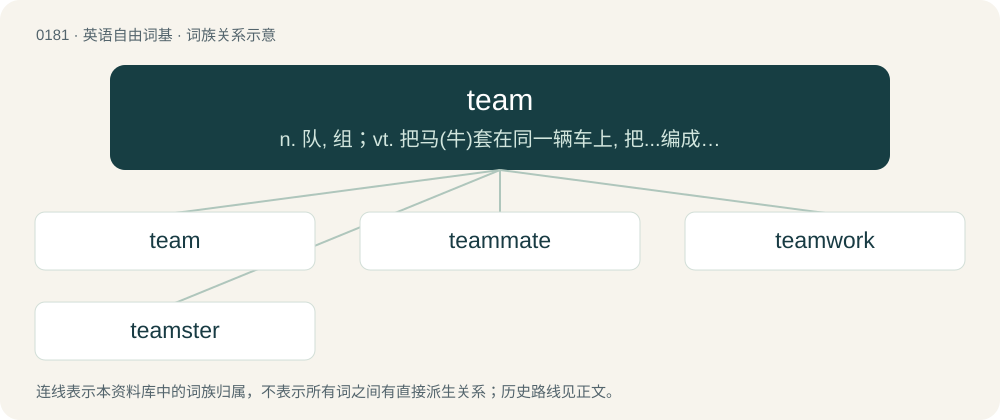

# 0198 · team — n. 队, 组；vt. 把马(牛)套在同一辆车上, 把...编成一组；vi. 驾驶卡车, 协作

[总目录](../00_总目录_按常用程度.md)

**类型**：英语自由词基　｜　**来源语言**：见词源记录

## 核心含义与来源

- 核心含义：n. 队, 组；vt. 把马(牛)套在同一辆车上, 把...编成一组；vi. 驾驶卡车, 协作
- 英文含义：A set of draught animals, such as two horses in front of a carriage.
- 词形：team

**来源记录 1**（名词；A set of draught animals, such as two horses in front of a carriage.）

From Middle English tem, teem, teme, from Old English tēam (“child-bearing, offspring, brood, set of draught animals”), from Proto-West Germanic \*taum, from Proto-Germanic \*taumaz (“that which draws or pulls”), from Proto-Germanic \*taugijaną, \*tugōną, \*teuhōną, \*teuhaną (“to lead, bring, pull, draw”), from Proto-Indo-European \*dewk- (“to pull, lead”). Cognate with Scots team, teem (“a chain, harness”), Saterland Frisian Toom (“bridle; breeding”), West Frisian team (“bridle, team”), Dutch toom (“bridle, reins, flock of birds”), German Low German Toom (“bridle”), German Zaum (“bridle”), Danish tømme (“rein”), Swedish töm (“leash, rein”). More at teem, tie, tow.

## 词族图

## 单词速览（常用到不常用）

| 单词 | 音标 | 释义 |
|---|---|---|
| [team](#w-1) | /ˈtiːm/ | n. 队, 组；vt. 把马(牛)套在同一辆车上, 把...编成一组；vi. 驾驶卡车, 协作 |
| [teammate](#w-2) | /ˈtiːmˌmeɪt/ | n. 队友 |
| [teamwork](#w-3) | /ˈtiːmwəːk/ | n. 协同作业, 协力；\[法\] 联合工作, 联合行动, 协调工作 |
| [teamster](#w-4) | 美 /ˈtim.stɚ/ | n. 联畜运输车驾驶者, 卡车驾驶员；\[法\] 卡车驾驶员, 运输工会会员, 驾驶一队牲畜者 |

## 逐词详解

### 1. team

**词性**：名词　｜　**音标**：/ˈtiːm/

**中文释义**：n. 队, 组；vt. 把马(牛)套在同一辆车上, 把...编成一组；vi. 驾驶卡车, 协作

**英文义项**：A set of draught animals, such as two horses in front of a carriage. / Any group of people involved in the same activity, especially sports or work.

**词源与演化**：

From Middle English tem, teem, teme, from Old English tēam (“child-bearing, offspring, brood, set of draught animals”), from Proto-West Germanic \*taum, from Proto-Germanic \*taumaz (“that which draws or pulls”), from Proto-Germanic \*taugijaną, \*tugōną, \*teuhōną, \*teuhaną (“to lead, bring, pull, draw”), from Proto-Indo-European \*dewk- (“to pull, lead”). Cognate with Scots team, teem (“a chain, harness”), Saterland Frisian Toom (“bridle; breeding”), West Frisian team (“bridle, team”), Dutch toom (“bridle, reins, flock of birds”), German Low German Toom (“bridle”), German Zaum (“bridle”), Danish tømme (“rein”), Swedish töm (“leash, rein”). More at teem, tie, tow.

**例句**：

> The IT manager leads a team of three software developers.

该用例对应义项：Any group of people involved in the same activity, especially sports or work.

### 2. teammate

**词性**：名词　｜　**音标**：/ˈtiːmˌmeɪt/

**中文释义**：n. 队友

**英文义项**：One who is on the same team.

**构词拆分**：team + -mate

**词源与演化**：

From team + -mate.

**例句**：

> Pass the ball to your teammate.

该用例对应义项：One who is on the same team.

### 3. teamwork

**词性**：名词　｜　**音标**：/ˈtiːmwəːk/

**中文释义**：n. 协同作业, 协力；\[法\] 联合工作, 联合行动, 协调工作

**英文义项**：The cooperative effort of a team of people to achieve a common goal.

**构词拆分**：team + work

**词源与演化**：

From team + work. Compare West Frisian teamwurk (“teamwork”).

**例句**：

> It will take money, good planning and, above all, teamwork.

该用例对应义项：cooperative work done by a team (especially when it is effective)

### 4. teamster

**词性**：名词　｜　**音标**：美 /ˈtim.stɚ/

**中文释义**：n. 联畜运输车驾驶者, 卡车驾驶员；\[法\] 卡车驾驶员, 运输工会会员, 驾驶一队牲畜者

**英文义项**：A person who drives a cargo truck (see Teamster).

**构词拆分**：team + -ster

**词源与演化**：

From team + -ster.
