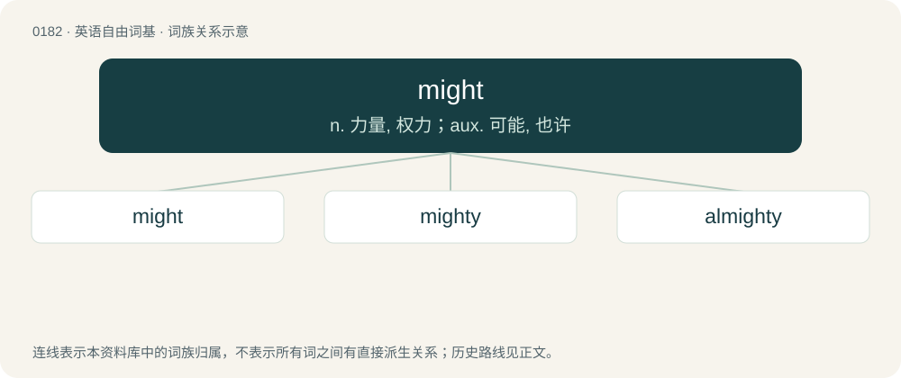

# 0199 · might — n. 力量, 权力；aux. 可能, 也许

[总目录](../00_总目录_按常用程度.md)

**类型**：英语自由词基　｜　**来源语言**：见词源记录

## 核心含义与来源

- 核心含义：n. 力量, 权力；aux. 可能, 也许
- 英文含义：Power, strength, force, or influence held by a person or group.
- 词形：might

**多个词源／构词路径**：同一拼写可能有不同来源；以下按词性和含义分别列出。

**来源记录 1**（名词；Power, strength, force, or influence held by a person or group.）

From Middle English maught, might, miȝt, myght, from Old English maht, meaht, meht, mieht, miht, mæht (“ability, power; strength; virtue”), from Proto-West Germanic \*mahti, from Proto-Germanic \*mahtiz (“ability, power; force, strength”), from Proto-Indo-European \*(me)mógʰe (“to be able to, to have power”), from \*megʰ- (“to be able”), corresponding to Germanic \*maganą (“to be able, may”) + \*-þiz. Equivalent to may + -th. Cognates Cognate with Scots micht (“might”), Yola mought (“might”), Dutch macht (“might, power”), German Macht (“might, power”), Luxembourgish Muecht (“authority, might, power”), Yiddish מאַכט (makht, “might, power”), Faroese and Icelandic máttur (“might, strength”), Danish magt (“power; force”), Norwegian Bokmål makt (“power”), Norwegian Nynorsk and Swedish makt (“power; force”), mått (“might, power”), Gothic 𐌼𐌰𐌷𐍄𐍃 (mahts, “ability, might, power”), and further to Irish smacht (“ordinance, regulation, rule; dominion, sway; control, discipline, restraint; fine, penalty”), Greek μάγος (mágos, “magician; sorcerer, wizard”), Lithuanian mėgti (“to like”), Belarusian моц (moc, “might, power”), Bulgarian мощ (mošt, “might, power”), Czech and Polish moc (“might, power”), Macedonian моќ (moḱ, “might, power”), Russian мочь (močʹ, “power, might”) and мощь (moščʹ, “force, strength”), Serbo-Croatian мо̑ћ, mȏć (“power; strength; potency; authority”), Slovene moč (“power; strength”), Ukrainian міч (mič) and міць (micʹ, “might, power”), Armenian մոգ (mog, “magus; fire-worshiper, Zoroastrian; astrologer; diviner, enchanter, sorcerer, wizard”), Persian مغ (moġ, “magus”), Sanskrit मघ (magha, “power, wealth; bounty, gift, reward”). See more at may.

**来源记录 2**（动词；Used to indicate a desired past action that was not done.）

From Old English meahte and mihte, inflections of magan, whence English may.

## 词族图

## 单词速览（常用到不常用）

| 单词 | 音标 | 释义 |
|---|---|---|
| [might](#w-1) | /maɪt/ | n. 力量, 权力；aux. 可能, 也许 |
| [mighty](#w-2) | 英 /ˈmaɪti/；美 /ˈmaɪti/ | n. 有势力的人；a. 有势力的, 强大的, 有力的；adv. 很, 极 |
| [almighty](#w-3) | /ɔːlˈmaɪti/ | a. 万能的, 全能的 |

## 逐词详解

### 1. might

**词性**：名词　｜　**音标**：/maɪt/

**中文释义**：n. 力量, 权力；aux. 可能, 也许

**英文义项**：Power, strength, force, or influence held by a person or group. / Physical strength or force.

**词源与演化**：

From Middle English maught, might, miȝt, myght, from Old English maht, meaht, meht, mieht, miht, mæht (“ability, power; strength; virtue”), from Proto-West Germanic \*mahti, from Proto-Germanic \*mahtiz (“ability, power; force, strength”), from Proto-Indo-European \*(me)mógʰe (“to be able to, to have power”), from \*megʰ- (“to be able”), corresponding to Germanic \*maganą (“to be able, may”) + \*-þiz. Equivalent to may + -th. Cognates Cognate with Scots micht (“might”), Yola mought (“might”), Dutch macht (“might, power”), German Macht (“might, power”), Luxembourgish Muecht (“authority, might, power”), Yiddish מאַכט (makht, “might, power”), Faroese and Icelandic máttur (“might, strength”), Danish magt (“power; force”), Norwegian Bokmål makt (“power”), Norwegian Nynorsk and Swedish makt (“power; force”), mått (“might, power”), Gothic 𐌼𐌰𐌷𐍄𐍃 (mahts, “ability, might, power”), and further to Irish smacht (“ordinance, regulation, rule; dominion, sway; control, discipline, restraint; fine, penalty”), Greek μάγος (mágos, “magician; sorcerer, wizard”), Lithuanian mėgti (“to like”), Belarusian моц (moc, “might, power”), Bulgarian мощ (mošt, “might, power”), Czech and Polish moc (“might, power”), Macedonian моќ (moḱ, “might, power”), Russian мочь (močʹ, “power, might”) and мощь (moščʹ, “force, strength”), Serbo-Croatian мо̑ћ, mȏć (“power; strength; potency; authority”), Slovene moč (“power; strength”), Ukrainian міч (mič) and міць (micʹ, “might, power”), Armenian մոգ (mog, “magus; fire-worshiper, Zoroastrian; astrologer; diviner, enchanter, sorcerer, wizard”), Persian مغ (moġ, “magus”), Sanskrit मघ (magha, “power, wealth; bounty, gift, reward”). See more at may.

**例句**：

> He pushed with all his might, but still it would not move.

该用例对应义项：Physical strength or force.

### 2. mighty

**词性**：形容词　｜　**音标**：英 /ˈmaɪti/；美 /ˈmaɪti/

**中文释义**：n. 有势力的人；a. 有势力的, 强大的, 有力的；adv. 很, 极

**英文义项**：Very strong; possessing might. / Very heavy and powerful.

**构词拆分**：might + -y

**词源与演化**：

From Middle English mighty, mightie, mighti, myghty, miȝty, maȝty, from Old English mihtiġ, mehtiġ, meahtiġ, mæhtiġ (“mighty”), from Proto-West Germanic \*mahtīg (“mighty”), from Proto-Germanic \*mahtīgaz (“mighty”), equivalent to might + -y. Cognate with Scots michty, mychty, Saterland Frisian machtich, Dutch machtig, German Low German machtig, German mächtig, Swedish mäktig.

**例句**：

> He's a mighty wrestler, but you are faster than him.

该用例对应义项：Very strong; possessing might.

### 3. almighty

**词性**：形容词　｜　**音标**：/ɔːlˈmaɪti/

**中文释义**：a. 万能的, 全能的

**英文义项**：Unlimited in might; omnipotent; all-powerful / Great; extreme; terrible.

**构词拆分**：al- + might + -y

**词源与演化**：

From Middle English almyghty, almighty, from Old English ælmihtiġ (“all-powerful”), from Proto-Germanic \*alamahtīgaz, equivalent to al- + might + -y.

**例句**：

> I heard an almighty crash and ran into the kitchen to see what had happened.

该用例对应义项：Great; extreme; terrible.
