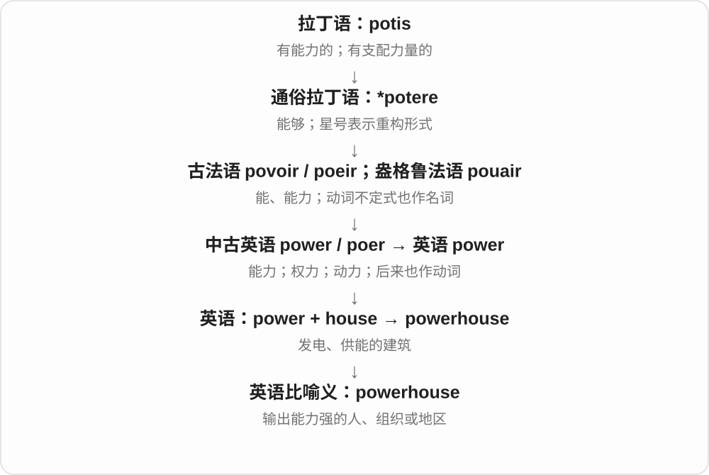

# 0201 · house — 房屋；容纳人的物或机构的场所

[逐词精讲目录](../00_逐词精讲目录.md) · [总目录](../00_总目录_按常用程度.md)

## 核心词根与来源

house 接古英语 hūs。名词通常 /haʊs/，动词“容纳、安置”通常 /haʊz/；housing 也保留 /z/。复合词常按用途命名，所以 house 不只表示普通民居。

**HOUSE：有一个空间，容纳某种生活、事物或工作**

人住的叫住宅，货物住的叫仓库；后半是 house，前半常说明里面做什么。

- **住所、住户与共居**：house · housing · household · housemate · houseguest · houseful
- **家务及生活**：housewife · housekeeper · housekeeping · housework · housemaid · housewarming · houseplant · housebound
- **展现不同用途的建筑**：warehouse · lighthouse · farmhouse · clubhouse · schoolhouse · treehouse · firehouse · courthouse · powerhouse
- **饮食与访客**：guesthouse · steakhouse · roadhouse · coffeehouse · teahouse · bathhouse
- **材料、存放与种植**：storehouse · boathouse · greenhouse · glasshouse · hothouse · smokehouse · icehouse
- **特殊居住与机构**：houseboat · bunkhouse · safehouse · jailhouse · gatehouse · outhouse · workhouse · almshouse · longhouse
- **其他用法及比喻**：madhouse · funhouse · wheelhouse · housebreaking · slaughterhouse · townhouse
- **house → houses：房屋与提供容纳处**：house · houses
- **greenhouse → greenhouses：种植用建筑名**：house · greenhouse · greenhouses
- **house 作为场所进入 playhouse**：playhouse · playhouses
- **barn：谷物的屋子**：barn · barns
- **house 容纳、安置 → housed**：housed

## 词形与演化规律

boathouse 是存船的建筑，houseboat 是供居住的船；guesthouse 是客舍，houseguest 是住客，后半通常决定它首先是什么。household 的一户不必由亲属构成；houseful 则是满屋数量。charterhouse 另有法语 chartreuse 的历史，不按普通 charter + house 硬拆，本页暂不扩列。

house 名词通常末尾 s，复数 houses 通常 z 加 iz；动词本来常以 z 结尾。

按绿植、种植用途命名，不要求房屋表面是绿色。

房屋名放在复合词末，复数 playhouses 保留 houses 常见 /zɪz/。

和 house 比较建筑用途，不表示由现代 house 派生。barn 承古英语 bere 大麦 + ærn 房屋、储存处的旧组合，后来缩合；今天不只存大麦。

动词 house 承古英语 husian 安置到屋中，与 hus 房屋相关。去 e 加完整 -ed；动词 s 读 /z/，housed /haʊzd/。

## 单词速览（按词族由简到繁）

同一基础词的相关扩展放在一起，先读基础形式，再读扩展；各组之间优先读常用的。具体词源关系见各词讲解。

| 单词 | 音标 | 核心意思 |
|---|---|---|
| [house](#w-1) | 名 /haʊs/；动 /haʊz/ | 房屋；机构；议院；容纳；安置 |
| [housing](#w-2) | /ˈhaʊzɪŋ/ | 住房；住房供给；外壳、罩壳 |
| [houses](#w-76) | 通常 /ˈhaʊzɪz/ | 房屋、住宅；机构、专门场所〔复数〕；容纳、安置〔第三人称单数〕 |
| [household](#w-3) | 英 /ˈhaʊshəʊld/；美 /ˈhaʊshoʊld/ | 同住的一户人；家庭的；家用的 |
| [housed](#w-82) | 英、美 /haʊzd/ | 安置了；容纳着；收藏于〔过去式、过去分词〕 |
| [housewife](#w-11) | /ˈhaʊswaɪf/ | 家庭主妇 |
| [housekeeper](#w-12) | 英 /ˈhaʊskiːpə/；美 /ˈhaʊskiːpər/ | 家政管家；客房清洁、管理人员 |
| [housekeeping](#w-13) | 英 /ˈhaʊskiːpɪŋ/；美 /ˈhaʊskiːpɪŋ/ | 家务管理；客房事务；例行整理 |
| [housework](#w-14) | 英 /ˈhaʊswɜːk/；美 /ˈhaʊswɜːrk/ | 家务 |
| [housemate](#w-17) | /ˈhaʊsmeɪt/ | 合住者；室友 |
| [houseboat](#w-32) | 英 /ˈhaʊsbəʊt/；美 /ˈhaʊsboʊt/ | 船屋；供居住的船 |
| [housemaid](#w-39) | /ˈhaʊsmeɪd/ | 女家仆；女佣〔传统职位称呼〕 |
| [housewarming](#w-42) | 英 /ˈhaʊswɔːmɪŋ/；美 /ˈhaʊswɔːrmɪŋ/ | 乔迁聚会；暖房聚会 |
| [houseguest](#w-44) | /ˈhaʊsɡest/ | 借住家中的客人 |
| [houseplant](#w-64) | 英 /ˈhaʊsplɑːnt/；美 /ˈhaʊsplænt/ | 室内盆栽；室内观赏植物 |
| [housebound](#w-66) | /ˈhaʊsbaʊnd/ | 难以离家的；受限在家的 |
| [houseful](#w-74) | /ˈhaʊsfʊl/ | 满屋的人或东西 |
| [housebreaking](#w-73) | /ˈhaʊsbreɪkɪŋ/ | 入室盗窃；训练宠物定点排泄 |
| [warehouse](#w-4) | 英 /ˈweəhaʊs/；美 /ˈwerhaʊs/ | 仓库；把……存入仓库 |
| [greenhouse](#w-5) | /ˈɡriːnhaʊs/ | 温室 |
| [greenhouses](#w-77) | /ˈɡriːnhaʊzɪz/ | 温室〔复数〕 |
| [courthouse](#w-6) | 英 /ˈkɔːthaʊs/；美 /ˈkɔːrthaʊs/ | 法院大楼；县政办公楼〔美〕 |
| [lighthouse](#w-7) | /ˈlaɪthaʊs/ | 灯塔 |
| [powerhouse](#w-8) | 英 /ˈpaʊəhaʊs/；美 /ˈpaʊərhaʊs/ | 发电厂房；实力强大的机构、地区或人物 |
| [farmhouse](#w-9) | 英 /ˈfɑːmhaʊs/；美 /ˈfɑːrmhaʊs/ | 农舍；农场住宅 |
| [clubhouse](#w-10) | /ˈklʌbhaʊs/ | 俱乐部会所；球队活动室 |
| [townhouse](#w-15) | /ˈtaʊnhaʊs/ | 联排住宅；城市住宅 |
| [slaughterhouse](#w-18) | 英 /ˈslɔːtəhaʊs/；美 /ˈslɔːtərhaʊs/ | 屠宰场 |
| [schoolhouse](#w-19) | /ˈskuːlhaʊs/ | 校舍；旧式学校建筑 |
| [treehouse](#w-20) | /ˈtriːhaʊs/ | 树屋 |
| [steakhouse](#w-22) | /ˈsteɪkhaʊs/ | 牛排馆 |
| [firehouse](#w-23) | 英 /ˈfaɪəhaʊs/；美 /ˈfaɪərhaʊs/ | 消防站〔美式〕 |
| [guesthouse](#w-24) | /ˈɡesthaʊs/ | 小型旅馆；客舍 |
| [workhouse](#w-25) | 英 /ˈwɜːkhaʊs/；美 /ˈwɜːrkhaʊs/ | 济贫院〔历史〕；劳动收容机构 |
| [boathouse](#w-28) | 英 /ˈbəʊthaʊs/；美 /ˈboʊthaʊs/ | 船库；船屋 |
| [madhouse](#w-29) | /ˈmædhaʊs/ | 乱哄哄的地方；精神病收容所〔旧称〕 |
| [roadhouse](#w-30) | 英 /ˈrəʊdhaʊs/；美 /ˈroʊdhaʊs/ | 路边旅店；公路餐馆、酒馆 |
| [storehouse](#w-31) | 英 /ˈstɔːhaʊs/；美 /ˈstɔːrhaʊs/ | 储藏室；仓库；宝库 |
| [bathhouse](#w-33) | 英 /ˈbɑːθhaʊs/；美 /ˈbæθhaʊs/ | 公共浴室；浴场建筑 |
| [wheelhouse](#w-34) | /ˈwiːlhaʊs/ | 驾驶舱；擅长的领域〔比喻〕 |
| [outhouse](#w-35) | /ˈaʊthaʊs/ | 室外附属建筑；室外厕所〔尤美式〕 |
| [jailhouse](#w-36) | /ˈdʒeɪlhaʊs/ | 监狱；拘押所〔尤美式、较口语〕 |
| [gatehouse](#w-37) | /ˈɡeɪthaʊs/ | 门楼；门房 |
| [coffeehouse](#w-38) | 英 /ˈkɒfihaʊs/；美 /ˈkɔːfihaʊs/ | 咖啡馆 |
| [glasshouse](#w-40) | 英 /ˈɡlɑːshaʊs/；美 /ˈɡlæshaʊs/ | 玻璃温室；玻璃房 |
| [smokehouse](#w-41) | 英 /ˈsməʊkhaʊs/；美 /ˈsmoʊkhaʊs/ | 熏制室；烟熏食品制作场所 |
| [hothouse](#w-43) | 英 /ˈhɒthaʊs/；美 /ˈhɑːthaʊs/ | 加温温室；密集培养环境 |
| [teahouse](#w-46) | /ˈtiːhaʊs/ | 茶馆；茶室 |
| [birdhouse](#w-47) | 英 /ˈbɜːdhaʊs/；美 /ˈbɜːrdhaʊs/ | 鸟屋；巢箱 |
| [funhouse](#w-50) | /ˈfʌnhaʊs/ | 游乐屋；哈哈镜、机关游乐场馆 |
| [bunkhouse](#w-49) | /ˈbʌŋkhaʊs/ | 集体宿舍；配有铺位的宿舍 |
| [safehouse](#w-55) | /ˈseɪfhaʊs/ | 安全屋；隐蔽保护住所 |
| [longhouse](#w-61) | 英 /ˈlɒŋhaʊs/；美 /ˈlɔːŋhaʊs/ | 长屋〔特定传统建筑〕 |
| [almshouse](#w-68) | /ˈɑːmzhaʊs/ | 慈善济贫住宅；救济院 |
| [icehouse](#w-75) | /ˈaɪshaʊs/ | 冰窖；储冰室；极冷房间〔比喻〕 |
| [barn](#w-80) | 英 /bɑːn/；美 /bɑrn/ | 农用仓房；谷仓；牲畜棚 |
| [barns](#w-81) | 英 /bɑːnz/；美 /bɑrnz/ | 农用仓房、谷仓、牲畜棚〔复数〕 |
| [playhouse](#w-78) | /ˈpleɪhaʊs/ | 剧场；儿童游戏屋 |
| [playhouses](#w-79) | /ˈpleɪhaʊzɪz/ | 剧场；儿童游戏屋〔复数〕 |

## 逐词讲解

### 1. house — 房屋；机构；议院；容纳；安置

**音标**：名 /haʊs/；动 /haʊz/

**先抓住这个画面**

先是一座可以住人的建筑，再把能容纳人、物或某种机构的场所一起叫 house。

**怎么拆**

接古英语 hūs，经中古英语 hous 延续。现代名词与动词结尾常分别读 /s/、/z/；house 的复数 houses 通常读 /ˈhaʊzɪz/。

**怎么变成今天的意思**

**古英语 hūs → 中古英语 hous**  
住宅、住所、遮蔽处

↓

**英语 house**  
房屋；机构、场所；为……提供空间

a house 是房屋，a publishing house 是出版社，a full house 是满座。house a collection 是容纳藏品，house families 是为家庭提供住所。

**常见搭配与例句**

a house of；a publishing house；house a collection；move house。

> They live in a small house near the river.

他们住在河边一座小房子里。

> The building houses a collection of old photographs.

这栋楼收藏着一批老照片。

> The concert played to a full house.

音乐会座无虚席。

**别混淆**

house 侧重建筑、机构，home 侧重生活与归属。This house is my home 可以同时使用，并不重复成完全同义。

### 2. housing — 住房；住房供给；外壳、罩壳

**音标**：/ˈhaʊzɪŋ/

**先抓住这个画面**

人需要住处，零件也需要被装在一个外壳里；两种都是给某对象提供容纳空间。

**怎么拆**

house 动词 + -ing，接中古英语 housen 的相应形式。-ing 不只作进行时，也能名词化说住房与构件外壳；s 在常见读音中为 /z/。

**怎么变成今天的意思**

**古英语 hūs → 中古英语 hous**  
住宅、住所、遮蔽处

↓

**英语 house**  
房屋；机构、场所；为……提供空间

↓

**house + -ing → housing**  
提供容纳空间；住房、部件外壳

affordable housing 是可负担住房，housing shortage 是住房短缺；the motor housing 是电机外壳。住房义通常集合不可数，外壳可按物件可数。

**常见搭配与例句**

public housing；a housing shortage；the engine housing。

> The town needs more affordable housing.

镇上需要更多价格可承担的住房。

> The protective housing keeps dust out of the motor.

保护外壳让灰尘不易进入电机。

**别混淆**

housing 不只是一栋 house，常关注整片住处供给或居住条件。零件 housing 更不能翻成机器的住宅小区。

### 3. houses — 房屋、住宅；机构、专门场所〔复数〕；容纳、安置〔第三人称单数〕

**音标**：通常 /ˈhaʊzɪz/

**先抓住这个画面**

一栋栋可住人的房子，是 houses；把东西、人安放在一个建筑里，也能用动词 houses。

**怎么拆**

house + -s。名词 house 常读 /haʊs/，普通复数 houses 通常变为 /ˈhaʊzɪz/；动词 house 常以 /z/ 结尾，第三人称也通常读 /ˈhaʊzɪz/。词族接古英语 hūs 住所及相关形式。

**怎么变成今天的意思**

**古英语 hūs → 中古英语 hous → house**  
房屋、住所；相关容纳动词用法

↓

**house + -s → houses**  
多栋房屋；单数主语容纳；常见读音 /ˈhaʊzɪz/

terraced houses 排屋；old houses 老房子；publishing houses 出版社；houses a collection 收藏、容纳一批藏品。

**常见搭配与例句**

houses along the river；the building houses ...。

> The houses on this street have small front gardens.

这条街上的房子都有小前花园。

> The old hall houses a collection of local photographs.

旧礼堂里收藏着一批当地照片。

**别混淆**

名词 houses 在 These houses are old 中配复数谓语；The building houses a museum 中是动词，表示这栋楼里设有博物馆。publishing houses 是出版社这一机构用法。

### 4. household — 同住的一户人；家庭的；家用的

**音标**：英 /ˈhaʊshəʊld/；美 /ˈhaʊshoʊld/

**先抓住这个画面**

把同一个住处里共同生活的人当成一户，不先问彼此有没有血缘。

**怎么拆**

接中古英语 houshold，可见 house + hold 的表面构词；历史重点是共同维持的一家、一户，不按“手握房子”逐字造义。

**怎么变成今天的意思**

**古英语 hūs → 中古英语 hous**  
住宅、住所、遮蔽处

↓

**中古英语 houshold → 英语 household**  
共同生活的一户人及家庭事务

a household 可是一人住，也可多人合住；household income 是该户总收入，household appliances 是家电。统计如何界定一户须看具体口径。

**常见搭配与例句**

a single-person household；household income；household chores。

> The survey contacted two hundred households.

调查联系了两百户住户。

> They share the household chores.

他们分担家务。

**别混淆**

family 强调亲属等家庭关系，household 强调共同居住生活单位。室友组成一户，不必因此成为亲属。

### 5. housed — 安置了；容纳着；收藏于〔过去式、过去分词〕

**音标**：英、美 /haʊzd/

**先抓住这个画面**

给人安排住处，是 housed；把资料、设备放在建筑或容器里，也可以用 housed。像给它们安排了一个能待着的空间。

**怎么拆**

house 动词去末尾 e，加完整 -ed → housed。动词 house 的 s 读 /z/，后缀读 /d/，所以 /haʊzd/。承古英语 husian 安置进屋，与 hus 房屋相关。

**怎么变成今天的意思**

**古英语 hus 房屋、husian 安置进屋 → house**  
名词与安置、容纳的动词关系很早便存在

↓

**house + -ed → housed**  
现代也说机构、收藏、设备被放置或容纳在某处

housed in a building 是安置、收藏在一栋建筑中；housed the collection 是收藏了该批藏品；housed the visitors 是为访客安排了住处。

**常见搭配与例句**

housed in；housed the collection；housed the visitors。

> The collection is housed in an old school building.

这批藏品收藏在一栋旧校舍里。

> The hostel housed the visitors for two nights.

旅舍为访客提供了两晚住处。

**别混淆**

名词 house 房子末尾通常 /s/，动词 house 容纳末尾 /z/。housed 常说容纳在某处，不要求被容纳的东西是人。

### 6. housewife — 家庭主妇

**音标**：/ˈhaʊswaɪf/

**先抓住这个画面**

把家庭日常事务作为主要职责的已婚女性，这是一种角色称呼。

**怎么拆**

house + wife，接中古英语 houswyf 等形式；wife 在现代整词中形成家庭主妇这一固定含义，不是泛指任何住在房里的妻子。

**怎么变成今天的意思**

**古英语 hūs → 中古英语 hous**  
住宅、住所、遮蔽处

↓

**中古英语 houswyf → 英语 housewife**  
管理家庭日常生活的女性角色

现代用法常指主要照料家庭、没有通常外部受薪工作的女性。也可用 homemaker 泛称持家者，具体自我称呼和劳动安排因人而异。复数 housewives。

**常见搭配与例句**

a full-time housewife；housewives and homemakers；a housewife’s work。

> She described the years when she worked as a full-time housewife.

她讲述了全职持家的那些年。

> The interview discusses the often overlooked work of housewives.

采访讨论家庭主妇常被忽视的劳动。

**别混淆**

housewife 不等于 housekeeper：前者通常是家庭角色，后者可为受雇管理家务的人，也可有不同工作岗位。

### 7. housekeeper — 家政管家；客房清洁、管理人员

**音标**：英 /ˈhaʊskiːpə/；美 /ˈhaʊskiːpər/

**先抓住这个画面**

让居住空间保持清洁、有序，物品和日常事务有人照管。

**怎么拆**

house（住处）+ keeper（照管者），按维持空间的职责命名；keeper 由 keep + -er 形成。

**怎么变成今天的意思**

**英语 house；keeper**  
并列组合的两部分

↓

**house + keeper → housekeeper**  
照管家务、房间事务的人

私人住宅可指家政管家，酒店可指客房清洁、管理岗位人员。具体职级和任务随雇主而异，不能一律叫高级总管。

**常见搭配与例句**

a hotel housekeeper；a live-in housekeeper；employ a housekeeper。

> The housekeeper prepared the guest room.

家政管家准备了客房。

> The hotel thanked its housekeepers for their work.

酒店感谢客房人员的工作。

**别混淆**

housekeeper 是工作角色或照管者，homeowner 是房产所有者，housemate 是共同居住者；三个身份不必重合。

### 8. housekeeping — 家务管理；客房事务；例行整理

**音标**：英 /ˈhaʊskiːpɪŋ/；美 /ˈhaʊskiːpɪŋ/

**先抓住这个画面**

大事开展前，先把环境、资料、通知和小事务理顺。

**怎么拆**

house + keeping，来自维持住处日常事务的活动名词，再比喻组织、系统的例行整理。

**怎么变成今天的意思**

**英语 house；keeping**  
并列组合的两部分

↓

**house + keeping → housekeeping**  
家庭或房间维护；例行管理事务

酒店 housekeeping 指客房事务部门或工作；a few housekeeping matters 在会议开始时常是几点安排提醒。电脑 housekeeping 可说清理维护，不是住户保洁的同一物理动作。

**常见搭配与例句**

housekeeping staff；housekeeping matters；routine housekeeping。

> The hotel provides daily housekeeping.

酒店提供每日客房清洁整理。

> Before we begin, there are two housekeeping matters.

开始前，先说明两项例行安排。

**别混淆**

housekeeping 与 housecleaning 都可整理，但 housekeeping 更含持续管理与常规安排，不只打扫灰尘。

### 9. housework — 家务

**音标**：英 /ˈhaʊswɜːk/；美 /ˈhaʊswɜːrk/

**先抓住这个画面**

饭后洗碗、擦地、收拾房间，让家能继续舒适地住。

**怎么拆**

house（房屋、家）+ work（劳动），组合指照料家庭环境的日常事务。

**怎么变成今天的意思**

**英语 house；work**  
并列的两个构词材料

↓

**house + work → housework**  
清洁、整理等家务劳动

通常不可数：do some housework。家务由谁承担不写在词里，不能把它限定成女性的事。

**常见搭配与例句**

do housework；share the housework；housework and childcare。

> We share the housework equally.

我们平等分担家务。

> I spent the morning doing housework.

我上午一直在做家务。

**别混淆**

housework 是家务，homework 是课后作业或准备功课；home 与 house 的近义不能使两个合成词自动相同。

### 10. housemate — 合住者；室友

**音标**：/ˈhaʊsmeɪt/

**先抓住这个画面**

住在同一套房、共享某些空间，但不必是亲属或恋人。

**怎么拆**

house（住处）+ mate（伙伴、同伴），按共同居住关系称呼。

**怎么变成今天的意思**

**英语 house；mate**  
并列组合的两部分

↓

**house + mate → housemate**  
同住一套房的人

英式常见，也可与 flatmate、roommate 按地区和住宿形态对应。housemate 不要求两人睡同一卧室。

**常见搭配与例句**

a new housemate；share with housemates；my housemate。

> My housemate cooks dinner on Mondays.

我的室友周一做晚饭。

> They are looking for a quiet housemate.

他们想找一位安静的合住者。

**别混淆**

housemate 是同住者，houseguest 是暂住访客；来住三晚的朋友通常更像 guest，不必成为长期室友。

### 11. houseboat — 船屋；供居住的船

**音标**：英 /ˈhaʊsbəʊt/；美 /ˈhaʊsboʊt/

**先抓住这个画面**

不是把船放进屋，而是把日常居住空间安到船上。

**怎么拆**

house（居住用途）+ boat（船），后半 boat 决定它是一种船。

**怎么变成今天的意思**

**英语 house；boat**  
并列组合的两部分

↓

**house + boat → houseboat**  
用作住所的船

有些长期泊住，有些可以航行；是否安装发动机、怎样停泊，要看具体对象。houseboat 先说明居住功能。

**常见搭配与例句**

live on a houseboat；a moored houseboat；a houseboat holiday。

> She lives on a houseboat along the canal.

她住在运河边的一艘船屋里。

> They rented a houseboat for a quiet holiday.

他们租了一艘船屋，过安静假期。

**别混淆**

houseboat 与 boathouse 不能互换：前者是一艘船，后者是一处建筑。

### 12. housemaid — 女家仆；女佣〔传统职位称呼〕

**音标**：/ˈhaʊsmeɪd/

**先抓住这个画面**

传统大宅里有人负责打扫、整理等家务，这个称呼特指相应女性雇员。

**怎么拆**

house（宅邸、家务场所）+ maid（女仆的旧职业义），不是“房子造出来”里的 made。

**怎么变成今天的意思**

**英语 house；maid**  
并列组合的两部分

↓

**house + maid → housemaid**  
负责住宅家务的女雇员

历史小说和旧式家庭服务场景常见。现代 housekeeper、cleaner 等可能更贴合具体岗位，不把所有家庭女性称作 housemaid。

**常见搭配与例句**

a young housemaid；a housemaid’s duties；work as a housemaid。

> The housemaid opened the curtains in the morning.

女佣早晨拉开了窗帘。

> The novel follows a housemaid working in a large country house.

小说写一位在乡间大宅工作的女佣。

**别混淆**

housemaid 是雇佣角色，housewife 通常是家庭角色；不是丈夫的妻子因为做家务就成了 housemaid。

### 13. housewarming — 乔迁聚会；暖房聚会

**音标**：英 /ˈhaʊswɔːmɪŋ/；美 /ˈhaʊswɔːrmɪŋ/

**先抓住这个画面**

搬进新家后请亲友来，让陌生的新屋有人的热闹与祝福。

**怎么拆**

house + warming，构词字面是给房屋带来温暖，固定称新居聚会。不把流传的单一仪式故事当作已证实的唯一源头。

**怎么变成今天的意思**

**英语 house；warming**  
并列组合的两部分

↓

**house + warming → housewarming**  
为新居而办的庆祝聚会

a housewarming party 是乔迁聚会，a housewarming gift 是乔迁礼物。房子可以是租来的新住处，不要求新建或买下产权。

**常见搭配与例句**

a housewarming party；a housewarming gift；hold a housewarming。

> They invited us to a housewarming party.

他们请我们参加乔迁聚会。

> We brought a plant as a housewarming gift.

我们带了一盆植物作乔迁礼物。

**别混淆**

housewarming 是庆祝迁居，不是单指开暖气；a heating system 是采暖系统，两个 warming 语境不同。

### 14. houseguest — 借住家中的客人

**音标**：/ˈhaʊsɡest/

**先抓住这个画面**

朋友来家里，不只是吃顿饭，而是在家中住上一段时间。

**怎么拆**

house（住处）+ guest（客人），按接待、留宿关系称人。

**怎么变成今天的意思**

**英语 house；guest**  
并列组合的两部分

↓

**house + guest → houseguest**  
住在别人家里的客人

常指留宿的朋友、亲人等，不必付旅馆费用；是否租住则是另外一种安排。

**常见搭配与例句**

a weekend houseguest；welcome houseguests；have houseguests。

> We have two houseguests this weekend.

这周末我们家有两位留宿客人。

> She was a considerate houseguest and offered to help with dinner.

她是个体贴的留宿客人，主动提出帮忙做晚饭。

**别混淆**

houseguest 是人，guesthouse 是建筑；housemate 通常强调合住关系，不是短期受邀访客。

### 15. houseplant — 室内盆栽；室内观赏植物

**音标**：英 /ˈhaʊsplɑːnt/；美 /ˈhaʊsplænt/

**先抓住这个画面**

把植物作为住处的一部分养在室内，而不是种在室外花园。

**怎么拆**

house（屋内）+ plant（植物），按常见种植、摆放环境形成分类名称。

**怎么变成今天的意思**

**英语 house；plant**  
并列组合的两部分

↓

**house + plant → houseplant**  
常在室内养护的植物

通常指盆栽观赏植物，不要求只能长在室内。具体光照、浇水需求依物种，不能从名称得到统一养法。

**常见搭配与例句**

a potted houseplant；buy a houseplant；indoor houseplants。

> She keeps several houseplants by the window.

她在窗边养了几盆室内植物。

> The shop sells pots and houseplants.

商店出售花盆和室内盆栽。

**别混淆**

houseplant 不是植物学上所有物种的固定门类，而是栽培使用场景；garden plant 同样是种植环境描述。

### 16. housebound — 难以离家的；受限在家的

**音标**：/ˈhaʊsbaʊnd/

**先抓住这个画面**

不是偏爱在家休息，而是因身体、照料责任或环境等限制，难以外出。

**怎么拆**

house（住处）+ bound（受限制的），这里通常接被限制、束缚的 bound，不是出发前往的另一 bound。

**怎么变成今天的意思**

**英语 house；bound〔受限〕**  
并列组合的两部分

↓

**house + bound〔受限〕 → housebound**  
被条件限制而难离住所的

可用于暂时或持续难外出的人。具体原因须由句子说明，不自动等于某一种疾病或永久状态。

**常见搭配与例句**

housebound residents；become housebound；temporarily housebound。

> The service delivers groceries to housebound residents.

服务给难以外出的居民配送食品。

> Snow left us housebound for two days.

积雪让我们困在家里两天。

**别混淆**

homebody 是喜欢待在家的人，housebound 是条件限制；homebound 另还可说朝家走，housebound 通常没有这个方向义。

### 17. houseful — 满屋的人或东西

**音标**：/ˈhaʊsfʊl/

**先抓住这个画面**

不报精确人数，只看屋里几乎被客人、孩子或物品占满。

**怎么拆**

house + -ful，-ful 在这里形成容纳量名词，相当于一屋子的量，不是普通性质形容词。

**怎么变成今天的意思**

**英语 house；-ful〔容纳量〕**  
并列组合的两部分

↓

**house + -ful〔容纳量〕 → houseful**  
足以装满一屋的人或物

a houseful of guests 是满屋客人，通常接 of 说明装满什么。可数复数 housefuls，不必按 house 的不规则声音变化猜。

**常见搭配与例句**

a houseful of guests；a houseful of children；have a houseful。

> We had a houseful of guests over the holidays.

假期里我们家满屋客人。

> She managed a houseful of excited children.

她照管着满屋兴奋的孩子。

**别混淆**

houseful 是一屋量，household 是共同生活的一户；来了一屋访客，不代表他们都成了同一户成员。

### 18. housebreaking — 入室盗窃；训练宠物定点排泄

**音标**：/ˈhaʊsbreɪkɪŋ/

**先抓住这个画面**

一个语境是闯入住宅，另一个是让宠物适应家里的生活规矩，必须分别识别。

**怎么拆**

house + breaking，入室义接 break into a house 等关系；宠物训练义接 break“训练、使习惯”这一用法。不能把两义都解释成损坏房屋。

**怎么变成今天的意思**

**英语 house；breaking**  
并列组合的两部分

↓

**house + breaking → housebreaking**  
入室侵入；另为宠物居家习惯训练

英式法律、新闻等可能说入室盗窃；美式宠物语境常说训练定点排泄。此处只识别词义，不从名称推出具体法律要件或训练方法。

**常见搭配与例句**

a housebreaking case；housebreaking a puppy；housebreaking training。

> The report recorded several cases of housebreaking.

报告记录了几起入室盗窃案件。

> We are still working on the puppy’s housebreaking.

我们还在训练小狗养成居家定点排泄的习惯。

**别混淆**

housebreaking 与 housewarming 正好不是两种家居聚会：前者有侵入或训练两类用法，后者才是乔迁。

### 19. warehouse — 仓库；把……存入仓库

**音标**：英 /ˈweəhaʊs/；美 /ˈwerhaʊs/

**先抓住这个画面**

货物还没售出或运走，先集中放在一座负责储存的建筑里。

**怎么拆**

ware（商品、货物）+ house（建筑），并非 where“哪里”与 house 的组合。作动词时可表示仓储。

**怎么变成今天的意思**

**英语 ware；house**  
并列组合的两部分

↓

**ware + house → warehouse**  
储存商品货物的建筑

a warehouse worker 是仓库工作人员，warehouse space 是仓储空间。data warehouse 是数据仓库比喻，具体技术结构需看系统。

**常见搭配与例句**

a storage warehouse；warehouse space；a warehouse worker。

> The goods are stored in a warehouse outside the city.

货物存放在城外仓库。

> The company needs more warehouse space.

公司需要更多仓储空间。

**别混淆**

warehouse 以存储为主，showroom 以展示为主；商品可从仓库取到展厅，两者用途不同。

### 20. greenhouse — 温室

**音标**：/ˈɡriːnhaʊs/

**先抓住这个画面**

用透光围护让植物在受控制的环境里生长，外面冷时里面仍可较温暖。

**怎么拆**

green（绿植、种植物）+ house（建筑），按栽种用途组合，不要求建筑墙面涂成绿色。

**怎么变成今天的意思**

**英语 green；house**  
并列组合的两部分

↓

**green + house → greenhouse**  
供植物栽培的温室

常用于培育、越冬、育苗。greenhouse gas、greenhouse effect 是科学领域的相应名称，词义不能只靠玻璃房的简单机制包办所有细节。

**常见搭配与例句**

grow plants in a greenhouse；a greenhouse roof；greenhouse gases。

> The tomatoes are grown in a greenhouse.

番茄是在温室里种的。

> The school built a small greenhouse for its gardening club.

学校为园艺社建了一座小温室。

**别混淆**

greenhouse 是栽培设施，green house 分开更可能是绿色的房屋；英文重音、语境也帮助区分。

### 21. greenhouses — 温室〔复数〕

**音标**：/ˈɡriːnhaʊzɪz/

**先抓住这个画面**

用透光覆盖物围出供植物生长的空间，是 greenhouses。green 抓绿植，house 抓建筑，用途比墙面颜色更重要。

**怎么拆**

green + house → greenhouse；复数 greenhouses 中，house 部分常把 /s/ 变为 /z/，再加 /ɪz/。

**怎么变成今天的意思**

**green + house → greenhouse**  
用于种植绿植的建筑

↓

**greenhouse → greenhouses**  
多座温室；house 部分的复数读音变化

glass greenhouses 玻璃温室；plants in greenhouses 温室中的植物。

**常见搭配与例句**

large greenhouses 大温室；rows of greenhouses 一排排温室。

> Rows of greenhouses stood behind the farm.

农场后面建着一排排温室。

> The seedlings were grown in greenhouses.

幼苗在温室里培育。

**别混淆**

greenhouses 不要求房子涂绿色。这个组合按种植用途命名；温室材料、大小和设备各不相同。

### 22. courthouse — 法院大楼；县政办公楼〔美〕

**音标**：英 /ˈkɔːthaʊs/；美 /ˈkɔːrthaʊs/

**先抓住这个画面**

把法庭、办公室等装在一栋办理公共事务的建筑里。

**怎么拆**

court“法院” + house“建筑”，英语复合。

**怎么变成今天的意思**

**拉丁 cohors，词干 cohort-；后期缩约为 cors / cort-**  
围起来的地方；聚集在其中的队伍，hort- 与 hortus“园地”相关

↓

**古法语 cort / curt**  
庭院；宫廷、君主及其随从

↓

**中古英语 court → 英语 court**  
宫廷、法庭、院落、球场；争取好感

↓

**英语 court + house → courthouse**  
法院所在的大楼；部分地区兼含县政办公室

美国语境尤其常用；可能有不止一个审判室，也可能容纳其他公共部门。

**常见搭配与例句**

outside the courthouse；the county courthouse。

> Reporters waited outside the courthouse.

记者在法院大楼外等候。

> The old courthouse now serves as a museum.

旧法院大楼现在用作博物馆。

**别混淆**

courtroom 是一个审判房间；courthouse 是整栋建筑。

### 23. lighthouse — 灯塔

**音标**：/ˈlaɪthaʊs/

**先抓住这个画面**

海岸或航道边一处高而显眼的光，给船舶提供定位线索。

**怎么拆**

light（光、灯）+ house（容纳装置的结构），按航海指示用途命名，不是室内采光很好的住宅。

**怎么变成今天的意思**

**英语 light；house**  
并列组合的两部分

↓

**light + house → lighthouse**  
设有航行指示光源的塔状建筑

不同灯塔有各自灯光特征，普通阅读先认出引导航行的设施。也可比喻希望、方向的标志，但具体判断不由词名完成。

**常见搭配与例句**

a coastal lighthouse；the lighthouse beam；an old lighthouse。

> The lighthouse stands at the entrance to the harbour.

灯塔立在港口入口。

> We could see the lighthouse beam through the mist.

透过薄雾，我们看得到灯塔光束。

**别混淆**

lighthouse 是航道、海岸灯塔，light house 分开也可能只是轻型房屋等字面结构；不能靠空格忽略整词。

### 24. powerhouse — 发电厂房；实力强大的机构、地区或人物

**音标**：英 /ˈpaʊəhaʊs/；美 /ˈpaʊərhaʊs/

**先抓住这个画面**

powerhouse 原是集中产生动力的地方，后来也像一台源源不断输出成果的发动机。

**怎么拆**

power + house 的英语复合词，从发电设施、动力厂房发展出强大人才或机构的比喻义。

**怎么变成今天的意思**

an industrial powerhouse 是工业实力强大的地区；an intellectual powerhouse 可指头脑出众的人或人才密集的机构。不是普通住宅里电力充足。

**常见搭配与例句**

an economic powerhouse；an industrial powerhouse；an intellectual powerhouse。

> The region became an industrial powerhouse.

这个地区发展成了工业重镇。

> Her small research group is a powerhouse of new ideas.

她的小型研究团队不断产出新点子，实力很强。

**别混淆**

power station 通常指真正的发电设施；powerhouse 在新闻评论里经常是强大生产力或影响力的比喻。

### 25. farmhouse — 农舍；农场住宅

**音标**：英 /ˈfɑːmhaʊs/；美 /ˈfɑːrmhaʊs/

**先抓住这个画面**

农场里除了田、棚和仓储，还有人住着、安排日常生活的房子。

**怎么拆**

farm（农场）+ house（住宅），按所处场所和居住用途组合。

**怎么变成今天的意思**

**英语 farm；house**  
并列组合的两部分

↓

**farm + house → farmhouse**  
农场中的住宅

a farmhouse kitchen 可说农舍厨房或相应风格；旧 farmhouse 也可能改成旅馆，名称保留建筑历史。

**常见搭配与例句**

an old farmhouse；a farmhouse kitchen；a stone farmhouse。

> They restored an old stone farmhouse.

他们修复了一座旧石农舍。

> The farmhouse overlooks fields and an orchard.

农舍俯瞰田地和果园。

**别混淆**

farmhouse 多指住宅，barn 常指农业储藏、牲畜等用房，不能把农场所有建筑都叫 farmhouse。

### 26. clubhouse — 俱乐部会所；球队活动室

**音标**：/ˈklʌbhaʊs/

**先抓住这个画面**

成员不只在场上活动，还要有一处碰面、休息和处理事务的据点。

**怎么拆**

club（俱乐部、会员组织）+ house（场所），不是 club 棍棒的储藏室。

**怎么变成今天的意思**

**英语 club；house**  
并列组合的两部分

↓

**club + house → clubhouse**  
会员、球队等聚集使用的场所

高尔夫 clubhouse 常有更衣、餐饮等空间；球队 clubhouse 可指队员使用的内部活动区域。设施由实际机构决定。

**常见搭配与例句**

a golf clubhouse；the team clubhouse；meet at the clubhouse。

> The players met at the clubhouse after the game.

赛后球员在会所碰面。

> The clubhouse has a small café.

会所里有个小咖啡馆。

**别混淆**

clubhouse 是成员据点，club 既可指组织也可指场所；country house 则是乡间宅邸，不能换着用。

### 27. townhouse — 联排住宅；城市住宅

**音标**：/ˈtaʊnhaʊs/

**先抓住这个画面**

城市里住宅一户接一户相连，常各有自己的入口；旧用法也可对比乡间住处。

**怎么拆**

town（城镇）+ house（住宅），历史城市住处与现代相连多层住宅的用法各有背景，不用一种造型覆盖所有时代。

**怎么变成今天的意思**

**英语 town；house**  
并列组合的两部分

↓

**town + house → townhouse**  
城里住宅；现代常指联排式住宅

现代房地产描述多说多层、与邻户相连的住宅类型。具体产权和共用设施安排另看项目，不由 townhouse 一词决定。

**常见搭配与例句**

a row of townhouses；a three-storey townhouse；a historic townhouse。

> They bought a narrow townhouse near the station.

他们买了车站附近一栋窄联排住宅。

> The old townhouse has been converted into a museum.

旧城市宅邸已改成博物馆。

**别混淆**

townhouse 是建筑、住宅类型，不等于 town hall 市政厅；town 不能让两个词都变成政府办公楼。

### 28. slaughterhouse — 屠宰场

**音标**：英 /ˈslɔːtəhaʊs/；美 /ˈslɔːtərhaʊs/

**先抓住这个画面**

供牲畜屠宰及相关处理的专门设施。

**怎么拆**

slaughter（屠宰）+ house（场所），按用途命名，不必是一栋普通住宅。

**怎么变成今天的意思**

**英语 slaughter；house**  
并列组合的两部分

↓

**slaughter + house → slaughterhouse**  
进行牲畜屠宰的设施

用于食品产业、监管、动物议题等叙述，英式也可用 abattoir。这里识别场所名称，不涉及处理步骤。

**常见搭配与例句**

a livestock slaughterhouse；slaughterhouse workers；a former slaughterhouse。

> The old slaughterhouse was converted into an arts centre.

旧屠宰场改成了艺术中心。

> The report examines working conditions in slaughterhouses.

报告考察屠宰场的工作条件。

**别混淆**

slaughterhouse 是生产设施，butcher’s shop 多是肉铺；卖肉地点与屠宰地点不必相同。

### 29. schoolhouse — 校舍；旧式学校建筑

**音标**：/ˈskuːlhaʊs/

**先抓住这个画面**

一座房子里承担教学和学生聚集的功能，尤其常见小型历史学校。

**怎么拆**

school + house，中古英语已有对应组合；按学校用途命名，不说学生自己的家。

**怎么变成今天的意思**

**英语 school；house**  
并列组合的两部分

↓

**school + house → schoolhouse**  
供学校教学使用的建筑

a one-room schoolhouse 是单教室校舍，常见乡村教育历史。现代大校园也可有该词，但 school building 更宽泛。

**常见搭配与例句**

an old schoolhouse；a one-room schoolhouse；the village schoolhouse。

> The village restored its old schoolhouse.

村子修复了旧校舍。

> The children once shared a one-room schoolhouse.

孩子们当年在单教室校舍里一同上学。

**别混淆**

schoolhouse 说建筑，school 可说机构、教学群体或建筑；同一家学校可以有多栋 buildings。

### 30. treehouse — 树屋

**音标**：/ˈtriːhaʊs/

**先抓住这个画面**

平台和小屋依托树干、树枝或树旁结构，离地搭起。

**怎么拆**

tree（树）+ house（小屋、住所），按支撑位置命名。

**怎么变成今天的意思**

**英语 tree；house**  
并列组合的两部分

↓

**tree + house → treehouse**  
搭在树上或依托树的屋状结构

儿童游戏和旅行住宿语境都可用。树屋不一定由活树单独承重，实际结构需要看具体设施，不由名字推断。

**常见搭配与例句**

a wooden treehouse；climb to a treehouse；a treehouse platform。

> The children imagined their treehouse was a castle.

孩子们把树屋想象成城堡。

> A ladder led up to the treehouse.

一道梯子通向树屋。

**别混淆**

treehouse 是在树上等处搭的小屋，birdhouse 是给鸟用的巢箱；对象和尺寸不一样。

### 31. steakhouse — 牛排馆

**音标**：/ˈsteɪkhaʊs/

**先抓住这个画面**

一家餐馆把牛排作为主要特色，而不是所有菜都平均安排。

**怎么拆**

steak（牛排）+ house（经营场所），house 在餐饮命名中说店、馆，不必是居住建筑。

**怎么变成今天的意思**

**英语 steak；house**  
并列组合的两部分

↓

**steak + house → steakhouse**  
以牛排为特色的餐馆

菜单仍可能有海鲜、蔬菜等，名称说明主打方向，不等于只卖一道菜。

**常见搭配与例句**

a local steakhouse；a steakhouse menu；dinner at a steakhouse。

> They booked a table at a steakhouse.

他们在牛排馆订了桌。

> The steakhouse also offers vegetarian dishes.

牛排馆也供应素食菜。

**别混淆**

steakhouse 是餐馆类型，slaughterhouse 是屠宰设施；都可能涉及肉，但在产业链上功能不同。

### 32. firehouse — 消防站〔美式〕

**音标**：英 /ˈfaɪəhaʊs/；美 /ˈfaɪərhaʊs/

**先抓住这个画面**

消防员和消防车辆平时待命、整备的据点。

**怎么拆**

fire + house，旧英语有含火房间、炉房等组合；现代美式消防站义按消防服务场所发展，不是说建筑本身正在着火。

**怎么变成今天的意思**

**古英语 hūs → 中古英语 hous**  
住宅、住所、遮蔽处

↓

**fire + house 的较早场所组合**  
与火相关的建筑、房间

↓

**现代美式 firehouse**  
消防人员和器材驻地

美式常用 firehouse，fire station 跨地区更直接。旧消防站改作别用时，也可保留 historical firehouse 名称。

**常见搭配与例句**

a local firehouse；an old firehouse；firehouse doors。

> The children visited the local firehouse.

孩子们参观了当地消防站。

> The old firehouse now houses a small museum.

旧消防站如今容纳着一家小博物馆。

**别混淆**

firehouse 是消防站，fireplace 是壁炉，house fire 是房屋火灾；词序和后半决定对象。

### 33. guesthouse — 小型旅馆；客舍

**音标**：/ˈɡesthaʊs/

**先抓住这个画面**

为暂来的人提供住处，常比大型酒店更小、更有家庭式感觉。

**怎么拆**

接古英语 gæsthūs、古诺尔斯语 gesthús 等相关日耳曼语形式，经中古英语延续；现代对应 guest + house。

**怎么变成今天的意思**

**古英语 hūs → 中古英语 hous**  
住宅、住所、遮蔽处

↓

**古英语 gæsthūs／古诺尔斯语 gesthús 等**  
给客人居住的房屋或房间

↓

**英语 guesthouse**  
小旅馆、客舍

可为经营小旅馆，也可是在大住宅旁专供访客的小屋。服务是否含早餐、几间客房，不由 guesthouse 一词统一规定。

**常见搭配与例句**

a family-run guesthouse；stay at a guesthouse；a small guesthouse。

> We stayed in a small guesthouse near the harbour.

我们住在港口附近一家小旅馆。

> The guesthouse is run by a local family.

客舍由当地一家人经营。

**别混淆**

guesthouse 是客人住的场所，houseguest 是借住家中的客人；成分倒过来，指人还是建筑就变了。

### 34. workhouse — 济贫院〔历史〕；劳动收容机构

**音标**：英 /ˈwɜːkhaʊs/；美 /ˈwɜːrkhaʊs/

**先抓住这个画面**

贫困者进入一个机构获取食宿，同时被要求劳动，条件往往严苛。

**怎么拆**

work + house，古英语及中古英语已有工作场所的组合；后来英国历史制度中的济贫院成为重要义项，不把所有时期机构都看成同一种。

**怎么变成今天的意思**

**古英语 weorc；wyrcan → 中古英语 work／werken**  
工作、做出的事物；做、制作

↓

**古英语 weorchūs 等工作场所名称**  
劳动、制作的房屋

↓

**英语 workhouse 的历史制度义**  
为贫困者提供食宿并要求劳动的机构

阅读英国历史或狄更斯作品时常见。它是特定历史机构，不能直接当作现代普通办公室或居家办公地点。

**常见搭配与例句**

a Victorian workhouse；enter the workhouse；the workhouse system。

> The museum occupies a former workhouse.

博物馆设在一所旧济贫院内。

> The novel describes the harsh conditions of the workhouse.

小说描写了济贫院严酷的条件。

**别混淆**

workhouse 是历史机构，workplace 是一般工作场所；house 在其中不表示轻松舒适的家。

### 35. boathouse — 船库；船屋

**音标**：英 /ˈbəʊthaʊs/；美 /ˈboʊthaʊs/

**先抓住这个画面**

船不下水时，有一处岸边或水边结构把它停放、遮护。

**怎么拆**

boat（船）+ house（容纳结构），按存放对象命名。

**怎么变成今天的意思**

**英语 boat；house**  
并列组合的两部分

↓

**boat + house → boathouse**  
停放、存储船只的建筑

常为划艇、游船等存放点，可能直接临水。名字不等于可在水上航行的住宅。

**常见搭配与例句**

a lakeside boathouse；store boats in a boathouse；an old boathouse。

> The rowing boats are kept in the boathouse.

划艇存放在船库里。

> They converted the old boathouse into a café.

他们把旧船屋改成了咖啡馆。

**别混淆**

boathouse 是存船的房，houseboat 是可供居住的船；英文后半通常决定“它是什么”。

### 36. madhouse — 乱哄哄的地方；精神病收容所〔旧称〕

**音标**：/ˈmædhaʊs/

**先抓住这个画面**

许多人同时说话、事情四处发生，场面让人觉得吵乱失控。

**怎么拆**

mad + house，历史上是对精神疾病收容机构的旧称，现代常借来夸张说喧闹混乱的场所。旧机构名含有过时的态度，不作为中性现代医疗名称。

**怎么变成今天的意思**

**英语 mad；house**  
并列组合的两部分

↓

**mad + house → madhouse**  
旧收容机构称呼；比喻乱哄哄的地方

It was a madhouse 常说现场乱成一团，不是说在场者都有精神疾病。用于真实机构时宜识别为历史称谓。

**常见搭配与例句**

a complete madhouse；turn into a madhouse；the old madhouse。

> The shop was a madhouse during the sale.

促销期间店里乱哄哄的。

> The biography discusses the institution then known as a madhouse.

传记讨论了当时被叫作疯人院的那所机构。

**别混淆**

madhouse 的口语比喻是强烈夸张；busy place 只说忙碌，不必批评混乱。

### 37. roadhouse — 路边旅店；公路餐馆、酒馆

**音标**：英 /ˈrəʊdhaʊs/；美 /ˈroʊdhaʊs/

**先抓住这个画面**

旅客沿路走，需要一处停下来吃饭、休息或娱乐的经营场所。

**怎么拆**

road（道路）+ house（经营场所），不同地区历史用法可偏旅店、餐馆、酒吧等。

**怎么变成今天的意思**

**英语 road；house**  
并列组合的两部分

↓

**road + house → roadhouse**  
公路旁服务旅客的旅店、餐饮场所

美国叙述可侧重路边酒馆、娱乐点，澳大利亚等语境还可能是较偏远公路服务点。用上下文判定，别只翻成普通住宅。

**常见搭配与例句**

a roadside roadhouse；stop at a roadhouse；a country roadhouse。

> We stopped at a roadhouse for lunch.

我们在一家路边餐馆停下吃午饭。

> The band played at a small country roadhouse.

乐队在乡间一家路边酒馆演出。

**别混淆**

roadhouse 以接待旅客、餐饮为场景，roadwork 是修路或训练，虽然前半相同，功能不一样。

### 38. storehouse — 储藏室；仓库；宝库

**音标**：英 /ˈstɔːhaʊs/；美 /ˈstɔːrhaʊs/

**先抓住这个画面**

东西先保存起来，之后需要时能从这里取出；知识也可积在一个人或一本书里。

**怎么拆**

store（储藏、储备）+ house（建筑），从储藏场所延伸为信息、经验等丰富来源。

**怎么变成今天的意思**

**英语 store；house**  
并列组合的两部分

↓

**store + house → storehouse**  
存放储备的场所；比喻丰富资料来源

a grain storehouse 是粮仓，a storehouse of knowledge 是知识宝库。抽象比喻强调丰富、可供取用，不一定每项都正确。

**常见搭配与例句**

a storehouse of；a grain storehouse；a valuable storehouse。

> The building once served as a grain storehouse.

这栋楼曾用作粮仓。

> The archive is a storehouse of local history.

档案馆是地方历史的宝库。

**别混淆**

storehouse 与 warehouse 在实体储物上可近，storehouse 的知识宝库比喻更常见，不把 warehouse 的所有技术义都搬过来。

### 39. bathhouse — 公共浴室；浴场建筑

**音标**：英 /ˈbɑːθhaʊs/；美 /ˈbæθhaʊs/

**先抓住这个画面**

洗浴不是在每家私人浴室，而是进入一处为多人提供洗浴设施的场所。

**怎么拆**

接古英语 bæþhūs 等形式，经中古英语延续；对应 bath + house，按洗浴用途命名。

**怎么变成今天的意思**

**古英语 hūs → 中古英语 hous**  
住宅、住所、遮蔽处

↓

**古英语 bæþhūs → 英语 bathhouse**  
供洗浴的建筑

历史浴场、公共洗浴设施和某些现代休闲场所都可用。具体是否包括蒸汽房、温泉等，看设施，不由词名决定。

**常见搭配与例句**

a public bathhouse；an ancient bathhouse；bathhouse remains。

> Archaeologists uncovered the remains of a Roman bathhouse.

考古学家发现了一座罗马浴场的遗迹。

> The village had a public bathhouse near the spring.

村里泉水附近有一处公共浴室。

**别混淆**

bathhouse 是服务洗浴的建筑，bathroom 是家或其他建筑里的浴室、卫生间；尺寸与公共使用侧重点不同。

### 40. wheelhouse — 驾驶舱；擅长的领域〔比喻〕

**音标**：/ˈwiːlhaʊs/

**先抓住这个画面**

船的操控集中在一处；后来比喻某人最熟悉、最能掌握的领域。

**怎么拆**

wheel（舵轮）+ house（容纳结构），先指船上操舵处。擅长领域义还经过体育等比喻发展，不直接说“有轮子的房屋”。

**怎么变成今天的意思**

**英语 wheel；house**  
并列组合的两部分

↓

**wheel + house → wheelhouse**  
船上操舵处；后来比喻熟悉擅长的领域

in my wheelhouse 是正好在我擅长范围，not in my wheelhouse 是不是我熟悉的事。常见职场口语。

**常见搭配与例句**

in someone’s wheelhouse；outside my wheelhouse；the ship’s wheelhouse。

> The captain was in the wheelhouse.

船长在驾驶舱里。

> Data visualisation is right in her wheelhouse.

数据可视化正是她的拿手领域。

**别混淆**

wheelhouse 的 wheel 是操舵相关材料，不是 houseboat 住在船上的同义词；船上还有很多不同空间。

### 41. outhouse — 室外附属建筑；室外厕所〔尤美式〕

**音标**：/ˈaʊthaʊs/

**先抓住这个画面**

主屋之外另有一间小建筑，具体可能是储物间，也可能是独立厕所。

**怎么拆**

out-（外面）+ house，接中古英语 outhous 等形式。美式常特别指室外厕所，其他语境可较宽地说附属建筑。

**怎么变成今天的意思**

**英语 out-；house**  
并列组合的两部分

↓

**out- + house → outhouse**  
主屋外的附属房；某些用法特指室外厕所

历史乡居叙述常见；the outhouse 在美国故事里通常容易被理解为户外厕所。具体用法有地区差异。

**常见搭配与例句**

an old outhouse；an outdoor outhouse；the outhouse behind the cottage。

> The cottage once had an outhouse at the end of the garden.

小屋过去在花园尽头有一间室外厕所。

> Old tools were stored in one of the outhouses.

旧工具存放在一间附属小屋里。

**别混淆**

outhouse 与 outside 不是同一个词性：后者可说在外面，前者是一种建筑名。

### 42. jailhouse — 监狱；拘押所〔尤美式、较口语〕

**音标**：/ˈdʒeɪlhaʊs/

**先抓住这个画面**

被拘押的人集中待在特定机构里，house 只是说明容纳场所。

**怎么拆**

jail（监狱、拘押场所）+ house（建筑），组合强化场所名称。

**怎么变成今天的意思**

**英语 jail；house**  
并列组合的两部分

↓

**jail + house → jailhouse**  
拘押人员的设施、监狱

常见美式故事、歌曲或口语，也可作 jailhouse interview 等修饰语。具体机构类型仍看地区制度。

**常见搭配与例句**

a jailhouse cell；a jailhouse interview；the old jailhouse。

> The old jailhouse is now a museum.

旧监狱如今是博物馆。

> The journalist conducted a jailhouse interview.

记者在拘押所进行了采访。

**别混淆**

jailhouse 不等于 courthouse，前者拘押，后者审理、司法办公；在同一司法背景下也不是一个场所功能。

### 43. gatehouse — 门楼；门房

**音标**：/ˈɡeɪthaʊs/

**先抓住这个画面**

大门不是孤零零一道开口，旁边或上方还有人值守、管理出入的小楼。

**怎么拆**

gate（大门）+ house（建筑），按邻接入口和管理用途命名。

**怎么变成今天的意思**

**英语 gate；house**  
并列组合的两部分

↓

**gate + house → gatehouse**  
大门旁或上方的门楼、门房

城堡 gatehouse 可是防御性门楼，庄园 gatehouse 可是入口处住宅或值班房。不能每句都按同一现代门卫岗亭想象。

**常见搭配与例句**

a castle gatehouse；an old gatehouse；at the gatehouse。

> Visitors collect tickets at the gatehouse.

访客在门房取票。

> The castle’s gatehouse survived the fire.

城堡门楼在大火中保存下来。

**别混淆**

gateway 是门口通路或门户，gatehouse 是门处的建筑；能从门楼下 gateway 通过，两个词观察角度不同。

### 44. coffeehouse — 咖啡馆

**音标**：英 /ˈkɒfihaʊs/；美 /ˈkɔːfihaʊs/

**先抓住这个画面**

人到这里喝咖啡，也聊天、读报、工作或听演出。

**怎么拆**

coffee + house，以主要提供的饮品和经营场所组合命名；具体社交历史随地区而不同。

**怎么变成今天的意思**

**英语 coffee；house**  
并列组合的两部分

↓

**coffee + house → coffeehouse**  
供应咖啡并供人停留的场所

与 café 很接近，coffeehouse 常有强调咖啡、交流或某类传统场所的感觉。不要求是一座独立小屋。

**常见搭配与例句**

a local coffeehouse；a historic coffeehouse；a coffeehouse conversation。

> They met at a coffeehouse near the university.

他们在大学附近咖啡馆见面。

> The exhibition explores the social life of early coffeehouses.

展览探讨早期咖啡馆的社交生活。

**别混淆**

coffeehouse 是场所，coffeepot 是壶；house 的命名用途与具体器具不能混。

### 45. glasshouse — 玻璃温室；玻璃房

**音标**：英 /ˈɡlɑːshaʊs/；美 /ˈɡlæshaʊs/

**先抓住这个画面**

透明围护把植物和人挡在风雨外，阳光却能照进去。

**怎么拆**

glass（玻璃）+ house（建筑），中古英语已有相应组合，常指玻璃温室。

**怎么变成今天的意思**

**英语 glass；house**  
并列组合的两部分

↓

**glass + house → glasshouse**  
以玻璃围护的建筑，尤温室

园艺中常与 greenhouse 接近。people in glass houses shouldn’t throw stones 的习语比喻自己也有同样弱点的人别轻易攻击别人，常分开写 glass houses。

**常见搭配与例句**

a botanical glasshouse；inside the glasshouse；glasshouse plants。

> The botanical garden has a large tropical glasshouse.

植物园有一座大型热带玻璃温室。

> Seedlings were moved into the glasshouse.

幼苗被移进了玻璃温室。

**别混淆**

glasshouse 偏材料外形，greenhouse 偏栽培用途；现代温室未必都用玻璃，二者不能在所有技术语境无条件等同。

### 46. smokehouse — 熏制室；烟熏食品制作场所

**音标**：英 /ˈsməʊkhaʊs/；美 /ˈsmoʊkhaʊs/

**先抓住这个画面**

把烟熏作为处理食物的一种工序，并有专门空间容纳这项活动。

**怎么拆**

smoke（烟、烟熏）+ house（场所），按用途命名；不是所有冒烟房屋都叫 smokehouse。

**怎么变成今天的意思**

**英语 smoke；house**  
并列组合的两部分

↓

**smoke + house → smokehouse**  
用于烟熏食物的设施

可用于农场历史、食品企业或餐饮店名。词只说明烟熏相关用途，不提供操作配方，也不表示普通屋内有烟就是正常情况。

**常见搭配与例句**

an old smokehouse；a fish smokehouse；a smokehouse building。

> The farm’s old smokehouse has been preserved.

农场旧熏制室被保存下来。

> The tour includes a visit to a traditional fish smokehouse.

参观行程包括一处传统熏鱼作坊。

**别混淆**

smokehouse 与 firehouse 不同：前者用于食品烟熏，后者美式常指消防站；火与烟有联系，词义却不可互换。

### 47. hothouse — 加温温室；密集培养环境

**音标**：英 /ˈhɒthaʊs/；美 /ˈhɑːthaʊs/

**先抓住这个画面**

外部条件不够，就在一个更温暖、受控制的环境里促使快速生长。

**怎么拆**

hot（热）+ house（建筑），中古英语已有相应形式，现代常指加温栽培设施，也比喻密集培养的环境。

**怎么变成今天的意思**

**英语 hot；house**  
并列组合的两部分

↓

**hot + house → hothouse**  
较高温度的温室；比喻高度强化的培养环境

a hothouse of ideas 可说创意密集发展的环境；a hothouse education 有时批评过度催熟。语气要看作者。

**常见搭配与例句**

hothouse flowers；a hothouse environment；a hothouse of ideas。

> The flowers were grown in a hothouse.

这些花是在加温温室里培育的。

> The small studio became a hothouse of new ideas.

小工作室成了新点子密集孕育的地方。

**别混淆**

hothouse 不只说夏天屋里热；普通过热住房可以说 a hot house，而合词通常有栽培、强化培养含义。

### 48. teahouse — 茶馆；茶室

**音标**：/ˈtiːhaʊs/

**先抓住这个画面**

以喝茶为主要活动，留出坐下休息、聊天或按某种传统品茶的空间。

**怎么拆**

tea（茶）+ house（场所），不同文化的茶馆、茶室形态不完全相同。

**怎么变成今天的意思**

**英语 tea；house**  
并列组合的两部分

↓

**tea + house → teahouse**  
供人饮茶的场所

可以是经营性茶馆，也可指特定园林、传统场景里的饮茶小屋。服务、仪式和礼俗不能仅凭词名推定。

**常见搭配与例句**

a traditional teahouse；a garden teahouse；meet at a teahouse。

> We stopped at a teahouse beside the lake.

我们在湖边茶馆停下来休息。

> The garden includes a small traditional teahouse.

园子里有一间小型传统茶室。

**别混淆**

teahouse 是场所，tearoom 也可相近但有各地用途差异；不把全世界茶馆想成同一种仪式空间。

### 49. birdhouse — 鸟屋；巢箱

**音标**：英 /ˈbɜːdhaʊs/；美 /ˈbɜːrdhaʊs/

**先抓住这个画面**

人做一个有入口的小箱体，让鸟类有筑巢、栖息的空间。

**怎么拆**

bird（鸟）+ house（容纳、栖居结构），用途决定名称，不要求按人住房尺寸搭造。

**怎么变成今天的意思**

**英语 bird；house**  
并列组合的两部分

↓

**bird + house → birdhouse**  
供鸟栖居、筑巢的小型结构

常见花园里的人工鸟屋，是否有鸟使用要看环境和设计。与 birdcage 鸟笼不同，许多 birdhouse 有自由出入的小口。

**常见搭配与例句**

a wooden birdhouse；hang a birdhouse；a birdhouse entrance。

> The children painted a wooden birdhouse.

孩子们给木鸟屋刷了漆。

> A small bird flew out of the birdhouse.

一只小鸟从鸟屋飞出来。

**别混淆**

birdhouse 是供鸟住的结构，treehouse 是依托树搭的人用小屋；放在树上的鸟屋仍是 birdhouse。

### 50. funhouse — 游乐屋；哈哈镜、机关游乐场馆

**音标**：/ˈfʌnhaʊs/

**先抓住这个画面**

走进一间被设计成搞怪、迷惑或逗乐的空间，镜子和通道可能故意变样。

**怎么拆**

fun（玩乐）+ house（场所），组合成游乐设施名称，而不是任何愉快家庭的房子。

**怎么变成今天的意思**

**英语 fun；house**  
并列组合的两部分

↓

**fun + house → funhouse**  
供游客体验搞怪机关等的游乐设施

funhouse mirror 是哈哈镜；比喻 funhouse version 可说扭曲夸张的版本。场所不一定恐怖，haunted house 才特别突出鬼屋主题。

**常见搭配与例句**

a funhouse mirror；enter the funhouse；a funhouse effect。

> The funhouse mirrors made everyone look unusually tall or wide.

哈哈镜让每个人看起来异常高或宽。

> The fair had a small funhouse beside the carousel.

集市在旋转木马旁有一间小游乐屋。

**别混淆**

funhouse 是游乐设施，playhouse 可是儿童玩具小屋或剧院，house 的用途线不同。

### 51. bunkhouse — 集体宿舍；配有铺位的宿舍

**音标**：/ˈbʌŋkhaʊs/

**先抓住这个画面**

许多人临时或长期共用一处住所，床铺排成一间间或一排排。

**怎么拆**

bunk（铺位、床）+ house（住所），常用于工地、农场、户外旅行住宿等。

**怎么变成今天的意思**

**英语 bunk；house**  
并列组合的两部分

↓

**bunk + house → bunkhouse**  
为多人提供铺位的宿舍

可以指工人住的宿舍，也可指旅行者使用的简朴集体住宿。是否上下铺、提供餐食等，要看具体设施。

**常见搭配与例句**

a workers’ bunkhouse；a mountain bunkhouse；stay in a bunkhouse。

> The seasonal workers stayed in a bunkhouse.

季节工住在集体宿舍。

> We spent the night in a simple mountain bunkhouse.

我们在山里一间简朴集体宿舍过了夜。

**别混淆**

bunkhouse 重在集体铺位，guesthouse 通常是接待客人的小型旅馆；二者可有交叉，但不必同样服务。

### 52. safehouse — 安全屋；隐蔽保护住所

**音标**：/ˈseɪfhaʊs/

**先抓住这个画面**

需要躲避危险、保护身份的人，暂时到一个不公开的地方住下。

**怎么拆**

safe（安全的）+ house（住所），固定指提供隐蔽保护的地点；也常分开写 safe house。

**怎么变成今天的意思**

**英语 safe；house**  
并列组合的两部分

↓

**safe + house → safehouse**  
为保护人身、身份等提供的隐蔽住所

常见于小说、新闻或某些保护叙述。名称描述用途，不保证现实中某建筑永远绝对安全。

**常见搭配与例句**

a secret safehouse；stay in a safehouse；move to a safehouse。

> In the novel, the witness waits in a safehouse.

小说里，证人在安全屋等候。

> The film follows a family moved to a safehouse.

影片讲述被转移到保护住所的一家人。

**别混淆**

safehouse 是保护场所，safe 作名词是保险箱；不能把保存钱物的箱子都说成 safehouse。

### 53. longhouse — 长屋〔特定传统建筑〕

**音标**：英 /ˈlɒŋhaʊs/；美 /ˈlɔːŋhaʊs/

**先抓住这个画面**

把居住、聚会或不同家庭的空间沿着长条建筑展开。

**怎么拆**

long（长）+ house（房屋）。用于多种文化的长形传统建筑名称，不是单一民族独有的一种构造。

**怎么变成今天的意思**

**英语 long；house**  
并列组合的两部分

↓

**long + house → longhouse**  
长形传统住房或公共建筑

历史、考古或文化描述中可见，不同地区使用材料、内部布局和居住组织都可能不同。只抓住长形建筑的共同命名，不能由词推出同一种社会制度。

**常见搭配与例句**

a traditional longhouse；a reconstructed longhouse；inside the longhouse。

> The site contains the remains of a wooden longhouse.

遗址中有一座木长屋的遗迹。

> The visitors entered a reconstructed longhouse.

访客走进一座复建长屋。

**别混淆**

longhouse 是建筑类型名称，不是所有狭长房间的普通称呼；a long room 只说房间形状。

### 54. almshouse — 慈善济贫住宅；救济院

**音标**：/ˈɑːmzhaʊs/

**先抓住这个画面**

援助不只是给一顿饭，而是给生活困难者一个住处。

**怎么拆**

英语 alms 救济钱物 + house 房屋，从中古英语已有的复合形式发展而来。

**怎么变成今天的意思**

**英语 alms + house**  
救济 + 房屋

↓

**中古英语 almeshous → almshouse**  
为需要帮助的人提供的慈善住处

在英国历史和建筑介绍中，almshouses 常是慈善资助的一排住宅。今天英国也仍有这类慈善住房，因此不能只把它当作已经消失的古代收容所。美国历史语境下也可指济贫机构，具体形态要看时代与地区。

**常见搭配与例句**

a row of almshouses；an almshouse charity；historic almshouses。

> A row of old almshouses stands beside the church.

教堂旁边立着一排古老的慈善济贫住宅。

> The charity restored the almshouses for local residents.

这个慈善机构修复了这些济贫住宅，供当地居民居住。

**别混淆**

almshouse 不等于所有养老院，也不等于教堂；重点是慈善救济性质的住处。现代具体入住规则不是这个词本身能说明的。

### 55. icehouse — 冰窖；储冰室；极冷房间〔比喻〕

**音标**：/ˈaɪshaʊs/

**先抓住这个画面**

还没有普及现代冰箱时，把冰存进专门保温空间，留待之后使用。

**怎么拆**

ice（冰）+ house（储存场所），历史常指储冰设施；比喻也能说特别冷的房间。

**怎么变成今天的意思**

**英语 ice；house**  
并列组合的两部分

↓

**ice + house → icehouse**  
储存冰的建筑、空间

古宅、历史工业设施叙述常见。an icehouse 可能不在地表，不能因为 house 就只想象有窗住宅。

**常见搭配与例句**

an old icehouse；the estate’s icehouse；cold as an icehouse。

> The estate’s icehouse is open to visitors.

庄园的旧冰窖向访客开放。

> Without heating, the room felt like an icehouse.

没有暖气，房间像冰窖一样冷。

**别混淆**

icehouse 是存冰设施，greenhouse 是温室；房屋状结构相近，也可能处在相反温度用途。

### 56. barn — 农用仓房；谷仓；牲畜棚

**音标**：英 /bɑːn/；美 /bɑrn/

**先抓住这个画面**

农场里一座大屋，用来放干草、谷物、农具，有时也安置牲畜，是 barn。旧名字像在说“大麦住的屋子”。

**怎么拆**

承古英语 bere 大麦 + ærn 房屋、储存处 → bereærn，经过缩合、变音成为 barn。今天用途已经扩大，不是只能存大麦。

**怎么变成今天的意思**

**古英语 bere 大麦 + ærn 房屋、储存处 → bereærn**  
储藏大麦的建筑

↓

**中古英语 bern 等 → barn**  
现代农用仓、牲畜棚等，不限大麦

store hay in the barn 是把干草存进仓房；an old barn converted into a house 是由旧农用仓改建的住宅。

**常见搭配与例句**

a wooden barn；a barn full of hay；the barn door。

> The farmer stored the hay in the barn.

农民把干草存进了仓房。

> They converted an old barn into a home.

他们把一座旧农用仓改成了住宅。

**别混淆**

barn 常是农场的较大仓棚，shed 更广、常较小，stable 特别偏养马的厩；具体建筑功能可以重叠。

### 57. barns — 农用仓房、谷仓、牲畜棚〔复数〕

**音标**：英 /bɑːnz/；美 /bɑrnz/

**先抓住这个画面**

农场上几座分开放草料、农具或牲畜的大仓棚，可以叫 barns。用途不同不妨碍都保留这个建筑名。

**怎么拆**

barn + -s，/n/ 后读 /z/；旧大麦屋子的缩合已在基础词里，现代复数直接加后缀。

**怎么变成今天的意思**

**古英语 bere 大麦 + ærn 房屋、储存处 → bereærn**  
储藏大麦的建筑

↓

**中古英语 bern 等 → barn**  
现代农用仓、牲畜棚等，不限大麦

↓

**barn + -s → barns**  
多座农场仓棚

old barns、stone barns 说年代、材料；several barns 数独立建筑，不是数里面几堆干草。

**常见搭配与例句**

wooden barns；old farm barns；barns beside the fields。

> Two red barns stood beside the fields.

田边立着两座红色农用仓。

> The village restored several old barns.

村里修复了几座旧仓房。

**别混淆**

barns 是建筑，farms 是农场整个单位；一家 farm 可以有几座 barns，不应按一座建筑就数一家农场。

### 58. playhouse — 剧场；儿童游戏屋

**音标**：/ˈpleɪhaʊs/

**先抓住这个画面**

play 可以是戏，也可以是玩。给戏一个房屋，是剧场；给孩子玩耍一间小屋，也叫 playhouse。

**怎么拆**

play + house；相应组合在晚古英语已有记录，不是所有合写词都由现代英语新造。两个常用义按前面 play 的用途理解。

**怎么变成今天的意思**

**古英语已有 pleghus 一类组合**  
play 的游戏、表演材料与 house 房屋结合

↓

**英语 playhouse**  
剧场；也用于儿童玩耍的小房屋

the local playhouse 常说本地剧场；a garden playhouse 常说花园里给孩子玩的房子。

**常见搭配与例句**

a children’s playhouse 儿童游戏屋；the town playhouse 镇上的剧场。

> The local playhouse is staging a new comedy.

本地剧场正在上演一出新喜剧。

> The children spent the afternoon in their garden playhouse.

孩子们下午都在花园游戏屋里玩。

**别混淆**

playhouse 是一个场所名，play house 分开写时可指孩子玩过家家；组合方式改变了句子里的工作。

### 59. playhouses — 剧场；儿童游戏屋〔复数〕

**音标**：/ˈpleɪhaʊzɪz/

**先抓住这个画面**

不同小剧场、几间儿童玩耍的小屋，都可以数作 playhouses；先看里面发生的是演戏还是孩子游戏。

**怎么拆**

playhouse + -s，末尾按 houses 的常见 /haʊzɪz/ 变化；复数作用于整个 play + house 的场所名称。

**怎么变成今天的意思**

**古英语已有 pleghus 一类组合**  
play 的游戏、表演材料与 house 房屋结合

↓

**英语 playhouse**  
剧场；也用于儿童玩耍的小房屋

↓

**playhouse + -s → playhouses**  
多个剧场、游戏屋

small playhouses 可以说小剧场，也可说小型游戏屋；theatre、garden、children 等周围词帮助选义。

**常见搭配与例句**

local playhouses 本地剧场；wooden playhouses 木制游戏屋。

> Several small playhouses opened in the city.

城里开了几个小剧场。

> The park has two wooden playhouses for children.

公园里有两间供孩子玩耍的木屋。

**别混淆**

playhouses 是房屋、场所，plays 是剧作、表演的复数；场所可以上演许多不同的 plays。

## 这一组要分清什么

house／home：建筑与归属重点不同。household／houseful：一户与一屋量。boathouse／houseboat：房与船。guesthouse／houseguest：场所与人。

## 串起来练习

The guesthouse housed a houseful of visitors, and the housekeeper kept everything in order.

客舍住满访客，家政管家把一切照管得井井有条。
