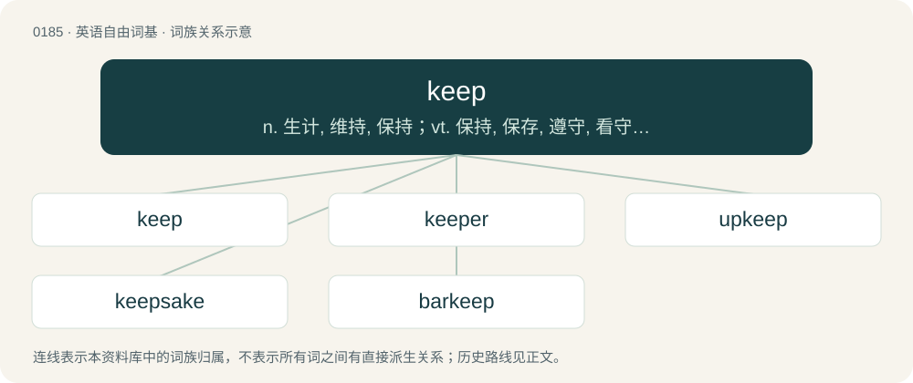

# 0203 · keep — n. 生计, 维持, 保持；vt. 保持, 保存, 遵守, 看守, 整理, 维持, 履行, 经营, 拘留, 记帐；vi. 保持, 继续不断

[总目录](../00_总目录_按常用程度.md)

**类型**：英语自由词基　｜　**来源语言**：见词源记录

## 核心含义与来源

- 核心含义：n. 生计, 维持, 保持；vt. 保持, 保存, 遵守, 看守, 整理, 维持, 履行, 经营, 拘留, 记帐；vi. 保持, 继续不断
- 英文含义：To continue in (a course or mode of action); to not intermit or fall from; to uphold or maintain.
- 词形：keep

**多个词源／构词路径**：同一拼写可能有不同来源；以下按词性和含义分别列出。

**来源记录 1**（动词；To continue in (a course or mode of action); to not intermit or fall from; to uphold or maintain.）

From Middle English kepen (“to keep, guard, look after, watch”), from Old English cēpan (“to seize, hold, observe”), from Proto-West Germanic \*kōpijan, from Proto-Germanic \*kōpijaną (“to look, heed, watch, observe”) (compare West Frisian kypje (“to look”)), from Proto-Indo-European \*ǵab-, \*ǵāb- (“to look after”) (compare Lithuanian žẽbti (“to eat reluctantly”), Russian забо́та (zabóta, “care, worry”)). The dialectal sense of the verb meaning “to put back” or “put away” may be analyzed as a semantic loan from a local language—compare Welsh cadw and Mandarin 收 (shōu).

**来源记录 2**（名词；The food or money required to keep someone alive and healthy; one's support, maintenance.）

From Middle English kepe, kep, from the verb (see above).

## 词族图

## 单词速览（常用到不常用）

| 单词 | 音标 | 释义 |
|---|---|---|
| [keep](#w-1) | /kiːp/ | n. 生计, 维持, 保持；vt. 保持, 保存, 遵守, 看守, 整理, 维持, 履行, 经营, 拘留, 记帐；vi. 保持, 继续不断 |
| [keeper](#w-2) | 英 /ˈkiː.pə/；美 /ˈkiː.pɚ/ | n. 监护人, 管理人, 看守人；\[机\] 保管人, 看守人, 保持片 |
| [upkeep](#w-3) | 美 /ˈʌpkip/ | n. 维持, 维修费；\[经\] 维修费, 养护费, 保养 |
| [keepsake](#w-4) | /ˈkiːp.seɪk/ | n. 纪念品 |
| [barkeep](#w-5) | 英 /ˈbɑː(ɹ)ˌkiːp/；美 /ˈbɑɹˌkiːp/ | n. &lt;美&gt;酒吧间老板, 酒吧间招待 |

## 逐词详解

### 1. keep

**词性**：动词　｜　**音标**：/kiːp/

**中文释义**：n. 生计, 维持, 保持；vt. 保持, 保存, 遵守, 看守, 整理, 维持, 履行, 经营, 拘留, 记帐；vi. 保持, 继续不断

**英文义项**：To continue in (a course or mode of action); to not intermit or fall from; to uphold or maintain. / To remain faithful to a given promise or word.

**词源与演化**：

From Middle English kepen (“to keep, guard, look after, watch”), from Old English cēpan (“to seize, hold, observe”), from Proto-West Germanic \*kōpijan, from Proto-Germanic \*kōpijaną (“to look, heed, watch, observe”) (compare West Frisian kypje (“to look”)), from Proto-Indo-European \*ǵab-, \*ǵāb- (“to look after”) (compare Lithuanian žẽbti (“to eat reluctantly”), Russian забо́та (zabóta, “care, worry”)). The dialectal sense of the verb meaning “to put back” or “put away” may be analyzed as a semantic loan from a local language—compare Welsh cadw and Mandarin 收 (shōu).

**例句**：

> I only meant to lend him the shirt at first, but it looked better on him than me, so I told him to keep it.

该用例对应义项：To maintain possession of.

### 2. keeper

**词性**：名词　｜　**音标**：英 /ˈkiː.pə/；美 /ˈkiː.pɚ/

**中文释义**：n. 监护人, 管理人, 看守人；\[机\] 保管人, 看守人, 保持片

**英文义项**：One who keeps (retains) something. / One who remains or keeps in a place or position.

**构词拆分**：By surface analysis, keep + -er

**词源与演化**：

From Middle English kepere. By surface analysis, keep + -er.

**例句**：

> Finders keepers; losers weepers.

该用例对应义项：One who keeps (retains) something.

### 3. upkeep

**词性**：名词　｜　**音标**：美 /ˈʌpkip/

**中文释义**：n. 维持, 维修费；\[经\] 维修费, 养护费, 保养

**英文义项**：Maintenance; the act or effort of keeping something in good and working condition.

**构词拆分**：up + keep

**词源与演化**：

From up + keep.

**例句**：

> I would enjoy having a swimming pool, but I don't want to deal with the upkeep.

该用例对应义项：Maintenance; the act or effort of keeping something in good and working condition.

### 4. keepsake

**词性**：名词　｜　**音标**：/ˈkiːp.seɪk/

**中文释义**：n. 纪念品

**英文义项**：An object given by a person and retained in memory of something or someone; something kept for sentimental or nostalgic reasons.

**构词拆分**：keep + sake

**词源与演化**：

From keep + sake.

**例句**：

> This is a keepsake from when I was a soldier.

### 5. barkeep

**词性**：名词　｜　**音标**：英 /ˈbɑː(ɹ)ˌkiːp/；美 /ˈbɑɹˌkiːp/

**中文释义**：n. &lt;美&gt;酒吧间老板, 酒吧间招待

**英文义项**：A bartender.

**构词拆分**：bar + keep

**词源与演化**：

From bar + keep, a clipping of barkeeper.
