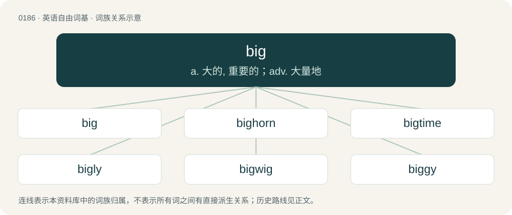

# 0204 · big — a. 大的, 重要的；adv. 大量地

[总目录](../00_总目录_按常用程度.md)

**类型**：英语自由词基　｜　**来源语言**：见词源记录

## 核心含义与来源

- 核心含义：a. 大的, 重要的；adv. 大量地
- 英文含义：Of great size, large.
- 词形：big

**来源记录 1**（形容词；Of great size, large.）

Inherited from Northern Middle English big, bigge (“powerful, strong”), possibly from a dialect of Old Norse. Ultimately perhaps a derivative of Proto-Germanic \*bugja- (“swollen up, thick”), from Proto-Indo-European \*bʰew-, \*bu- (“to swell”), in which case big would be related to bogey, bugbear, and bug. Compare dialectal Norwegian bugge (“great man”), Low German Bögge, Boggelmann.

## 词族图

## 单词速览（常用到不常用）

| 单词 | 音标 | 释义 |
|---|---|---|
| [big](#w-1) | /bɪɡ/ | a. 大的, 重要的；adv. 大量地 |
| [bighorn](#w-2) | /ˈbighɒːn/ | n. 加拿大盘羊 |
| [bigtime](#w-3) | /bigtaim/ | a. 一流的;大规模的 |
| [bigly](#w-4) | 英 /ˈbɪɡ.li/ | adv. big的变形 |
| [bigwig](#w-5) | /ˈbɪɡ.wɪɡ/ | n. 要人, 大亨 |
| [biggy](#w-6) | /ˈbɪɡi/ | \[医\]\[=bismuth glycine glucose yeast(agar)\]甘氨酸铋葡糖酵母（琼脂） |

## 逐词详解

### 1. big

**词性**：形容词　｜　**音标**：/bɪɡ/

**中文释义**：a. 大的, 重要的；adv. 大量地

**英文义项**：Of great size, large. / Fat.

**词源与演化**：

Inherited from Northern Middle English big, bigge (“powerful, strong”), possibly from a dialect of Old Norse. Ultimately perhaps a derivative of Proto-Germanic \*bugja- (“swollen up, thick”), from Proto-Indo-European \*bʰew-, \*bu- (“to swell”), in which case big would be related to bogey, bugbear, and bug. Compare dialectal Norwegian bugge (“great man”), Low German Bögge, Boggelmann.

**例句**：

> I'm not big on the idea, but if you want to go ahead with it, I won't stop you.

该用例对应义项：Enthusiastic (about).

### 2. bighorn

**词性**：名词　｜　**音标**：/ˈbighɒːn/

**中文释义**：n. 加拿大盘羊

**英文义项**：Certain North American species of sheep / especially, Ovis canadensis, having large, curving horns.

**构词拆分**：big + horn

**词源与演化**：

From big + horn.

**例句**：

> Public safety workers spotted the object while conducting a count of bighorn sheep.

### 3. bigtime

**词性**：形容词　｜　**音标**：/bigtaim/

**中文释义**：a. 一流的;大规模的

**英文义项**：Of major significance or importance.

**构词拆分**：big + time

**词源与演化**：

From big + time.

### 4. bigly

**词性**：形容词　｜　**音标**：英 /ˈbɪɡ.li/

**中文释义**：adv. big的变形

**英文义项**：Habitable, liveable; hence delightful, pleasant, pleasing.

**构词拆分**：big (“to build, construct, live in, reside, dwell”) + -ly

**词源与演化**：

From Middle English bygly, biglie, byggly (“comfortable, stately, perfect”), borrowed from Old Norse byggiligr, byggviligr (“habitable”); equivalent to big (“to build, construct, live in, reside, dwell”) + -ly. Cognate with Icelandic byggilegur (“inhabitable, liveable”).

### 5. bigwig

**词性**：名词　｜　**音标**：/ˈbɪɡ.wɪɡ/

**中文释义**：n. 要人, 大亨

**英文义项**：A person of importance in a group or organization.

**构词拆分**：big + wig

**词源与演化**：

First arose in the 1730s, from big + wig. Formerly, English men of authority (such as judges and Members of Parliament) wore wigs. Bigwig plays on the idea that higher authority is denoted by a larger wig.

**例句**：

> The company bigwig is gathering his staff together for a meeting today.

该用例对应义项：A person of importance in a group or organization.

### 6. biggy

**词性**：名词　｜　**音标**：/ˈbɪɡi/

**中文释义**：\[医\]\[=bismuth glycine glucose yeast(agar)\]甘氨酸铋葡糖酵母（琼脂）

**英文义项**：Something large in size in comparison to similar things. / Something impressive in comparison to similar things.

**构词拆分**：big + -y

**词源与演化**：

From big + -y.

**例句**：

> The wardrobe is the biggy – we'd better move that first.

该用例对应义项：Something large in size in comparison to similar things.
