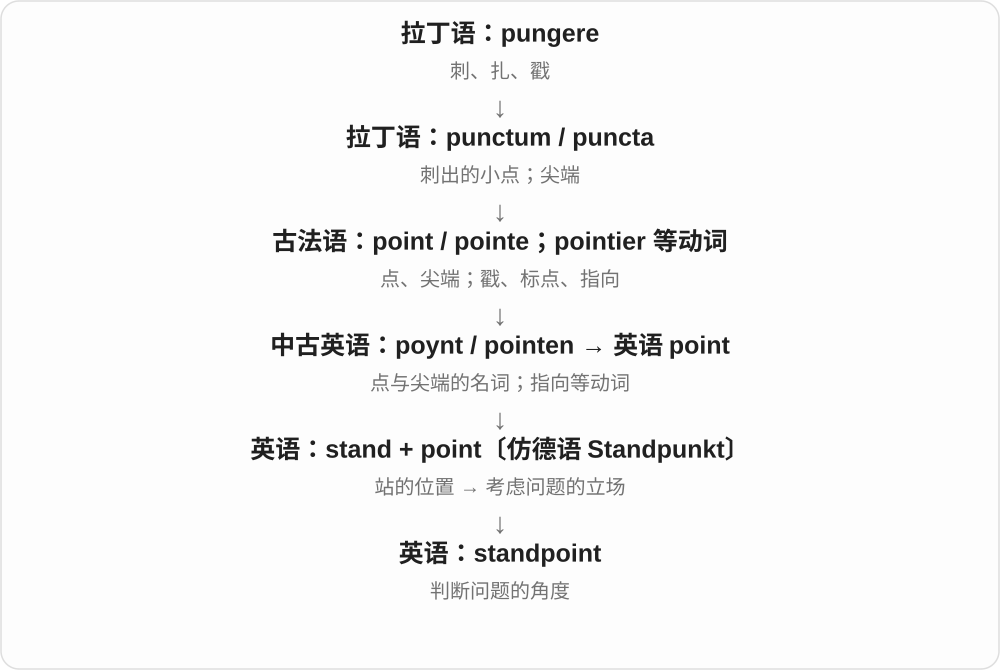

# 0206 · stand — 站立、支住；位置与坚持

[逐词精讲目录](../00_逐词精讲目录.md) · [总目录](../00_总目录_按常用程度.md)

## 核心词根与来源

stand 接古英语 standan，经中古英语延续；stand → stood。standing、withstand 可辨动作、状态和旧前缀。understand、standard 虽可放在历史关联中学习，意义形成不能只靠现代字面拼出来。

**STAND：支住身体或事物，留在某个位置**

人站着，架子支着东西，面对压力仍站得住，就有坚持和承受的感觉。

- **基本状态、承受与位置**：stand · standing · withstand · standstill · standpoint
- **台架、场所与支撑**：nightstand · newsstand · bandstand · grandstand · handstand · kickstand
- **历史扩展需谨慎拆解**：understand · standard
- **站住、保持立场的过去形式 stood**：stand · stood
- **stand → stands：站、立与售卖的小摊**：stand · stands
- **standard → standards：旗帜、参照与标准**：standard · standards
- **stand 的台架义进入 nightstand**：stand · nightstand · nightstands

## 词形与演化规律

先看 stand、standing、withstand；standpoint、standstill、grandstand 为共享讲解。支架用途再分 nightstand、newsstand、bandstand、handstand、kickstand。understand 的语义桥梁和 standard 的更早分析有争议，单列解释。

stand → stood → stood；stood 的 oo 读 /ʊ/。

站住、占据位置的动作，发展出立场、架台、摊位等名词。

军旗与标准有历史联系，但中间语义过渡和更远词源保留争议。

stand 在这里为支物台架名，不是站立动作。

## 单词速览（按词族由简到繁）

同一基础词的相关扩展放在一起，先读基础形式，再读扩展；各组之间优先读常用的。具体词源关系见各词讲解。

| 单词 | 音标 | 核心意思 |
|---|---|---|
| [stand](#w-2) | /stænd/ | 站；立；保持某位置；忍受；台架、立场 |
| [standard](#w-3) | 英 /ˈstændəd/；美 /ˈstændərd/ | 标准；水准；标准的；旗帜〔历史〕 |
| [standards](#w-16) | 英 /ˈstændədz/；美 /ˈstændərdz/ | 标准、水平、准则〔standard 的复数〕 |
| [standing](#w-4) | /ˈstændɪŋ/ | 站立的；长期有效的；地位、声誉 |
| [stands](#w-15) | /stændz/ | 站着；位于；忍受；代表〔stands for〕；台架、摊位、看台〔复数〕 |
| [stood](#w-14) | /stʊd/ | 站着、站住了；坚持、处于某位置；stand 的过去式、过去分词 |
| [standpoint](#w-5) | 英、美 /ˈstændpɔɪnt/ | 立场；看问题的角度 |
| [standstill](#w-7) | /ˈstændstɪl/ | 停顿；完全停滞 |
| [understand](#w-1) | 英 /ˌʌndəˈstænd/；美 /ˌʌndərˈstænd/ | 理解；懂；体谅；据悉、认为 |
| [withstand](#w-6) | /wɪðˈstænd/，也 /wɪθˈstænd/ | 经受住；抵挡住 |
| [grandstand](#w-8) | /ˈɡrændstænd/ | 大看台；哗众取宠、做给观众看〔动词〕 |
| [nightstand](#w-9) | /ˈnaɪtstænd/ | 床头柜；床边小桌〔尤美〕 |
| [nightstands](#w-17) | /ˈnaɪtstændz/ | 床头柜、床边小桌〔复数，常见美式〕 |
| [newsstand](#w-10) | 英 /ˈnjuːzstænd/；美 /ˈnuːzstænd/ | 报刊亭；售报摊 |
| [bandstand](#w-11) | /ˈbændstænd/ | 露天音乐台；乐队演奏台 |
| [handstand](#w-12) | /ˈhændstænd/ | 手倒立 |
| [kickstand](#w-13) | /ˈkɪkstænd/ | 自行车、摩托车支架；折叠支撑架 |

## 逐词讲解

### 1. stand — 站；立；保持某位置；忍受；台架、立场

**音标**：/stænd/

**先抓住这个画面**

先想一个人双脚支住、直立不倒；身体稳住，态度也能稳住。

**怎么拆**

接古英语 standan，经中古英语 standen、stonden 延续；过去式、过去分词 stood /stʊd/ 保留历史元音变化。名词台架、立场等由动作及位置发展。

**怎么变成今天的意思**

**古英语 standan → 中古英语 standen / stonden**  
站立；占据一个位置

↓

**英语 stand**  
站；立着；坚持；忍受；台架

stand up 是站起来，stand by a decision 是坚持决定，can’t stand the noise 是受不了噪声；a music stand 是乐谱架，take a stand 是表明坚定立场。

**常见搭配与例句**

stand up；stand still；can’t stand；take a stand；a display stand。

> Please stand behind the yellow line.

请站在黄线后面。

> I can’t stand waiting in a noisy room.

我受不了在吵闹房间里等着。

> She took a stand against the unfair rule.

她明确反对这项不公平规定。

**别混淆**

stand 作不及物可说东西立着，也能及物说把东西竖放：stand the bottle upright。忍受义常接名词或 -ing，如 can’t stand waiting。

### 2. standard — 标准；水准；标准的；旗帜〔历史〕

**音标**：英 /ˈstændəd/；美 /ˈstændərd/

**先抓住这个画面**

大家需要同一个参照来判断尺寸、质量或做法，而不是各用各的尺。

**怎么拆**

经古法语 estandart、相关中世纪拉丁语形式借入，早有军旗、集结标志义；更早是否站稳、固定地点等组合有不同分析。不能把现代拼写简单当 stand + ard，然后断言标准就是站得稳。

**怎么变成今天的意思**

**古法语 estandart 等 → 中古英语 standard**  
军旗、显著标志等早期义

↓

**英语 standard 的度量、规范用法**  
比较所依据的尺度；标准的

meet a standard 是达到标准，a high standard 是高水准，standard size 是标准尺寸。历史小说里 a royal standard 可能是王旗；这些义相关，但中间语义转化不全是确定单一路线。

**常见搭配与例句**

meet standards；set a standard；a high standard；standard practice。

> The product meets the required safety standard.

产品符合所要求的安全标准。

> This is standard practice in the workshop.

这是车间的常规做法。

**别混淆**

standard 是衡量规范或普通规格，standing 常是地位、长期有效；standard procedure 是标准程序，不写 standing procedure 来表达完全相同的概念。

### 3. standards — 标准、水平、准则〔standard 的复数〕

**音标**：英 /ˈstændədz/；美 /ˈstændərdz/

**先抓住这个画面**

拿一把公认的尺来比，要求达到的程度、做事遵循的准则，就是 standards。历史上这个名字先有军旗、集结标志等用法。

**怎么拆**

standard + -s，/d/ 后读 /z/。standard 接古法语 estandart 等旗帜词及相关中世纪拉丁形式；从军旗到权威参照的过程并不完全清楚，更早还存在不同构词解释。

**怎么变成今天的意思**

**古法语 estandart、相关拉丁形式 → standard**  
军旗、醒目标志；更早来源有争议

↓

**参照、标准义 → standard + -s → standards**  
公认参照 → 多项标准、要求或水平

quality standards 质量标准；high standards 高要求；living standards 生活水平；meet the standards 达到标准。

**常见搭配与例句**

standards for the work；standards of service。

> The team checks whether the work meets the required standards.

团队检查这项工作是否达到所要求的标准。

> She has high standards for her own writing.

她对自己的写作要求很高。

**别混淆**

high standards 可说要求高；living standards 说生活条件、水平。标准义的历史不等于现代简单拆 stand + ard 就能直接推导全部意思。

### 4. standing — 站立的；长期有效的；地位、声誉

**音标**：/ˈstændɪŋ/

**先抓住这个画面**

人站着不坐下，规则立着没撤掉，人在群体里也有自己的位置。

**怎么拆**

stand + -ing，接早期英语相应分词和名词形式；standing 不是只有进行时，已能作形容词及地位、持续时间等名词。

**怎么变成今天的意思**

**古英语 standan → 中古英语 standen / stonden**  
站立；占据一个位置

↓

**古英语 standende 等 → 中古英语 standing 对应形式**  
站立着；持续状态

↓

**英语 standing**  
站立、长期有效；地位声誉

a standing ovation 是起立鼓掌，a standing invitation 是长期有效的邀请，professional standing 是职业声望；a problem of long standing 是存在已久的问题。

**常见搭配与例句**

a standing ovation；a standing invitation；professional standing；of long standing。

> The audience gave the performers a standing ovation.

观众起立为表演者鼓掌。

> Her professional standing grew over the years.

多年来，她的职业声望不断提高。

**别混淆**

standing 形容持续有效，stationary 说不移动；a standing order 还可能是银行常设付款指示等固定术语，不能只译成站立的命令。

### 5. stands — 站着；位于；忍受；代表〔stands for〕；台架、摊位、看台〔复数〕

**音标**：/stændz/

**先抓住这个画面**

人、东西稳稳占住一个位置，是 stands；能立住放东西的架台、售货的摊位，也由站立、摆设的画面理解。固定搭配再说明它怎样站、替谁站。

**怎么拆**

stand + -s，/d/ 后读 /z/。stand 继承古英语 standan，经中古英语延续；台架、摊位、立场等名词由动作、位置发展。过去式、分词是 stood。

**怎么变成今天的意思**

**古英语 standan → stand 动词及相关名词**  
站立、占据位置 → 架台、摊位、立场

↓

**stand + -s → stands**  
单数主语站、位于；多个架台、摊位等

stands by the door 站在门边；stands for something 代表某事；food stands 食品摊位；music stands 乐谱架；the stands 体育场看台。

**常见搭配与例句**

stands in the centre；stands out from the crowd。

> A small wooden table stands beside the window.

窗边放着一张小木桌。

> Several food stands lined the road to the festival.

通往节庆活动的路边排着几个食品摊。

**别混淆**

stands for 可以说缩写代表什么，也可说主张、维护的原则。stands out 是显眼、突出，stands by someone 是支持某人。多义搭配按完整短语记。

### 6. stood — 站着、站住了；坚持、处于某位置；stand 的过去式、过去分词

**音标**：/stʊd/

**先抓住这个画面**

过去人站在那里，某样东西立在那里，或一个人守着立场不退，都可以用 stood。

**怎么拆**

接古英语 standan 的过去式 stod 等旧强变位形式，现代过去分词也用 stood。词干里元音和 n 的不同都有较早历史。

**怎么变成今天的意思**

**古英语 standan、stod 等**  
站立、保持位置及其过去形式

↓

**现代 stand → stood → stood**  
过去和过去分词同形

stood at the door 站在门边；stood up 起身站起；stood firm 坚持不退；stood out 显眼、出众。

**常见搭配与例句**

stood beside the gate；stood her ground。

> He stood at the door, waiting for us.

他站在门边等我们。

> She stood firm despite the criticism.

尽管受到批评，她仍坚持立场。

**别混淆**

stood 的 oo 读 /ʊ/，与 food 的 /uː/ 不同。was standing 常描写当时正在站着，stood 则可直接叙述过去的站立状态或动作。

### 7. standpoint — 立场；看问题的角度

**音标**：英、美 /ˈstændpɔɪnt/

**先抓住这个画面**

人站的位置不同，看见的重点就不同：从成本看、从安全看，结论可能不一样。

**怎么拆**

stand“站立” + point“位置”；仿德语 Standpunkt 的构词，不是先有英语再传成德语。

**怎么变成今天的意思**

常用 from a … standpoint 来声明这一次按什么标准考虑。它可以是职业、利益或分析角度。

**常见搭配与例句**

from a practical standpoint；from the customer’s standpoint。

> From a safety standpoint, the wider exit is preferable.

从安全角度看，更宽的出口更合适。

> Try to consider the delay from the customer’s standpoint.

试着从顾客的立场考虑这次延误。

**别混淆**

viewpoint 更容易指个人看法；standpoint 常突出你所处的位置或采用的判断标准。

### 8. standstill — 停顿；完全停滞

**音标**：/ˈstændstɪl/

**先抓住这个画面**

原先能走、能推进，现在像站在原地，一点也不动。

**怎么拆**

stand（站立、停住）+ still（静止），与 stand still 短语相连形成名词。

**怎么变成今天的意思**

**英语 stand；still**  
并列组合的材料

↓

**stand + still → standstill**  
完全停止移动、推进的状态

come to a standstill 是完全停住，bring something to a standstill 是使完全停止。可说交通、生产、谈判，不必都有人站立。

**常见搭配与例句**

come to a standstill；at a standstill；bring to a standstill。

> Traffic came to a standstill after the accident.

事故后交通完全停住了。

> The talks are at a standstill.

会谈陷入停滞。

**别混淆**

standstill 是停止状态，standstill 不等于 stand-up 的表演或站立式安排；复合词要按整词理解。

### 9. understand — 理解；懂；体谅；据悉、认为

**音标**：英 /ˌʌndəˈstænd/；美 /ˌʌndərˈstænd/

**先抓住这个画面**

不是只听见一句话，而是知道对方究竟在说什么、为何这样说。

**怎么拆**

接古英语 understandan、中古英语 understanden，可辨 under- 与 stand 的历史构成；但从站立怎样发展到理解，具体解释仍有争议。“站在下面所以理解”不是已证实词源。

**怎么变成今天的意思**

**古英语 understandan → 中古英语 understanden**  
已经表示理解、领会；更早语义桥梁有争议

↓

**英语 understand**  
懂含义、明白处境、据悉

understand the instructions 是懂说明，understand how someone feels 是体谅感受；I understand that ... 还可引出据我所知。过去式、过去分词 understood。

**常见搭配与例句**

understand why；understand how；make oneself understood；as I understand it。

> I understand the words, but not the joke.

这些词我都懂，可没听懂笑话。

> Thank you for understanding why I needed more time.

谢谢你理解我为什么需要更多时间。

**别混淆**

know 可以是知道事实，understand 更强调领会意义、原因或处境。构词联想可以辅助记忆，但对这个词不能把猜测画成确定的历史因果。

### 10. withstand — 经受住；抵挡住

**音标**：/wɪðˈstænd/，也 /wɪθˈstænd/

**先抓住这个画面**

压力推过来，人或物仍然撑住，没有被冲垮。

**怎么拆**

接古英语 wiþstandan、中古英语 withstanden；with- 在这里保留 against“对抗”的旧义，不是现代最常见的“和……一起”。

**怎么变成今天的意思**

**古英语 standan → 中古英语 standen / stonden**  
站立；占据一个位置

↓

**古英语 wiþ- + standan → wiþstandan**  
抵住、对抗而立

↓

**中古英语 withstanden → withstand**  
承受、抵挡住

withstand pressure 是经受压力，withstand strong winds 是扛住强风。过去式和过去分词 withstood /wɪðˈstʊd/，跟 stand → stood 的模式走。

**常见搭配与例句**

withstand pressure；withstand heat；withstand the test of time。

> The bridge was designed to withstand strong winds.

这座桥在设计时考虑了抵御强风。

> The material can withstand repeated washing.

这种材料经得住反复洗涤。

**别混淆**

withstand 是经受住作用力，stand with someone 是与某人站在一起或支持某人；拆成两个词就不是同一结构。

### 11. grandstand — 大看台；哗众取宠、做给观众看〔动词〕

**音标**：/ˈɡrændstænd/

**先抓住这个画面**

先是看比赛的主要看台，再变成“为了让看台鼓掌而卖弄”。

**怎么拆**

grand + stand“看台”；动词来自 grandstand player 一类体育用语，指刻意向观众炫技。

**怎么变成今天的意思**

**拉丁语 grandis**  
大的、成长充分的；更早来源未定

↓

**古法语 grant / grand → 英语 grand**  
大、重要 → 宏伟、盛大、出色

↓

**英语 grand + stand → grandstand〔名词〕**  
主要、大型的看台

↓

**grandstand player 一类说法 → grandstand〔动词〕**  
为看台观众卖弄 → 哗众取宠

sit in the grandstand 是坐在看台上；a politician is grandstanding 指他在做显眼、讨好观众的表现。动词明显贬义，不只是正常公开发言。

**常见搭配与例句**

the main grandstand；grandstand for the cameras；political grandstanding。

> The crowd filled the grandstand before the race.

比赛开始前，人群就坐满了大看台。

> He used the meeting to grandstand for the cameras.

他利用会议在镜头前作秀。

**别混淆**

perform 是表演或履职；grandstand 强调抢眼、求掌声，可能忽略实际任务。

### 12. nightstand — 床头柜；床边小桌〔尤美〕

**音标**：/ˈnaɪtstænd/

**先抓住这个画面**

晚上躺下前，眼镜、书和灯需要一个伸手就够得到的地方。

**怎么拆**

night（夜间、睡眠时段）+ stand（支物的台架），按床边用途命名；不是 night + stand 的“熬夜站着”。

**怎么变成今天的意思**

**英语 night；stand〔台架〕**  
并列组合的两部分

↓

**night + stand〔台架〕 → nightstand**  
床边放东西的小柜、桌

美式常见，英式也常说 bedside table。可以有抽屉，也可以是一张简单小桌，重点在床边使用。

**常见搭配与例句**

a bedside nightstand；on the nightstand；a nightstand drawer。

> She left her glasses on the nightstand.

她把眼镜放在床头柜上。

> A small lamp stood on each nightstand.

两边床头柜上各摆着一盏小灯。

**别混淆**

nightstand 是家具，night shift 是夜班；名字里 night 不意味着有人值夜站岗。

### 13. nightstands — 床头柜、床边小桌〔复数，常见美式〕

**音标**：/ˈnaɪtstændz/

**先抓住这个画面**

床边放灯、水杯、书的小桌柜，是 nightstands。night 给睡眠、床边场景，stand 是支放物品的台架。

**怎么拆**

night + stand 名词 → nightstand，现代加 -s，/d/ 后读 /z/。按常见用途命名，不要求只有夜里使用。

**怎么变成今天的意思**

**night + stand → nightstand**  
床边、夜间用途的台架家具

↓

**nightstand + -s → nightstands**  
多个床边小柜、桌

matching nightstands 配套床头柜；lamps on the nightstands 床头柜上的灯。

**常见搭配与例句**

wooden nightstands 木床头柜；nightstands beside the bed 床两旁的小柜。

> Matching nightstands stood beside the bed.

床两侧放着配套床头柜。

> Small lamps rested on the nightstands.

床头柜上放着小灯。

**别混淆**

英式常见 bedside tables、bedside cabinets。stand 在这里是支放物品的台架名。

### 14. newsstand — 报刊亭；售报摊

**音标**：英 /ˈnjuːzstænd/；美 /ˈnuːzstænd/

**先抓住这个画面**

路边摆出一排报纸杂志，过路人停下来买一份。

**怎么拆**

news（新闻；这里借指报刊）+ stand（摊台），不是让新闻站立起来。news 本来以 s 结尾，不另把这里的 s 误认成连接后缀。

**怎么变成今天的意思**

**英语 news；stand〔摊台〕**  
并列组合的两部分

↓

**news + stand〔摊台〕 → newsstand**  
出售报刊的摊亭

常在车站、街边、机场看到。on newsstands 可表示刊物正在市面发售，并不是所有刊物一定只通过小亭出售。

**常见搭配与例句**

a station newsstand；buy a paper at a newsstand；on newsstands。

> I bought a magazine at the station newsstand.

我在车站报刊亭买了本杂志。

> The new issue reaches newsstands next week.

新一期杂志下周上市。

**别混淆**

newsstand 是销售报刊的地点，newsletter 是定期通讯；stand 这一后半先把它定成摊台。

### 15. bandstand — 露天音乐台；乐队演奏台

**音标**：/ˈbændstænd/

**先抓住这个画面**

公园里搭一个供乐队演奏的高台，人们围在外面听。

**怎么拆**

band（乐队）+ stand（台），常见亭状有顶结构，但名称重点在演出用途。

**怎么变成今天的意思**

**英语 band；stand〔台〕**  
并列组合的两部分

↓

**band + stand〔台〕 → bandstand**  
供乐队演奏的平台

公园、广场音乐活动叙述常见，也可用于其他小型音乐舞台。a brass band on the bandstand 是铜管乐队在音乐台上演奏。

**常见搭配与例句**

a park bandstand；play on the bandstand；restore a bandstand。

> A brass band performed on the park bandstand.

铜管乐队在公园音乐台演奏。

> The town restored its old wooden bandstand.

小镇修复了旧木制音乐台。

**别混淆**

bandstand 供表演者站台，grandstand 多指观众看台；音乐人和观众所在区域不同。

### 16. handstand — 手倒立

**音标**：/ˈhændstænd/

**先抓住这个画面**

正常用脚支撑身体，这次反过来，由双手撑地让身体倒立。

**怎么拆**

hand（手）+ stand（站立、支撑姿势），按支撑部位命名，不是手放在站台上。

**怎么变成今天的意思**

**英语 hand；stand**  
并列组合的两部分

↓

**hand + stand → handstand**  
用手支撑身体的倒立姿势

do a handstand 是做手倒立，hold a handstand 是保持姿势。体操比赛、舞蹈、动作照片的叙述里都可见；也能作动词说做手倒立。

**常见搭配与例句**

do a handstand；hold a handstand；a handstand position。

> The gymnast held a handstand for several seconds.

体操运动员保持手倒立几秒钟。

> The photograph captures her in a handstand.

照片拍下了她手倒立的瞬间。

**别混淆**

handstand 靠手支撑，headstand 常称头倒立；两者不能因为身体都倒过来就当同一个姿势。

### 17. kickstand — 自行车、摩托车支架；折叠支撑架

**音标**：/ˈkɪkstænd/

**先抓住这个画面**

停车后放下一根撑杆，车就能靠它立住，不必一直用手扶。

**怎么拆**

kick（脚踢、脚拨的动作）+ stand（支撑架），按常用脚拨下的自行车部件命名，后扩展为设备的折叠支撑。

**怎么变成今天的意思**

**英语 kick；stand〔支架〕**  
并列组合的两部分

↓

**kick + stand〔支架〕 → kickstand**  
可放下使车辆、设备立住的支撑杆

a bicycle kickstand 是车撑，a phone kickstand 是手机支架；后者不需要真的用脚去踢。

**常见搭配与例句**

lower the kickstand；a folding kickstand；a built-in kickstand。

> He lowered the kickstand before getting off the bike.

他下自行车前放下了车撑。

> The tablet case has a folding kickstand.

平板保护套带有折叠支架。

**别混淆**

kickstand 说明支撑功能，kickstart 是启动、促使开始的另一词；别把车撑误当启动器。

## 这一组要分清什么

nightstand 家具、newsstand 摊亭、bandstand 演奏台。understand 早已表示理解，不能说站在下面所以懂了。withstand 的 with- 保留对抗义。

## 串起来练习

The old bandstand still stands, having withstood years of wind and rain.

旧音乐台经受多年风雨，如今仍然立着。
