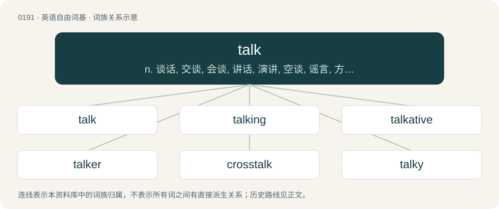

# 0212 · talk — n. 谈话, 交谈, 会谈, 讲话, 演讲, 空谈, 谣言, 方言, 语言；vi. 讲话, 演讲, 说话, 谈话, 交流, 闲聊, 说闲话；vt. 讲, 说, 讨论, 谈论

[总目录](../00_总目录_按常用程度.md)

**类型**：英语自由词基　｜　**来源语言**：见词源记录

## 核心含义与来源

- 核心含义：n. 谈话, 交谈, 会谈, 讲话, 演讲, 空谈, 谣言, 方言, 语言；vi. 讲话, 演讲, 说话, 谈话, 交流, 闲聊, 说闲话；vt. 讲, 说, 讨论, 谈论
- 英文含义：To communicate, usually by means of speech.
- 词形：talk

**多个词源／构词路径**：同一拼写可能有不同来源；以下按词性和含义分别列出。

**来源记录 1**（动词；To communicate, usually by means of speech.）

From Middle English talken, talkien, from Old English \*tealcian (“to talk, chat”), from Proto-West Germanic \*talkōn, from Proto-Germanic \*talkōną (“to talk, chatter”), frequentative form of Proto-Germanic \*talōną (“to count, recount, tell”), from Proto-Indo-European \*dol-, \*del- (“to aim, calculate, adjust, count”), equivalent to tell + -k. Cognates Cognate with Low German taalken (“to chatter, gossip, talk”). Related also to Bavarian zoin (“to pay”), Cimbrian zaln (“to pay”), Dutch talen (“to care, long; to speak; to say”), German zahlen (“to pay”), Mòcheno zoln (“to pay”), Danish and Norwegian Bokmål tale (“to talk, speak”), Faroese, Icelandic, and Swedish tala (“to speak, talk”), Norwegian Nynorsk tala (“to speak, talk”); also Latin dolus (“deceit, deception, fraud, guile, treachery, trickery; malice; artifice, device, stratagem”), Ancient Greek δόλος (dólos, “deceit, trick; wiles; bait”), Armenian տող (toġ, “line (in a text)”). More at tale. Despite the surface similarity, unrelated to Proto-Indo-European \*telkʷ- (“to talk”) (due to Grimm's law), which is the source of loquacious.

**来源记录 2**（名词；A conversation or discussion; usually serious, but informal.）

From Middle English talk, talke (“conversation; discourse”), from the verb (see above).

## 词族图

## 单词速览（常用到不常用）

| 单词 | 音标 | 释义 |
|---|---|---|
| [talk](#w-1) | 英 /tɔːk/；美 /tɔk/ | n. 谈话, 交谈, 会谈, 讲话, 演讲, 空谈, 谣言, 方言, 语言；vi. 讲话, 演讲, 说话, 谈话, 交流, 闲聊, 说闲话；vt. 讲, 说, 讨论, 谈论 |
| [talking](#w-2) | 英 /ˈtɔːkɪŋ/；美 /ˈtɔkɪŋ/ | a. 说话的, 多嘴的, 富有表情的；n. 讲话, 谈论 |
| [talkative](#w-3) | 英 /ˈtɔː.kə.tɪv/；美 /ˈtɔ.kə.ɾɪv/ | a. 喜欢说话的, 饶舌的, 多嘴的 |
| [talker](#w-4) | 英 /ˈtɔːkə/；美 /ˈtɔkɚ/ | n. 说话的人, 饶舌者, 空谈者 |
| [crosstalk](#w-5) | /ˈkrɔs,tɔːk/ | \[计\] 串扰, 串音, 串话 |
| [talky](#w-6) | /ˈtɔː.ki/ | a. 对话过多的 |

## 逐词详解

### 1. talk

**词性**：动词　｜　**音标**：英 /tɔːk/；美 /tɔk/

**中文释义**：n. 谈话, 交谈, 会谈, 讲话, 演讲, 空谈, 谣言, 方言, 语言；vi. 讲话, 演讲, 说话, 谈话, 交流, 闲聊, 说闲话；vt. 讲, 说, 讨论, 谈论

**英文义项**：To communicate, usually by means of speech. / To discuss; to talk about.

**词源与演化**：

From Middle English talken, talkien, from Old English \*tealcian (“to talk, chat”), from Proto-West Germanic \*talkōn, from Proto-Germanic \*talkōną (“to talk, chatter”), frequentative form of Proto-Germanic \*talōną (“to count, recount, tell”), from Proto-Indo-European \*dol-, \*del- (“to aim, calculate, adjust, count”), equivalent to tell + -k. Cognates Cognate with Low German taalken (“to chatter, gossip, talk”). Related also to Bavarian zoin (“to pay”), Cimbrian zaln (“to pay”), Dutch talen (“to care, long; to speak; to say”), German zahlen (“to pay”), Mòcheno zoln (“to pay”), Danish and Norwegian Bokmål tale (“to talk, speak”), Faroese, Icelandic, and Swedish tala (“to speak, talk”), Norwegian Nynorsk tala (“to speak, talk”); also Latin dolus (“deceit, deception, fraud, guile, treachery, trickery; malice; artifice, device, stratagem”), Ancient Greek δόλος (dólos, “deceit, trick; wiles; bait”), Armenian տող (toġ, “line (in a text)”). More at tale. Despite the surface similarity, unrelated to Proto-Indo-European \*telkʷ- (“to talk”) (due to Grimm's law), which is the source of loquacious.

**例句**：

> Although I don't speak Chinese, I managed to talk with the villagers using signs and gestures.

该用例对应义项：To communicate, usually by means of speech.

### 2. talking

**词性**：名词　｜　**音标**：英 /ˈtɔːkɪŋ/；美 /ˈtɔkɪŋ/

**中文释义**：a. 说话的, 多嘴的, 富有表情的；n. 讲话, 谈论

**英文义项**：The action of the verb talk.

**构词拆分**：By surface analysis, talk + -ing

**词源与演化**：

From Middle English talkynge. By surface analysis, talk + -ing.

**例句**：

> It's been nice talking to you, but I really must go now.

### 3. talkative

**词性**：形容词　｜　**音标**：英 /ˈtɔː.kə.tɪv/；美 /ˈtɔ.kə.ɾɪv/

**中文释义**：a. 喜欢说话的, 饶舌的, 多嘴的

**英文义项**：Tending to talk a lot. / Speaking openly and honestly, neglecting privacy and consequences.

**构词拆分**：talk + -ative

**词源与演化**：

From Middle English talkatyve, equivalent to talk + -ative.

**用法示例／搭配（非完整句）**：

> a talkative TV show

该用例对应义项：Tending to talk a lot.

### 4. talker

**词性**：名词　｜　**音标**：英 /ˈtɔːkə/；美 /ˈtɔkɚ/

**中文释义**：n. 说话的人, 饶舌者, 空谈者

**英文义项**：A person who talks, especially one who gives a speech, or is loquacious or garrulous. / Any creature or machine that talks.

**构词拆分**：talk + -er

**词源与演化**：

From Middle English talkere, equivalent to talk + -er.

**例句**：

> The royal engagement is likely to be a top talker right through the wedding.

该用例对应义项：A popular topic of conversation.

### 5. crosstalk

**词性**：名词　｜　**音标**：/ˈkrɔs,tɔːk/

**中文释义**：\[计\] 串扰, 串音, 串话

**英文义项**：Undesirable signals from a neighbouring transmission circuit; undesired coupling between circuits. / The situation where one or more components of a signal transduction pathway affect another pathway.

**构词拆分**：From cross- + talk.

**词源与演化**：

From cross- + talk. Usage in reference to the Chinese comedic performance is probably a loose calque from Chinese 相聲／相声 (xiàngsheng).

**例句**：

> I couldn't hear the opening address because of all the crosstalk around me.

该用例对应义项：Conversation that is incidental to the topic under discussion.

### 6. talky

**词性**：形容词　｜　**音标**：/ˈtɔː.ki/

**中文释义**：a. 对话过多的

**英文义项**：Talkative or loquacious / Containing a great deal of dialogue or talking in general

**构词拆分**：talk + -y

**词源与演化**：

From talk + -y.
