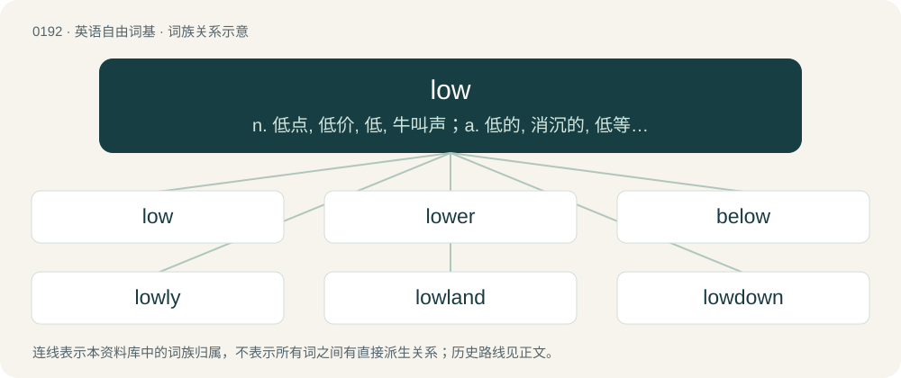

# 0213 · low — n. 低点, 低价, 低, 牛叫声；a. 低的, 消沉的, 低等的, 浅的, 卑贱的；adv. 低下地, 谦卑地, 低

[总目录](../00_总目录_按常用程度.md)

**类型**：英语自由词基　｜　**来源语言**：见词源记录

## 核心含义与来源

- 核心含义：n. 低点, 低价, 低, 牛叫声；a. 低的, 消沉的, 低等的, 浅的, 卑贱的；adv. 低下地, 谦卑地, 低
- 英文含义：Situated close to, or even below, the ground or another normal reference plane; not high or lofty.
- 词形：low

**多个词源／构词路径**：同一拼写可能有不同来源；以下按词性和含义分别列出。

**来源记录 1**（形容词；Situated close to, or even below, the ground or another normal reference plane; not high or lofty.）

From Middle English lah, loue, from Old Norse lágr (“low”), from Proto-Germanic \*lēgaz (“low; flat”), from \*ligjaną (“to lie; to lead”), from Proto-Indo-European \*légʰyeti (“to be lying down”), from \*legʰ- (“to lie”). Cognates Cognate with Scots laich (“low”), Saterland Frisian läich (“low”), West Frisian leech (“low”), Dutch laag (“low”), German Low German leeg, leeg' (“low; inferior”), West Flemish leeg (“lazy”), Danish lav (“low”), Faroese and Icelandic lágur (“low”), Norwegian Bokmål, Norwegian Nynorsk, and Swedish låg (“low”), Finnish laaka (“flat”), Ingrian laaku (“gentle”); also Irish laigh, luigh (“to lie”), Manx lhie (“lie; lay”), Scottish Gaelic laigh (“lie; lay”), Faliscan 𐌋𐌄𐌂𐌄𐌕 (lecet, “he lies down”), Latin lectus (“bed”), South Picene 𐌅𐌄𐌉𐌀𐌕 (veiat, “to lie”), Ancient Greek λέχομαι (lékhomai, “to lie down”), Albanian lag (“band, encampment, troop”), Belarusian ляжа́ць (ljažácʹ, “to lie”), Bulgarian лежа́ (ležá, “to lie”), Czech ležet (“to lie”), Macedonian лежи (leži, “to lie”), Polish leżeć (“to lie”), Russian лежа́ть (ležátʹ, “to lie”), Serbo-Croatian лѐжати, lèžati (“to lie”), Slovene ležáti (“to lie”), Ukrainian лежа́ти (ležáty, “to lie”), Tocharian B lyäk- (“to lie”). More at lie.

**来源记录 2**（动词；To moo.）

From Middle English lowen (“to low”), from Old English hlōwan (“to low; to bellow; to roar”), from Proto-Germanic \*hlōaną (“to call; shout”), from Proto-Indo-European \*kelh₁- (“to call”). Cognate with Dutch loeien (“to low”), Middle High German lüejen (“to roar”), dialectal Swedish lumma (“to roar”), Latin calō (“to call”), Ancient Greek καλέω (kaléō), Latin clāmō (“to shout, claim”). More at claim.

**来源记录 3**（名词；A flame; fire; blaze.）

From Middle English lowe, loghe, from Old Norse logi (“fire, flame, sword”), from Proto-Germanic \*lugô (“flame, blaze”), from Proto-Indo-European \*lewk- (“light”). Cognate with Icelandic logi (“flame”), Swedish låga (“flame”), Danish lue (“flame”), German Lohe (“blaze, flames”), North Frisian leag (“fire, flame”), Old English līeġ (“fire, flame, lightning”). More at More at leye and More at light.

## 词族图

## 单词速览（常用到不常用）

| 单词 | 音标 | 释义 |
|---|---|---|
| [low](#w-1) | 英 /ˈləʊ/；美 /ˈloʊ/ | n. 低点, 低价, 低, 牛叫声；a. 低的, 消沉的, 低等的, 浅的, 卑贱的；adv. 低下地, 谦卑地, 低 |
| [lower](#w-2) | 英 /ˈləʊ.ə/；美 /ˈloʊ.ɚ/ | a. 低的, 下级的, 下层的；vi. 降低, 跌落, 减弱；vt. 放下, 降下, 减弱, 贬低 |
| [below](#w-3) | 英 /bɪˈləʊ/；美 /bɪˈloʊ/ | prep. 在下面；adv. 在下面 |
| [lowly](#w-4) | 英 /ˈləʊli/；美 /ˈloʊli/ | a. 地位低的, 卑下的, 谦卑的；adv. 位置低下的, 低声地, 谦逊地 |
| [lowland](#w-5) | /ˈləulənd/ | n. 低地, 苏格兰低地；a. 低地的 |
| [lowdown](#w-6) | /ˈləjdajn/ | n. 内幕, 真相 |
| [lowlife](#w-7) | 英 /ˈləʊlaɪf/；美 /ˈloʊlaɪf/ | n. 下层阶级的人, 卑劣人, 罪犯 |
| [lowbrow](#w-8) | 英 /ˈləʊbɹaʊ/；美 /ˈloʊbɹaʊ/ | a. 教养浅薄的；n. 教养浅薄的人 |
| [lowen](#w-9) |  | \[人名\] \[英格兰人姓氏\] 洛温 Lewin的变体 |

## 逐词详解

### 1. low

**词性**：形容词　｜　**音标**：英 /ˈləʊ/；美 /ˈloʊ/

**中文释义**：n. 低点, 低价, 低, 牛叫声；a. 低的, 消沉的, 低等的, 浅的, 卑贱的；adv. 低下地, 谦卑地, 低

**英文义项**：Situated close to, or even below, the ground or another normal reference plane; not high or lofty. / Pertaining to (or, especially of a language: spoken in) in an area which is at a lesser elevation, closer to sea level (especially near the sea), than other regions.

**词源与演化**：

From Middle English lah, loue, from Old Norse lágr (“low”), from Proto-Germanic \*lēgaz (“low; flat”), from \*ligjaną (“to lie; to lead”), from Proto-Indo-European \*légʰyeti (“to be lying down”), from \*legʰ- (“to lie”). Cognates Cognate with Scots laich (“low”), Saterland Frisian läich (“low”), West Frisian leech (“low”), Dutch laag (“low”), German Low German leeg, leeg' (“low; inferior”), West Flemish leeg (“lazy”), Danish lav (“low”), Faroese and Icelandic lágur (“low”), Norwegian Bokmål, Norwegian Nynorsk, and Swedish låg (“low”), Finnish laaka (“flat”), Ingrian laaku (“gentle”); also Irish laigh, luigh (“to lie”), Manx lhie (“lie; lay”), Scottish Gaelic laigh (“lie; lay”), Faliscan 𐌋𐌄𐌂𐌄𐌕 (lecet, “he lies down”), Latin lectus (“bed”), South Picene 𐌅𐌄𐌉𐌀𐌕 (veiat, “to lie”), Ancient Greek λέχομαι (lékhomai, “to lie down”), Albanian lag (“band, encampment, troop”), Belarusian ляжа́ць (ljažácʹ, “to lie”), Bulgarian лежа́ (ležá, “to lie”), Czech ležet (“to lie”), Macedonian лежи (leži, “to lie”), Polish leżeć (“to lie”), Russian лежа́ть (ležátʹ, “to lie”), Serbo-Croatian лѐжати, lèžati (“to lie”), Slovene ležáti (“to lie”), Ukrainian лежа́ти (ležáty, “to lie”), Tocharian B lyäk- (“to lie”). More at lie.

**例句**：

> They spoke in low voices so I would not hear what they were saying.

该用例对应义项：Quiet; soft; not loud.

### 2. lower

**词性**：形容词　｜　**音标**：英 /ˈləʊ.ə/；美 /ˈloʊ.ɚ/

**中文释义**：a. 低的, 下级的, 下层的；vi. 降低, 跌落, 减弱；vt. 放下, 降下, 减弱, 贬低

**英文义项**：Bottom; more towards the bottom than the middle of an object. / Situated on lower ground, nearer a coast, or more southerly.

**构词拆分**：low + -er (comparative suffix)

**词源与演化**：

From low + -er (comparative suffix).

**用法示例／搭配（非完整句）**：

> Lower Manhattan

该用例对应义项：Situated on lower ground, nearer a coast, or more southerly.

### 3. below

**词性**：介词　｜　**音标**：英 /bɪˈləʊ/；美 /bɪˈloʊ/

**中文释义**：prep. 在下面；adv. 在下面

**英文义项**：Lower in spatial position than. / Lower than in value, price, rank, concentration, etc.

**构词拆分**：be- + low

**词源与演化**：

From Middle English bilooghe, equivalent to be- + low. Compare also earlier Middle English alogh, alow, aloȝ, alowe (“below”), benethen (“beneath”), Dutch omlaag (“downwards”).

**例句**：

> Liverpool are below Manchester City in the Premier League.

该用例对应义项：Lower than in value, price, rank, concentration, etc.

### 4. lowly

**词性**：形容词　｜　**音标**：英 /ˈləʊli/；美 /ˈloʊli/

**中文释义**：a. 地位低的, 卑下的, 谦卑的；adv. 位置低下的, 低声地, 谦逊地

**英文义项**：Not high; not elevated in place; low. / Low in rank or social importance.

**构词拆分**：low + -ly

**词源与演化**：

From low + -ly; compare Middle English lowly.

**例句**：

> Of humble (or lowly) birth.

该用例对应义项：of low birth or station (`base' is archaic in this sense)

### 5. lowland

**词性**：名词　｜　**音标**：/ˈləulənd/

**中文释义**：n. 低地, 苏格兰低地；a. 低地的

**英文义项**：An area which is considered particularly low or lower than surrounding areas.

**构词拆分**：low + land

**词源与演化**：

From low + land.

**例句**：

> The lowland region was prone to flooding during the rainy season.

该用例对应义项：An area which is considered particularly low or lower than surrounding areas.

### 6. lowdown

**词性**：名词　｜　**音标**：/ˈləjdajn/

**中文释义**：n. 内幕, 真相

**英文义项**：inside information, the story or truth. / A lowlife, a despicable person.

**构词拆分**：low + down

**词源与演化**：

Compound adjective of low + down in the sense of "humble" recorded in the 1540s, in the sense of "vulgar, far down the social scale" in 1888. Recorded as a noun in 1915 in the slang sense of secret or inside information.

**例句**：

> All the reporters hoped to be the first to get the lowdown on the celebrity's marriage plans.

该用例对应义项：inside information, the story or truth.

### 7. lowlife

**词性**：名词　｜　**音标**：英 /ˈləʊlaɪf/；美 /ˈloʊlaɪf/

**中文释义**：n. 下层阶级的人, 卑劣人, 罪犯

**英文义项**：An untrustworthy, despicable, disreputable, or otherwise immoral person, especially one suspected of being a criminal. / A person who is rebuked by their community for their behavior.

**构词拆分**：low + life

**词源与演化**：

From low + life.

**例句**：

> They say all the lowlifes used to hang out at the docks and plot their despicable crimes, before being elected to public office.

该用例对应义项：An untrustworthy, despicable, disreputable, or otherwise immoral person, especially one suspected of being a criminal.

### 8. lowbrow

**词性**：形容词　｜　**音标**：英 /ˈləʊbɹaʊ/；美 /ˈloʊbɹaʊ/

**中文释义**：a. 教养浅薄的；n. 教养浅薄的人

**英文义项**：Unsophisticated, not intended for an audience of intelligence, education or culture.

**构词拆分**：low + brow

**词源与演化**：

A bahuvrihi compound of low + brow. An Americanism whose first use appears c. 1902. Refers to the (by that time discredited) pseudoscience of phrenology, which suggested that a person of low intelligence and sophistication would possess a lower brow-line than someone of greater intelligence and sophistication.

**例句**：

> The Three Stooges are known for their lowbrow slapstick humor consisting of foolish action for the masses.

该用例对应义项：Unsophisticated, not intended for an audience of intelligence, education or culture.

### 9. lowen

**词性**：动词

**中文释义**：\[人名\] \[英格兰人姓氏\] 洛温 Lewin的变体

**英文义项**：To make or become low.

**构词拆分**：low + -en

**词源与演化**：

From low + -en.
