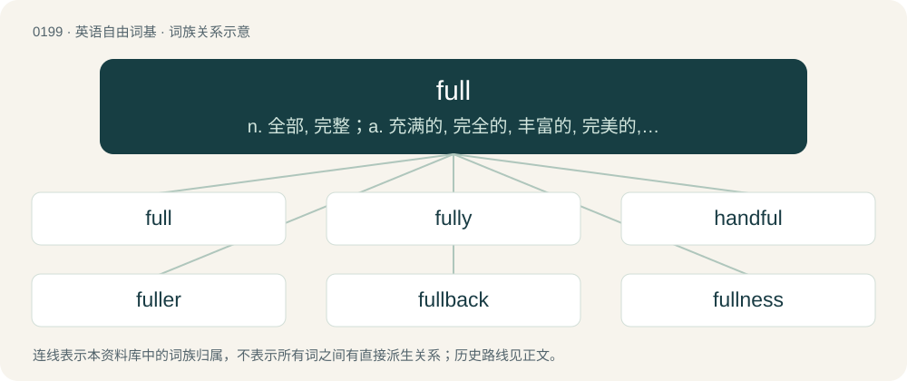

# 0221 · full — n. 全部, 完整；a. 充满的, 完全的, 丰富的, 完美的, 丰满的, 详尽的；adv. 完全地, 整整, 十分

[总目录](../00_总目录_按常用程度.md)

**类型**：英语自由词基　｜　**来源语言**：见词源记录

## 核心含义与来源

- 核心含义：n. 全部, 完整；a. 充满的, 完全的, 丰富的, 完美的, 丰满的, 详尽的；adv. 完全地, 整整, 十分
- 英文含义：Containing the maximum possible amount that can fit in the space available.
- 词形：full

**多个词源／构词路径**：同一拼写可能有不同来源；以下按词性和含义分别列出。

**来源记录 1**（形容词；Containing the maximum possible amount that can fit in the space available.）

From Middle English ful, from Old English full (“full”), from Proto-West Germanic \*full, from Proto-Germanic \*fullaz (“full”), from Proto-Indo-European \*pl̥h₁nós (“full”). Germanic cognates include West Frisian fol, Low German vull, Dutch vol, German voll, Danish fuld, Norwegian Bokmål, Norwegian Nynorsk, and Swedish full. Proto-Indo-European cognates include English plenty (via Latin, compare plēnus), Welsh llawn, Russian по́лный (pólnyj), Lithuanian pilnas, Persian پر (por), Sanskrit पूर्ण (pūrṇá). See also fele and Scots fou (whence the English doublet fou (“drunk”)). For the "drunk, intoxicated" sense, compare also Swedish full and other Scandinavian languages.

**来源记录 2**（名词；Utmost measure or extent; highest state or degree; the state, position, or moment of fullness; fill.）

From Middle English fulle, fylle, fille, from Old English fyllu, fyllo (“fullness, fill, plenty”), from Proto-Germanic \*fullį̄, \*fulnō (“fullness, filling, overflow”), from Proto-Indo-European \*plūno-, \*plno- (“full”), from \*pelh₁-, \*pleh₁- (“to fill; full”). Cognate with German Fülle (“fullness, fill”), Icelandic fylli (“fulness, fill”). More at fill.

**来源记录 3**（动词；To baptise.）

From Middle English fullen, fulwen (“to baptise”), from Old English fullian, fulwian (“to baptise”), from full- + \*wīhan (later \*wēon (“to make holy”)). Compare Old English fulluht, fulwiht (“baptism”).

**来源记录 4**（动词；To make cloth denser and firmer by soaking, beating and pressing; to waulk or walk.）

From Middle English fullen (“to full”), from Anglo-Norman fuller, fuler, Middle French foller, fouler, from Old French foler, fouler (“to tread, stamp, full”), from Medieval Latin fullāre, from Latin fullō (“a fuller”). Compare Old English fullian (“to full”).

## 词族图

## 单词速览（常用到不常用）

| 单词 | 音标 | 释义 |
|---|---|---|
| [full](#w-1) | /fʊl/ | n. 全部, 完整；a. 充满的, 完全的, 丰富的, 完美的, 丰满的, 详尽的；adv. 完全地, 整整, 十分 |
| [fully](#w-2) | 英 /ˈfʊli/ | adv. 十分地, 完全地, 充分地 |
| [handful](#w-3) | /ˈhæn(d)fʊl/ | n. 少数, 一把, 棘手事 |
| [fuller](#w-4) | 英 /ˈfʊ.lə/；美 /ˈfʊ.ləɹ/ | n. 漂洗工, 套柄铁锤；\[机\] 半圆型锤 |
| [fullback](#w-5) | 美 /ˈfʊlˌbæk/ | n. 后卫 |
| [fullness](#w-6) | 英 /ˈfʊlnəs/ | n. 满, 充满, 丰富；\[医\] 发胀 |
| [fullscreen](#w-7) |  | 【英文】To make a window occupy the entire screen. |
| [fulsome](#w-8) | /ˈfʊlsəm/ | a. 过度的, 过分的, 令人生厌的 |

## 逐词详解

### 1. full

**词性**：形容词　｜　**音标**：/fʊl/

**中文释义**：n. 全部, 完整；a. 充满的, 完全的, 丰富的, 完美的, 丰满的, 详尽的；adv. 完全地, 整整, 十分

**英文义项**：Containing the maximum possible amount that can fit in the space available. / Complete; with nothing omitted.

**词源与演化**：

From Middle English ful, from Old English full (“full”), from Proto-West Germanic \*full, from Proto-Germanic \*fullaz (“full”), from Proto-Indo-European \*pl̥h₁nós (“full”). Germanic cognates include West Frisian fol, Low German vull, Dutch vol, German voll, Danish fuld, Norwegian Bokmål, Norwegian Nynorsk, and Swedish full. Proto-Indo-European cognates include English plenty (via Latin, compare plēnus), Welsh llawn, Russian по́лный (pólnyj), Lithuanian pilnas, Persian پر (por), Sanskrit पूर्ण (pūrṇá). See also fele and Scots fou (whence the English doublet fou (“drunk”)). For the "drunk, intoxicated" sense, compare also Swedish full and other Scandinavian languages.

**例句**：

> She had tattoos the full length of her arms. He was prosecuted to the full extent of the law.

该用例对应义项：Total, entire.

### 2. fully

**词性**：副词　｜　**音标**：英 /ˈfʊli/

**中文释义**：adv. 十分地, 完全地, 充分地

**英文义项**：In a full manner; without lack or defect; completely, entirely. / Used as an intensifier for a quantity.

**构词拆分**：full + -ly

**词源与演化**：

From Middle English fully, fulliche, volliche, from Old English fullīċe (“fully”), equivalent to full + -ly. Compare German völlig (“fully”), Swedish fullt (“fully”).

**例句**：

> He is fully capable of meeting his responsibilities.

该用例对应义项：In a full manner; without lack or defect; completely, entirely.

### 3. handful

**词性**：名词　｜　**音标**：/ˈhæn(d)fʊl/

**中文释义**：n. 少数, 一把, 棘手事

**英文义项**：The amount that a hand will grasp or contain. / A small number, usually approximately five.

**构词拆分**：hand + full (“fullness, plenty”)；hand + -ful

**词源与演化**：

From Middle English handful, hondful, from Old English handfull (“handful”), from Proto-Germanic \*handufullō, \*handufulliz (“handful”), from Proto-Germanic \*handuz (“hand”) + \*fullaz (“full”); equivalent to hand + full (“fullness, plenty”) or hand + -ful. Cognate with Saterland Frisian Hondful (“handful”), West Frisian hânfol (“handful”), Dutch handvol (“handful”), German Handvoll (“handful”), Danish håndfuld (“handful”), Swedish handfull (“handful”), Icelandic handfylli (“handful”).

**例句**：

> Those twins are a real handful to look after.

该用例对应义项：Something which can only be managed with difficulty.

### 4. fuller

**词性**：名词　｜　**音标**：英 /ˈfʊ.lə/；美 /ˈfʊ.ləɹ/

**中文释义**：n. 漂洗工, 套柄铁锤；\[机\] 半圆型锤

**英文义项**：One who fulls cloth.

**构词拆分**：full (“to densen cloth”) + -er

**词源与演化**：

Inherited from Middle English fullere, from Old English fullere, from Latin fullō (“fuller”) + -ere; equivalent to full (“to densen cloth”) + -er.

**例句**：

> With the birth of the twins, our house is getting fuller.

### 5. fullback

**词性**：名词　｜　**音标**：美 /ˈfʊlˌbæk/

**中文释义**：n. 后卫

**英文义项**：An offensive back whose primary jobs are to block in advance of the halfback on running plays and for the quarterback on passing plays. / A position behind the main line of backs in both rugby union and rugby league. In rugby union, they wear number 15 jersey at the start of play and are the last line of defence responsible for catching punts.

**构词拆分**：full + back

**词源与演化**：

From full + back.

**例句**：

> The fullback was expelled from the match.

### 6. fullness

**词性**：名词　｜　**音标**：英 /ˈfʊlnəs/

**中文释义**：n. 满, 充满, 丰富；\[医\] 发胀

**英文义项**：Being full; completeness. / The degree to which a space is full.

**构词拆分**：full + -ness

**词源与演化**：

From Middle English fulnesse, from Old English fulnes, fylnes, fyllnis (“completeness; abundance”), equivalent to full + -ness. Cognate with Old High German folnissi (“fullness”).

**例句**：

> The actor enjoyed the fullness of his success.

该用例对应义项：Being full; completeness.

### 7. fullscreen

**词性**：动词

**英文义项**：To make a window occupy the entire screen.

**构词拆分**：full + screen

**词源与演化**：

From full + screen.

### 8. fulsome

**词性**：形容词　｜　**音标**：/ˈfʊlsəm/

**中文释义**：a. 过度的, 过分的, 令人生厌的

**英文义项**：Offensive to good taste, tactless, overzealous, excessive. / Excessively flattering (connoting insincerity).

**构词拆分**：full + -some

**词源与演化**：

From Middle English fulsom, equivalent to full + -some. The meaning has evolved from an original positive connotation "abundant" to a neutral "plump" to a negative "overfed". In modern usage, it can take on any of these inflections. See usage note. The negative sense "offensive, gross; disgusting, sickening" developed secondarily after the 13th century and was influenced by Middle English foul (“foul”). In the 18th century, the word was sometimes even spelled foulsome.

**例句**：

> The fulsome thanks of the war-torn nation lifted our weary spirits.

该用例对应义项：Characterised or marked by fullness; abundant, copious.
