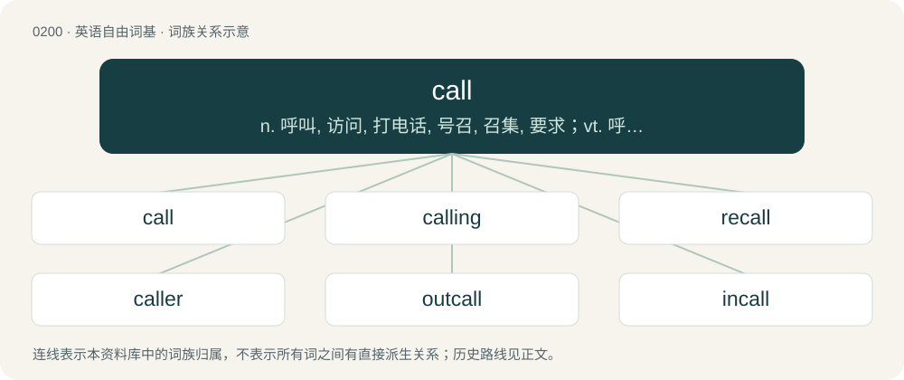

# 0222 · call — n. 呼叫, 访问, 打电话, 号召, 召集, 要求；vt. 呼叫, 召集, 打电话；vi. 叫喊, 访问, 叫牌

[总目录](../00_总目录_按常用程度.md)

**类型**：英语自由词基　｜　**来源语言**：见词源记录

## 核心含义与来源

- 核心含义：n. 呼叫, 访问, 打电话, 号召, 召集, 要求；vt. 呼叫, 召集, 打电话；vi. 叫喊, 访问, 叫牌
- 英文含义：To request, summon, or beckon.
- 词形：call

**来源记录 1**（动词；To request, summon, or beckon.）

From Middle English callen, from Old English ċeallian (“to call, shout”) and Old Norse kalla (“to call; shout; refer to as; name”); both from Proto-Germanic \*kalzōną (“to call, shout”), from Proto-Indo-European \*golH-so- (“voice, cry”), from \*gel(H)- (“to vocalize, call, shout”). Cognates \* Scots call, caw, ca (“to call, cry, shout”) \* Dutch kallen (“to chat, talk”) \* German Low German kallen (“to speak, talk”) \* German kallen (“to call”) \* Swedish kalla (“to call, refer to, beckon”) \* Norwegian kalle (“to call, name”) \* Danish kalde (“to call, name”) \* Icelandic kalla (“to call, shout, name”) \* Welsh galw (“to call, demand”) \* Polish głos (“voice”) \* Lithuanian gal̃sas (“echo”) \* Russian голос (golos, “voice”) \* Albanian gjuhë (“language, tongue”).

## 词族图

## 单词速览（常用到不常用）

| 单词 | 音标 | 释义 |
|---|---|---|
| [call](#w-1) | 英 /kɔːl/；美 /kɔl/ | n. 呼叫, 访问, 打电话, 号召, 召集, 要求；vt. 呼叫, 召集, 打电话；vi. 叫喊, 访问, 叫牌 |
| [calling](#w-2) | 英 /ˈkɔːlɪŋ/；美 /ˈkɔlɪŋ/ | n. 职业, 行业, 呼唤, 召集；\[计\] 呼叫 |
| [recall](#w-3) | 英 /ɹɪˈkɔːl/；美 /ɹɪˈkɔl/ | n. 回忆, 召回, 撤消；vt. 回想, 回忆, 召回, 撤消, 使恢复；\[计\] 检索 |
| [caller](#w-4) | 英 /ˈkɔːlə/；/ˈkɔ.lɚ/ | n. 访客, 召集员, 传唤员；a. 新鲜的；\[计\] 呼叫方标识 |
| [outcall](#w-5) |  | n. 出诊；\[网络\] 电话回访；大众按摩；男店 |
| [incall](#w-6) |  | 【英文】A visit by a client to a provider of some service, such as a massage therapist or a prostitute. |

## 逐词详解

### 1. call

**词性**：动词　｜　**音标**：英 /kɔːl/；美 /kɔl/

**中文释义**：n. 呼叫, 访问, 打电话, 号召, 召集, 要求；vt. 呼叫, 召集, 打电话；vi. 叫喊, 访问, 叫牌

**英文义项**：To request, summon, or beckon. / To cry or shout.

**词源与演化**：

From Middle English callen, from Old English ċeallian (“to call, shout”) and Old Norse kalla (“to call; shout; refer to as; name”); both from Proto-Germanic \*kalzōną (“to call, shout”), from Proto-Indo-European \*golH-so- (“voice, cry”), from \*gel(H)- (“to vocalize, call, shout”). Cognates \* Scots call, caw, ca (“to call, cry, shout”) \* Dutch kallen (“to chat, talk”) \* German Low German kallen (“to speak, talk”) \* German kallen (“to call”) \* Swedish kalla (“to call, refer to, beckon”) \* Norwegian kalle (“to call, name”) \* Danish kalde (“to call, name”) \* Icelandic kalla (“to call, shout, name”) \* Welsh galw (“to call, demand”) \* Polish głos (“voice”) \* Lithuanian gal̃sas (“echo”) \* Russian голос (golos, “voice”) \* Albanian gjuhë (“language, tongue”).

**例句**：

> I bet $800 and Jane raised to $1600. My options: call (match her $1600 bet), reraise, or fold.

该用例对应义项：To equal the same amount that other players are currently betting.

### 2. calling

**词性**：名词　｜　**音标**：英 /ˈkɔːlɪŋ/；美 /ˈkɔlɪŋ/

**中文释义**：n. 职业, 行业, 呼唤, 召集；\[计\] 呼叫

**英文义项**：A strong urge (to do some particular thing with or in one's life, for example to become religious, to help the poor, or to be an entertainer). / A job or occupation.

**构词拆分**：call + -ing

**词源与演化**：

From Middle English calling, callynge, equivalent to call + -ing.

**例句**：

> In the distance I hear a muezzin calling the faithful to prayer.

### 3. recall

**词性**：动词　｜　**音标**：英 /ɹɪˈkɔːl/；美 /ɹɪˈkɔl/

**中文释义**：n. 回忆, 召回, 撤消；vt. 回想, 回忆, 召回, 撤消, 使恢复；\[计\] 检索

**英文义项**：To withdraw, retract (one's words etc.); to revoke (an order). / To call back, bring back, or summon (someone) to a specific place, station, etc.

**构词拆分**：re- + call

**词源与演化**：

From re- + call, probably modelled on Latin revocāre, French rappeler, English withcall.

**例句**：

> He was recalled to service after his retirement.

该用例对应义项：To call back, bring back, or summon (someone) to a specific place, station, etc.

### 4. caller

**词性**：名词　｜　**音标**：英 /ˈkɔːlə/；/ˈkɔ.lɚ/

**中文释义**：n. 访客, 召集员, 传唤员；a. 新鲜的；\[计\] 呼叫方标识

**英文义项**：The person who makes a telephone call. / A visitor.

**构词拆分**：call + -er

**词源与演化**：

From Middle English callar, equivalent to call + -er.

**例句**：

> If the called function throws an exception, the caller should be prepared to handle the error.

该用例对应义项：A function that calls another (the callee).

### 5. outcall

**词性**：名词

**中文释义**：n. 出诊；\[网络\] 电话回访；大众按摩；男店

**英文义项**：A visit by a provider of some service, such as a massage therapist or a prostitute, to a client.

**构词拆分**：out- + call

**词源与演化**：

From out- + call.

### 6. incall

**词性**：名词

**英文义项**：A visit by a client to a provider of some service, such as a massage therapist or a prostitute.

**构词拆分**：in- + call

**词源与演化**：

From in- + call.
