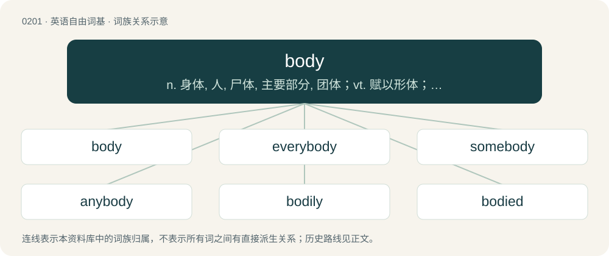

# 0223 · body — n. 身体, 人, 尸体, 主要部分, 团体；vt. 赋以形体；\[计\] 体

[总目录](../00_总目录_按常用程度.md)

**类型**：英语自由词基　｜　**来源语言**：见词源记录

## 核心含义与来源

- 核心含义：n. 身体, 人, 尸体, 主要部分, 团体；vt. 赋以形体；\[计\] 体
- 英文含义：The physical structure of a human or animal seen as one single organism.
- 词形：body

**来源记录 1**（名词；The physical structure of a human or animal seen as one single organism.）

From Middle English body, bodi, bodiȝ, from Old English bodiġ, bodeġ (“body, trunk, chest, torso, height, stature”), from Proto-West Germanic \*bodag (“body, trunk”), from Proto-Indo-European \*bʰewdʰ- (“to be awake, observe”). Cognate with Old High German botah (“body, corpse, trunk, torso”) (whence Swabian Bottich (“body, torso”), Bavarian Bottich (“body, torso, carcass; lower part of a shirt or jacket”)).

## 词族图

## 单词速览（常用到不常用）

| 单词 | 音标 | 释义 |
|---|---|---|
| [body](#w-1) | 英 /ˈbɒdi/；美 /ˈbɑdi/ | n. 身体, 人, 尸体, 主要部分, 团体；vt. 赋以形体；\[计\] 体 |
| [everybody](#w-2) | 英 /ˈɛv.ɹi.bɒ.di/；美 /ˈɛv.ɹiˌbɑdi/ | pron. 每个人, 人人 |
| [somebody](#w-3) | 英 /ˈsʌmbˌɒdi/；美 /ˈsʌmˌbədi/ | n. 了不起的人, 大人物；pron. 有人, 某人 |
| [anybody](#w-4) | 英 /ˈɛn.i.bɒd.i/；美 /ˈɛn.i.bə.di/ | pron. 任何人；n. 重要人物 |
| [bodily](#w-5) | 英 /ˈbɒdɪli/；美 /ˈbɑdɪli/ | a. 身体的；adv. 亲自 |
| [bodied](#w-6) | 美 /ˈbɑdid/ | a. 有形的；有躯体的 |
| [antibody](#w-7) | 英 /ˈæn.tiˌbɒd.i/；美 /ˈæn.tɪˌbɑ.di/ | n. 抗体；\[化\] 抗体 |
| [bodyguard](#w-8) | 英 /ˈbɒdiɡɑːd/；美 /ˈbɑːdiɡɑːɹd/ | n. 保镖, 护卫 |
| [embody](#w-9) | 英 /ɪmˈbɒdi/；美 /ɪmˈbɑdi/ | vt. 具体表达, 使具体化；\[经\] 合并, 具体化, 具体表现 |
| [bodybuilding](#w-10) | 英 /ˈbɒ.diˌbɪl.dɪŋ/；美 /ˈbɑ.diˌbɪl.dɪŋ/ | n. 健美 |
| [bodybuilder](#w-11) | 英 /ˈbɒ.diˌbɪl.də/；美 /ˈbɑ.diˌbɪl.dəɹ/ | n. 健美运动者；锻炼肌肉者 |
| [bodywork](#w-12) | /ˈbɒdiwəːk/ | n. 车身 |
| [bodyweight](#w-13) |  | 体重 |
| [bodysuit](#w-14) | /ˈbɒdisuːt/ | n. 紧身衣裤 |
| [crossbody](#w-15) |  | 【英文】Of a bag or belt etc., worn diagonally across the body. |
| [unibody](#w-16) | /ˈjuːniˈbɔdi/ | 单片式汽车车身, 单片式车身的汽车 |
| [homebody](#w-17) | /ˈhəumbɒdi/ | n. 重视家庭生活的人, 喜欢在家消遣的男人 |
| [busybody](#w-18) | /ˈbizibɒdi/ | n. 爱管闲事的人, 好事的人 |

## 逐词详解

### 1. body

**词性**：名词　｜　**音标**：英 /ˈbɒdi/；美 /ˈbɑdi/

**中文释义**：n. 身体, 人, 尸体, 主要部分, 团体；vt. 赋以形体；\[计\] 体

**英文义项**：The physical structure of a human or animal seen as one single organism. / The fleshly or corporeal nature of a human, as opposed to the spirit or soul.

**词源与演化**：

From Middle English body, bodi, bodiȝ, from Old English bodiġ, bodeġ (“body, trunk, chest, torso, height, stature”), from Proto-West Germanic \*bodag (“body, trunk”), from Proto-Indo-European \*bʰewdʰ- (“to be awake, observe”). Cognate with Old High German botah (“body, corpse, trunk, torso”) (whence Swabian Bottich (“body, torso”), Bavarian Bottich (“body, torso, carcass; lower part of a shirt or jacket”)).

**例句**：

> The bumpers and front tyres were ruined, but the body of the car was in remarkable shape.

该用例对应义项：The largest or most important part of anything, as distinct from its appendages or accessories; (of vehicles, sometimes) the outer shell (as contrasted with the frame and powertrain).

### 2. everybody

**词性**：代词　｜　**音标**：英 /ˈɛv.ɹi.bɒ.di/；美 /ˈɛv.ɹiˌbɑdi/

**中文释义**：pron. 每个人, 人人

**英文义项**：Every individual in a set; all people.

**构词拆分**：every + body

**词源与演化**：

From every + body.

**例句**：

> Does everybody have their ticket(s) at hand?

该用例对应义项：Every individual in a set; all people.

### 3. somebody

**词性**：名词　｜　**音标**：英 /ˈsʌmbˌɒdi/；美 /ˈsʌmˌbədi/

**中文释义**：n. 了不起的人, 大人物；pron. 有人, 某人

**英文义项**：Any person. / A recognised or important person, a celebrity.

**构词拆分**：some + body

**词源与演化**：

From Middle English sum body, equivalent to some + body.

**例句**：

> I'm tired of being a nobody – I want to be a somebody.

该用例对应义项：A recognised or important person, a celebrity.

### 4. anybody

**词性**：代词　｜　**音标**：英 /ˈɛn.i.bɒd.i/；美 /ˈɛn.i.bə.di/

**中文释义**：pron. 任何人；n. 重要人物

**英文义项**：Any one out of an indefinite number of persons; anyone; any person. / A person of some consideration or standing.

**构词拆分**：By surface analysis, any + body

**词源与演化**：

From Middle English ani-bodi, anybodi, eny body. By surface analysis, any + body.

**例句**：

> Everybody who wants to be anybody will come to Jake's party.

该用例对应义项：A person of some consideration or standing.

### 5. bodily

**词性**：形容词　｜　**音标**：英 /ˈbɒdɪli/；美 /ˈbɑdɪli/

**中文释义**：a. 身体的；adv. 亲自

**英文义项**：Of, relating to, or concerning the body. / Having a body or material form; physical; corporeal.

**构词拆分**：body + -ly

**词源与演化**：

From Middle English bodily; equivalent to body + -ly.

**例句**：

> His bodily deficiencies were a heavy burden to him.

该用例对应义项：Of, relating to, or concerning the body.

### 6. bodied

**词性**：形容词　｜　**音标**：美 /ˈbɑdid/

**中文释义**：a. 有形的；有躯体的

**英文义项**：Having a specified form of body. / Having a bodily form; corporeal or incarnate.

**构词拆分**：body + -ed

**词源与演化**：

From body + -ed.

**例句**：

> The earliest form of ownership is an ownership of the women by the able bodied men of the community.

### 7. antibody

**词性**：名词　｜　**音标**：英 /ˈæn.tiˌbɒd.i/；美 /ˈæn.tɪˌbɑ.di/

**中文释义**：n. 抗体；\[化\] 抗体

**英文义项**：A protein produced by B-lymphocytes that binds to a specific antigen.

**构词拆分**：anti- + body

**词源与演化**：

From anti- + body, a calque of German Antikörper.

**例句**：

> Rodrigo tried to get an antibody from the bat.

### 8. bodyguard

**词性**：名词　｜　**音标**：英 /ˈbɒdiɡɑːd/；美 /ˈbɑːdiɡɑːɹd/

**中文释义**：n. 保镖, 护卫

**英文义项**：A person or group of persons, often armed, responsible for protecting someone.

**构词拆分**：body + guard

**词源与演化**：

From body + guard.

**例句**：

> I was the one who suggested that Tom hire a bodyguard.

### 9. embody

**词性**：动词　｜　**音标**：英 /ɪmˈbɒdi/；美 /ɪmˈbɑdi/

**中文释义**：vt. 具体表达, 使具体化；\[经\] 合并, 具体化, 具体表现

**英文义项**：To represent in a physical or concrete form; to incarnate or personify. / To represent in some other form, such as a code of laws.

**构词拆分**：em- + body

**词源与演化**：

From em- + body.

**例句**：

> The US Constitution aimed to embody the ideals of diverse groups of people, from Puritans to Deists.

该用例对应义项：To represent in some other form, such as a code of laws.

### 10. bodybuilding

**词性**：名词　｜　**音标**：英 /ˈbɒ.diˌbɪl.dɪŋ/；美 /ˈbɑ.diˌbɪl.dɪŋ/

**中文释义**：n. 健美

**英文义项**：A sport in which the aesthetics of muscular development is the basis for competition. / Work done to construct or repair the body of an automobile.

**构词拆分**：body + building

**词源与演化**：

From body + building.

**例句**：

> Bodybuilding is his hobby so he has a very firm tight body with lots of muscle definition.

### 11. bodybuilder

**词性**：名词　｜　**音标**：英 /ˈbɒ.diˌbɪl.də/；美 /ˈbɑ.diˌbɪl.dəɹ/

**中文释义**：n. 健美运动者；锻炼肌肉者

**英文义项**：A person who uses diet and exercise to build an aesthetically muscular physique, in order to compete in bodybuilding.

**构词拆分**：body + builder

**词源与演化**：

From body + builder.

**例句**：

> It was obvious that the muscle-bound bodybuilder had been taking steroids.

### 12. bodywork

**词性**：名词　｜　**音标**：/ˈbɒdiwəːk/

**中文释义**：n. 车身

**英文义项**：The exterior body of a motor vehicle. / The repair of such a body.

**构词拆分**：body + work

**词源与演化**：

From body + work.

**例句**：

> There's a lot of bodywork still left to be done.

该用例对应义项：The repair of such a body.

### 13. bodyweight

**词性**：形容词

**中文释义**：体重

**英文义项**：Employing (only) a person's own weight as resistance to movement for the purpose of physical exercise.

**构词拆分**：body + weight

**词源与演化**：

From body + weight.

**例句**：

> Without access to a gym, Steve focused on bodyweight work.

该用例对应义项：Employing (only) a person's own weight as resistance to movement for the purpose of physical exercise.

### 14. bodysuit

**词性**：名词　｜　**音标**：/ˈbɒdisuːt/

**中文释义**：n. 紧身衣裤

**英文义项**：A one-piece, skin-tight garment rather like a leotard.

**构词拆分**：body + suit

**词源与演化**：

From body + suit.

### 15. crossbody

**词性**：形容词

**英文义项**：Of a bag or belt etc., worn diagonally across the body.

**构词拆分**：cross- + body

**词源与演化**：

From cross- + body.

**用法示例／搭配（非完整句）**：

> crossbody bag

该用例对应义项：Of a bag or belt etc., worn diagonally across the body.

### 16. unibody

**词性**：名词　｜　**音标**：/ˈjuːniˈbɔdi/

**中文释义**：单片式汽车车身, 单片式车身的汽车

**英文义项**：An automobile construction technique in which the body is integrated into a single unit with the chassis rather than having a separate body-on-frame. / A body of this type.

**构词拆分**：uni- + body

**词源与演化**：

From uni- + body.

### 17. homebody

**词性**：名词　｜　**音标**：/ˈhəumbɒdi/

**中文释义**：n. 重视家庭生活的人, 喜欢在家消遣的男人

**英文义项**：A person who prefers to remain at home, rather than participate in social events elsewhere.

**构词拆分**：home + body

**词源与演化**：

From home + body.

**例句**：

> Although my uncle likes to travel, my aunt is a homebody, so he usually comes with us while she stays home with her cats.

该用例对应义项：A person who prefers to remain at home, rather than participate in social events elsewhere.

### 18. busybody

**词性**：名词　｜　**音标**：/ˈbizibɒdi/

**中文释义**：n. 爱管闲事的人, 好事的人

**英文义项**：Someone who interferes with others; one who is nosy, intrusive or meddlesome. / A device consisting of three mirrors that, when attached to the wall of a house, allows an occupant to see who is at the front door without a direct line of sight.

**构词拆分**：busy + body

**词源与演化**：

From busy + body.

**例句**：

> Tom told his busybody neighbour to get a life and to get his nose out of everyone's business.
