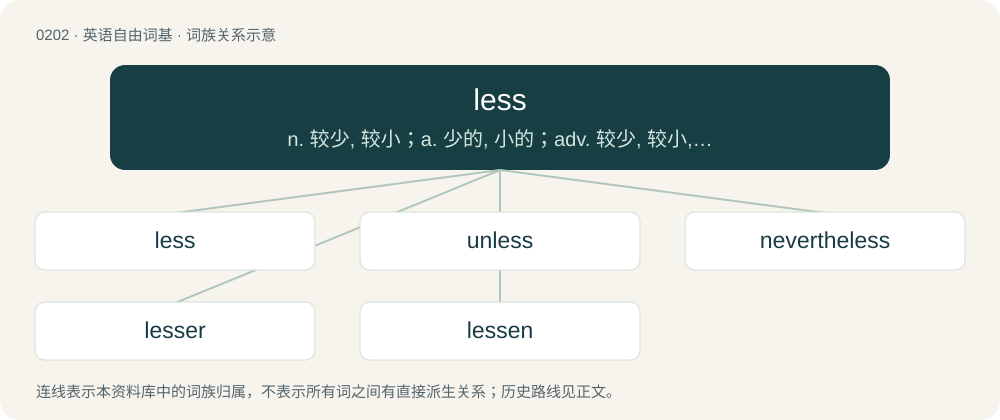

# 0224 · less — n. 较少, 较小；a. 少的, 小的；adv. 较少, 较小, 较差

[总目录](../00_总目录_按常用程度.md)

**类型**：英语自由词基　｜　**来源语言**：见词源记录

## 核心含义与来源

- 核心含义：n. 较少, 较小；a. 少的, 小的；adv. 较少, 较小, 较差
- 英文含义：Used for constructing syntactic diminutive comparatives of adjectives and adverbs.
- 词形：less

**来源记录 1**（副词；Used for constructing syntactic diminutive comparatives of adjectives and adverbs.）

Adverb From Middle English les, lesse, leasse, lasse, from Old English lǣs (“smaller, less”), from Proto-Germanic \*laisiz, from Proto-Indo-European \*leys- (“to shrink, grow thin, be gentle”). Cognate with Old Frisian lēs (“less”), Old Saxon lēs (“less”). According to Kroonen (2013), from a northern Indo-European root Proto-Indo-European \*leh₂is- or \*leh₃is-, which he connects to Lithuanian liesas (“lean”). Determiner and preposition from Middle English lees, lesse, leasse, lasse, from Old English lǣssa (“less”), from Proto-Germanic \*laisizan-, from Proto-Germanic \*laisiz (“smaller, lesser, fewer, lower”) (see above). Cognate with Old Frisian lessa (“less”). Verb from Middle English lessen, from the determiner. Noun from Middle English lesse, from the determiner.

## 词族图

## 单词速览（常用到不常用）

| 单词 | 音标 | 释义 |
|---|---|---|
| [less](#w-1) | /lɛs/ | n. 较少, 较小；a. 少的, 小的；adv. 较少, 较小, 较差 |
| [unless](#w-2) | /ənˈlɛs/ | conj. 除非；prep. 除...之外 |
| [nevertheless](#w-3) | 英 /ˌnɛvəðəˈlɛs/；美 /ˌnɛvɚðəˈlɛs/ | adv. 然而, 虽然如此；conj. 然而 |
| [lesser](#w-4) | 英 /ˈlɛsə/；美 /ˈlɛsɚ/ | a. 较少的, 较小的, 次要的 |
| [lessen](#w-5) | 英 /ˈlɛsən/ | vt. 减少, 缩小, 减轻；vi. 变小 |

## 逐词详解

### 1. less

**词性**：名词　｜　**音标**：/lɛs/

**中文释义**：n. 较少, 较小；a. 少的, 小的；adv. 较少, 较小, 较差

**英文义项**：A smaller amount or quantity.

**词源与演化**：

Adverb From Middle English les, lesse, leasse, lasse, from Old English lǣs (“smaller, less”), from Proto-Germanic \*laisiz, from Proto-Indo-European \*leys- (“to shrink, grow thin, be gentle”). Cognate with Old Frisian lēs (“less”), Old Saxon lēs (“less”). According to Kroonen (2013), from a northern Indo-European root Proto-Indo-European \*leh₂is- or \*leh₃is-, which he connects to Lithuanian liesas (“lean”). Determiner and preposition from Middle English lees, lesse, leasse, lasse, from Old English lǣssa (“less”), from Proto-Germanic \*laisizan-, from Proto-Germanic \*laisiz (“smaller, lesser, fewer, lower”) (see above). Cognate with Old Frisian lessa (“less”). Verb from Middle English lessen, from the determiner. Noun from Middle English lesse, from the determiner.

**例句**：

> Last month less of my salary was taken up with household expenses.

该用例对应义项：A smaller amount or quantity.

### 2. unless

**词性**：连词　｜　**音标**：/ənˈlɛs/

**中文释义**：conj. 除非；prep. 除...之外

**英文义项**：Except on a specified condition; if not. / If not; used with counterfactual conditionals.

**构词拆分**：of + on + upon + in + un- + less

**词源与演化**：

From Middle English unlesse, earlier on lesse (modern on + less), from (not) on lesse (than) (“(not) on a less compelling condition (than)”). The quality of negation in the word and the lack of stress changed on to un-.

**例句**：

> Unless part of the staff, you are not allowed beyond this point.

该用例对应义项：Except on a specified condition; if not.

### 3. nevertheless

**词性**：副词　｜　**音标**：英 /ˌnɛvəðəˈlɛs/；美 /ˌnɛvɚðəˈlɛs/

**中文释义**：adv. 然而, 虽然如此；conj. 然而

**英文义项**：In spite of what preceded; yet.

**构词拆分**：By surface analysis, never (“not at all”) + the + less

**词源与演化**：

From Middle English nevertheles, never-þe-les, nevere-þe-lesse. By surface analysis, never (“not at all”) + the + less; compare never the wiser.

**例句**：

> It's just five in the morning, but nevertheless it is light out.

### 4. lesser

**词性**：形容词　｜　**音标**：英 /ˈlɛsə/；美 /ˈlɛsɚ/

**中文释义**：a. 较少的, 较小的, 次要的

**英文义项**：Of two (or, rarely, more than two) things: the smaller in size (littler), in value, in importance etc.

**构词拆分**：From less + -er.

**词源与演化**：

From less + -er.

**例句**：

> The larger Sand Hill Cranes increasingly do not migrate, but almost all lesser ones do.

该用例对应义项：that which is of lesser size, quality, degree, or significance; of lower status, importance, or rank

### 5. lessen

**词性**：动词　｜　**音标**：英 /ˈlɛsən/

**中文释义**：vt. 减少, 缩小, 减轻；vi. 变小

**英文义项**：To make less; to diminish; to reduce. / To become less.

**构词拆分**：less + -en (verbal suffix)

**词源与演化**：

From Middle English lessenen, lasnen, equivalent to less + -en (verbal suffix).

**例句**：

> Sami agreed to testify against Layla in order to lessen his sentence.
