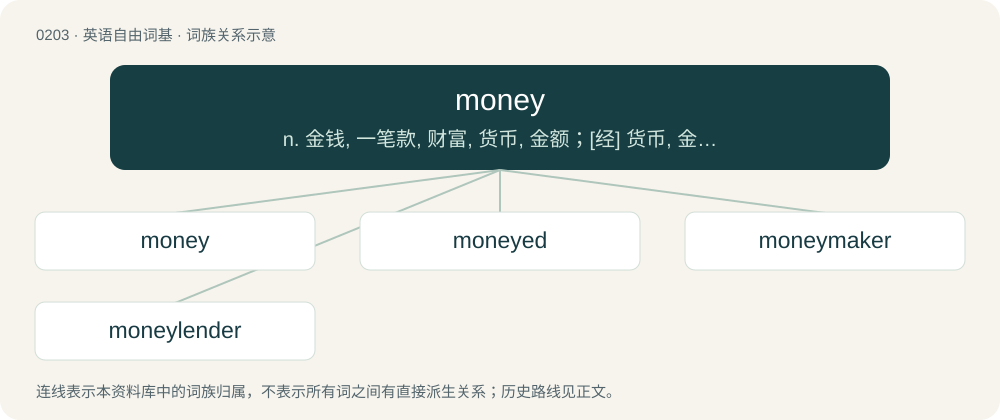

# 0225 · money — n. 金钱, 一笔款, 财富, 货币, 金额；\[经\] 货币, 金钱, 财产

[总目录](../00_总目录_按常用程度.md)

**类型**：英语自由词基　｜　**来源语言**：见词源记录

## 核心含义与来源

- 核心含义：n. 金钱, 一笔款, 财富, 货币, 金额；\[经\] 货币, 金钱, 财产
- 英文含义：A generally accepted means of exchange.
- 词形：money

**来源记录 1**（名词；A generally accepted means of exchange.）

From Middle English moneye, moneie, money, borrowed from Anglo-Norman muneie (“money”), from Latin monēta (“money, a place for coining money, coin, mint”), from the name of the temple of Juno Moneta in Rome, where a mint was. In this sense, displaced native Old English feoh, whence English fee. Doublet of mint, ultimately from the same Latin word but through Germanic and Old English, and of manat, through Russian and Azerbaijani or Turkmen.

## 词族图

## 单词速览（常用到不常用）

| 单词 | 音标 | 释义 |
|---|---|---|
| [money](#w-1) | 英 /ˈmʌn.i/；美 /ˈmʌn.i/ | n. 金钱, 一笔款, 财富, 货币, 金额；\[经\] 货币, 金钱, 财产 |
| [moneyed](#w-2) | /ˈmʌniːd/ | a. 有钱的；\[法\] 金钱上的, 有钱的, 富有的 |
| [moneymaker](#w-3) | 英 /ˈmʌniˌmeɪkə/；美 /ˈmʌniˌmeɪkɚ/ | n. 很会赚钱的人 |
| [moneylender](#w-4) | /ˈmʌni.lendə/ | n. 放债者 |

## 逐词详解

### 1. money

**词性**：名词　｜　**音标**：英 /ˈmʌn.i/；美 /ˈmʌn.i/

**中文释义**：n. 金钱, 一笔款, 财富, 货币, 金额；\[经\] 货币, 金钱, 财产

**英文义项**：A generally accepted means of exchange. / A currency maintained by a state or other entity which can guarantee its value (such as a monetary union).

**词源与演化**：

From Middle English moneye, moneie, money, borrowed from Anglo-Norman muneie (“money”), from Latin monēta (“money, a place for coining money, coin, mint”), from the name of the temple of Juno Moneta in Rome, where a mint was. In this sense, displaced native Old English feoh, whence English fee. Doublet of mint, ultimately from the same Latin word but through Germanic and Old English, and of manat, through Russian and Azerbaijani or Turkmen.

**例句**：

> Before colonial times cowry shells imported from Mauritius were used as money in Western Africa.

该用例对应义项：A generally accepted means of exchange.

### 2. moneyed

**词性**：形容词　｜　**音标**：/ˈmʌniːd/

**中文释义**：a. 有钱的；\[法\] 金钱上的, 有钱的, 富有的

**英文义项**：Affluent, rich. / Paid for; funded

**构词拆分**：money + -ed

**词源与演化**：

From money + -ed.

### 3. moneymaker

**词性**：名词　｜　**音标**：英 /ˈmʌniˌmeɪkə/；美 /ˈmʌniˌmeɪkɚ/

**中文释义**：n. 很会赚钱的人

**英文义项**：Someone or something that earns or makes money; anything lucrative or profitable. / (usually a woman's) butt, ass, rear end

**构词拆分**：money + maker

**词源与演化**：

From Middle English monymaker; equivalent to money + maker.

**例句**：

> With careful management, she hoped to grow her small business into a real moneymaker.

该用例对应义项：Someone or something that earns or makes money; anything lucrative or profitable.

### 4. moneylender

**词性**：名词　｜　**音标**：/ˈmʌni.lendə/

**中文释义**：n. 放债者

**英文义项**：A person who lends money and charges interest, especially one who is not part of the official financial industry.

**构词拆分**：money + lender

**词源与演化**：

From money + lender.
