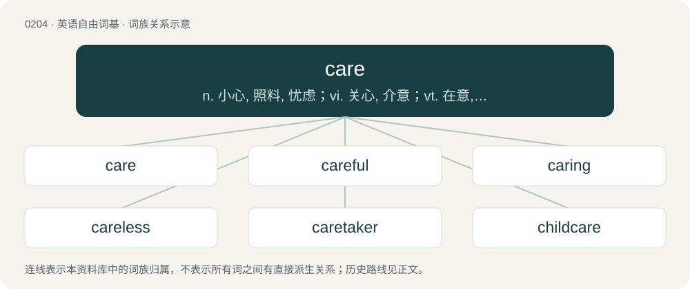

# 0226 · care — n. 小心, 照料, 忧虑；vi. 关心, 介意；vt. 在意, 喜欢

[总目录](../00_总目录_按常用程度.md)

**类型**：英语自由词基　｜　**来源语言**：见词源记录

## 核心含义与来源

- 核心含义：n. 小心, 照料, 忧虑；vi. 关心, 介意；vt. 在意, 喜欢
- 英文含义：Close attention; concern; responsibility.
- 词形：care

**多个词源／构词路径**：同一拼写可能有不同来源；以下按词性和含义分别列出。

**来源记录 1**（名词；Close attention; concern; responsibility.）

From Middle English care, from Old English caru, ċearu (“care, concern, anxiety, sorrow, grief, trouble”), from Proto-West Germanic \*karu, from Proto-Germanic \*karō (“care, sorrow, cry”), from Proto-Indo-European \*ǵeh₂r- (“shout, call”). Cognate with Old Saxon cara, kara (“concern, action”), Middle High German kar (“sorrow, lamentation”), Icelandic kör (“sickbed”), Gothic 𐌺𐌰𐍂𐌰 (kara, “concern, care”). Related also to Dutch karig (“scanty”), German karg (“sparse, meagre, barren”), Latin garriō, Ancient Greek γῆρυς (gêrus). See also chary.

**来源记录 2**（动词；To be concerned (about), to have an interest (in); to feel concern (about).）

From Middle English caren, carien, from Old English carian (“to sorrow, grieve, be troubled, be anxious, to care for, heed”), from Proto-West Germanic \*karōn (“to care”), from Proto-Germanic \*karōną (“to care”). Cognate with Old Saxon karōn (“to lament”), Middle High German karen, karn (“to complain, lament, grieve, mourn”), archaic German karen (“to groan, gasp”), Alemannic German karen, kären (“to groan, gasp”), Swedish kära (“to fall in love”), Icelandic kæra (“to care, like”), Gothic 𐌺𐌰𐍂𐍉𐌽 (karōn, “to be concerned”).

## 词族图

## 单词速览（常用到不常用）

| 单词 | 音标 | 释义 |
|---|---|---|
| [care](#w-1) | 英 /kɛə/；美 /kɛɚ/ | n. 小心, 照料, 忧虑；vi. 关心, 介意；vt. 在意, 喜欢 |
| [careful](#w-2) | 英 /ˈkɛːfl̩/；美 /ˈkɛɹfəl/ | a. 小心的, 谨慎的 |
| [caring](#w-3) | 英 /ˈkɛə.ɹɪŋ/；美 /ˈkɛɹ.ɪŋ/ | a. 有同情心的；表示或感到关怀或关心的 |
| [careless](#w-4) | 英 /ˈkɛəlɪs/；美 /kɛɹ.ləs/ | a. 粗心的, 不关心的, 无忧无虑的 |
| [caretaker](#w-5) | 英 /ˈkɛəˌteɪ.kə/；美 /ˈkɛɹˌteɪ.kɚ/ | n. 照顾者, 看管者, 看守人；\[法\] 看守员, 管理员, 看管人 |
| [childcare](#w-6) | /ˈtʃaildkεə/ | n. 儿童照管；儿童保育 |
| [skincare](#w-7) | 英 /ˈskɪn.kɛə/；美 /ˈskɪn.kɛɹ/ | a. 护理皮肤的 |
| [daycare](#w-8) | 英 /ˈdeɪkeə(ɹ)/ | n. 日托；日间照管儿童 |
| [carefree](#w-9) | 英 /ˈkɛəfɹiː/；美 /ˈkɛɚfɹi/ | a. 无忧无虑的, 不负责的 |
| [caregiver](#w-10) | 英 /ˈkɛəɡɪvə/；美 /ˈkɛɹɡɪvɚ/ | n. 照料者, 护理者 |
| [carer](#w-11) | 英 /ˈkɛəɹə/；美 /ˈkeɹɚ/ | n. 负责照顾（老人, 病人, 小孩）的人 |
| [caregiving](#w-12) | 英 /ˈkeəɡɪvɪŋ/ | 【英文】The provision of care such as assistance with activities of daily living (e.g., feeding, bathing, dressing, transportation, household administration), usually by someone who is not a health care professional, especia |
| [aftercare](#w-13) | 英 /ˈɑːf.tə(ɹ).kɛə(ɹ)/；美 /ˈæf.təɹ.kɛɹ/ | n. 病后的照顾调养, 释放后的安置 |
| [carling](#w-14) | /ˈkɑːliŋ/ | 【英文】A cultivar of field pea or maple pea, dried, soaked, boiled, then fried. |
| [homecare](#w-15) |  | 【英文】The care and maintenance of one's home. |
| [haircare](#w-16) |  | n. 头发的护理 |
| [caretaking](#w-17) | /ˈkeəteɪkɪŋ/ | 看管 |

## 逐词详解

### 1. care

**词性**：名词　｜　**音标**：英 /kɛə/；美 /kɛɚ/

**中文释义**：n. 小心, 照料, 忧虑；vi. 关心, 介意；vt. 在意, 喜欢

**英文义项**：Close attention; concern; responsibility. / Worry.

**词源与演化**：

From Middle English care, from Old English caru, ċearu (“care, concern, anxiety, sorrow, grief, trouble”), from Proto-West Germanic \*karu, from Proto-Germanic \*karō (“care, sorrow, cry”), from Proto-Indo-European \*ǵeh₂r- (“shout, call”). Cognate with Old Saxon cara, kara (“concern, action”), Middle High German kar (“sorrow, lamentation”), Icelandic kör (“sickbed”), Gothic 𐌺𐌰𐍂𐌰 (kara, “concern, care”). Related also to Dutch karig (“scanty”), German karg (“sparse, meagre, barren”), Latin garriō, Ancient Greek γῆρυς (gêrus). See also chary.

**例句**：

> Care should be taken when holding babies.

该用例对应义项：Close attention; concern; responsibility.

### 2. careful

**词性**：形容词　｜　**音标**：英 /ˈkɛːfl̩/；美 /ˈkɛɹfəl/

**中文释义**：a. 小心的, 谨慎的

**英文义项**：Taking care; attentive to potential danger, error or harm; cautious. / Conscientious and painstaking; meticulous.

**构词拆分**：care + -ful

**词源与演化**：

From Middle English careful, from Old English carful; equivalent to care + -ful.

**例句**：

> Be very careful (while) trekking through the jungle.

该用例对应义项：Taking care; attentive to potential danger, error or harm; cautious.

### 3. caring

**词性**：形容词　｜　**音标**：英 /ˈkɛə.ɹɪŋ/；美 /ˈkɛɹ.ɪŋ/

**中文释义**：a. 有同情心的；表示或感到关怀或关心的

**英文义项**：Kind, sensitive, or empathetic.

**构词拆分**：care + -ing

**词源与演化**：

From care + -ing. The adjective follows from the verb.

**例句**：

> She's a very caring person; she always has a kind word for everyone.

该用例对应义项：Kind, sensitive, or empathetic.

### 4. careless

**词性**：形容词　｜　**音标**：英 /ˈkɛəlɪs/；美 /kɛɹ.ləs/

**中文释义**：a. 粗心的, 不关心的, 无忧无虑的

**英文义项**：Not concerned or worried (about). / Not giving sufficient attention or thought, especially concerning the avoidance of harm or mistakes.

**构词拆分**：care + -less

**词源与演化**：

From Middle English careles, from Old English carlēas (“careless, reckless, void of care, free from care, free”), equivalent to care + -less. Cognate with Icelandic kærulaus (“careless, negligent”).

**例句**：

> Jessica was so careless that she put her shorts on backwards.

该用例对应义项：Not giving sufficient attention or thought, especially concerning the avoidance of harm or mistakes.

### 5. caretaker

**词性**：名词　｜　**音标**：英 /ˈkɛəˌteɪ.kə/；美 /ˈkɛɹˌteɪ.kɚ/

**中文释义**：n. 照顾者, 看管者, 看守人；\[法\] 看守员, 管理员, 看管人

**英文义项**：Someone who takes care of a place or thing; someone looking after a place, or responsible for keeping it in good repair. / Synonym of caregiver (“a person who provides care to another”).

**构词拆分**：care + taker

**词源与演化**：

From care + taker.

**例句**：

> Her dad was a cemetery caretaker for many years. There was a lot of landscaping work. The gravedigging itself was done with backhoes.

该用例对应义项：Someone who takes care of a place or thing; someone looking after a place, or responsible for keeping it in good repair.

### 6. childcare

**词性**：名词　｜　**音标**：/ˈtʃaildkεə/

**中文释义**：n. 儿童照管；儿童保育

**英文义项**：The act, practice, or occupation of supervising and taking care of young children. / A place where young children are supervised while away from their parents or guardians.

**构词拆分**：child + care

**词源与演化**：

From child + care.

**例句**：

> Only a handful of men want to take childcare leave.

### 7. skincare

**词性**：名词　｜　**音标**：英 /ˈskɪn.kɛə/；美 /ˈskɪn.kɛɹ/

**中文释义**：a. 护理皮肤的

**英文义项**：The care and treatment of the skin, especially of the face.

**构词拆分**：skin + care

**词源与演化**：

From skin + care.

**例句**：

> The saleswoman told her that her face would look older unless she bought this line of skincare products.

该用例对应义项：The care and treatment of the skin, especially of the face.

### 8. daycare

**词性**：名词　｜　**音标**：英 /ˈdeɪkeə(ɹ)/

**中文释义**：n. 日托；日间照管儿童

**英文义项**：Daytime supervision, usually of children or pets. / A daycare centre.

**构词拆分**：day + care

**词源与演化**：

From day + care.

**例句**：

> Sami was so excited for his kids to go to that daycare.

### 9. carefree

**词性**：形容词　｜　**音标**：英 /ˈkɛəfɹiː/；美 /ˈkɛɚfɹi/

**中文释义**：a. 无忧无虑的, 不负责的

**英文义项**：Without cares or worries; free of concern or worries; without difficulty.

**构词拆分**：care + -free

**词源与演化**：

From care + -free.

**例句**：

> He left his cell phone behind and enjoyed a carefree summer day at the beach.

该用例对应义项：Without cares or worries; free of concern or worries; without difficulty.

### 10. caregiver

**词性**：名词　｜　**音标**：英 /ˈkɛəɡɪvə/；美 /ˈkɛɹɡɪvɚ/

**中文释义**：n. 照料者, 护理者

**英文义项**：A carer; a person who looks after another person.

**构词拆分**：care + giver

**词源与演化**：

From care + giver.

**例句**：

> Ziri was separated from his caregiver at a very young age.

### 11. carer

**词性**：名词　｜　**音标**：英 /ˈkɛəɹə/；美 /ˈkeɹɚ/

**中文释义**：n. 负责照顾（老人, 病人, 小孩）的人

**英文义项**：Someone who regularly looks after another person, either as a job or often through family responsibilities.

**构词拆分**：care + -er

**词源与演化**：

From care + -er.

**例句**：

> They retired early to be a full-time carer for their partner.

该用例对应义项：Someone who regularly looks after another person, either as a job or often through family responsibilities.

### 12. caregiving

**词性**：名词　｜　**音标**：英 /ˈkeəɡɪvɪŋ/

**英文义项**：The provision of care such as assistance with activities of daily living (e.g., feeding, bathing, dressing, transportation, household administration), usually by someone who is not a health care professional, especially by a family member as unpaid labor. / The provision of health care services as a paid occupation.

**构词拆分**：care + giving

**词源与演化**：

From care + giving.

**例句**：

> The macho society discourages men from engaging in nurturing and caregiving roles.

### 13. aftercare

**词性**：名词　｜　**音标**：英 /ˈɑːf.tə(ɹ).kɛə(ɹ)/；美 /ˈæf.təɹ.kɛɹ/

**中文释义**：n. 病后的照顾调养, 释放后的安置

**英文义项**：The care given to a patient during recovery from an operation or after hospitalization. / Services and support offered to a customer for the goods or service they have purchased.

**构词拆分**：after- + care

**词源与演化**：

From after- + care.

**例句**：

> Aftercare involves providing comfort and support to partners after a scene.

### 14. carling

**词性**：名词　｜　**音标**：/ˈkɑːliŋ/

**英文义项**：A cultivar of field pea or maple pea, dried, soaked, boiled, then fried.

**构词拆分**：care + -ling

**词源与演化**：

From care + -ling (synchronically), being connected to the custom of serving these peas to the poor on Care Sunday, called also Carling Sunday after the peas.

### 15. homecare

**词性**：名词

**英文义项**：The care and maintenance of one's home. / Treatment of a patient at his or her own home.

**构词拆分**：home + care

**词源与演化**：

From home + care.

### 16. haircare

**词性**：名词

**中文释义**：n. 头发的护理

**英文义项**：The care and treatment of the hair.

**构词拆分**：hair + care

**词源与演化**：

From hair + care.

**例句**：

> The oldest haircare tool is the comb, invented more than 5000 years ago in Persia.

### 17. caretaking

**词性**：名词　｜　**音标**：/ˈkeəteɪkɪŋ/

**中文释义**：看管

**英文义项**：The act of taking care or taking charge of something. / Caregiving.

**构词拆分**：care + taking

**词源与演化**：

From care + taking.

**例句**：

> Caretaking of the extensive grounds is a major expense for the museum foundation.

该用例对应义项：The act of taking care or taking charge of something.
