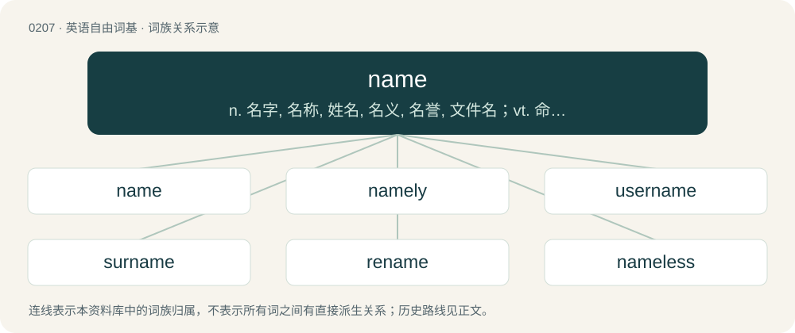

# 0230 · name — n. 名字, 名称, 姓名, 名义, 名誉, 文件名；vt. 命名, 称呼, 任命, 提名, 列举；a. 姓名的, 据以取名的

[总目录](../00_总目录_按常用程度.md)

**类型**：英语自由词基　｜　**来源语言**：见词源记录

## 核心含义与来源

- 核心含义：n. 名字, 名称, 姓名, 名义, 名誉, 文件名；vt. 命名, 称呼, 任命, 提名, 列举；a. 姓名的, 据以取名的
- 英文含义：Any nounal word or phrase which indicates a particular person, place, class, or thing.
- 词形：name

**多个词源／构词路径**：同一拼写可能有不同来源；以下按词性和含义分别列出。

**来源记录 1**（名词；Any nounal word or phrase which indicates a particular person, place, class, or thing.）

From Middle English name, nome, from Old English nama, noma, from Proto-West Germanic \*namō, from Proto-Germanic \*namô (“name”), from Proto-Indo-European \*h₁nómn̥ (“name”). Cognates Germanic Cognates: Yola naame, name, naume (“name”), North Frisian Naam, neem, noome, nööm (“name”), Saterland Frisian Nome, Noome (“name”), West Frisian namme (“name”), Alemannic German Naame, namä, noame, nomu, nàmund (“name”), Cimbrian naamo, name, nåm (“name”), Dutch naam, name (“name”), German Nahme, Name (“name”), German Low German Naam (“name”), Luxembourgish Numm (“name”), Mòcheno nu'm (“name”), Vilamovian noma (“name”), Yiddish נאָמען (nomen, “name”), Danish, Faroese and Norwegian Bokmål navn (“name”), Icelandic nafn (“name”), Norwegian Nynorsk nabn, namn (“name”), Swedish namn (“name”), Gothic 𐌽𐌰𐌼𐍉 (namō, “name”). Indo-European Cognates: Latin nōmen (“name”) (whence Spanish nombre (“name”)), Russian имя (imja, “name”), Ashkun nām (“name”), Kamkata-viri nom, num (“name”), Prasuni nom, nëmë (“name”), Waigali nām (“name”), Sanskrit नामन् (nā́man, “name”). Possible cognates outside of Indo-European include Finnish nimi (“name”) and Hungarian név (“name”). Doublet of nomen, noun, and -onym. False cognate of Japanese 名前 (namae).

**来源记录 2**（动词；To give a name to.）

From Middle English namen, from Old English namian (“to name, mention”) and ġenamian (“to name, call, appoint”), from Proto-West Germanic \*namōn (“to name”). Cognate with West Frisian neame (“to name; to mention”). Compare also Old English nemnan, nemnian (“to name, give a name to a person or thing”).

**来源记录 3**（名词；Any of several types of true yam (Dioscorea) used in Caribbean Spanish cooking.）

Borrowed from Spanish ñame, substituting n for the unfamiliar Spanish letter ñ. Doublet of yam.

## 词族图

## 单词速览（常用到不常用）

| 单词 | 音标 | 释义 |
|---|---|---|
| [name](#w-1) | 英 /neɪm/ | n. 名字, 名称, 姓名, 名义, 名誉, 文件名；vt. 命名, 称呼, 任命, 提名, 列举；a. 姓名的, 据以取名的 |
| [namely](#w-2) | /ˈneɪmli/ | adv. 即, 就是, 换句话说 |
| [username](#w-3) |  | n. \[计\]由字母或数字组成的用户名称, 以标明用户的身份 |
| [surname](#w-4) | 英 /ˈsɜːˌneɪm/；美 /ˈsɝˌneɪm/ | n. 姓, 别号, 绰号；vt. 呼以姓氏, 起绰号 |
| [rename](#w-5) | /ɹiːˈneɪm/ | vt. 重新命名, 再命名, 给...改名；\[计\] 重命名; DOS内部命令:更改文件名 |
| [nameless](#w-6) | /ˈneimlis/ | a. 无名的, 匿名的, 不可名状的 |
| [namesake](#w-7) | /ˈneɪmseɪk/ | n. 同名人, 同名物 |
| [filename](#w-8) | 美 /ˈfaɪ.əl.neɪm/ | n. 文件名；\[计\] 文件名 |
| [codename](#w-9) |  | n. 研发代码；代号 |
| [namespace](#w-10) | /ˈneɪmspeɪs/ | n. \[计\]命名空间 |
| [nameplate](#w-11) | /ˈneimpleit/ | n. 名牌, 标示牌 |
| [nametag](#w-12) | /ˈneim,tæɡ/ | n. 名牌；用户标签 |
| [hostname](#w-13) |  | \[计\] 主机名 |

## 逐词详解

### 1. name

**词性**：名词　｜　**音标**：英 /neɪm/

**中文释义**：n. 名字, 名称, 姓名, 名义, 名誉, 文件名；vt. 命名, 称呼, 任命, 提名, 列举；a. 姓名的, 据以取名的

**英文义项**：Any nounal word or phrase which indicates a particular person, place, class, or thing. / A reputation.

**词源与演化**：

From Middle English name, nome, from Old English nama, noma, from Proto-West Germanic \*namō, from Proto-Germanic \*namô (“name”), from Proto-Indo-European \*h₁nómn̥ (“name”). Cognates Germanic Cognates: Yola naame, name, naume (“name”), North Frisian Naam, neem, noome, nööm (“name”), Saterland Frisian Nome, Noome (“name”), West Frisian namme (“name”), Alemannic German Naame, namä, noame, nomu, nàmund (“name”), Cimbrian naamo, name, nåm (“name”), Dutch naam, name (“name”), German Nahme, Name (“name”), German Low German Naam (“name”), Luxembourgish Numm (“name”), Mòcheno nu'm (“name”), Vilamovian noma (“name”), Yiddish נאָמען (nomen, “name”), Danish, Faroese and Norwegian Bokmål navn (“name”), Icelandic nafn (“name”), Norwegian Nynorsk nabn, namn (“name”), Swedish namn (“name”), Gothic 𐌽𐌰𐌼𐍉 (namō, “name”). Indo-European Cognates: Latin nōmen (“name”) (whence Spanish nombre (“name”)), Russian имя (imja, “name”), Ashkun nām (“name”), Kamkata-viri nom, num (“name”), Prasuni nom, nëmë (“name”), Waigali nām (“name”), Sanskrit नामन् (nā́man, “name”). Possible cognates outside of Indo-European include Finnish nimi (“name”) and Hungarian név (“name”). Doublet of nomen, noun, and -onym. False cognate of Japanese 名前 (namae).

**例句**：

> I've never liked the name my parents gave me so I changed it at the age of twenty.

该用例对应义项：Any nounal word or phrase which indicates a particular person, place, class, or thing.

### 2. namely

**词性**：副词　｜　**音标**：/ˈneɪmli/

**中文释义**：adv. 即, 就是, 换句话说

**英文义项**：Specifically; that is to say.

**构词拆分**：name + -ly

**词源与演化**：

From Middle English namely, nameliche, namelike, equivalent to name + -ly. Cognate with Saterland Frisian nämmelk, West Frisian nammentlik, Dutch namelijk, German Low German nämlich, German nämlich, Danish nemlig, Swedish nämligen, Icelandic nefnilega.

**例句**：

> Some of the students — namely Paul, Alice and Jake — seem to have trouble with geometry.

该用例对应义项：Specifically; that is to say.

### 3. username

**词性**：名词

**中文释义**：n. \[计\]由字母或数字组成的用户名称, 以标明用户的身份

**英文义项**：A name or string of characters used as a person's identification on an individual computer system.

**构词拆分**：user + name

**词源与演化**：

From user + name.

**例句**：

> His username and password on his Apple PC is VolvestarcXXX.

该用例对应义项：A name or string of characters used as a person's identification on an individual computer system.

### 4. surname

**词性**：名词　｜　**音标**：英 /ˈsɜːˌneɪm/；美 /ˈsɝˌneɪm/

**中文释义**：n. 姓, 别号, 绰号；vt. 呼以姓氏, 起绰号

**英文义项**：The portion of a person's name that is generally hereditary or treated as an indicator of a person's family, which may be shared with other members of the family, or otherwise derived from their names in some fashion; distinguished from that person's given name(s). / Synonym of epithet, an additional name, particularly those derived from a birthplace, quality, or achievement.

**构词拆分**：sur- + name

**词源与演化**：

Inherited from Middle English surname, a partial calque of Old French surnum, surnoun (“surname; nickname”) (whence Middle English surnoun), from Late Latin supernōmen, suprānōmen (“surname”), from super- (“over, above, beyond”) and nōmen (“name”), equivalent to sur- + name.

**例句**：

> James is my first name, and Smith is my surname.

该用例对应义项：The portion of a person's name that is generally hereditary or treated as an indicator of a person's family, which may be shared with other members of the family, or otherwise derived from their names in some fashion; distinguished from that person's given name(s).

### 5. rename

**词性**：动词　｜　**音标**：/ɹiːˈneɪm/

**中文释义**：vt. 重新命名, 再命名, 给...改名；\[计\] 重命名; DOS内部命令:更改文件名

**英文义项**：To give a new name to.

**构词拆分**：re- + name

**词源与演化**：

From re- + name.

**例句**：

> Tom bought Chuck's Bar and Grill, but he didn't rename it.

### 6. nameless

**词性**：形容词　｜　**音标**：/ˈneimlis/

**中文释义**：a. 无名的, 匿名的, 不可名状的

**英文义项**：Not having a name. / Whose name is unknown; unidentified or obscured.

**构词拆分**：name + -less

**词源与演化**：

From Middle English nameles, equivalent to name + -less. Cognate with Dutch naamloos (“nameless”), German namenlos (“nameless”), Danish navnløs (“nameless”), Swedish namnlös (“nameless”), Icelandic nafnlaus (“nameless, anonymous”).

**例句**：

> The culprits shall remain nameless here, as some names have been changed to protect the guilty; just don't let it happen again.

该用例对应义项：Whose name is unknown; unidentified or obscured.

### 7. namesake

**词性**：名词　｜　**音标**：/ˈneɪmseɪk/

**中文释义**：n. 同名人, 同名物

**英文义项**：An entity that lends its name to another entity. / A person with the same name as another.

**构词拆分**：name + sake

**词源与演化**：

Mid-17th century. Equivalent to name + sake. From the phrase “for (one's) name's sake”, first found in Bible translations as a rendering of a Calque of Hebrew לְמַעַן שְׁמוֹ (l'má'an sh'mó) idiom meaning “to protect one's reputation” or possibly “vouched for by one's reputation”. A familiar example is in Psalm 23:3.

**例句**：

> The statesman Winston Churchill has a namesake, the American novelist Winston Churchill.

该用例对应义项：A person with the same name as another.

### 8. filename

**词性**：名词　｜　**音标**：美 /ˈfaɪ.əl.neɪm/

**中文释义**：n. 文件名；\[计\] 文件名

**英文义项**：The name assigned to a file in a file system.

**构词拆分**：file + name

**词源与演化**：

From file + name.

**例句**：

> Make sure you recall the filename before you attempt to recover the file.

### 9. codename

**词性**：动词

**中文释义**：n. 研发代码；代号

**英文义项**：To give a codename to.

**构词拆分**：code + name

**词源与演化**：

From code + name.

### 10. namespace

**词性**：名词　｜　**音标**：/ˈneɪmspeɪs/

**中文释义**：n. \[计\]命名空间

**英文义项**：A conceptual space that groups classes, identifiers, etc. in order to avoid conflicts with items in unrelated code that carry the same names.

**构词拆分**：name + space

**词源与演化**：

From name + space.

### 11. nameplate

**词性**：名词　｜　**音标**：/ˈneimpleit/

**中文释义**：n. 名牌, 标示牌

**英文义项**：A plate or plaque inscribed with a name. / The masthead of a newspaper.

**构词拆分**：name + plate

**词源与演化**：

From name + plate.

**用法示例／搭配（非完整句）**：

> the brass nameplate on the doctor's front door

该用例对应义项：A plate or plaque inscribed with a name.

### 12. nametag

**词性**：名词　｜　**音标**：/ˈneim,tæɡ/

**中文释义**：n. 名牌；用户标签

**英文义项**：A tag with one's name inscribed on it.

**构词拆分**：name + tag

**词源与演化**：

From name + tag.

**例句**：

> We'd better put nametags in the children's school uniforms, in case they get mixed up.

该用例对应义项：A tag with one's name inscribed on it.

### 13. hostname

**词性**：名词

**中文释义**：\[计\] 主机名

**英文义项**：The unique name by which any device attached to a computer network is known. / A computer or other network device's Internet domain name; a fully qualified hostname.

**构词拆分**：host + name

**词源与演化**：

From host + name.
