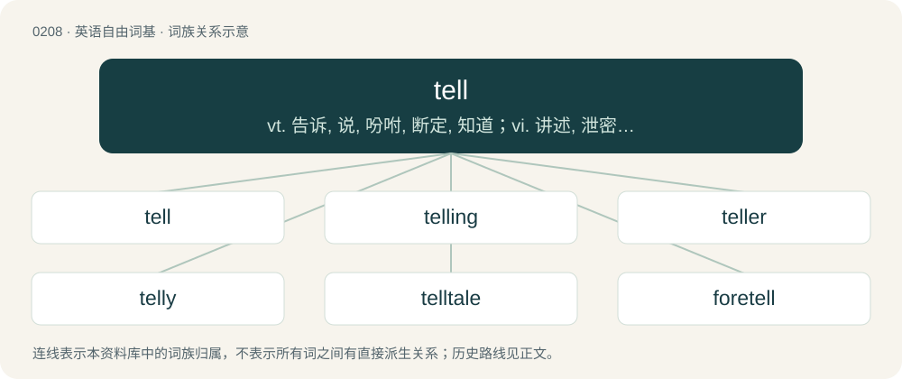

# 0231 · tell — vt. 告诉, 说, 吩咐, 断定, 知道；vi. 讲述, 泄密, 告发, 表明

[总目录](../00_总目录_按常用程度.md)

**类型**：英语自由词基　｜　**来源语言**：见词源记录

## 核心含义与来源

- 核心含义：vt. 告诉, 说, 吩咐, 断定, 知道；vi. 讲述, 泄密, 告发, 表明
- 英文含义：To determine the number, amount, or value of \[something\].
- 词形：tell

**多个词源／构词路径**：同一拼写可能有不同来源；以下按词性和含义分别列出。

**来源记录 1**（动词；To determine the number, amount, or value of \[something\].）

From Middle English tellen (“to count, tell”), from Old English tellan (“to count, tell”), from Proto-West Germanic \*talljan, from Proto-Germanic \*taljaną, \*talzijaną (“to count, enumerate”), from Proto-Germanic \*talą, \*talō (“number, counting”), from Proto-Indo-European \*dol- (“calculation, fraud”). Cognate with Saterland Frisian tälle (“to say; tell”), West Frisian telle (“to count”), West Frisian fertelle (“to tell, narrate”), Dutch tellen (“to count”) and Dutch vertellen (“to tell”), Low German tellen (“to count”), German zählen, Faroese telja, Swedish tala (“to speak”). More at tale.

**来源记录 2**（名词；A hill or mound, originally and especially in the Middle East, over or consisting of the ruins of ancient settlements.）

From Arabic تَلّ (tall, “hill, elevation”) or Hebrew תֵּל (tél, “hill”), from Proto-Semitic \*tall- (“hill”).

## 词族图

## 单词速览（常用到不常用）

| 单词 | 音标 | 释义 |
|---|---|---|
| [tell](#w-1) | 英 /tɛl/ | vt. 告诉, 说, 吩咐, 断定, 知道；vi. 讲述, 泄密, 告发, 表明 |
| [telling](#w-2) | /ˈtɛlɪŋ/ | a. 有效的, 显著的, 显露内心活动的 |
| [teller](#w-3) | 英 /ˈtɛlə/；美 /ˈtɛləɹ/ | n. 叙述者, 讲故事者, 出纳员；\[经\] 出纳员 |
| [telly](#w-4) | /ˈtɛli/ | 【英文】Inclined to telling (by explicitly stating facts), instead of showing (by conveying an impression so that events are described in the narrative). |
| [telltale](#w-5) | /ˈtɛlteɪl/ | n. 搬弄是非者, 迹象, 指示器；a. 搬弄是非的, 泄露秘密的, 报警的 |
| [foretell](#w-6) | /fɔɹˈtɛl/ | vt. 预言, 预告, 预示 |
| [retell](#w-7) | /ɹiˈtɛl/ | vt. 再讲, 重复, 重说 |

## 逐词详解

### 1. tell

**词性**：动词　｜　**音标**：英 /tɛl/

**中文释义**：vt. 告诉, 说, 吩咐, 断定, 知道；vi. 讲述, 泄密, 告发, 表明

**英文义项**：To determine the number, amount, or value of \[something\]. / To notice, discern. (Roughly, "can tell" means "know" but with a sense of direct perception.)

**词源与演化**：

From Middle English tellen (“to count, tell”), from Old English tellan (“to count, tell”), from Proto-West Germanic \*talljan, from Proto-Germanic \*taljaną, \*talzijaną (“to count, enumerate”), from Proto-Germanic \*talą, \*talō (“number, counting”), from Proto-Indo-European \*dol- (“calculation, fraud”). Cognate with Saterland Frisian tälle (“to say; tell”), West Frisian telle (“to count”), West Frisian fertelle (“to tell, narrate”), Dutch tellen (“to count”) and Dutch vertellen (“to tell”), Low German tellen (“to count”), German zählen, Faroese telja, Swedish tala (“to speak”). More at tale.

**例句**：

> All told, there were over a dozen. Can you tell time on a clock? He had untold wealth.

该用例对应义项：To determine the number, amount, or value of \[something\].

### 2. telling

**词性**：名词　｜　**音标**：/ˈtɛlɪŋ/

**中文释义**：a. 有效的, 显著的, 显露内心活动的

**英文义项**：The act of narration. / The disclosure of information.

**构词拆分**：tell + -ing

**词源与演化**：

Gerund from the verb tell, from tell + -ing.

**例句**：

> There is no telling what would happen if she doesn't show up.

### 3. teller

**词性**：名词　｜　**音标**：英 /ˈtɛlə/；美 /ˈtɛləɹ/

**中文释义**：n. 叙述者, 讲故事者, 出纳员；\[经\] 出纳员

**英文义项**：A person who tells stories. / A bank clerk who receives and pays out money.

**构词拆分**：tell (verb) + -er

**词源与演化**：

From Middle English tellere (“one who counts or enumerates; one who recounts or relates; teller”), equivalent to tell (verb) + -er.

**例句**：

> Tom is a terrible joke teller, because he often forgets the punchline.

### 4. telly

**词性**：形容词　｜　**音标**：/ˈtɛli/

**英文义项**：Inclined to telling (by explicitly stating facts), instead of showing (by conveying an impression so that events are described in the narrative).

**构词拆分**：tell + -y

**词源与演化**：

From tell + -y, related to the writing advice show, don't tell.

### 5. telltale

**词性**：名词　｜　**音标**：/ˈtɛlteɪl/

**中文释义**：n. 搬弄是非者, 迹象, 指示器；a. 搬弄是非的, 泄露秘密的, 报警的

**英文义项**：One who divulges private information with intent to hurt others. / An indicator, such as a warning light, that serves to warn of a hazard or problem.

**构词拆分**：tell + tale

**词源与演化**：

From tell + tale, perhaps dissimilated from earlier taleteller, from Middle English tale tellere (literally “tale teller”).

**例句**：

> The telltale was the lipstick on his shirt collar.

该用例对应义项：Something that serves to reveal something else.

### 6. foretell

**词性**：动词　｜　**音标**：/fɔɹˈtɛl/

**中文释义**：vt. 预言, 预告, 预示

**英文义项**：To predict; to tell (the future) before it occurs; to prophesy. / To tell (a person) of the future.

**构词拆分**：fore- + tell

**词源与演化**：

First use appears before 1400, from Middle English foretellen, equivalent to fore- + tell.

**例句**：

> I count the sparkle of constellations to foretell the future of my love.

### 7. retell

**词性**：动词　｜　**音标**：/ɹiˈtɛl/

**中文释义**：vt. 再讲, 重复, 重说

**英文义项**：To tell again, often differently, what one has read or heard; to paraphrase.

**构词拆分**：re- + tell

**词源与演化**：

From re- + tell.

**例句**：

> The author decided to retell the classic fairy tale with a modern twist.

该用例对应义项：To tell again, often differently, what one has read or heard; to paraphrase.
