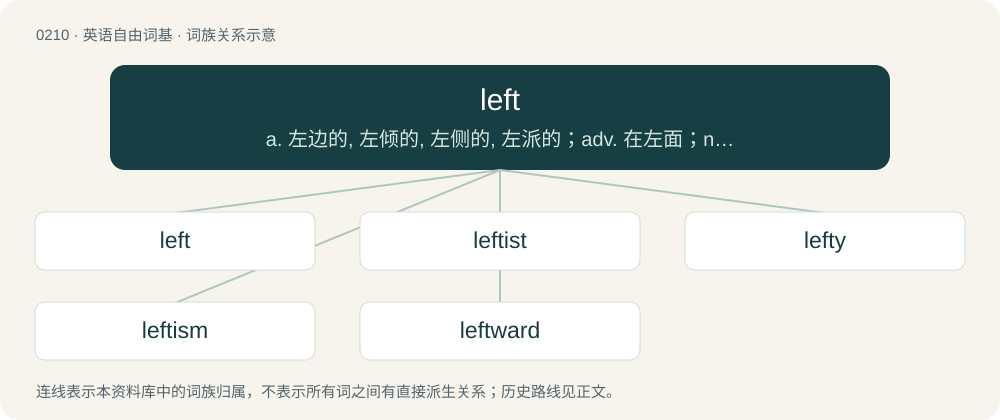

# 0232 · left — a. 左边的, 左倾的, 左侧的, 左派的；adv. 在左面；n. 左, 左面, 左派

[总目录](../00_总目录_按常用程度.md)

**类型**：英语自由词基　｜　**来源语言**：见词源记录

## 核心含义与来源

- 核心含义：a. 左边的, 左倾的, 左侧的, 左派的；adv. 在左面；n. 左, 左面, 左派
- 英文含义：Designating the side of the body toward the west when one is facing north; the side of the body on which the heart is located in most humans; the opposite of right. This arrow points to the reader's left: ←
- 词形：left

**多个词源／构词路径**：同一拼写可能有不同来源；以下按词性和含义分别列出。

**来源记录 1**（形容词；Designating the side of the body toward the west when one is facing north; the side of the body on which the heart is located in most humans; the opposite of right. This arrow points to the reader's left: ←）

From Middle English left, luft, leoft, lift, lyft, from Old English left, lyft (“weak, clumsy, foolish”), attested in Old English lyftādl (“palsy, paralysis”), from Proto-Germanic \*luft-, from \*lubjaną (“to castrate, lop off”) (compare dialectal English lib, West Frisian lobje, Dutch lubben), from Proto-Indo-European \*(s)lewp-, \*(s)lup- (“hanging limply”). Compare Scots left (“left”), North Frisian lefts, leeft, leefts (“left”), West Frisian lofts (“left”), obsolete Dutch lucht, leftsch, lefts, lefs (“left”), dialectal Dutch loof (“weak, worthless”), archaic Low German lucht (“left”).

**来源记录 2**（形容词；leftover, remaining）

From Middle English left, variant of laft (“remaining, left”), from Old English lǣfed, ġelǣfed, past participle of lǣfan (“to leave”). More at leave.

## 词族图

## 单词速览（常用到不常用）

| 单词 | 音标 | 释义 |
|---|---|---|
| [left](#w-1) | 英 /ˈlɛft/；美 /ˈɫɛft/ | a. 左边的, 左倾的, 左侧的, 左派的；adv. 在左面；n. 左, 左面, 左派 |
| [leftist](#w-2) | 英 /ˈlɛf.tɪst/ | n. 左翼的人, 左派；a. 左派的 |
| [lefty](#w-3) | /ˈlɛfti/ | n. 左撇子, 左翼分子 |
| [leftism](#w-4) | /ˈleftizəm/ | n. 左派观点, 在倾行为 |
| [leftward](#w-5) | /ˈleftwəd/ | a. 左方的, 左侧的；adv. 在左方, 在左手 |

## 逐词详解

### 1. left

**词性**：形容词　｜　**音标**：英 /ˈlɛft/；美 /ˈɫɛft/

**中文释义**：a. 左边的, 左倾的, 左侧的, 左派的；adv. 在左面；n. 左, 左面, 左派

**英文义项**：Designating the side of the body toward the west when one is facing north; the side of the body on which the heart is located in most humans; the opposite of right. This arrow points to the reader's left: ← / Anticlockwise, particularly when describing a change in direction or orientation.

**词源与演化**：

From Middle English left, luft, leoft, lift, lyft, from Old English left, lyft (“weak, clumsy, foolish”), attested in Old English lyftādl (“palsy, paralysis”), from Proto-Germanic \*luft-, from \*lubjaną (“to castrate, lop off”) (compare dialectal English lib, West Frisian lobje, Dutch lubben), from Proto-Indo-European \*(s)lewp-, \*(s)lup- (“hanging limply”). Compare Scots left (“left”), North Frisian lefts, leeft, leefts (“left”), West Frisian lofts (“left”), obsolete Dutch lucht, leftsch, lefts, lefs (“left”), dialectal Dutch loof (“weak, worthless”), archaic Low German lucht (“left”).

**例句**：

> The Eiffel Tower is on the left bank of the Seine.

该用例对应义项：Designating the bank of a river (etc.) on one's left when facing downstream (i.e. facing forward while floating with the current); that is, the north bank of a river that flows eastward. If this arrow: ⥲ shows the direction of the current, the tilde is on the left side of the river.

### 2. leftist

**词性**：名词　｜　**音标**：英 /ˈlɛf.tɪst/

**中文释义**：n. 左翼的人, 左派；a. 左派的

**英文义项**：A person who holds views associated with the political left. / Someone who holds socialist or communist-leaning economic views, usually alongside progressive social views; an anticapitalist.

**构词拆分**：left + -ist

**词源与演化**：

From left + -ist.

**例句**：

> I'm leftist. This means that my left hand is dominant.

### 3. lefty

**词性**：名词　｜　**音标**：/ˈlɛfti/

**中文释义**：n. 左撇子, 左翼分子

**英文义项**：One who is left-handed. / One who has left-wing political views.

**构词拆分**：left + -y

**词源与演化**：

From left + -y (nominal suffix).

**例句**：

> I'll bet my lefty he won't show up for work today.

该用例对应义项：One's left testicle.

### 4. leftism

**词性**：名词　｜　**音标**：/ˈleftizəm/

**中文释义**：n. 左派观点, 在倾行为

**英文义项**：Belief in the principles of left-wing politics.

**构词拆分**：left + -ism

**词源与演化**：

From left + -ism.

**例句**：

> Ted Kaczynski's bad critique of leftism has found him many supporters on the far right.

### 5. leftward

**词性**：形容词　｜　**音标**：/ˈleftwəd/

**中文释义**：a. 左方的, 左侧的；adv. 在左方, 在左手

**英文义项**：To or from the left.

**构词拆分**：left + -ward

**词源与演化**：

From left + -ward.
