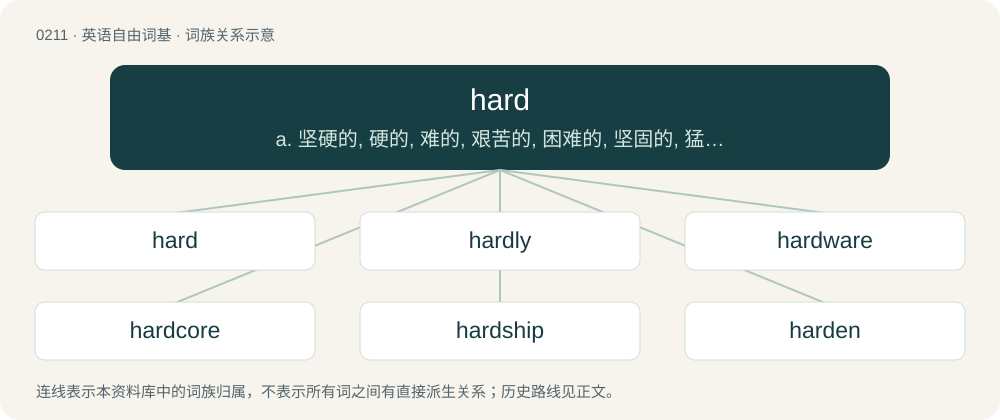

# 0233 · hard — a. 坚硬的, 硬的, 难的, 艰苦的, 困难的, 坚固的, 猛烈的, 艰难的, 结实的, 确实的；adv. 坚硬地, 努力地, 辛苦地, 接近地, 猛烈地, 牢固地

[总目录](../00_总目录_按常用程度.md)

**类型**：英语自由词基　｜　**来源语言**：见词源记录

## 核心含义与来源

- 核心含义：a. 坚硬的, 硬的, 难的, 艰苦的, 困难的, 坚固的, 猛烈的, 艰难的, 结实的, 确实的；adv. 坚硬地, 努力地, 辛苦地, 接近地, 猛烈地, 牢固地
- 英文含义：Solid and firm.
- 词形：hard

**来源记录 1**（形容词；Solid and firm.）

From Middle English hard, from Old English heard, from Proto-West Germanic \*hard(ī), from Proto-Germanic \*harduz, from Proto-Indo-European \*kort-ús, from \*kret- (“strong, powerful”). Cognates Cognate with Yola hard (“hard”), West Frisian hurd (“hard”), Alemannic German hert (“hard”), Bavarian hoat (“hard”), Central Franconian haat (“hard”), Dutch hard (“hard”), German hart (“hard”), Luxembourgish haart (“hard”), Danish and Swedish hård (“hard”), Faroese and Icelandic harður (“hard”), Norwegian Bokmål hard (“hard”), Norwegian Nynorsk hard, hard’u (“hard”), Gothic 𐌷𐌰𐍂𐌳𐌿𐍃 (hardus, “hard”), Ancient Greek κρατύς (kratús, “strong, mighty”), Sanskrit क्रतु (krátu, “power, might, ability”), Avestan 𐬑𐬭𐬀𐬙𐬎 (xratu).

## 词族图

## 单词速览（常用到不常用）

| 单词 | 音标 | 释义 |
|---|---|---|
| [hard](#w-1) | 英 /hɑːd/；美 /hɑɹd/ | a. 坚硬的, 硬的, 难的, 艰苦的, 困难的, 坚固的, 猛烈的, 艰难的, 结实的, 确实的；adv. 坚硬地, 努力地, 辛苦地, 接近地, 猛烈地, 牢固地 |
| [hardly](#w-2) | 英 /ˈhɑːdli/；美 /ˈhɑɹdli/ | adv. 刚刚, 几乎不, 勉强是 |
| [hardware](#w-3) | 英 /ˈhɑːdˌwɛə/；美 /ˈhɑɹdˌwɛɹ/ | n. 硬件, 五金器具, 零件；\[计\] 硬件 |
| [hardcore](#w-4) | /hɑː(ɹ)dˈkɔː(ɹ)/ | a. 赤裸裸描写性行为的 |
| [hardship](#w-5) | 英 /ˈhɑːdˌʃɪp/；美 /ˈhɑɹdˌʃɪp/ | n. 艰难, 辛苦, 苦难；\[法\] 受苦, 吃苦, 苦难 |
| [harden](#w-6) | 英 /ˈhɑːdn̩/；美 /ˈhɑɹdn̩/ | vt. 使变硬, 使坚强, 使冷酷；vi. 变硬, 变冷酷 |
| [hardwood](#w-7) | 美 /ˈhɑɹdˌwʊd/ | n. 硬木, 硬木材, 阔叶材, 落叶树；\[机\] 硬木 |
| [hardcover](#w-8) | 英 /ˈhɑːdˌkʌvə/；美 /ˈhɑɹdˌkʌvɚ/ | a. 硬书皮的；n. 硬封面的书, 精装书 |
| [hardworking](#w-9) | /ˈhɑːɹdˌwɜːɹ.kɪŋ/ | a. 苦干的, 不辞辛劳的 |
| [hardness](#w-10) | 英 /ˈhɑːdnəs/；美 /ˈhɑɹdnəs/ | n. 坚硬, 困难, 严厉, 勇气；\[化\] 硬度 |
| [hardline](#w-11) | 英 /ˈhɑːdlaɪn/；美 /ˈhɑɹdlaɪn/ | n. 强硬路线；\[电\] 硬线 |
| [hardback](#w-12) | 美 /ˈhɑɹdˌbæk/ | a. 硬封面的；n. 精装本 |
| [hardball](#w-13) | /ˈhɑːdbɔːl/ | n. 硬式棒球（等于baseball）；（为达到某种目的而采取的）强硬手段；\[俚\]刀剑搏杀 |
| [hardman](#w-14) |  | 【英文】A man who is particularly tough or muscular |
| [hardwired](#w-15) |  | a. 电路的 |
| [hardtop](#w-16) | /ˈhɑːdtɔp/ | n. 有金属顶盖的汽车；室内电影院 |
| [hardstyle](#w-17) |  | 【英文】A genre of electronic dance music that combines elements of trance, techno, and hardcore, with origins in the Netherlands and Belgium. |
| [hardscrabble](#w-18) | 美 /ˈhɑɹdˌskɹæbəl/ | \[美\]贫脊的, 非常穷困的 |
| [hardheaded](#w-19) | /ˈhɑːdˈhedid/ | a. 不易激动的, 冷静的, 脚踏实地的, 无懈可击的 |

## 逐词详解

### 1. hard

**词性**：形容词　｜　**音标**：英 /hɑːd/；美 /hɑɹd/

**中文释义**：a. 坚硬的, 硬的, 难的, 艰苦的, 困难的, 坚固的, 猛烈的, 艰难的, 结实的, 确实的；adv. 坚硬地, 努力地, 辛苦地, 接近地, 猛烈地, 牢固地

**英文义项**：Solid and firm. / Resistant to pressure; difficult to break, cut, or penetrate.

**词源与演化**：

From Middle English hard, from Old English heard, from Proto-West Germanic \*hard(ī), from Proto-Germanic \*harduz, from Proto-Indo-European \*kort-ús, from \*kret- (“strong, powerful”). Cognates Cognate with Yola hard (“hard”), West Frisian hurd (“hard”), Alemannic German hert (“hard”), Bavarian hoat (“hard”), Central Franconian haat (“hard”), Dutch hard (“hard”), German hart (“hard”), Luxembourgish haart (“hard”), Danish and Swedish hård (“hard”), Faroese and Icelandic harður (“hard”), Norwegian Bokmål hard (“hard”), Norwegian Nynorsk hard, hard’u (“hard”), Gothic 𐌷𐌰𐍂𐌳𐌿𐍃 (hardus, “hard”), Ancient Greek κρατύς (kratús, “strong, mighty”), Sanskrit क्रतु (krátu, “power, might, ability”), Avestan 𐬑𐬭𐬀𐬙𐬎 (xratu).

**例句**：

> The senator asked the party chief to put the hard word on his potential rivals.

该用例对应义项：Severe, harsh, unfriendly, brutal.

### 2. hardly

**词性**：副词　｜　**音标**：英 /ˈhɑːdli/；美 /ˈhɑɹdli/

**中文释义**：adv. 刚刚, 几乎不, 勉强是

**英文义项**：Barely, only just, almost not. / Certainly not; not at all.

**构词拆分**：hard + -ly

**词源与演化**：

From Middle English hardely, hardliche, from Old English heardlīċe (“boldly; hardily; without ease; in a way that causes pain; not easily; only by degrees”), equivalent to hard + -ly. Compare Dutch hardelijk, German härtlich.

**例句**：

> It's hardly possible he could lose the election.

该用例对应义项：Barely, only just, almost not.

### 3. hardware

**词性**：名词　｜　**音标**：英 /ˈhɑːdˌwɛə/；美 /ˈhɑɹdˌwɛɹ/

**中文释义**：n. 硬件, 五金器具, 零件；\[计\] 硬件

**英文义项**：Fixtures, equipment, fasteners, tools, and devices used for general-purpose construction and repair of a structure or object. Also such equipment as sold as stock by a store of the same name, e.g. hardware store. / Equipment.

**构词拆分**：hard + -ware

**词源与演化**：

From Middle English hardware; equivalent to hard + -ware; attested since the mid-15th century.

**例句**：

> He needed a hammer, nails, screws, nuts, bolts and other assorted hardware, so he went to the hardware store.

该用例对应义项：Fixtures, equipment, fasteners, tools, and devices used for general-purpose construction and repair of a structure or object. Also such equipment as sold as stock by a store of the same name, e.g. hardware store.

### 4. hardcore

**词性**：形容词　｜　**音标**：/hɑː(ɹ)dˈkɔː(ɹ)/

**中文释义**：a. 赤裸裸描写性行为的

**英文义项**：Having an extreme dedication to a certain activity. / So hard as to require extreme dedication to complete.

**构词拆分**：hard + core

**词源与演化**：

From hard + core: hard to the core; 1936 (n.); 1951 (adj.)

**例句**：

> That show was hardcore, dude.

该用例对应义项：Particularly intense; thrillingly dangerous or erratic; desirably violent in appearance; pleasing or "cool" due to intensity or danger.

### 5. hardship

**词性**：名词　｜　**音标**：英 /ˈhɑːdˌʃɪp/；美 /ˈhɑɹdˌʃɪp/

**中文释义**：n. 艰难, 辛苦, 苦难；\[法\] 受苦, 吃苦, 苦难

**英文义项**：Difficulty or trouble; hard times. / A burden, a source of difficulty that could impose a barrier.

**构词拆分**：hard + -ship

**词源与演化**：

From Middle English hardshipe, equivalent to hard + -ship.

**例句**：

> When you visit the museum, we invite you to make a donation of $10 if this will not be a hardship.

该用例对应义项：A burden, a source of difficulty that could impose a barrier.

### 6. harden

**词性**：动词　｜　**音标**：英 /ˈhɑːdn̩/；美 /ˈhɑɹdn̩/

**中文释义**：vt. 使变硬, 使坚强, 使冷酷；vi. 变硬, 变冷酷

**英文义项**：To become hard. / To make something hard or harder.

**构词拆分**：hard + -en

**词源与演化**：

From Middle English hardenen, equivalent to hard + -en. Cognate with Danish hærdne (“to harden; cure”), Swedish hårdna (“to harden”), Norwegian herdne (“to harden”), Icelandic harðna (“to harden”).

**例句**：

> Brother men who live after us, Harden not your hearts against us.

### 7. hardwood

**词性**：名词　｜　**音标**：美 /ˈhɑɹdˌwʊd/

**中文释义**：n. 硬木, 硬木材, 阔叶材, 落叶树；\[机\] 硬木

**英文义项**：The wood from any dicotyledonous tree, without regard to its hardness. / (in more general use) As the preceding, but limited to those that are commercial timbers, and are at least average in hardness.

**构词拆分**：hard + wood

**词源与演化**：

From hard + wood. The term refers to the seed coat of the tree's seeds; it does not refer to the degree of hardness of the tree's wood, but it seems to do so and is usually assumed to do so by speakers not well informed about trees and timber.

**例句**：

> You should have used hardwood for this window sill instead of this junk.

该用例对应义项：A joint term for the commercial timbers, without distinguishing which.

### 8. hardcover

**词性**：名词　｜　**音标**：英 /ˈhɑːdˌkʌvə/；美 /ˈhɑɹdˌkʌvɚ/

**中文释义**：a. 硬书皮的；n. 硬封面的书, 精装书

**英文义项**：A book with a rigid binding, often of cardboard or leather.

**构词拆分**：hard + cover

**词源与演化**：

From hard + cover.

**例句**：

> I bought the novel in paperback because it was cheaper than the hardcover.

### 9. hardworking

**词性**：形容词　｜　**音标**：/ˈhɑːɹdˌwɜːɹ.kɪŋ/

**中文释义**：a. 苦干的, 不辞辛劳的

**英文义项**：Of a person, taking their work seriously and doing it well and rapidly.

**构词拆分**：From hard + working.

**词源与演化**：

From hard + working.

**例句**：

> He used to be very hardworking, but now he's a bit lazy.

### 10. hardness

**词性**：名词　｜　**音标**：英 /ˈhɑːdnəs/；美 /ˈhɑɹdnəs/

**中文释义**：n. 坚硬, 困难, 严厉, 勇气；\[化\] 硬度

**英文义项**：The quality of being hard. / An instance of this quality; hardship.

**构词拆分**：hard + -ness

**词源与演化**：

From Middle English hardness, hardnesse, from Old English heardnes, from heard + -nes, equivalent to hard + -ness.

**例句**：

> The hardness of the material was high.

该用例对应义项：A measure of how hard a material is.

### 11. hardline

**词性**：形容词　｜　**音标**：英 /ˈhɑːdlaɪn/；美 /ˈhɑɹdlaɪn/

**中文释义**：n. 强硬路线；\[电\] 硬线

**英文义项**：Uncompromising; rigidly holding to a set of beliefs. / Belonging to a hardline.

**构词拆分**：hard + line

**词源与演化**：

From hard + line.

**例句**：

> Smith's hardline approach to drugs gained him the support of many local citizens.

该用例对应义项：Uncompromising; rigidly holding to a set of beliefs.

### 12. hardback

**词性**：名词　｜　**音标**：美 /ˈhɑɹdˌbæk/

**中文释义**：a. 硬封面的；n. 精装本

**英文义项**：A book with a solid binding.

**构词拆分**：hard + back

**词源与演化**：

From hard + back, formed in analogy to earlier paperback.

**例句**：

> The girl was carrying several books, not textbooks but thick hardback books.

### 13. hardball

**词性**：名词　｜　**音标**：/ˈhɑːdbɔːl/

**中文释义**：n. 硬式棒球（等于baseball）；（为达到某种目的而采取的）强硬手段；\[俚\]刀剑搏杀

**英文义项**：In baseball, a type of ball and baseball game, as opposed to softball. / Tough or ruthless behavior, especially in combat, politics or business.

**构词拆分**：hard + ball

**词源与演化**：

From hard + ball.

**例句**：

> They play hardball in the Senate.

该用例对应义项：a no-nonsense attitude in business or politics

### 14. hardman

**词性**：名词

**英文义项**：A man who is particularly tough or muscular / A rugby player

**构词拆分**：hard + man

**词源与演化**：

From hard + man.

**例句**：

> He's just a wannabe hardman.

该用例对应义项：A man who is particularly tough or muscular

### 15. hardwired

**词性**：形容词

**中文释义**：a. 电路的

**英文义项**：Designed to perform a specific task. / Of devices, closely or tightly coupled.

**构词拆分**：hard + wired

**词源与演化**：

From hard + wired.

**例句**：

> I'm hardwired to have a shower every morning.

该用例对应义项：Having made a belief or a pattern of behavior or a habit.

### 16. hardtop

**词性**：名词　｜　**音标**：/ˈhɑːdtɔp/

**中文释义**：n. 有金属顶盖的汽车；室内电影院

**英文义项**：The removable rigid roof of a convertible or sports car. / A car with such a roof.

**构词拆分**：hard + top

**词源与演化**：

From hard + top.

### 17. hardstyle

**词性**：名词

**英文义项**：A genre of electronic dance music that combines elements of trance, techno, and hardcore, with origins in the Netherlands and Belgium. / In contrast to sports style, a specifically intensive workout exercise, such as a swing squat.

**构词拆分**：hard + style

**词源与演化**：

From hard + style.

### 18. hardscrabble

**词性**：形容词　｜　**音标**：美 /ˈhɑɹdˌskɹæbəl/

**中文释义**：\[美\]贫脊的, 非常穷困的

**英文义项**：Requiring much work to farm, and ultimately not very productive. / Involving hard work and struggle.

**构词拆分**：hard + scrabble

**词源与演化**：

From hard + scrabble.

**例句**：

> He leads a hardscrabble existence.

该用例对应义项：Involving hard work and struggle.

### 19. hardheaded

**词性**：形容词　｜　**音标**：/ˈhɑːdˈhedid/

**中文释义**：a. 不易激动的, 冷静的, 脚踏实地的, 无懈可击的

**英文义项**：Stubborn; wilful. / Realistic; pragmatic.

**构词拆分**：hard + headed

**词源与演化**：

From hard + headed. First appears c. mid-15th century in the writings of Osbern Bokenam.
