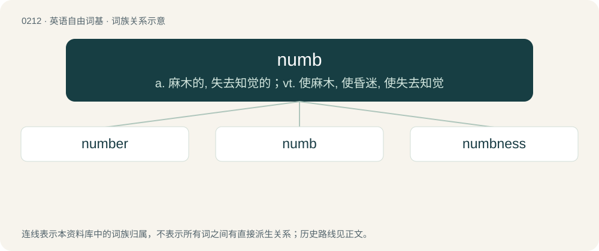

# 0234 · numb — a. 麻木的, 失去知觉的；vt. 使麻木, 使昏迷, 使失去知觉

[总目录](../00_总目录_按常用程度.md)

**类型**：英语自由词基　｜　**来源语言**：见词源记录

## 核心含义与来源

- 核心含义：a. 麻木的, 失去知觉的；vt. 使麻木, 使昏迷, 使失去知觉
- 英文含义：Physically unable to feel, not having the power of sensation.
- 词形：numb

**来源记录 1**（形容词；Physically unable to feel, not having the power of sensation.）

From the past participle of nim (“to take”). Compare German benommen (“dazed, numb”) and Old Norse numinn. The final ⟨b⟩ is a later addition; it was never pronounced, and did not appear in the original word.

## 词族图

## 单词速览（常用到不常用）

| 单词 | 音标 | 释义 |
|---|---|---|
| [number](#w-1) | 英 /ˈnʌmə/；美 /ˈnʌmɚ/ | 【英文】Something that numbs. |
| [numb](#w-2) | /nʌm/ | a. 麻木的, 失去知觉的；vt. 使麻木, 使昏迷, 使失去知觉 |
| [numbness](#w-3) | /ˈnʌmnis/ | n. 麻木, 麻痹；\[医\] 麻木 |

## 逐词详解

### 1. number

**词性**：名词　｜　**音标**：英 /ˈnʌmə/；美 /ˈnʌmɚ/

**英文义项**：Something that numbs.

**构词拆分**：numb (verb) + -er

**词源与演化**：

Equivalent to numb (verb) + -er

### 2. numb

**词性**：形容词　｜　**音标**：/nʌm/

**中文释义**：a. 麻木的, 失去知觉的；vt. 使麻木, 使昏迷, 使失去知觉

**英文义项**：Physically unable to feel, not having the power of sensation. / Emotionally unable to feel or respond in a normal way.

**词源与演化**：

From the past participle of nim (“to take”). Compare German benommen (“dazed, numb”) and Old Norse numinn. The final ⟨b⟩ is a later addition; it was never pronounced, and did not appear in the original word.

**用法示例／搭配（非完整句）**：

> legs numb from kneeling

该用例对应义项：Physically unable to feel, not having the power of sensation.

### 3. numbness

**词性**：名词　｜　**音标**：/ˈnʌmnis/

**中文释义**：n. 麻木, 麻痹；\[医\] 麻木

**英文义项**：Absent or reduced sensitivity to cutaneous stimulation. / Inability or reduced ability to experience emotion.

**构词拆分**：numb + -ness

**词源与演化**：

From numb + -ness.

**例句**：

> I have some numbness in my left hand.
