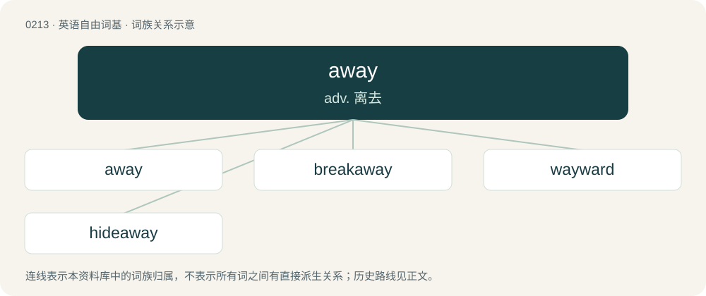

# 0235 · away — adv. 离去

[总目录](../00_总目录_按常用程度.md)

**类型**：英语自由词基　｜　**来源语言**：见词源记录

## 核心含义与来源

- 核心含义：adv. 离去
- 英文含义：From a place, hence.
- 词形：away

**来源记录 1**（副词；From a place, hence.）

From Middle English away, awey, awei, oway, o wey, on way, from Old English āweġ, onweġ (“away”), originally on weġ (“on one's way; onward; on”), equivalent to a- (“on”) + way. Cognate with Scots awa, away (“away”), Old Frisian aweg, awei (“away”), Saterland Frisian wäch, wääge (“away”), Dutch weg (“away”), German weg (“away”), Danish væk (“away”), Swedish i väg (“away; off; along”).

## 词族图

## 单词速览（常用到不常用）

| 单词 | 音标 | 释义 |
|---|---|---|
| [away](#w-1) | 英 /əˈweɪ/ | adv. 离去 |
| [breakaway](#w-2) | /ˈbɹeɪkəweɪ/ | n. 脱离, (美)(非正式)一碰就散开/脱落的, 分裂 |
| [wayward](#w-3) | /ˈweɪwə(ɹ)d/ | a. 任性的, 难以捉摸的, 不稳定的, 刚愎的；\[法\] 顽强的, 任性的, 不规则的 |
| [hideaway](#w-4) | 美 /ˈhaɪdəˌweɪ/ | n. 隐匿处, 潜伏处, 退隐处 |

## 逐词详解

### 1. away

**词性**：形容词　｜　**音标**：英 /əˈweɪ/

**中文释义**：adv. 离去

**英文义项**：Not here, gone, absent, unavailable, traveling; on vacation. / At a specified distance in space, time, or figuratively.

**构词拆分**：a- (“on”) + way

**词源与演化**：

From Middle English away, awey, awei, oway, o wey, on way, from Old English āweġ, onweġ (“away”), originally on weġ (“on one's way; onward; on”), equivalent to a- (“on”) + way. Cognate with Scots awa, away (“away”), Old Frisian aweg, awei (“away”), Saterland Frisian wäch, wääge (“away”), Dutch weg (“away”), German weg (“away”), Danish væk (“away”), Swedish i väg (“away; off; along”).

**例句**：

> The master is away from home on a course.

该用例对应义项：Not here, gone, absent, unavailable, traveling; on vacation.

### 2. breakaway

**词性**：形容词　｜　**音标**：/ˈbɹeɪkəweɪ/

**中文释义**：n. 脱离, (美)(非正式)一碰就散开/脱落的, 分裂

**英文义项**：Having broken away from a larger unit. / Capable of breaking off without damaging the larger structure.

**构词拆分**：break + away

**词源与演化**：

From break + away, a deverbal from break away.

**例句**：

> The breakaway republic is slowly establishing order and civil society.

该用例对应义项：Having broken away from a larger unit.

### 3. wayward

**词性**：形容词　｜　**音标**：/ˈweɪwə(ɹ)d/

**中文释义**：a. 任性的, 难以捉摸的, 不稳定的, 刚愎的；\[法\] 顽强的, 任性的, 不规则的

**英文义项**：Given to a wilful, perverse deviation from the expected norm; tending to stray. / Obstinate, contrary and unpredictable.

**构词拆分**：away + -ward

**词源与演化**：

Shortening of away + -ward.

**例句**：

> The father had trouble communicating with his wayward son.

### 4. hideaway

**词性**：名词　｜　**音标**：美 /ˈhaɪdəˌweɪ/

**中文释义**：n. 隐匿处, 潜伏处, 退隐处

**英文义项**：a hiding place, somewhere one can go to get away from other people

**构词拆分**：hide + away

**词源与演化**：

From hide + away.

**例句**：

> This weekend, let's find some romantic hideaway on the coast.

该用例对应义项：a hiding place, somewhere one can go to get away from other people
