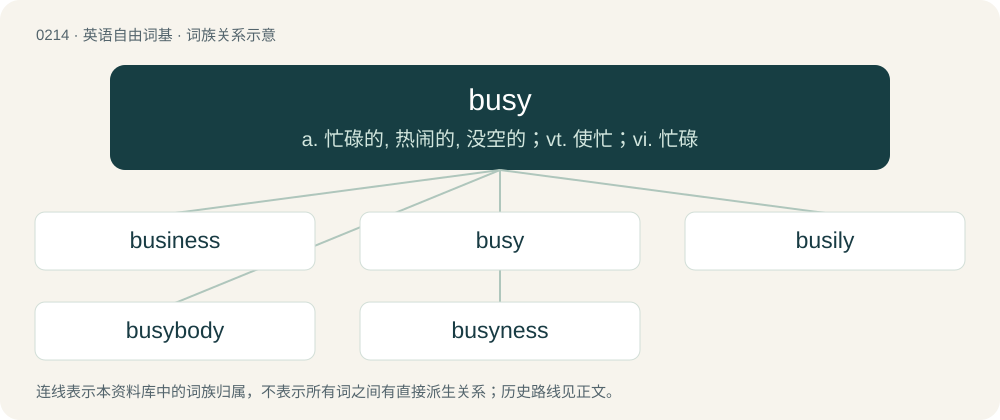

# 0236 · busy — a. 忙碌的, 热闹的, 没空的；vt. 使忙；vi. 忙碌

[总目录](../00_总目录_按常用程度.md)

**类型**：英语自由词基　｜　**来源语言**：见词源记录

## 核心含义与来源

- 核心含义：a. 忙碌的, 热闹的, 没空的；vt. 使忙；vi. 忙碌
- 英文含义：Crowded with business or activities; having a great deal going on.
- 词形：busy

**多个词源／构词路径**：同一拼写可能有不同来源；以下按词性和含义分别列出。

**来源记录 1**（形容词；Crowded with business or activities; having a great deal going on.）

From Middle English bisy, busie, from Old English bisiġ (“busy, occupied, diligent”), from Proto-West Germanic \*bisīg (“diligent; zealous; busy”). Cognate with Saterland Frisian biesich (“active, diligent, hard-working, industrious”), Dutch bezig (“busy”), Low German besig (“busy”). The spelling with ⟨u⟩ represents the pronunciation of the West Midland and Southern dialects while the Modern English pronunciation with /ɪ/ is from the dialects of the East Midlands.

**来源记录 2**（动词；To make somebody busy or active; to occupy.）

From Middle English bisien, from Old English bisgian (“to occupy, employ, trouble, afflict”), from Proto-West Germanic \*bisīgōn. Cognate with Old Frisian bisgia (“to use”).

## 词族图

## 单词速览（常用到不常用）

| 单词 | 音标 | 释义 |
|---|---|---|
| [business](#w-1) | /ˈbɪz.nɪs/ | n. 生意, 事情, 业务, 商业, 商行, 职责；\[经\] 企业, 商业, 营业 |
| [busy](#w-2) | /ˈbɪz.i/ | a. 忙碌的, 热闹的, 没空的；vt. 使忙；vi. 忙碌 |
| [busily](#w-3) | /ˈbizili/ | adv. 忙碌地 |
| [busybody](#w-4) | /ˈbizibɒdi/ | n. 爱管闲事的人, 好事的人 |
| [busyness](#w-5) | 英 /ˈbɪz.i.nɪs/；美 /ˈbɪz.i.nəs/ | n. 繁忙, 忙碌 |

## 逐词详解

### 1. business

**词性**：名词　｜　**音标**：/ˈbɪz.nɪs/

**中文释义**：n. 生意, 事情, 业务, 商业, 商行, 职责；\[经\] 企业, 商业, 营业

**英文义项**：A specific commercial enterprise or establishment. / A person's occupation, work, or trade.

**构词拆分**：busy + -ness

**词源与演化**：

From Middle English busines, busynes, businesse, bisynes, from Old English bisiġnes (“business, busyness”), equivalent to busy + -ness. Doublet of busyness. Sense 17 (something very good, top quality), possibly derives from "the bee's knees"

**例句**：

> They did nearly a million dollars of business over the long weekend.

该用例对应义项：The volume or amount of commercial trade.

### 2. busy

**词性**：形容词　｜　**音标**：/ˈbɪz.i/

**中文释义**：a. 忙碌的, 热闹的, 没空的；vt. 使忙；vi. 忙碌

**英文义项**：Crowded with business or activities; having a great deal going on. / Engaged with or preoccupied by an activity or person.

**词源与演化**：

From Middle English bisy, busie, from Old English bisiġ (“busy, occupied, diligent”), from Proto-West Germanic \*bisīg (“diligent; zealous; busy”). Cognate with Saterland Frisian biesich (“active, diligent, hard-working, industrious”), Dutch bezig (“busy”), Low German besig (“busy”). The spelling with ⟨u⟩ represents the pronunciation of the West Midland and Southern dialects while the Modern English pronunciation with /ɪ/ is from the dialects of the East Midlands.

**例句**：

> Flowers, stripes, and checks in the same fabric make for a busy pattern.

该用例对应义项：Having a lot going on; complicated or intricate.

### 3. busily

**词性**：副词　｜　**音标**：/ˈbizili/

**中文释义**：adv. 忙碌地

**英文义项**：In a busy manner; actively.

**构词拆分**：busy + -ly

**词源与演化**：

From Middle English busily, busiliche, bisili, bisiliche, equivalent to busy + -ly.

**例句**：

> They were busily engaged in buying souvenirs.

该用例对应义项：in a busy manner

### 4. busybody

**词性**：名词　｜　**音标**：/ˈbizibɒdi/

**中文释义**：n. 爱管闲事的人, 好事的人

**英文义项**：Someone who interferes with others; one who is nosy, intrusive or meddlesome. / A device consisting of three mirrors that, when attached to the wall of a house, allows an occupant to see who is at the front door without a direct line of sight.

**构词拆分**：busy + body

**词源与演化**：

From busy + body.

**例句**：

> Tom told his busybody neighbour to get a life and to get his nose out of everyone's business.

### 5. busyness

**词性**：名词　｜　**音标**：英 /ˈbɪz.i.nɪs/；美 /ˈbɪz.i.nəs/

**中文释义**：n. 繁忙, 忙碌

**英文义项**：The state of being busy.

**构词拆分**：busy + -ness

**词源与演化**：

From busy + -ness; the ⟨y⟩ (-y) is kept to distinguish from business (of which it is a doublet), which is derived from the same two morphemes but by regular spelling rules.

**例句**：

> They manifested all the busyness of a pack of beavers.

该用例对应义项：the state of being or appearing to be actively engaged in an activity
