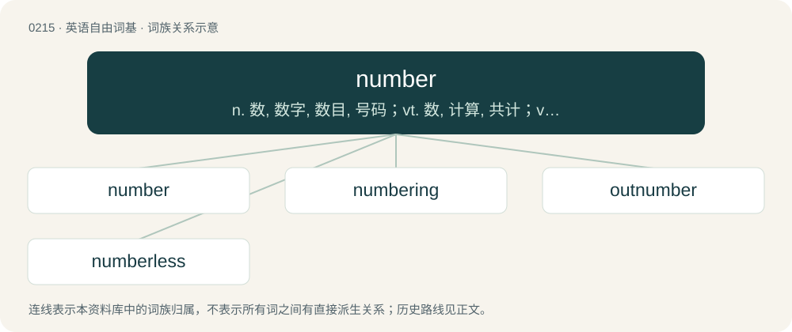

# 0237 · number — n. 数, 数字, 数目, 号码；vt. 数, 计算, 共计；vi. 计算, 报数

[总目录](../00_总目录_按常用程度.md)

**类型**：英语自由词基　｜　**来源语言**：见词源记录

## 核心含义与来源

- 核心含义：n. 数, 数字, 数目, 号码；vt. 数, 计算, 共计；vi. 计算, 报数
- 英文含义：Quantity of countable things.
- 词形：number

**多个词源／构词路径**：同一拼写可能有不同来源；以下按词性和含义分别列出。

**来源记录 1**（名词；Quantity of countable things.）

Inherited from Middle English number, nombre, numbre, noumbre, from Anglo-Norman noumbre, Old French nombre, from Latin numerus (“number”), ultimately from Proto-Indo-European \*nem- (“to distribute, to give, to take”). Compare Saterland Frisian Nummer, Nuumer, West Frisian nûmer, Dutch nummer (“number”), German Nummer (“number”), Danish nummer (“number”), Swedish nummer (“number”), Icelandic númer (“number”). Displaced Middle English ȝetæl and rime; more at tell, tale and rhyme. Distantly related (via Proto-Indo-European) to obsolete English nim (“to take, seize”) and its Germanic cognates (e.g. German nehmen), hence also to numb.

**来源记录 2**（名词；Something that numbs.）

Equivalent to numb (verb) + -er

## 词族图

## 单词速览（常用到不常用）

| 单词 | 音标 | 释义 |
|---|---|---|
| [number](#w-1) | /ˈnʌmbər/ | n. 数, 数字, 数目, 号码；vt. 数, 计算, 共计；vi. 计算, 报数 |
| [numbering](#w-2) | /ˈnʌmbəriŋ/ | n. 编号方式；\[计\] 编号方式 |
| [outnumber](#w-3) | /aʊtˈnʌmbə(ɹ)/ | vt. 数目超过, 比...多 |
| [numberless](#w-4) | 英 /ˈnʌmbələs/；美 /ˈnʌmbɚləs/ | a. 无数的, 无号数的；\[机\] 无数的, 数不清的 |

## 逐词详解

### 1. number

**词性**：名词　｜　**音标**：/ˈnʌmbər/

**中文释义**：n. 数, 数字, 数目, 号码；vt. 数, 计算, 共计；vi. 计算, 报数

**英文义项**：Quantity of countable things. / An abstract entity used to describe quantity.

**词源与演化**：

Inherited from Middle English number, nombre, numbre, noumbre, from Anglo-Norman noumbre, Old French nombre, from Latin numerus (“number”), ultimately from Proto-Indo-European \*nem- (“to distribute, to give, to take”). Compare Saterland Frisian Nummer, Nuumer, West Frisian nûmer, Dutch nummer (“number”), German Nummer (“number”), Danish nummer (“number”), Swedish nummer (“number”), Icelandic númer (“number”). Displaced Middle English ȝetæl and rime; more at tell, tale and rhyme. Distantly related (via Proto-Indo-European) to obsolete English nim (“to take, seize”) and its Germanic cognates (e.g. German nehmen), hence also to numb.

**例句**：

> There are, in addition to all the red socks, a number that don’t suit me either.

该用例对应义项：Quantity of countable things.

### 2. numbering

**词性**：名词　｜　**音标**：/ˈnʌmbəriŋ/

**中文释义**：n. 编号方式；\[计\] 编号方式

**英文义项**：A sequence of numbers indicating order or otherwise used for identification. / The action of creating or assigning such a sequence for identification.

**构词拆分**：number + -ing

**词源与演化**：

From Middle English nombrynge; equivalent to number + -ing.

**例句**：

> Their numbering system is base 5 instead of base 10.

### 3. outnumber

**词性**：动词　｜　**音标**：/aʊtˈnʌmbə(ɹ)/

**中文释义**：vt. 数目超过, 比...多

**英文义项**：To be more in number than somebody or something.

**构词拆分**：out- + number

**词源与演化**：

From out- + number.

**例句**：

> Women outnumbered men by two to one.

该用例对应义项：To be more in number than somebody or something.

### 4. numberless

**词性**：形容词　｜　**音标**：英 /ˈnʌmbələs/；美 /ˈnʌmbɚləs/

**中文释义**：a. 无数的, 无号数的；\[机\] 无数的, 数不清的

**英文义项**：Without number; having too many to count.

**构词拆分**：number + -less

**词源与演化**：

From number + -less.

**例句**：

> The stars are as numberless as the grains of sand on a beach.

该用例对应义项：Without number; having too many to count.
