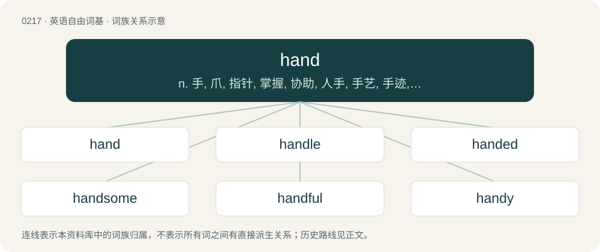

# 0241 · hand — n. 手, 爪, 指针, 掌握, 协助, 人手, 手艺, 手迹, 支配, 插手；vt. 交给, 支持, 搀扶

[总目录](../00_总目录_按常用程度.md)

**类型**：英语自由词基　｜　**来源语言**：见词源记录

## 核心含义与来源

- 核心含义：n. 手, 爪, 指针, 掌握, 协助, 人手, 手艺, 手迹, 支配, 插手；vt. 交给, 支持, 搀扶
- 英文含义：The part of the forelimb below the forearm or wrist in humans and other primates, and the corresponding part in many other animals.
- 词形：hand

**多个词源／构词路径**：同一拼写可能有不同来源；以下按词性和含义分别列出。

**来源记录 1**（名词；The part of the forelimb below the forearm or wrist in humans and other primates, and the corresponding part in many other animals.）

From Middle English hond, hand, from Old English hand, from Proto-West Germanic \*handu, from Proto-Germanic \*handuz. See also Dutch and Swedish hand (“hand”), Danish hånd, German Hand, West Frisian hân. Perhaps compare Old Swedish hinna (“to gain”), Gothic 𐍆𐍂𐌰-𐌷𐌹𐌽𐌸𐌰𐌽 (fra-hinþan, “to take captive, capture”); and Latvian sīts (“hunting spear”), Ancient Greek κεντέω (kentéō, “prick”), Albanian çandër (“pitchfork, prop”).

**来源记录 2**（动词；To give, pass or transmit with the hand, literally or figuratively.）

From Middle English handen, honden, from the noun (see above); and also from henden (&gt; English hend), from Old English \*hendan, ġehendan (“to seize by hand, grasp, hold”), from Proto-West Germanic \*handijan, from Proto-Germanic \*handijaną (“to take by hand, grasp”), from the noun (see above). Cognate with Old Frisian handa, henda (“to grasp, seize”), Middle Low German handen, henden (in derivatives), Dutch handen, henden (“to arrange, dispose, be handy”), Dutch overhandigen (“to hand, hand over”), Middle High German handen (“to cut, hew”), Middle High German henden (“to give hands to; take hold of, seize”), Old Norse henda (“to grasp, seize, take by hand”).

## 词族图

## 单词速览（常用到不常用）

| 单词 | 音标 | 释义 |
|---|---|---|
| [hand](#w-1) | 英 /hænd/；美 /hænd/ | n. 手, 爪, 指针, 掌握, 协助, 人手, 手艺, 手迹, 支配, 插手；vt. 交给, 支持, 搀扶 |
| [handle](#w-2) | /ˈhæn.d(ə)l/ | 【英文】To touch; to feel or hold with the hand(s). |
| [handed](#w-3) | 英 /ˈhændɪd/；美 /ˈhændəd/ | a. 有手的, 用手的 |
| [handsome](#w-4) | /ˈhæn.səm/ | a. 英俊的, 大方的, 慷慨的, 相当可观的, 美观的, 灵敏的 |
| [handful](#w-5) | /ˈhæn(d)fʊl/ | n. 少数, 一把, 棘手事 |
| [handy](#w-6) | /ˈhæn.di/ | a. 便利的, 敏捷的, 容易取得的；\[化\] 便于使用的; 易操作的 |
| [handmade](#w-7) | 英 /ˈhændˌmeɪd/；美 /ˈhændˌmeɪd/ | a. 手工的, 手制的 |
| [beforehand](#w-8) | 英 /bɪˈfɔːhænd/；美 /bɪˈfɔɹhænd/ | adv. 预先 |
| [handwriting](#w-9) | /ˈhændɹaɪtɪŋ/ | n. 笔迹 |
| [handbag](#w-10) | 英 /ˈhændˌbæɡ/ | n. 手提包 |
| [handshake](#w-11) | 美 /ˈhæn(d)ˌʃeɪk/ | n. 握手 |
| [handgun](#w-12) | 美 /ˈhændˌɡʌn/ | n. 手枪 |
| [handwritten](#w-13) | /ˈhænd.ritən/ | a. 手写的 |
| [firsthand](#w-14) | 英 /ˈfɜːstˌhænd/；美 /ˈfɝstˌhænd/ | a. 直接的, 直接得来的, 直接采购的；adv. 直接地 |
| [handcuffs](#w-15) | /ˈhændˌkʌfs/ | n. 手铐；\[法\] 手铐 |
| [handkerchief](#w-16) | 英 /ˈhæŋkəːt͡ʃɪf/；/ˈhæŋkɚt͡ʃəf/ | n. 手帕, 头巾, 围巾 |
| [shorthand](#w-17) | 英 /ˈʃɔːthænd/；美 /ˈʃɔɹthænd/ | n. 速记；\[法\] 速记法, 速记, 记录文字 |
| [handball](#w-18) | /ˈhændbɒːl/ | n. 墙手球, 墙手球运动 |
| [handset](#w-19) | /ˈhæn(d)sɛt/ | n. 电话听筒 |
| [secondhand](#w-20) | /ˌsɛk(ə)n(d)ˈhænd/ | a. 间接获得的, 旧的, 二手的, 做旧货买卖的；adv. 间接地, 间接听来, 以旧货 |
| [handcrafted](#w-21) | /ˈhændkrɑːftɪd/ | v. 手工, 手艺( handcraft的过去式和过去分词 ) |
| [hander](#w-22) | /ˈhændə(ɹ)/ | n. \[机械\]支持器；夹头 |
| [backhand](#w-23) | 英 /ˈbækhænd/ | n. 手背拍, 反手抽击, 左斜手写体；v. 反手抽击 |
| [handpicked](#w-24) | /ˈhændˈpikt/ | a. 用手采摘的, 精选的, 非公正选出的 |
| [handiwork](#w-25) | 英 /ˈhændiˌwɜːk/；美 /ˈhændiˌwɝk/ | n. 手工, 手工艺, 手工 |
| [forehand](#w-26) | 英 /fɔːhænd/；美 /fɔːɹhænd/ | n. 正打, 正击；a. 正打的 |
| [offhand](#w-27) | 美 /ˌɔfˈhænd/ | a. 即时的, 即席的, 无准备的, 随便的, 简慢的, 不友好的；adv. 即时地, 即席地, 随便地 |
| [handcuff](#w-28) | /ˈhændˌkʌf/ | vt. 给...戴上手铐；n. 手铐 |
| [freehand](#w-29) | /ˈfriːhænd/ | a. 徒手画的；adv. 徒手画地；\[计\] 手画线 |
| [handbrake](#w-30) |  | n. 手煞车 |
| [handstand](#w-31) | /ˈhændˌstænd/ | n. 手倒立 |
| [underhand](#w-32) | /ˈʌn.də(ɹ)ˌ(h)ænd/ | a. 秘密的, 低手的, 偷偷摸摸的；\[法\] 卑鄙的, 秘密的, 欺诈的 |
| [backhanded](#w-33) | /ˈbækˌhændəd/ | a. 间接的 |
| [overhand](#w-34) | /ˈəuvəhænd/ | a. 超手的, 肩上的；adv. 举手过肩；vt. 平式缝纫 |
| [handrail](#w-35) | 美 /ˈhændˌɹeɪl/ | n. 栏杆, 扶手 |
| [handloom](#w-36) | /ˈhændluːm/ | n. 手摇纺织机 |
| [handmaid](#w-37) | 美 /ˈhændˌmeɪd/ | n. 侍女, 女仆 |
| [farmhand](#w-38) | 英 /ˈfɑːmˌhænd/；美 /ˈfɑɹmˌhænd/ | n. 农场工人 |
| [handprint](#w-39) | /ˈhænd.pɹɪnt/ | n. 手印 |
| [handwashing](#w-40) |  | (handwash 的现在分词) v. 手洗 |
| [handwork](#w-41) | /ˈhændwəːk/ | n. 手工 |
| [handpainted](#w-42) |  | 【英文】Painted by hand, not mechanically |
| [deckhand](#w-43) | 美 /ˈdɛkˌhænd/ | n. 甲板水手, 普通水手 |
| [handcraft](#w-44) | 美 /ˈhændˌkɹæft/ | vt. 用手工造 |
| [longhand](#w-45) | 美 /lɔŋˌhænd/；/ˈlɒŋˌhænd/ | n. 普通写法 |

## 逐词详解

### 1. hand

**词性**：名词　｜　**音标**：英 /hænd/；美 /hænd/

**中文释义**：n. 手, 爪, 指针, 掌握, 协助, 人手, 手艺, 手迹, 支配, 插手；vt. 交给, 支持, 搀扶

**英文义项**：The part of the forelimb below the forearm or wrist in humans and other primates, and the corresponding part in many other animals. / A limb of certain animals, such as the foot of a hawk, or any one of the four extremities of a monkey.

**词源与演化**：

From Middle English hond, hand, from Old English hand, from Proto-West Germanic \*handu, from Proto-Germanic \*handuz. See also Dutch and Swedish hand (“hand”), Danish hånd, German Hand, West Frisian hân. Perhaps compare Old Swedish hinna (“to gain”), Gothic 𐍆𐍂𐌰-𐌷𐌹𐌽𐌸𐌰𐌽 (fra-hinþan, “to take captive, capture”); and Latvian sīts (“hunting spear”), Ancient Greek κεντέω (kentéō, “prick”), Albanian çandër (“pitchfork, prop”).

**例句**：

> He raised his hand to ask a question.

他举手提问。

### 2. handle

**词性**：动词　｜　**音标**：/ˈhæn.d(ə)l/

**英文义项**：To touch; to feel or hold with the hand(s). / To accustom to the hand; to take care of with the hands.

**构词拆分**：hand + -le

**词源与演化**：

From Middle English handlen, from Old English handlian (“to handle, feel, deal with, discuss”), from Proto-West Germanic \*handulōn, from Proto-Germanic \*handulōną (“to take, grip, feel”), equivalent to hand + -le. Cognate with West Frisian handelje, hanneljen, hanljen (“to handle, treat”), Dutch handelen (“to handle, deal, act, negotiate”), German handeln (“to act, trade, negotiate, behave”), Swedish handla (“to buy, trade, deal”), Icelandic höndla (“to handle”).

**例句**：

> I can't handle this hot weather.

该用例对应义项：To put up with; to endure (and continue to function).

### 3. handed

**词性**：形容词　｜　**音标**：英 /ˈhændɪd/；美 /ˈhændəd/

**中文释义**：a. 有手的, 用手的

**英文义项**：Having a certain kind or number of hands. / Synonym of chiral.

**构词拆分**：hand + -ed

**词源与演化**：

From hand + -ed.

**例句**：

> A handed, tree-living animal.

该用例对应义项：having or involving the use of hands

### 4. handsome

**词性**：形容词　｜　**音标**：/ˈhæn.səm/

**中文释义**：a. 英俊的, 大方的, 慷慨的, 相当可观的, 美观的, 灵敏的

**英文义项**：Having a pleasing appearance, good-looking, attractive, particularly / Of a man or boy: attractively manly, having a pleasing face and overall effect.

**构词拆分**：hand + -some

**词源与演化**：

From Middle English handsum, hondsom, equivalent to hand + -some. Compare Dutch handzaam, German Low German handsaam. The original sense was “easy to handle or use”, hence “suitable” and “apt, clever” (mid-16th century), giving rise to the current appreciatory senses (late 16th century).

**例句**：

> I was struck dumb. Here was the most handsome man I’d ever seen in my life coming out of the surf.

该用例对应义项：Of a man or boy: attractively manly, having a pleasing face and overall effect.

### 5. handful

**词性**：名词　｜　**音标**：/ˈhæn(d)fʊl/

**中文释义**：n. 少数, 一把, 棘手事

**英文义项**：The amount that a hand will grasp or contain. / A small number, usually approximately five.

**构词拆分**：hand + full (“fullness, plenty”)；hand + -ful

**词源与演化**：

From Middle English handful, hondful, from Old English handfull (“handful”), from Proto-Germanic \*handufullō, \*handufulliz (“handful”), from Proto-Germanic \*handuz (“hand”) + \*fullaz (“full”); equivalent to hand + full (“fullness, plenty”) or hand + -ful. Cognate with Saterland Frisian Hondful (“handful”), West Frisian hânfol (“handful”), Dutch handvol (“handful”), German Handvoll (“handful”), Danish håndfuld (“handful”), Swedish handfull (“handful”), Icelandic handfylli (“handful”).

**例句**：

> Those twins are a real handful to look after.

该用例对应义项：Something which can only be managed with difficulty.

### 6. handy

**词性**：形容词　｜　**音标**：/ˈhæn.di/

**中文释义**：a. 便利的, 敏捷的, 容易取得的；\[化\] 便于使用的; 易操作的

**英文义项**：Easy to use, useful. / Nearby, within reach.

**构词拆分**：hand + -y

**词源与演化**：

From Middle English handy, hondi (attested in personal names), alteration of earlier hendi (“handy, skillful”), from Old English \*hendiġ (“skillful”) (attested in listhendiġ (“skilled in art”)), from Proto-West Germanic \*handīg, \*handag, \*handug, from Proto-Germanic \*handugaz (“handy, skillful, nimble”), from \*handuz (“hand”), equivalent to hand + -y. Cognate with Saterland Frisian jäntich (“handy”), Middle Low German handich (“skillful, apt”), Middle High German handec, hendec (“manual, hand-held”), Old Norse hǫndugr (“efficient”), Gothic 𐌷𐌰𐌽𐌳𐌿𐌲𐍃 (handugs, “wise, clever”). Akin to Dutch handig (“handy”), Norwegian hendig (“handy”), Swedish händig (“handy”).

**例句**：

> She's very handy: she made all her own kitchen cupboards.

该用例对应义项：Dexterous, skilful. (of a person)

### 7. handmade

**词性**：形容词　｜　**音标**：英 /ˈhændˌmeɪd/；美 /ˈhændˌmeɪd/

**中文释义**：a. 手工的, 手制的

**英文义项**：Made by hand; manufactured manually.

**构词拆分**：hand + made

**词源与演化**：

From hand + made.

**例句**：

> Each handmade bowl has a slightly different shape.

每只手工制作的碗，形状都有细微差别。

### 8. beforehand

**词性**：副词　｜　**音标**：英 /bɪˈfɔːhænd/；美 /bɪˈfɔɹhænd/

**中文释义**：adv. 预先

**英文义项**：At an earlier or preceding time.

**构词拆分**：before + hand

**词源与演化**：

From Middle English biforhand, biforhond, beforehonde, bifornhand, equivalent to before + hand. \[13th century. After Old French avant main\].

**例句**：

> Will it be possible to have access to the room beforehand so that we can set up chairs?

该用例对应义项：At an earlier or preceding time.

### 9. handwriting

**词性**：名词　｜　**音标**：/ˈhændɹaɪtɪŋ/

**中文释义**：n. 笔迹

**英文义项**：The act or process of writing done with the hand, rather than typed or word-processed. / Text that was written by hand.

**构词拆分**：hand + writing；handwrite + -ing

**词源与演化**：

From hand + writing, equal to handwrite + -ing.

**例句**：

> Handwriting can be slow and painful for one with arthritis.

该用例对应义项：the activity of writing by hand

### 10. handbag

**词性**：名词　｜　**音标**：英 /ˈhændˌbæɡ/

**中文释义**：n. 手提包

**英文义项**：A small bag used chiefly by women for carrying various small personal items, sometimes considered as a fashion accessory.

**构词拆分**：hand + bag

**词源与演化**：

From hand + bag. The music genre is named from women dancing around a pile of their handbags in nightclubs. The verb is a reference to Margaret Thatcher's handbag.

**例句**：

> Mary claimed that the handbag had been a present from her husband.

### 11. handshake

**词性**：名词　｜　**音标**：美 /ˈhæn(d)ˌʃeɪk/

**中文释义**：n. 握手

**英文义项**：The grasping of hands by two people when greeting, leave-taking, or making an agreement. / An exchange of signals between two devices when communications begin in order to ensure synchronization.

**构词拆分**：hand + shake

**词源与演化**：

From hand + shake. See the appendix for the history of the gesture itself.

**例句**：

> He came in and greeted all those present with a handshake.

### 12. handgun

**词性**：名词　｜　**音标**：美 /ˈhændˌɡʌn/

**中文释义**：n. 手枪

**英文义项**：A small gun with a relatively short barrel, designed to be held and operated with a single hand.

**构词拆分**：hand + gun

**词源与演化**：

From hand + gun.

**例句**：

> Ziri lifted his T-shirt to reveal a handgun tucked into his waistband.

### 13. handwritten

**词性**：形容词　｜　**音标**：/ˈhænd.ritən/

**中文释义**：a. 手写的

**英文义项**：Written with a person's hand, as opposed to typed.

**构词拆分**：hand + written

**词源与演化**：

From hand + written.

**例句**：

> Even small gestures, like a handwritten note, can touch my heart deeply.

### 14. firsthand

**词性**：形容词　｜　**音标**：英 /ˈfɜːstˌhænd/；美 /ˈfɝstˌhænd/

**中文释义**：a. 直接的, 直接得来的, 直接采购的；adv. 直接地

**英文义项**：Direct, without intermediate stages. / Not previously owned or used; contrasted with secondhand.

**构词拆分**：first + hand

**词源与演化**：

From first + hand.

**用法示例／搭配（非完整句）**：

> firsthand knowledge

该用例对应义项：Direct, without intermediate stages.

### 15. handcuffs

**词性**：名词　｜　**音标**：/ˈhændˌkʌfs/

**中文释义**：n. 手铐；\[法\] 手铐

**英文义项**：A fastening consisting of two metal rings, designed to go around a person's wrists, and connected by a chain or hinge. / Any abstract constraint, such as rules, regulations, or lack of resources.

**构词拆分**：hand + cuff (“end of shirtsleeve”)

**词源与演化**：

1775, from hand + cuff (“end of shirtsleeve”). Possibly influenced by Old English handcops, from hand + cops (“fetter, chains”), but due to lack of continuity (centuries between Old English and modern term), generally analyzed as a re-invention.

**例句**：

> They complained that their rules of engagement were handcuffs that guaranteed counterproductivity.

该用例对应义项：Any abstract constraint, such as rules, regulations, or lack of resources.

### 16. handkerchief

**词性**：名词　｜　**音标**：英 /ˈhæŋkəːt͡ʃɪf/；/ˈhæŋkɚt͡ʃəf/

**中文释义**：n. 手帕, 头巾, 围巾

**英文义项**：A piece of cloth, usually square and often fine and elegant, carried for wiping the face, eyes, nose or hands. / A piece of cloth shaped like a handkerchief to be worn about the neck; a neckerchief or neckcloth.

**构词拆分**：hand + kerchief

**词源与演化**：

From hand + kerchief.

**例句**：

> He sneezed into his handkerchief during the meeting.

该用例对应义项：A piece of cloth, usually square and often fine and elegant, carried for wiping the face, eyes, nose or hands.

### 17. shorthand

**词性**：名词　｜　**音标**：英 /ˈʃɔːthænd/；美 /ˈʃɔɹthænd/

**中文释义**：n. 速记；\[法\] 速记法, 速记, 记录文字

**英文义项**：A rough and rapid method of writing by substituting symbols for letters, words, etc. / Any brief or shortened way of saying or doing something.

**构词拆分**：short + hand (“handwriting; style of penmanship”)

**词源与演化**：

The noun is derived from short + hand (“handwriting; style of penmanship”). The verb is derived from the noun.

**例句**：

> The jargon becomes a shorthand for these advanced concepts.

该用例对应义项：Any brief or shortened way of saying or doing something.

### 18. handball

**词性**：动词　｜　**音标**：/ˈhændbɒːl/

**中文释义**：n. 墙手球, 墙手球运动

**英文义项**：To manually load or unload a container, trailer, or to otherwise manually move bulk goods (often on pallets) from one type of transport receptacle to another. / To illegally touch the ball with the hand or arm.

**构词拆分**：hand + ball

**词源与演化**：

From hand + ball.

**例句**：

> If the defender handballs in the penalty area, a penalty is awarded.

该用例对应义项：To illegally touch the ball with the hand or arm.

### 19. handset

**词性**：动词　｜　**音标**：/ˈhæn(d)sɛt/

**中文释义**：n. 电话听筒

**英文义项**：To typeset by hand.

**构词拆分**：hand + set

**词源与演化**：

From hand + set.

**例句**：

> The customer gets the best possible price for his old handset.

### 20. secondhand

**词性**：形容词　｜　**音标**：/ˌsɛk(ə)n(d)ˈhænd/

**中文释义**：a. 间接获得的, 旧的, 二手的, 做旧货买卖的；adv. 间接地, 间接听来, 以旧货

**英文义项**：Not new; previously owned and used by another. / Dealing in such merchandise.

**构词拆分**：second + hand

**词源与演化**：

From second + hand.

**用法示例／搭配（非完整句）**：

> exposure to secondhand smoke from cigarette-smoking colleagues

该用例对应义项：Inhaled from the air near someone else smoking.

### 21. handcrafted

**词性**：形容词　｜　**音标**：/ˈhændkrɑːftɪd/

**中文释义**：v. 手工, 手艺( handcraft的过去式和过去分词 )

**英文义项**：Made by hand or using the hands, as opposed to by mass production or using machinery.

**构词拆分**：hand + crafted

**词源与演化**：

From hand + crafted.

**例句**：

> Each handcrafted sculpture is a unique work of art: no two are exactly the same.

该用例对应义项：Made by hand or using the hands, as opposed to by mass production or using machinery.

### 22. hander

**词性**：名词　｜　**音标**：/ˈhændə(ɹ)/

**中文释义**：n. \[机械\]支持器；夹头

**英文义项**：One who hands over or transmits; a conveyor in succession

**构词拆分**：hand + -er

**词源与演化**：

From hand (verb) + -er.

### 23. backhand

**词性**：名词　｜　**音标**：英 /ˈbækhænd/

**中文释义**：n. 手背拍, 反手抽击, 左斜手写体；v. 反手抽击

**英文义项**：A stroke made across the chest from the off-hand side to the racquet hand side; a stroke during which the back of the hand faces the shot. / Handwriting that leans to the left.

**构词拆分**：back + hand

**词源与演化**：

From back + hand.

**例句**：

> It was written in a shaky backhand.

该用例对应义项：Handwriting that leans to the left.

### 24. handpicked

**词性**：形容词　｜　**音标**：/ˈhændˈpikt/

**中文释义**：a. 用手采摘的, 精选的, 非公正选出的

**英文义项**：Picked by hand rather than by machinery. / Selected with great care or by insiders or an individual.

**构词拆分**：hand + picked

**词源与演化**：

From hand + picked.

**例句**：

> A number of handpicked employees will run the project.

该用例对应义项：Selected with great care or by insiders or an individual.

### 25. handiwork

**词性**：名词　｜　**音标**：英 /ˈhændiˌwɜːk/；美 /ˈhændiˌwɝk/

**中文释义**：n. 手工, 手工艺, 手工

**英文义项**：Work done by the hands. / A handmade object; a handicraft.

**构词拆分**：hand + work

**词源与演化**：

From Middle English hondywerk, handiwerc, from Old English handġeweorc (“work done by hand, creation”), from hand (“hand”) + ġeweorc (“work”). Equivalent to hand + work, though it may now be reinterpreted as handy (“skilful”) + work. Compare Saterland Frisian Hondwierk, Dutch handwerk, German Handwerk.

**例句**：

> The Museum of Popular Arts showcases Portugal's finest handiworks.

该用例对应义项：A handmade object; a handicraft.

### 26. forehand

**词性**：名词　｜　**音标**：英 /fɔːhænd/；美 /fɔːɹhænd/

**中文释义**：n. 正打, 正击；a. 正打的

**英文义项**：A stroke in which the palm of the hand faces the direction of the stroke. / A throw similar to a sidearm throw in baseball, where the disc remains on the throwing-arm side of the body and is led by the middle finger.

**构词拆分**：fore- + hand

**词源与演化**：

From fore- + hand.

**用法示例／搭配（非完整句）**：

> the devastating speed of her forehand return

该用例对应义项：A stroke in which the palm of the hand faces the direction of the stroke.

### 27. offhand

**词性**：形容词　｜　**音标**：美 /ˌɔfˈhænd/

**中文释义**：a. 即时的, 即席的, 无准备的, 随便的, 简慢的, 不友好的；adv. 即时地, 即席地, 随便地

**英文义项**：Without planning or thinking ahead. / Careless; without sufficient thought or consideration.

**构词拆分**：off- + hand

**词源与演化**：

From Middle English \*ofhande, \*ofhende, from Old English ofhende (“absent, lost”), ultimately from Proto-Germanic \*abahandijaz. Equivalent to (and re-formed as) off- + hand. Cognate with Icelandic afhendur. Compare onhand.

**例句**：

> He doesn't realise how hurtful his offhand remarks can be.

该用例对应义项：Careless; without sufficient thought or consideration.

### 28. handcuff

**词性**：动词　｜　**音标**：/ˈhændˌkʌf/

**中文释义**：vt. 给...戴上手铐；n. 手铐

**英文义项**：To apply handcuffs to someone. / to restrain or restrict.

**构词拆分**：hand + cuff (“end of shirtsleeve”)

**词源与演化**：

From hand + cuff (“end of shirtsleeve”). Possibly an adaptation of Middle English handcops (“shackles for the hand, handcuffs”), from Old English handcops, from hand + cops, cosp (“fetter, chains”), but due to a lack of continuity (centuries between Old English and the modern term), generally analyzed as a re-invention. Nominal form first appears c. 1591 in the publications of John Florio. Verbal form first appears c. 1649.

**例句**：

> Dang, I’m handcuffed by these regulations. I’d like to help but it’d be illegal.

该用例对应义项：to restrain or restrict.

### 29. freehand

**词性**：形容词　｜　**音标**：/ˈfriːhænd/

**中文释义**：a. 徒手画的；adv. 徒手画地；\[计\] 手画线

**英文义项**：Drawn using the hand without any helping device.

**构词拆分**：free + hand

**词源与演化**：

From free + hand.

### 30. handbrake

**词性**：名词

**中文释义**：n. 手煞车

**英文义项**：A brake in a vehicle, set by hand, and usually locking on until released by hand, enabling its use when parked. / The mechanism, particularly the locking hand-operated lever or foot-operated toggle lever in a motorcar or the hand-operated crank on a railcar, which is used to set and release such a brake.

**构词拆分**：hand + brake

**词源与演化**：

From hand + brake.

**例句**：

> Tom drove through town with his handbrake on, without noticing it.

### 31. handstand

**词性**：名词　｜　**音标**：/ˈhændˌstænd/

**中文释义**：n. 手倒立

**英文义项**：The act of standing on one's hands, most often in an inverted way. / The position of standing on one's hands.

**构词拆分**：hand + stand

**词源与演化**：

From hand + stand.

**例句**：

> Tom did a handstand and his shirt fell over his face.

### 32. underhand

**词性**：名词　｜　**音标**：/ˈʌn.də(ɹ)ˌ(h)ænd/

**中文释义**：a. 秘密的, 低手的, 偷偷摸摸的；\[法\] 卑鄙的, 秘密的, 欺诈的

**英文义项**：The lower of two hands, the hand under the work.

**构词拆分**：under + hand

**词源与演化**：

From under + hand.

**例句**：

> Your underhand should be entirely under the quilt.

该用例对应义项：The lower of two hands, the hand under the work.

### 33. backhanded

**词性**：形容词　｜　**音标**：/ˈbækˌhændəd/

**中文释义**：a. 间接的

**英文义项**：With the back of the hand. / Involving a backward flip of the hand.

**构词拆分**：back + hand

**词源与演化**：

From back + hand + -ed.

**例句**：

> The English teacher uses subtle, backhanded compliments that undermine the non-native speakers' abilities.

### 34. overhand

**词性**：形容词　｜　**音标**：/ˈəuvəhænd/

**中文释义**：a. 超手的, 肩上的；adv. 举手过肩；vt. 平式缝纫

**英文义项**：Executed with the hand brought forward and down from above the shoulders. / Sewn with close, vertical stitches that draw the edges of a seam together.

**构词拆分**：over- + hand

**词源与演化**：

From over- + hand.

**用法示例／搭配（非完整句）**：

> an overhand shuffle of a deck of cards

该用例对应义项：Executed with the hand brought forward and down from above the shoulders.

### 35. handrail

**词性**：名词　｜　**音标**：美 /ˈhændˌɹeɪl/

**中文释义**：n. 栏杆, 扶手

**英文义项**：A rail which can be held, such as on the side of a staircase, ramp, or other walkway, and serving as a support or guard. / A moving continuous belt-like rail on either side of an escalator which users can hold on to for support.

**构词拆分**：hand + rail

**词源与演化**：

From hand + rail.

**例句**：

> The staircase to the loft doesn't have a handrail. It's not safe.

### 36. handloom

**词性**：名词　｜　**音标**：/ˈhændluːm/

**中文释义**：n. 手摇纺织机

**英文义项**：A simple machine used for weaving by hand.

**构词拆分**：hand + loom

**词源与演化**：

From hand + loom.

### 37. handmaid

**词性**：名词　｜　**音标**：美 /ˈhændˌmeɪd/

**中文释义**：n. 侍女, 女仆

**英文义项**：A moth of the species Dysauxes ancilla.

**构词拆分**：By surface analysis, compound of hand + maid

**词源与演化**：

Inherited from Middle English handemayde, hand-maide, handmaide, handmayd, hand mayde, hand-mayde, haundmaid, hondemayde, hondmaide, hond-mayde. By surface analysis, compound of hand + maid, the first component in the sense of "ready at hand".

### 38. farmhand

**词性**：名词　｜　**音标**：英 /ˈfɑːmˌhænd/；美 /ˈfɑɹmˌhænd/

**中文释义**：n. 农场工人

**英文义项**：Synonym of farmworker. / A player in the minor leagues.

**构词拆分**：farm + hand

**词源与演化**：

From farm + hand.

**例句**：

> Matthew hired a new farmhand to help him care for his growing flock of sheep.

### 39. handprint

**词性**：名词　｜　**音标**：/ˈhænd.pɹɪnt/

**中文释义**：n. 手印

**英文义项**：A visible mark left on a surface by the contact of a hand, not limited to fingerprints.

**构词拆分**：hand + print

**词源与演化**：

From hand + print.

**例句**：

> The floor was covered with handprints, footprints, and pawprints.

该用例对应义项：A visible mark left on a surface by the contact of a hand, not limited to fingerprints.

### 40. handwashing

**词性**：名词

**中文释义**：(handwash 的现在分词) v. 手洗

**英文义项**：The washing of one's hands.

**构词拆分**：hand + washing

**词源与演化**：

From hand + washing.

**例句**：

> Handwashing (include the wrists and lower arms, health officials say) and disinfecting are key to preventing the virus from spreading.

### 41. handwork

**词性**：名词　｜　**音标**：/ˈhændwəːk/

**中文释义**：n. 手工

**英文义项**：Work done by the hands, as opposed to by machine.

**构词拆分**：hand + work

**词源与演化**：

From Middle English hondwerk, from Old English handweorc (“work done by hand; handiwork”), from Proto-Germanic \*handuwerką; equivalent to hand + work. Cognate with Dutch handwerk, German Handwerk, Swedish hantverk.

**例句**：

> With little donor money coming in, relief workers can only do the barest minimum, such as teaching children songs and handwork.

### 42. handpainted

**词性**：形容词

**英文义项**：Painted by hand, not mechanically

**构词拆分**：hand + painted

**词源与演化**：

From hand + painted.

### 43. deckhand

**词性**：名词　｜　**音标**：美 /ˈdɛkˌhænd/

**中文释义**：n. 甲板水手, 普通水手

**英文义项**：A member of the crew of a merchant ship who performs manual labour. / A stagehand.

**构词拆分**：deck + hand

**词源与演化**：

From deck + hand.

**例句**：

> He went to sea as a deckhand at the age of fourteen.

### 44. handcraft

**词性**：名词　｜　**音标**：美 /ˈhændˌkɹæft/

**中文释义**：vt. 用手工造

**英文义项**：handicraft

**构词拆分**：hand + -craft

**词源与演化**：

From Middle English handcrafte, handecraft, hond-craft, from Old English handcræft, equivalent to hand + -craft. Cognate with Dutch handkracht, German Handkraft.

**例句**：

> This area is famous for its handcraft business.

### 45. longhand

**词性**：名词　｜　**音标**：美 /lɔŋˌhænd/；/ˈlɒŋˌhænd/

**中文释义**：n. 普通写法

**英文义项**：The written characters used in the common method of writing; opposed to shorthand, or typing or printing; handwriting.

**构词拆分**：long + hand

**词源与演化**：

From long + hand, by analogy with shorthand.

**例句**：

> That girl couldn't take things down in longhand, let alone shorthand.
