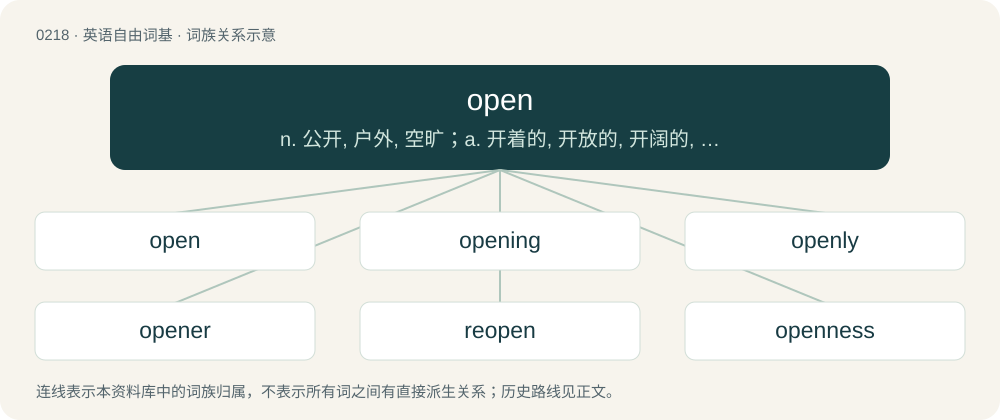

# 0242 · open — n. 公开, 户外, 空旷；a. 开着的, 开放的, 开阔的, 营业着的, 公开的, 悬而未决的；vt. 打开, 公开, 开放

[总目录](../00_总目录_按常用程度.md)

**类型**：英语自由词基　｜　**来源语言**：见词源记录

## 核心含义与来源

- 核心含义：n. 公开, 户外, 空旷；a. 开着的, 开放的, 开阔的, 营业着的, 公开的, 悬而未决的；vt. 打开, 公开, 开放
- 英文含义：Able to have something pass through or along it.
- 词形：open

**来源记录 1**（形容词；Able to have something pass through or along it.）

Adjective from Middle English open, from Old English open (“open”), from Proto-West Germanic \*opan, from Proto-Germanic \*upanaz (“open”), from Proto-Indo-European \*upo (“up from under, over”). Cognates \* Scots apen (“open”) \* Saterland Frisian eepen (“open”) \* West Frisian iepen (“open”) \* Cimbrian offe (“open”) \* Dutch open (“open”) \* German offen (“open”) \* Vilamovian ufa, uffa (“open”) \* Yiddish אָפֿן (ofn, “open”) \* Danish åben (“open”) \* Icelandic opinn (“open”) \* Norwegian Bokmål åpen (“open”) \* Norwegian Nynorsk open (“open”) \* Swedish öppen (“open”) Compare also Latin supinus (“on one's back, supine”), Albanian hap (“to open”). Related to up. Verb from Middle English openen, from Old English openian (“to open”), from Proto-West Germanic \*opanōn, from Proto-Germanic \*upanōną (“to raise; lift; open”), from Proto-Germanic \*upanaz (“open”, adjective). Cognate with Saterland Frisian eepenje (“to open”), West Frisian iepenje (“to open”), Dutch openen (“to open”), German öffnen (“to open”), Danish åbne (“to open”), Swedish öppna (“to open”), Norwegian Bokmål åpne (“to open”), Norwegian Nynorsk and Icelandic opna (“to open”). Related to English up. Noun from Middle English open (“an aperture or opening”), from the verb. In the sports sense, however, a shortening of “open competition”.

## 词族图

## 单词速览（常用到不常用）

| 单词 | 音标 | 释义 |
|---|---|---|
| [open](#w-1) | 英 /ˈəʊ.pən/；美 /ˈoʊ.pən/ | n. 公开, 户外, 空旷；a. 开着的, 开放的, 开阔的, 营业着的, 公开的, 悬而未决的；vt. 打开, 公开, 开放 |
| [opening](#w-2) | 英 /ˈəʊ.pə.nɪŋ/；美 /ˈoʊ.pə.nɪŋ/ | n. 开始, 口子, 穴, 揭幕；a. 开始的 |
| [openly](#w-3) | 美 /ˈoʊpənli/ | adv. 公开地, 坦率地, 直率地, 公然地 |
| [opener](#w-4) | 英 /ˈəʊ.pən.ə/；美 /ˈoʊ.pən.ɚ/ | n. 开...的人, 开局人, 开创人, 开具, 开启工具, 首项；\[经\] 申请开证人 |
| [reopen](#w-5) | /ɹiːˈəʊpən/ | v. 重开, 再开始, 再开 |
| [openness](#w-6) | /ˈəupənnis/ | n. 公开；宽阔；率真 |
| [opencast](#w-7) | /ˈəupənkɑːst/ | a. 露天开采的 |

## 逐词详解

### 1. open

**词性**：形容词　｜　**音标**：英 /ˈəʊ.pən/；美 /ˈoʊ.pən/

**中文释义**：n. 公开, 户外, 空旷；a. 开着的, 开放的, 开阔的, 营业着的, 公开的, 悬而未决的；vt. 打开, 公开, 开放

**英文义项**：Able to have something pass through or along it. / Not covered, sealed, etc.; having an opening or aperture showing what is inside.

**词源与演化**：

Adjective from Middle English open, from Old English open (“open”), from Proto-West Germanic \*opan, from Proto-Germanic \*upanaz (“open”), from Proto-Indo-European \*upo (“up from under, over”). Cognates \* Scots apen (“open”) \* Saterland Frisian eepen (“open”) \* West Frisian iepen (“open”) \* Cimbrian offe (“open”) \* Dutch open (“open”) \* German offen (“open”) \* Vilamovian ufa, uffa (“open”) \* Yiddish אָפֿן (ofn, “open”) \* Danish åben (“open”) \* Icelandic opinn (“open”) \* Norwegian Bokmål åpen (“open”) \* Norwegian Nynorsk open (“open”) \* Swedish öppen (“open”) Compare also Latin supinus (“on one's back, supine”), Albanian hap (“to open”). Related to up. Verb from Middle English openen, from Old English openian (“to open”), from Proto-West Germanic \*opanōn, from Proto-Germanic \*upanōną (“to raise; lift; open”), from Proto-Germanic \*upanaz (“open”, adjective). Cognate with Saterland Frisian eepenje (“to open”), West Frisian iepenje (“to open”), Dutch openen (“to open”), German öffnen (“to open”), Danish åbne (“to open”), Swedish öppna (“to open”), Norwegian Bokmål åpne (“to open”), Norwegian Nynorsk and Icelandic opna (“to open”). Related to English up. Noun from Middle English open (“an aperture or opening”), from the verb. In the sports sense, however, a shortening of “open competition”.

**例句**：

> Compared to their last match, which was a dour and defensive affair, this was a very open game.

该用例对应义项：Characterised by free-flowing play.

### 2. opening

**词性**：形容词　｜　**音标**：英 /ˈəʊ.pə.nɪŋ/；美 /ˈoʊ.pə.nɪŋ/

**中文释义**：n. 开始, 口子, 穴, 揭幕；a. 开始的

**英文义项**：Pertaining to the start or beginning of a series of events. / Of the first period of play, usually up to the fall of the first wicket.

**构词拆分**：open + -ing

**词源与演化**：

From Middle English openynge, openande, openand, from Old English openiende, from Proto-West Germanic \*opanōndī, from Proto-Germanic \*upanōndz, present participle of \*upanōną (“to open”), equivalent to open + -ing. Cognate with West Frisian iepenjend, Dutch openend, German öffnend, Swedish öppnande, Icelandic opnandi.

**例句**：

> The opening theme of Beethoven's Fifth Symphony is, perhaps, the most recognizable in all of European art music.

该用例对应义项：Pertaining to the start or beginning of a series of events.

### 3. openly

**词性**：副词　｜　**音标**：美 /ˈoʊpənli/

**中文释义**：adv. 公开地, 坦率地, 直率地, 公然地

**英文义项**：In an open manner; visibly.

**构词拆分**：By surface analysis, open + -ly

**词源与演化**：

From Middle English openli, from Old English openlīċe. By surface analysis, open + -ly.

**例句**：

> He openly flaunted his affection for his sister.

该用例对应义项：in an open way

### 4. opener

**词性**：名词　｜　**音标**：英 /ˈəʊ.pən.ə/；美 /ˈoʊ.pən.ɚ/

**中文释义**：n. 开...的人, 开局人, 开创人, 开具, 开启工具, 首项；\[经\] 申请开证人

**英文义项**：A person who opens something. / A device that opens something; specifically a tin-opener/can-opener, or a bottle opener.

**构词拆分**：open + -er (suffix forming agent nouns)

**词源与演化**：

From Middle English oppinnare, opynnare, from Old English openere, equivalent to open + -er (suffix forming agent nouns).

**例句**：

> The late-night openers in the mall include two restaurants and a clothing store.

该用例对应义项：An establishment that opens.

### 5. reopen

**词性**：动词　｜　**音标**：/ɹiːˈəʊpən/

**中文释义**：v. 重开, 再开始, 再开

**英文义项**：To open (something) again. / To open again.

**构词拆分**：re- + open

**词源与演化**：

From re- + open.

**例句**：

> Many countries are struggling to decide how and when to reopen schools.

### 6. openness

**词性**：名词　｜　**音标**：/ˈəupənnis/

**中文释义**：n. 公开；宽阔；率真

**英文义项**：Accommodating attitude or opinion, as in receptivity to new ideas, behaviors, cultures, peoples, environments, experiences, etc., different from the familiar, conventional, traditional, or one's own. / The degree to which a person, group, organization, institution, or society exhibits this liberal attitude or opinion.

**构词拆分**：open + -ness

**词源与演化**：

From Middle English \*opennesse, from Old English openness (“openness, publicity”), equivalent to open + -ness. Cognate with Old High German offannussi (“disclosure, revelation, openness”).

**例句**：

> His openness is a very positive quality, although not without its drawbacks.

### 7. opencast

**词性**：形容词　｜　**音标**：/ˈəupənkɑːst/

**中文释义**：a. 露天开采的

**英文义项**：Of or pertaining to strip mining, in which material is removed from a surface that has been exposed

**构词拆分**：open + cast

**词源与演化**：

From open + cast.

**例句**：

> The opencast lignite mines in Germany cover tens of square kilometers.
