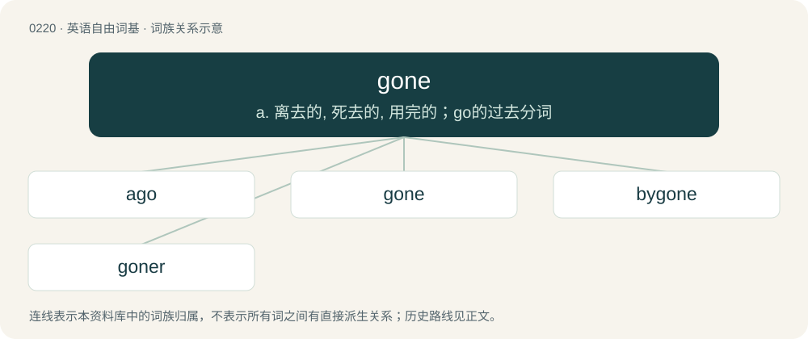

# 0243 · gone — a. 离去的, 死去的, 用完的；go的过去分词

[总目录](../00_总目录_按常用程度.md)

**类型**：英语自由词基　｜　**来源语言**：见词源记录

## 核心含义与来源

- 核心含义：a. 离去的, 死去的, 用完的；go的过去分词
- 英文含义：Away, having left.
- 词形：gone

**来源记录 1**（形容词；Away, having left.）

From Middle English gon, igon, gan, ȝegan, from Old English gān, ġegān, from Proto-Germanic \*gānaz (“gone”), past participle of \*gāną (“to go”). Cognate with West Germanic Scots gane (“gone”), West Frisian gien (“gone”), Low German gahn (“gone”), and Dutch gegaan (“gone”).

## 词族图

## 单词速览（常用到不常用）

| 单词 | 音标 | 释义 |
|---|---|---|
| [ago](#w-1) | 英 /əˈɡəʊ/；美 /əˈɡoʊ/ | adv. 以前 |
| [gone](#w-2) | 英 /ɡɒn/；美 /ɡɔn/ | a. 离去的, 死去的, 用完的；go的过去分词 |
| [bygone](#w-3) | 英 /ˈbaɪɡɒn/；美 /ˈbaɪɡɔn/ | n. 过去的事, 往事；a. 过去的 |
| [goner](#w-4) | 英 /ˈɡɒnə(ɹ)/；美 /ˈɡɔːnɚ/ | n. 已死者, 无法挽救的人 |

## 逐词详解

### 1. ago

**词性**：postp　｜　**音标**：英 /əˈɡəʊ/；美 /əˈɡoʊ/

**中文释义**：adv. 以前

**英文义项**：Before now, before the present time

**构词拆分**：a- + gone

**词源与演化**：

From Middle English ago, agon (“passed”), past participle of agon (“to depart, escape, pass”), from Old English āgān (“to go away, pass away, go forth, come to pass”), from Proto-Germanic \*uz- (“out”), \*gāną (“to go”), equivalent to a- + gone, and by surface analysis, a- + go. Cognate with German ergehen (“to come to pass, fare, go forth”). Compare also Old Saxon āgangan (“to go or pass by”), Gothic 𐌿𐍃𐌲𐌰𐌲𐌲𐌰𐌽 (usgaggan, “to go forth”).

**例句**：

> When they first met in 2000, my dad told my mom how he had gotten the money. The story begins 20 years ago.

该用例对应义项：Before now, before the present time

### 2. gone

**词性**：形容词　｜　**音标**：英 /ɡɒn/；美 /ɡɔn/

**中文释义**：a. 离去的, 死去的, 用完的；go的过去分词

**英文义项**：Away, having left. / No longer existing, having passed.

**词源与演化**：

From Middle English gon, igon, gan, ȝegan, from Old English gān, ġegān, from Proto-Germanic \*gānaz (“gone”), past participle of \*gāną (“to go”). Cognate with West Germanic Scots gane (“gone”), West Frisian gien (“gone”), Low German gahn (“gone”), and Dutch gegaan (“gone”).

**例句**：

> Have you seen the company's revenue? It's through the floor. They're gone.

该用例对应义项：Doomed, done for.

### 3. bygone

**词性**：形容词　｜　**音标**：英 /ˈbaɪɡɒn/；美 /ˈbaɪɡɔn/

**中文释义**：n. 过去的事, 往事；a. 过去的

**英文义项**：Having been or happened in the distant past.

**构词拆分**：by + gone

**词源与演化**：

From by (adverb) + gone. See go by.

**例句**：

> William's grandfather's stories always filled him with nostalgia for a bygone era.

### 4. goner

**词性**：名词　｜　**音标**：英 /ˈɡɒnə(ɹ)/；美 /ˈɡɔːnɚ/

**中文释义**：n. 已死者, 无法挽救的人

**英文义项**：Someone (or something) doomed; a hopeless case, especially someone who is bound to die soon. / A ball hit out of the playing area for a home run.

**构词拆分**：gone + -er

**词源与演化**：

From gone + -er. First attestations around 1850.

**例句**：

> You'll be a goner if I hit you with this gun.

该用例对应义项：Someone (or something) doomed; a hopeless case, especially someone who is bound to die soon.
