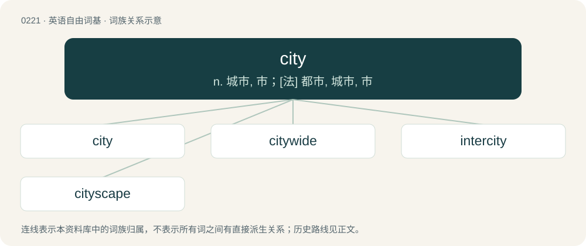

# 0244 · city — n. 城市, 市；\[法\] 都市, 城市, 市

[总目录](../00_总目录_按常用程度.md)

**类型**：英语自由词基　｜　**来源语言**：见词源记录

## 核心含义与来源

- 核心含义：n. 城市, 市；\[法\] 都市, 城市, 市
- 英文含义：A large settlement, bigger than a town; sometimes with a specific legal definition, depending on the place.
- 词形：city

**来源记录 1**（名词；A large settlement, bigger than a town; sometimes with a specific legal definition, depending on the place.）

Inherited from Middle English cite, derived from Old French cite, derived from Late Latin cīvitātem (“city”), in Classical Latin "citizenry", derived from cīvis (“fellow-citizen”), ultimately from Proto-Indo-European \*ḱey- (“lie down; settle”). Cognate with Old English hīwan pl (“members of one's household, servants”). See hewe. Doublet of civitas. Mostly displaced native Old English burg, whence Modern English borough.

## 词族图

## 单词速览（常用到不常用）

| 单词 | 音标 | 释义 |
|---|---|---|
| [city](#w-1) | 英 /sɪtɪ/；美 /ˈsɪt.i/ \[ˈsɪɾ.i\] | n. 城市, 市；\[法\] 都市, 城市, 市 |
| [citywide](#w-2) | /ˈsɪt.iˌwaɪd/ | a. 全市的, 全市性的 |
| [intercity](#w-3) | /.intəˈsiti/ | a. 城市间的 |
| [cityscape](#w-4) | /ˈsitiskeip/ | n. 都市风景 |

## 逐词详解

### 1. city

**词性**：名词　｜　**音标**：英 /sɪtɪ/；美 /ˈsɪt.i/ \[ˈsɪɾ.i\]

**中文释义**：n. 城市, 市；\[法\] 都市, 城市, 市

**英文义项**：A large settlement, bigger than a town; sometimes with a specific legal definition, depending on the place. / The central business district; downtown.

**词源与演化**：

Inherited from Middle English cite, derived from Old French cite, derived from Late Latin cīvitātem (“city”), in Classical Latin "citizenry", derived from cīvis (“fellow-citizen”), ultimately from Proto-Indo-European \*ḱey- (“lie down; settle”). Cognate with Old English hīwan pl (“members of one's household, servants”). See hewe. Doublet of civitas. Mostly displaced native Old English burg, whence Modern English borough.

**例句**：

> I'm going into the city today to do some shopping.

该用例对应义项：The central business district; downtown.

### 2. citywide

**词性**：形容词　｜　**音标**：/ˈsɪt.iˌwaɪd/

**中文释义**：a. 全市的, 全市性的

**英文义项**：Throughout a city.

**构词拆分**：city + -wide

**词源与演化**：

From city + -wide.

**用法示例／搭配（非完整句）**：

> citywide violence

该用例对应义项：Throughout a city.

### 3. intercity

**词性**：形容词　｜　**音标**：/.intəˈsiti/

**中文释义**：a. 城市间的

**英文义项**：Between cities; connecting cities with other cities.

**构词拆分**：inter- + city

**词源与演化**：

From inter- + city.

**例句**：

> I plan to catch an intercity train, or bus.

该用例对应义项：Between cities; connecting cities with other cities.

### 4. cityscape

**词性**：名词　｜　**音标**：/ˈsitiskeip/

**中文释义**：n. 都市风景

**英文义项**：The view of the buildings of a city, usually referring to a pictured landscape.

**构词拆分**：city + -scape

**词源与演化**：

From city + -scape.

**例句**：

> The dominant character of the cityscape is it poverty.

该用例对应义项：a viewpoint toward a city or other heavily populated area
