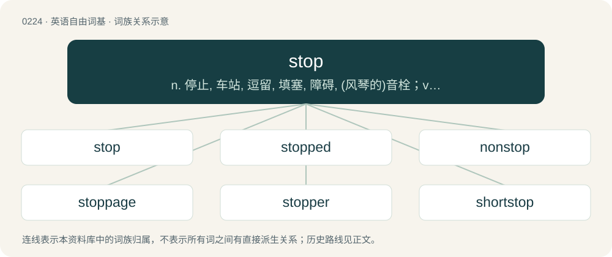

# 0247 · stop — n. 停止, 车站, 逗留, 填塞, 障碍, (风琴的)音栓；vi. 停止, 被塞住；vt. 塞住, 堵塞, 阻止, 击落, 停止, 终止, 断绝

[总目录](../00_总目录_按常用程度.md)

**类型**：英语自由词基　｜　**来源语言**：见词源记录

## 核心含义与来源

- 核心含义：n. 停止, 车站, 逗留, 填塞, 障碍, (风琴的)音栓；vi. 停止, 被塞住；vt. 塞住, 堵塞, 阻止, 击落, 停止, 终止, 断绝
- 英文含义：To cease moving.
- 词形：stop

**多个词源／构词路径**：同一拼写可能有不同来源；以下按词性和含义分别列出。

**来源记录 1**（动词；To cease moving.）

From Middle English stoppen, stoppien, from Old English stoppian (“to stop, close”), from Proto-West Germanic \*stoppōn, from Proto-Germanic \*stuppōną (“to stop, close”), \*stuppijaną (“to push, pierce, prick”), from Proto-Indo-European \*(s)tewp-, \*(s)tewb- (“to push; stick”), from \*(s)tew- (“to bump; impact; butt; push; beat; strike; hit”). Cognate with Saterland Frisian stopje (“to stop, block”), West Frisian stopje (“to stop”), Dutch stoppen (“to stop”), Low German stoppen (“to stop”), German stopfen (“to be filling, stuff”), German stoppen (“to stop”), Danish and Norwegian Bokmål stoppe (“to stop”), Icelandic, Norwegian Nynorsk, and Swedish stoppa (“to stop”), Middle High German stupfen, stüpfen (“to pierce”). More at stuff, stump. Alternative etymology derives Proto-West Germanic \*stoppōn from an assumed Vulgar Latin \*stūpāre, \*stuppāre (“to stop up with tow”), from stūpa, stīpa, stuppa (“tow, flax, oakum”), from Ancient Greek στύπη (stúpē), στύππη (stúppē, “tow, flax, oakum”). This derivation, however, is doubtful, as the earliest instances of the Germanic verb do not carry the meaning of "stuff, stop with tow". Rather, these senses developed later in response to influence from similar sounding words in Latin and Romance.

**来源记录 2**（名词；A small well-bucket; a milk-pail.）

From Middle English stoppe, from Old English stoppa (“bucket, pail, a stop”), from Proto-Germanic \*stuppô (“vat, vessel”), from Proto-Indo-European \*(s)teub- (“to push, hit; stick, stump”). See stoup. Cognates Cognate with Norwegian stopp, stoppa (“deep well, recess”), Middle High German stubech, stübich (“barrel, vat, unit of measure”) (German Stübchen). Related also to Middle Low German stōp (“beaker, flask”), Middle High German stouf (“beaker, flask”), Norwegian staupa (“goblet”), Icelandic staupa (“shot-glass”), Old English stēap (“a stoup, beaker, drinking vessel, cup, flagon”). Cognate to Albanian shtambë (“amphora, bucket”).

**来源记录 3**（名词；The squark that is the superpartner of a top quark.）

From s- + top.

## 词族图

## 单词速览（常用到不常用）

| 单词 | 音标 | 释义 |
|---|---|---|
| [stop](#w-1) | 英 /stɒp/；/stɑp/ | n. 停止, 车站, 逗留, 填塞, 障碍, (风琴的)音栓；vi. 停止, 被塞住；vt. 塞住, 堵塞, 阻止, 击落, 停止, 终止, 断绝 |
| [stopped](#w-2) | 英 /stɒpt/；美 /stɑpt/ | v. 停止；停下来（stop的过去式和过去分词） |
| [nonstop](#w-3) | 英 /ˌnɒnˈstɒp/；美 /ˌnɑnˈstɑp/ | a. 直达的, 不着陆的, 不休息的；adv. 不休息地；n. 直达车, 直达行驶 |
| [stoppage](#w-4) | /ˈstɔpidʒ/ | n. 停止, 中止, 阻塞, 阻碍, 堵塞, 故障, 停付, 扣除, 扣留, 停工, 罢工；\[化\] 停机 |
| [stopper](#w-5) | 英 /ˈstɒp.ə/；美 /ˈstɑ.pɚ/ | n. 阻止的人, 木塞, 制止器；vt. 用塞子塞住, 闭嘴 |
| [shortstop](#w-6) | 美 /ʃɔɹt.stap/ | n. 游击手, 停显液 |
| [backstop](#w-7) | /ˈbæk.stɒp/ | n. 挡球网, 接球手；\[电\] 背向停止 |
| [stopwatch](#w-8) | /ˈstɒpwɒtʃ/ | n. 计时表, 码表 |
| [stopgap](#w-9) | 英 /ˈstɒpɡæp/；美 /ˈstɑpˌɡæp/ | n. 权宜之计, 补缺者；a. 暂时的, 权宜的 |
| [stoplight](#w-10) | /ˈstɒplait/ | n. 交通信号灯 |
| [doorstop](#w-11) | /ˈdɒːstɒp/ | n. 制门器 |

## 逐词详解

### 1. stop

**词性**：动词　｜　**音标**：英 /stɒp/；/stɑp/

**中文释义**：n. 停止, 车站, 逗留, 填塞, 障碍, (风琴的)音栓；vi. 停止, 被塞住；vt. 塞住, 堵塞, 阻止, 击落, 停止, 终止, 断绝

**英文义项**：To cease moving. / Not to continue.

**词源与演化**：

From Middle English stoppen, stoppien, from Old English stoppian (“to stop, close”), from Proto-West Germanic \*stoppōn, from Proto-Germanic \*stuppōną (“to stop, close”), \*stuppijaną (“to push, pierce, prick”), from Proto-Indo-European \*(s)tewp-, \*(s)tewb- (“to push; stick”), from \*(s)tew- (“to bump; impact; butt; push; beat; strike; hit”). Cognate with Saterland Frisian stopje (“to stop, block”), West Frisian stopje (“to stop”), Dutch stoppen (“to stop”), Low German stoppen (“to stop”), German stopfen (“to be filling, stuff”), German stoppen (“to stop”), Danish and Norwegian Bokmål stoppe (“to stop”), Icelandic, Norwegian Nynorsk, and Swedish stoppa (“to stop”), Middle High German stupfen, stüpfen (“to pierce”). More at stuff, stump. Alternative etymology derives Proto-West Germanic \*stoppōn from an assumed Vulgar Latin \*stūpāre, \*stuppāre (“to stop up with tow”), from stūpa, stīpa, stuppa (“tow, flax, oakum”), from Ancient Greek στύπη (stúpē), στύππη (stúppē, “tow, flax, oakum”). This derivation, however, is doubtful, as the earliest instances of the Germanic verb do not carry the meaning of "stuff, stop with tow". Rather, these senses developed later in response to influence from similar sounding words in Latin and Romance.

**例句**：

> To achieve maximum depth of field, he stopped down to an f-stop of 22.

该用例对应义项：To adjust the aperture of a camera lens.

### 2. stopped

**词性**：形容词　｜　**音标**：英 /stɒpt/；美 /stɑpt/

**中文释义**：v. 停止；停下来（stop的过去式和过去分词）

**英文义项**：Not moving, but not properly parked or berthed; said also of the occupants of such a vehicle. / In the state resulting from having stopped.

**构词拆分**：stop + -ed

**词源与演化**：

From stop + -ed. In some senses, the adjective follows from the verb; in others, it may derive directly from the noun stop.

**例句**：

> They passed a stopped car on the side of the road, but realized there was nothing they could do to help.

该用例对应义项：Not moving, but not properly parked or berthed; said also of the occupants of such a vehicle.

### 3. nonstop

**词性**：形容词　｜　**音标**：英 /ˌnɒnˈstɒp/；美 /ˌnɑnˈstɑp/

**中文释义**：a. 直达的, 不着陆的, 不休息的；adv. 不休息地；n. 直达车, 直达行驶

**英文义项**：Without stopping; without interruption or break. / Describing a point mutation within a stop codon that causes the continued translation of an mRNA strand.

**构词拆分**：From non- + stop.

**词源与演化**：

From non- + stop.

**例句**：

> There's a nonstop flight to Mauritius, but I'm not sitting on the same plane for thirteen hours.

该用例对应义项：Without stopping; without interruption or break.

### 4. stoppage

**词性**：名词　｜　**音标**：/ˈstɔpidʒ/

**中文释义**：n. 停止, 中止, 阻塞, 阻碍, 堵塞, 故障, 停付, 扣除, 扣留, 停工, 罢工；\[化\] 停机

**英文义项**：A pause or halt of some activity. / Something that forms an obstacle to continued activity; a blockage or obstruction.

**构词拆分**：stop + -age

**词源与演化**：

From stop + -age.

**例句**：

> A soccer match lasts 90 minutes, without considering stoppage time.

### 5. stopper

**词性**：名词　｜　**音标**：英 /ˈstɒp.ə/；美 /ˈstɑ.pɚ/

**中文释义**：n. 阻止的人, 木塞, 制止器；vt. 用塞子塞住, 闭嘴

**英文义项**：Someone or something that stops something. / A type of knot at the end of a rope, to prevent it from unravelling.

**构词拆分**：stop + -er

**词源与演化**：

From stop + -er.

**例句**：

> Cattle futures: spillover momentum plus evidence of a strong stopper (i.e., 96 loads demanded) should kick the opening higher.

该用例对应义项：In the commodity futures market, someone who is long (owns) a futures contract and is demanding delivery because they want to take possession of the deliverable commodity.

### 6. shortstop

**词性**：名词　｜　**音标**：美 /ʃɔɹt.stap/

**中文释义**：n. 游击手, 停显液

**英文义项**：The infield defensive player that stands between the second baseman and the third baseman. / A nimble defender.

**构词拆分**：short + stop

**词源与演化**：

From short + stop.

**例句**：

> The shortstop ranged deep into the hole to make the stop.

该用例对应义项：The infield defensive player that stands between the second baseman and the third baseman.

### 7. backstop

**词性**：名词　｜　**音标**：/ˈbæk.stɒp/

**中文释义**：n. 挡球网, 接球手；\[电\] 背向停止

**英文义项**：An object or a person put in the rear or in the back of something to reinforce, hold, support. / A default arrangement that holds if all else fails.

**构词拆分**：back + stop

**词源与演化**：

From back + stop.

### 8. stopwatch

**词性**：名词　｜　**音标**：/ˈstɒpwɒtʃ/

**中文释义**：n. 计时表, 码表

**英文义项**：A timepiece designed to measure the amount of time elapsed between a particular time when activated and when the piece is deactivated.

**构词拆分**：stop + watch

**词源与演化**：

From stop + watch.

**例句**：

> The teacher also demonstrated with a stopwatch and a buzzer.

### 9. stopgap

**词性**：名词　｜　**音标**：英 /ˈstɒpɡæp/；美 /ˈstɑpˌɡæp/

**中文释义**：n. 权宜之计, 补缺者；a. 暂时的, 权宜的

**英文义项**：That which stops up or fills a gap or hole. / Something spoken to fill up an uncomfortable pause in speech; a filled pause or filler.

**构词拆分**：stop (“to close or block (an opening)”) + gap

**词源与演化**：

The noun is derived from stop (“to close or block (an opening)”) + gap, from the phrase to stop a gap. The adjective is from an attributive use of the noun, and the verb is derived from the noun.

**例句**：

> The small company used their old product with a few kludged enhancements as a stopgap until they could develop a new product.

该用例对应义项：A short-term fix or temporary measure used until something better can be obtained; that which serves as an expedient in an emergency; a band-aid solution.

### 10. stoplight

**词性**：名词　｜　**音标**：/ˈstɒplait/

**中文释义**：n. 交通信号灯

**英文义项**：A traffic control signal, traditionally consisting of three lights, colored green, yellow/amber, and red, meaning proceed, prepare to stop, and stop, respectively. / A light on the rear of a vehicle that is activated when braking; a brake light.

**构词拆分**：stop + light

**词源与演化**：

From stop + light.

**例句**：

> When the stoplight turns green the cars will start.

### 11. doorstop

**词性**：名词　｜　**音标**：/ˈdɒːstɒp/

**中文释义**：n. 制门器

**英文义项**：Any device or object used to halt the motion of a door, as a large or heavy object, a wedge, or some piece of hardware fixed to the floor, door or wall. / A large book, which by implication could be used to stop a door.

**构词拆分**：door + stop

**词源与演化**：

From door + stop.

**例句**：

> The door was held open with a doorstop.
