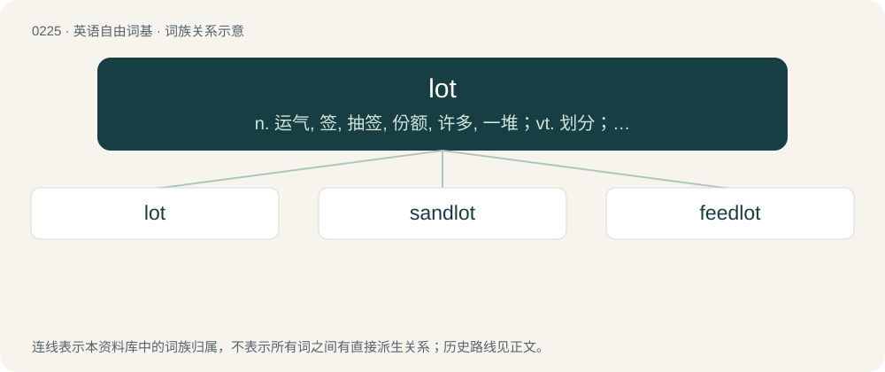

# 0248 · lot — n. 运气, 签, 抽签, 份额, 许多, 一堆；vt. 划分；vi. 抽签, 抓阄

[总目录](../00_总目录_按常用程度.md)

**类型**：英语自由词基　｜　**来源语言**：见词源记录

## 核心含义与来源

- 核心含义：n. 运气, 签, 抽签, 份额, 许多, 一堆；vt. 划分；vi. 抽签, 抓阄
- 英文含义：A large quantity or number; a great deal.
- 词形：lot

**来源记录 1**（名词；A large quantity or number; a great deal.）

From Middle English lot, from Old English hlot (“portion, choice, decision”), from Proto-West Germanic \*hlut, from Proto-Germanic \*hlutą. Cognate with North Frisian lod, Saterland Frisian Lot, West Frisian lot, Dutch lot, French lot, German Low German Lott, Middle High German luz. Doublet of lotto. Related also to German Los.

## 词族图

## 单词速览（常用到不常用）

| 单词 | 音标 | 释义 |
|---|---|---|
| [lot](#w-1) | 英 /lɒt/；美 /lɑt/ | n. 运气, 签, 抽签, 份额, 许多, 一堆；vt. 划分；vi. 抽签, 抓阄 |
| [sandlot](#w-2) | /ˈsændlɔt/ | n. 沙地, 小孩们的运动用空地 |
| [feedlot](#w-3) | /ˈfiːdlɒt/ | n. 饲育场 |

## 逐词详解

### 1. lot

**词性**：名词　｜　**音标**：英 /lɒt/；美 /lɑt/

**中文释义**：n. 运气, 签, 抽签, 份额, 许多, 一堆；vt. 划分；vi. 抽签, 抓阄

**英文义项**：A large quantity or number; a great deal. / A separate, appropriated portion; a quantized, subdivided set consisting a whole.

**词源与演化**：

From Middle English lot, from Old English hlot (“portion, choice, decision”), from Proto-West Germanic \*hlut, from Proto-Germanic \*hlutą. Cognate with North Frisian lod, Saterland Frisian Lot, West Frisian lot, Dutch lot, French lot, German Low German Lott, Middle High German luz. Doublet of lotto. Related also to German Los.

**例句**：

> The table was loaded with food, but by evening there was nothing but crumbs; we had eaten the lot.

该用例对应义项：All members of a set; everything.

### 2. sandlot

**词性**：名词　｜　**音标**：/ˈsændlɔt/

**中文释义**：n. 沙地, 小孩们的运动用空地

**英文义项**：A vacant lot where children play.

**构词拆分**：sand + lot

**词源与演化**：

From sand + lot.

**例句**：

> Many great players started out playing sandlot baseball.

该用例对应义项：A vacant lot where children play.

### 3. feedlot

**词性**：名词　｜　**音标**：/ˈfiːdlɒt/

**中文释义**：n. 饲育场

**英文义项**：Land on which livestock are fattened for market.

**构词拆分**：feed + lot

**词源与演化**：

From feed + lot.
