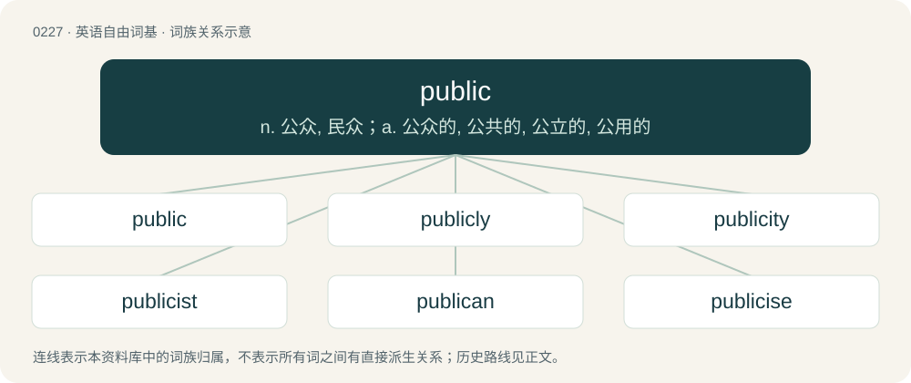

# 0251 · public — n. 公众, 民众；a. 公众的, 公共的, 公立的, 公用的

[总目录](../00_总目录_按常用程度.md)

**类型**：英语自由词基　｜　**来源语言**：见词源记录

## 核心含义与来源

- 核心含义：n. 公众, 民众；a. 公众的, 公共的, 公立的, 公用的
- 英文含义：Able to be known or seen by everyone; happening without concealment; open to general view.
- 词形：public

**多个词源／构词路径**：同一拼写可能有不同来源；以下按词性和含义分别列出。

**来源记录 1**（形容词；Able to be known or seen by everyone; happening without concealment; open to general view.）

The adjective and noun are derived from Late Middle English publik, publike (“(adjective) generally observable, public; relating to the general public or public affairs; (noun) a generally observable place or situation”), from Anglo-Norman public, publik, publique, Middle French public, publique, and Old French public (“(adjective) generally observable, public; relating to the general public; official; (noun) community or its members collectively; nation, state; audience, spectators collectively”) (modern French public, publique (obsolete)); and from their etymon Latin pūblicus (“of or belonging to the community, people, or state; general, public”), an alteration of poplicus (influenced by pūbēs (“adult men; male population”)), from poplus (“community; the people, public; nation, state”) (later populus; from Proto-Italic \*poplos (“army”); further origin uncertain, possibly from Etruscan or from Proto-Indo-European \*pleh₁- (“to fill”)) + -icus (suffix meaning ‘of or pertaining to’). Related to people, populus, etc. The Middle English word displaced native Old English ceorlfolc and folclic. The verb is derived from the adjective.

**来源记录 2**（名词；An internet publication.）

Semantic loan from Russian па́блик (páblik) and Ukrainian па́блік (páblik, “public webpage on a blog or on social media”), both borrowed from English public: see etymology 1.

## 词族图

## 单词速览（常用到不常用）

| 单词 | 音标 | 释义 |
|---|---|---|
| [public](#w-1) | 英 /ˈpʌb.lɪk/ | n. 公众, 民众；a. 公众的, 公共的, 公立的, 公用的 |
| [publicly](#w-2) | 英 /ˈpʌb.lɪ.kli/ | adv. 公然地, 以公众名义 |
| [publicity](#w-3) | /pʌbˈlɪsɪti/ | n. 名声, 宣传, 公开场合；\[经\] 宣传, 广告 |
| [publicist](#w-4) | /ˈpʌblisist/ | n. 国际法学家, 政治评论家, 政治作家, 广告员；\[法\] 国际法学家, 公法学家, 政治学 |
| [publican](#w-5) | 英 /ˈpʌblɪk(ə)n/；美 /ˈpʌblək(ə)n/ | n. 小酒馆老板, 酒店老板, 客栈老板, 征收员 |
| [publicise](#w-6) | /ˈpʌblɪ(ˌ)saɪz/ | vt. 公布, 为...做广告, 宣传 |
| [nonpublic](#w-7) |  | \[网络\] 非公开 |

## 逐词详解

### 1. public

**词性**：形容词　｜　**音标**：英 /ˈpʌb.lɪk/

**中文释义**：n. 公众, 民众；a. 公众的, 公共的, 公立的, 公用的

**英文义项**：Able to be known or seen by everyone; happening without concealment; open to general view. / Open to all members of a community, as opposed to only a segment of it; especially, provided by national or local authorities and supported by money from taxes.

**词源与演化**：

The adjective and noun are derived from Late Middle English publik, publike (“(adjective) generally observable, public; relating to the general public or public affairs; (noun) a generally observable place or situation”), from Anglo-Norman public, publik, publique, Middle French public, publique, and Old French public (“(adjective) generally observable, public; relating to the general public; official; (noun) community or its members collectively; nation, state; audience, spectators collectively”) (modern French public, publique (obsolete)); and from their etymon Latin pūblicus (“of or belonging to the community, people, or state; general, public”), an alteration of poplicus (influenced by pūbēs (“adult men; male population”)), from poplus (“community; the people, public; nation, state”) (later populus; from Proto-Italic \*poplos (“army”); further origin uncertain, possibly from Etruscan or from Proto-Indo-European \*pleh₁- (“to fill”)) + -icus (suffix meaning ‘of or pertaining to’). Related to people, populus, etc. The Middle English word displaced native Old English ceorlfolc and folclic. The verb is derived from the adjective.

**用法示例／搭配（非完整句）**：

> public housing public officer public prosecutor public servant

该用例对应义项：Officially representing the community; carried out or funded by the government or state on behalf of the community, rather than by a private organization.

### 2. publicly

**词性**：副词　｜　**音标**：英 /ˈpʌb.lɪ.kli/

**中文释义**：adv. 公然地, 以公众名义

**英文义项**：In public, openly, in an open and public manner. / By, for, or on behalf of the public.

**构词拆分**：public + -ly

**词源与演化**：

From public + -ly.

**用法示例／搭配（非完整句）**：

> publicly announce something

该用例对应义项：In public, openly, in an open and public manner.

### 3. publicity

**词性**：名词　｜　**音标**：/pʌbˈlɪsɪti/

**中文释义**：n. 名声, 宣传, 公开场合；\[经\] 宣传, 广告

**英文义项**：Advertising or other activity designed to rouse public interest in something. / Public interest attracted in this way.

**构词拆分**：public + -ity

**词源与演化**：

From French publicité, From Medieval Latin pūblicitātem, accusative singular of pūblicitās, from Latin pūblicus (“public, general”). Morphologically public + -ity.

**例句**：

> The publicity of the court room.

该用例对应义项：the quality of being open to public view

### 4. publicist

**词性**：名词　｜　**音标**：/ˈpʌblisist/

**中文释义**：n. 国际法学家, 政治评论家, 政治作家, 广告员；\[法\] 国际法学家, 公法学家, 政治学

**英文义项**：A person whose job is to publicize information or events; a publicity agent; a public relations agent or worker. / A journalist, often a commentator, who focusses on politics.

**构词拆分**：public + -ist

**词源与演化**：

Borrowed from French publiciste, equivalent to public + -ist.

**例句**：

> The publicist boasted of her multifarious contacts across film, fashion, and politics.

### 5. publican

**词性**：名词　｜　**音标**：英 /ˈpʌblɪk(ə)n/；美 /ˈpʌblək(ə)n/

**中文释义**：n. 小酒馆老板, 酒店老板, 客栈老板, 征收员

**英文义项**：The landlord (manager or owner) of a public house (“a bar or tavern, often also selling food and sometimes lodging; a pub”). / The manager or owner of a hotel.

**构词拆分**：public (“open to all members of a community”) + -an (suffix forming agent nouns)

**词源与演化**：

Probably from public house (“(Britain) bar or tavern, often also selling food and sometimes lodging, pub”) or public (“open to all members of a community”) + -an (suffix forming agent nouns), apparently originally used humorously.

### 6. publicise

**词性**：动词　｜　**音标**：/ˈpʌblɪ(ˌ)saɪz/

**中文释义**：vt. 公布, 为...做广告, 宣传

**英文义项**：To make widely known to the public. / To advertise, create publicity for.

**构词拆分**：From public + -ise.

**词源与演化**：

From public + -ise.

### 7. nonpublic

**词性**：形容词

**中文释义**：\[网络\] 非公开

**英文义项**：Not open to the public; not available to or shared by the public; private.

**构词拆分**：From non- + public.

**词源与演化**：

From non- + public.
