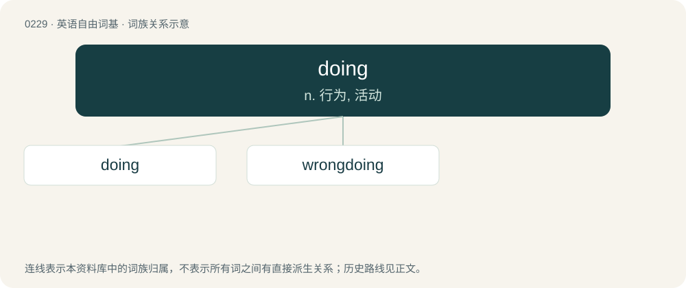

# 0254 · doing — n. 行为, 活动

[总目录](../00_总目录_按常用程度.md)

**类型**：英语自由词基　｜　**来源语言**：见词源记录

## 核心含义与来源

- 核心含义：n. 行为, 活动
- 英文含义：A deed or action, especially when somebody is held responsible for it.
- 词形：doing

**多个词源／构词路径**：同一拼写可能有不同来源；以下按词性和含义分别列出。

**来源记录 1**（名词；A deed or action, especially when somebody is held responsible for it.）

See do.

**来源记录 2**（感叹词；The sound made by an elastic object when struck by or striking a hard object.）

Onomatopoeic.

## 词族图

## 单词速览（常用到不常用）

| 单词 | 音标 | 释义 |
|---|---|---|
| [doing](#w-1) | /ˈduːɪŋ/ | n. 行为, 活动 |
| [wrongdoing](#w-2) | /ˈɹɒŋˌduːɪŋ/ | n. 干坏事, 坏事 |

## 逐词详解

### 1. doing

**词性**：名词　｜　**音标**：/ˈduːɪŋ/

**中文释义**：n. 行为, 活动

**英文义项**：A deed or action, especially when somebody is held responsible for it.

**词源与演化**：

See do.

**例句**：

> Draining that swamp is going to take some doing!

该用例对应义项：A deed or action, especially when somebody is held responsible for it.

### 2. wrongdoing

**词性**：名词　｜　**音标**：/ˈɹɒŋˌduːɪŋ/

**中文释义**：n. 干坏事, 坏事

**英文义项**：Violation of standards of behavior. / An instance of doing wrong.

**构词拆分**：wrong + doing

**词源与演化**：

From Middle English wrong doyng, wrong doynge, wrong doinge, equivalent to wrong + doing.

**例句**：

> A Chinese proverb goes, "He who commits wrongdoing repeatedly will come to no good end."

该用例对应义项：Violation of standards of behavior.
