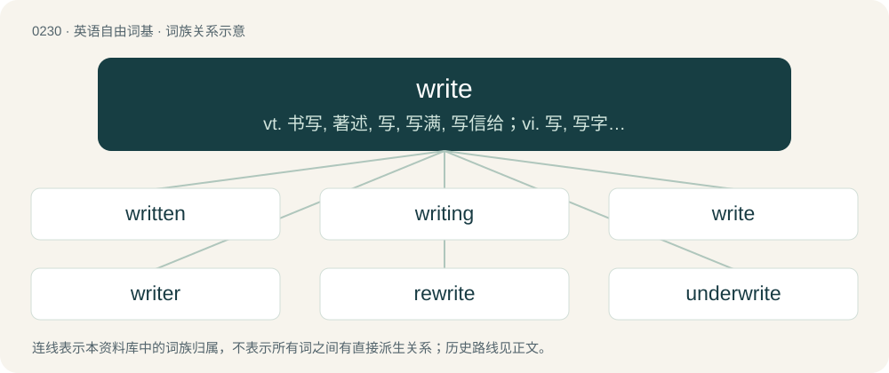

# 0256 · write — vt. 书写, 著述, 写, 写满, 写信给；vi. 写, 写字, 写信, 写作, 作曲；\[计\] 书写器

[总目录](../00_总目录_按常用程度.md)

**类型**：英语自由词基　｜　**来源语言**：见词源记录

## 核心含义与来源

- 核心含义：vt. 书写, 著述, 写, 写满, 写信给；vi. 写, 写字, 写信, 写作, 作曲；\[计\] 书写器
- 英文含义：To form letters, words or symbols on a surface in order to communicate.
- 词形：write

**来源记录 1**（动词；To form letters, words or symbols on a surface in order to communicate.）

From Middle English writen, from Old English wrītan, from Proto-West Germanic \*wrītan, from Proto-Germanic \*wrītaną (“to carve, write”), from Proto-Indo-European \*wrey- (“to rip, tear”). Cognate with West Frisian write (“to wear by rubbing, rip, tear”), Dutch wrijten (“to argue, quarrel”), Middle Low German wrîten (“to scratch, draw, write”) (&gt; Low German wrieten, rieten (“to tear, split”)), German reißen (“to tear, rip”), Norwegian rita (“to rough-sketch, carve, write”), Swedish rita (“to draw, design, delineate, model”), Icelandic ríta, rita (“to inscribe, sketch, write”), German ritzen (“to carve, scratch”), Proto-Slavic \*ryti (“to carve, engrave, dig”), Polish ryć (“to engrave, dig”), Czech rýt (“to engrave, dig”). See also rit and rat.

## 词族图

## 单词速览（常用到不常用）

| 单词 | 音标 | 释义 |
|---|---|---|
| [written](#w-1) | /ˈɹɪ.tn̩/ | a. 书面的, 写成文字的；write的过去分词 |
| [writing](#w-2) | /ˈɹaɪtɪŋ/ | n. 书写, 著作, 笔迹, 作品；\[医\] 书写 |
| [write](#w-3) | 美 /ɹəɪt/；/ɹaɪt/ | vt. 书写, 著述, 写, 写满, 写信给；vi. 写, 写字, 写信, 写作, 作曲；\[计\] 书写器 |
| [writer](#w-4) | 英 /ˈɹaɪ.tə(ɹ)/；美 /ˈɹaɪ.təɹ/ | n. 作家, 撰稿者, 抄写员；\[化\] 记录器 |
| [rewrite](#w-5) | 英 /ɹiːˈɹaɪt/；美 /ɹiˈɹaɪt/ | vt. 重写, 改写, 改写新闻, 书面答复；vi. 修改旧作；n. 改写的作品 |
| [underwrite](#w-6) | /ˈʌndəɹaɪt/ | vt. 签名于下, 给...保险；vi. 经营保险业 |
| [overwrite](#w-7) | 英 /əʊ.vəˈɹaɪt/；美 /oʊ.vɚˈɹaɪt/ | vi. 写得过多(或长)；vt. 写得过多, 用华丽文体写, 写在...上面；\[计\] 改写 |

## 逐词详解

### 1. written

**词性**：形容词　｜　**音标**：/ˈɹɪ.tn̩/

**中文释义**：a. 书面的, 写成文字的；write的过去分词

**英文义项**：Of, relating, or characteristic of writing (i.e., of that which has been written). / Having been written.

**构词拆分**：write + -en

**词源与演化**：

Morphologically write + -en.

**例句**：

> I can speak Japanese fairly well, but I have no understanding whatsoever of written Japanese.

该用例对应义项：Having been written.

### 2. writing

**词性**：名词　｜　**音标**：/ˈɹaɪtɪŋ/

**中文释义**：n. 书写, 著作, 笔迹, 作品；\[医\] 书写

**英文义项**：Graphism of symbols such as letters that express some meaning. / Something written, such as a document, article or book.

**构词拆分**：write + -ing

**词源与演化**：

From Middle English writing, writyng, wryting, wrytyng, from Old English wrīting (“writing”), equivalent to write + -ing.

**例句**：

> Congrats, you did an interesting piece of writing.

该用例对应义项：A work of an author.

### 3. write

**词性**：动词　｜　**音标**：美 /ɹəɪt/；/ɹaɪt/

**中文释义**：vt. 书写, 著述, 写, 写满, 写信给；vi. 写, 写字, 写信, 写作, 作曲；\[计\] 书写器

**英文义项**：To form letters, words or symbols on a surface in order to communicate. / To be the author of (a book, article, poem, etc.).

**词源与演化**：

From Middle English writen, from Old English wrītan, from Proto-West Germanic \*wrītan, from Proto-Germanic \*wrītaną (“to carve, write”), from Proto-Indo-European \*wrey- (“to rip, tear”). Cognate with West Frisian write (“to wear by rubbing, rip, tear”), Dutch wrijten (“to argue, quarrel”), Middle Low German wrîten (“to scratch, draw, write”) (&gt; Low German wrieten, rieten (“to tear, split”)), German reißen (“to tear, rip”), Norwegian rita (“to rough-sketch, carve, write”), Swedish rita (“to draw, design, delineate, model”), Icelandic ríta, rita (“to inscribe, sketch, write”), German ritzen (“to carve, scratch”), Proto-Slavic \*ryti (“to carve, engrave, dig”), Polish ryć (“to engrave, dig”), Czech rýt (“to engrave, dig”). See also rit and rat.

**例句**：

> Please write your name at the top of the page.

请在页面顶部写下你的名字。

### 4. writer

**词性**：名词　｜　**音标**：英 /ˈɹaɪ.tə(ɹ)/；美 /ˈɹaɪ.təɹ/

**中文释义**：n. 作家, 撰稿者, 抄写员；\[化\] 记录器

**英文义项**：A person who writes, or produces literary work; an author can refer to themselves as "the writer". / Anything that writes or produces output.

**构词拆分**：write + -er；writ + -er

**词源与演化**：

From Middle English writer, writere, from Old English wrītere (“draughtsman; painter; writer; scribe; copyist”) and ġewritere (“writer; composer”), equivalent to write + -er and writ + -er. Cognate with Icelandic ritari (“clerk, secretary”), Faroese ritari (“clerk, secretary”).

**例句**：

> Has your girlfriend written you another letter already? She’s quite a writer!

该用例对应义项：A person who writes, or produces literary work; an author can refer to themselves as "the writer".

### 5. rewrite

**词性**：动词　｜　**音标**：英 /ɹiːˈɹaɪt/；美 /ɹiˈɹaɪt/

**中文释义**：vt. 重写, 改写, 改写新闻, 书面答复；vi. 修改旧作；n. 改写的作品

**英文义项**：To write again, differently; to modify; to revise. / To write again (without changes).

**构词拆分**：re- + write

**词源与演化**：

From re- + write.

**例句**：

> She decided to rewrite the final paragraph.

她决定重写最后一段。

### 6. underwrite

**词性**：动词　｜　**音标**：/ˈʌndəɹaɪt/

**中文释义**：vt. 签名于下, 给...保险；vi. 经营保险业

**英文义项**：To write below or under; subscribe. / To sign; to put one's name to.

**构词拆分**：By surface analysis, under- + write

**词源与演化**：

From Middle English underwriten, from Old English underwrītan (“to write at the foot of, write under, subscribe”). Compare Dutch onderschrijven (“to endorse”), German unterschreiben (“to sign; endorse”), Danish underskrive (“to sign; endorse”). By surface analysis, under- + write.

**例句**：

> Not every company can afford to underwrite such an expensive event.

### 7. overwrite

**词性**：动词　｜　**音标**：英 /əʊ.vəˈɹaɪt/；美 /oʊ.vɚˈɹaɪt/

**中文释义**：vi. 写得过多(或长)；vt. 写得过多, 用华丽文体写, 写在...上面；\[计\] 改写

**英文义项**：To destroy (older) data by recording new data over it. / To cover in writing; to write over the top of.

**构词拆分**：over- + write

**词源与演化**：

From over- + write.

**例句**：

> Do you want to overwrite the previous saved data?
