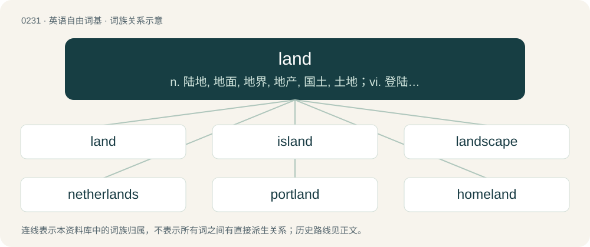

# 0257 · land — n. 陆地, 地面, 地界, 地产, 国土, 土地；vi. 登陆, 登岸, 到达；vt. 使上岸, 使登陆, 使到达

[总目录](../00_总目录_按常用程度.md)

**类型**：英语自由词基　｜　**来源语言**：见词源记录

## 核心含义与来源

- 核心含义：n. 陆地, 地面, 地界, 地产, 国土, 土地；vi. 登陆, 登岸, 到达；vt. 使上岸, 使登陆, 使到达
- 英文含义：The part of Earth which is not covered by oceans or other bodies of water.
- 词形：land

**多个词源／构词路径**：同一拼写可能有不同来源；以下按词性和含义分别列出。

**来源记录 1**（名词；The part of Earth which is not covered by oceans or other bodies of water.）

From Middle English lond, land, from Old English land, from Proto-West Germanic \*land, from Proto-Germanic \*landą (“land”), from Proto-Indo-European \*lendʰ- (“land, heath”). Cognates Cognate with Scots laund (“land”), Yola lhoan, lloan, loan, londe, lone (“land”), North Frisian loun, luin, lun, Lön, lönj, löön (“land”), Saterland Frisian Lound (“land”), West Frisian lân (“land”), Limburgish Land, landj, Laïnt (“land”), Dutch land (“land, country”), Luxembourgish and German Land (“land, country, state”), Vilamovian łaond (“land”), Danish, Elfdalian, Faroese, Icelandic, Norwegian Bokmål, Norwegian Nynorsk and Swedish land (“land, country, shore, territory”). Non-Germanic cognates include Old Irish lann (“heath”), Welsh llan (“enclosure”), Breton lann (“heath”), Old Church Slavonic лѧдо (lędo), from Proto-Slavic \*lędo (“heath, wasteland”), French lande (“heath”) and Albanian lëndinë (“heath, grassland”).

**来源记录 2**（名词；lant; urine）

From Middle English \*land, from Old English hland. More at lant.

## 词族图

## 单词速览（常用到不常用）

| 单词 | 音标 | 释义 |
|---|---|---|
| [land](#w-1) | /lænd/ | n. 陆地, 地面, 地界, 地产, 国土, 土地；vi. 登陆, 登岸, 到达；vt. 使上岸, 使登陆, 使到达 |
| [island](#w-2) | Western /ˈaɪlənd/ | n. 岛, 岛屿, 孤立地区, 安全岛；vt. 使成岛状, 孤立 |
| [landscape](#w-3) | 英 /ˈlan(d)skeɪp/ | n. 风景, 山水, 风景画；vi. 从事景观美化；vt. 美化...景观 |
| [netherlands](#w-4) |  | 【英文】Hindquarters, butt. |
| [portland](#w-5) |  | 【英文】The land around a port |
| [homeland](#w-6) | 英 /ˈhəʊmˌlænd/；美 /ˈhoʊmˌlænd/ | n. 本国, 故国 |
| [mainland](#w-7) | 英 /ˈmeɪnlænd/；美 /ˈmeɪnlənd/ | n. 大陆, 本土；\[法\] 大陆 |
| [landlord](#w-8) | 英 /ˈlænd.lɔːd/；美 /ˈlæn(d).lɔɹd/ | n. 房东, 地主；\[经\] 业主, 地主, 房东 |
| [landmark](#w-9) | 英 /ˈlændmɑːk/；美 /ˈlændmɑɹk/ | n. 陆标, 划时代的事, 地界标；\[医\] 界标 |
| [inland](#w-10) | /ˈɪnlənd/ | a. 内陆的, 国内的；n. 内地 |
| [iceland](#w-11) |  | 【英文】A land or region of icy terrain. |
| [highland](#w-12) | /ˈhaɪ.lənd/ | n. 高地, 苏格兰高地 |
| [woodland](#w-13) | 英 /ˈwʊd.lənd/ | n. 林区, 林地 |
| [wonderland](#w-14) | 英 /ˈwʌndəˌlænd/；美 /ˈwʌndɚˌlænd/ | n. 奇境, 仙境, 非常奇妙的地方 |
| [landslide](#w-15) | 英 /ˈlæn(d).slaɪd/ | n. 山崩；\[化\] 滑坡 |
| [midland](#w-16) | /ˈmidlənd/ | n. 中部地方, 内地 |
| [farmland](#w-17) | 英 /ˈfɑːmlænd/；美 /ˈfɑːɹmlænd/ | n. 农田 |
| [landfill](#w-18) | 英 /ˈlæn(d).fɪl/ | n. 垃圾堆；垃圾填埋地 |
| [heartland](#w-19) | 英 /ˈhɑːtlənd/；美 /ˈhɑɹtlənd/ | n. 心脏地区, 中心地带 |
| [overland](#w-20) | /ˈəuvəlænd/ | a. 经由陆路的, 经过陆地的；adv. 经由陆路地 |
| [wasteland](#w-21) | 英 /ˈweɪs(t)ˌland/；美 /ˈweɪs(t)ˌlænd/ | n. 荒地, 未开垦地 |
| [lander](#w-22) | /ˈlændə/ | n. 出铁槽；着陆器；把钩工人 |
| [wetland](#w-23) | /ˈwetlænd/ | n. 湿地, 沼泽地；\[经\] 湿地 |
| [landowner](#w-24) | 英 /ˈlændˌəʊ.nə/；美 /ˈlændˌoʊ.nɚ/ | n. 地主；\[法\] 土地所有人, 地主 |
| [landfall](#w-25) | 英 /ˈlænd.fɔːl/；美 /ˈlænd.fɔl/ | n. 初见陆地, 到达陆地, 着陆 |
| [upland](#w-26) | 英 /ˈʌplənd/；美 /ˈʌplənd/ | n. 山地, 高地, 高原；a. 高地的, 山地的 |
| [parkland](#w-27) | /ˈpɑːk.lænd/ | n. 公用场地；有树丛的开阔草地 |
| [motherland](#w-28) | 英 /ˈmʌð.ə.lænd/；美 /ˈmʌðɚˌlænd/ | n. 祖国 |
| [grassland](#w-29) | /ˈgræslænd/ | n. 牧草地, 草原 |
| [kirkland](#w-30) |  | 【英文】Land owned by the church. |
| [landline](#w-31) | 美 /ˈlændˌlaɪn/ | n. 输送路线, 地上通讯线, 地平线；\[电\] 陆线 |
| [lowland](#w-32) | /ˈləulənd/ | n. 低地, 苏格兰低地；a. 低地的 |
| [fatherland](#w-33) | /ˈfɑːðəˈlænd/ | n. 祖国 |
| [lakeland](#w-34) |  | 【英文】Terrain with many lakes. |
| [landlady](#w-35) | 英 /ˈlæn(d)ˌleɪ.di/ | n. 女房东, 女地主 |
| [southland](#w-36) | /ˈsajθlənd, -lænd/ | n. 南国, 南部地方 |
| [neverland](#w-37) | /ˈnevəlænd/ | n. 梦幻岛；永无乡（等于never-never land, 童话故事里彼得·潘生活的地方） |
| [rockland](#w-38) |  | n. (Rockland)人名；(瑞典)罗克兰；罗克兰 |
| [landlocked](#w-39) | 英 /ˈlændlɒkt/；美 /ˈlændlɑkt/ | a. 被陆地围住的 |
| [headland](#w-40) | /ˈhɛdlənd/ | n. 陆岬, 未耕地 |
| [moorland](#w-41) | /ˈmuələnd/ | n. 高沼地 |
| [timberland](#w-42) | /ˈtimbəlænd/ | n. 森林, 林地 |
| [northland](#w-43) | /ˈnɒːθlənd/ | n. 北国, 北部地方, 北部地带 |
| [gangland](#w-44) | /ˈ^æŋlænd/ | n. 黑社会, 强盗世界；\[法\] 黑社会, 强盗世界 |
| [landmass](#w-45) | 英 /ˈlænd.mæs/ | n. 陆块 |
| [landless](#w-46) | /ˈlændlis/ | a. 无土地的, 无土地所有权的 |
| [netherland](#w-47) |  | 【英文】A supposed place to which one's spirit descends upon death; the netherworld. |
| [westland](#w-48) |  | 【英文】The western part of a geographic area; a land lying to the west. |
| [bushland](#w-49) | /ˈbjʃlænd/ | n. 未开垦森林地带 |
| [fairyland](#w-50) | /ˈfєərilænd/ | n. 仙境, 乐园 |
| [wildland](#w-51) | /ˈwaildlænd/ | n. 荒地 |
| [borderland](#w-52) | /ˈbɔː(ɹ).də(ɹ)ˌlænd/ | n. 边界地方, 边陲, 两可间的状态 |
| [eastland](#w-53) |  | \[人名\] 伊斯特兰; \[地名\] \[美国\] 伊斯特兰 |
| [marshland](#w-54) |  | n. 沼泽地区, 沼泽地 |
| [copland](#w-55) |  | 【英文】The world of police officers and police activity. |
| [cropland](#w-56) | /ˈkrɔplænd/ | \[经\] 农地 |
| [vineland](#w-57) | /ˈvainlænd/ | n. (适宜于种植葡萄的)葡萄地 |
| [outland](#w-58) | /ˈautlænd. -lənd/ | n. 靠近边界之土地, 边境地区 |
| [dryland](#w-59) | /ˈdrailænd/ | n. 旱地 |
| [landward](#w-60) | 美 /ˈlændwɚd/ | a. 向陆的, 近陆的；adv. 向陆地 |
| [wheatland](#w-61) | /ˈhwiːtlænd/ | n. 小麦地, 适宜种小麦的地 |
| [lackland](#w-62) | /ˈlæklænd/ | \[人名\] 拉克兰 |
| [rangeland](#w-63) | /ˈreindʒlænd/ | n. 牧场 |
| [flatland](#w-64) | 英 /ˈflatlənd/ | 平原 |
| [scrubland](#w-65) | /ˈskrʌblænd/ | n. 灌木丛林地 |
| [landsman](#w-66) | /ˈlændzmən/ | n. 同胞, 未出过海的人 |
| [foreland](#w-67) | /ˈfɒːlənd/ | n. 沿海地区, 海角, 海岸地 |
| [landform](#w-68) | 英 /ˈlænd.fɔːm/；美 /ˈlænd.fɔɹm/ | n. 地形 |
| [swampland](#w-69) | /ˈswɔmplænd, ˈswɔːm-/ | n. 沼泽地 |
| [heathland](#w-70) | /ˈhiːθlænd/ | n. &lt;英&gt;欧石南丛生的荒野 |
| [landowning](#w-71) | /ˈlænd,əjniŋ/ | a. 拥有土地的, 有关土地所有权的；n. 作为地主 |
| [playland](#w-72) | /pˈleɪlænd/ | 操场, （儿童）游戏场 |

## 逐词详解

### 1. land

**词性**：名词　｜　**音标**：/lænd/

**中文释义**：n. 陆地, 地面, 地界, 地产, 国土, 土地；vi. 登陆, 登岸, 到达；vt. 使上岸, 使登陆, 使到达

**英文义项**：The part of Earth which is not covered by oceans or other bodies of water. / Real estate or landed property; a partitioned and measurable area which is owned and acquired and on which buildings and structures can be built and erected.

**词源与演化**：

From Middle English lond, land, from Old English land, from Proto-West Germanic \*land, from Proto-Germanic \*landą (“land”), from Proto-Indo-European \*lendʰ- (“land, heath”). Cognates Cognate with Scots laund (“land”), Yola lhoan, lloan, loan, londe, lone (“land”), North Frisian loun, luin, lun, Lön, lönj, löön (“land”), Saterland Frisian Lound (“land”), West Frisian lân (“land”), Limburgish Land, landj, Laïnt (“land”), Dutch land (“land, country”), Luxembourgish and German Land (“land, country, state”), Vilamovian łaond (“land”), Danish, Elfdalian, Faroese, Icelandic, Norwegian Bokmål, Norwegian Nynorsk and Swedish land (“land, country, shore, territory”). Non-Germanic cognates include Old Irish lann (“heath”), Welsh llan (“enclosure”), Breton lann (“heath”), Old Church Slavonic лѧдо (lędo), from Proto-Slavic \*lędo (“heath, wasteland”), French lande (“heath”) and Albanian lëndinë (“heath, grassland”).

**例句**：

> Maybe that's how it works in TV-land, but not in the real world.

该用例对应义项：Realm, domain.

### 2. island

**词性**：名词　｜　**音标**：Western /ˈaɪlənd/

**中文释义**：n. 岛, 岛屿, 孤立地区, 安全岛；vt. 使成岛状, 孤立

**英文义项**：A contiguous area of land, smaller than a continent, totally surrounded by water. / A contiguous area of land, smaller than a continent, partially surrounded by water; a peninsula; a half-island.

**构词拆分**：ey + land

**词源与演化**：

From earlier iland, from Middle English iland, yland, ylond, from Old English īeġland, from Proto-West Germanic \*auwjuland, from Proto-Germanic \*awjōlandą (from Proto-Germanic \*awjō (“island, waterland, meadow”), from Proto-Indo-European \*h₂ekʷeh₂) + \*landą (“land”), equivalent to ey + land. Doublet of Öland. Cognate with Scots island, iland, yland (“island”), West Frisian eilân (“island”), Saterland Frisian Ailound (“island”), Dutch eiland (“island”), Low German Eiland (“island”), German Eiland (“island”), Swedish ö (“island”), Öland (“Sweden's second largest island”), Danish ø (“island”), Norwegian øy (“island”), øyland (“large island”), Icelandic eyland (“island”). The insertion of ⟨s⟩—a 16th century spelling modification—is due to a change in spelling to the unrelated term isle, which previously lacked s (cf. Middle English ile, yle). The re-addition was mistakenly carried over to include iland as well. Related also to German Aue (“water-meadow”), Latin aqua (“water”). More at ea.

**例句**：

> Dunton island, near Birmingham, is one of the most confusingly labelled islands in the U.K.

该用例对应义项：A roundabout; a traffic circle.

### 3. landscape

**词性**：名词　｜　**音标**：英 /ˈlan(d)skeɪp/

**中文释义**：n. 风景, 山水, 风景画；vi. 从事景观美化；vt. 美化...景观

**英文义项**：A portion of land or territory as defined by its landform, its geographical (and architectural) features. / A portion of land which the eye can comprehend in a single view, including all the objects thus seen.

**构词拆分**：By surface analysis, land + -ship

**词源与演化**：

From an alteration (due to Dutch landschap) of earlier landskip, lantschip, from Middle English \*landschippe, \*landschapp, from Old English landsċipe, landsċeap (“region, district, tract of land”); in some senses from Dutch landschap (“region, district, province, landscape”), from Middle Dutch landscap, lantscap (“region”), from Old Dutch \*landskepi, \*landskapi (“region”). Cognate with Scots landskape, landskep, landskip (“landscape”), West Frisian lânskip (“landscape”), Low German landschop (“landscape, district”), German Landschaft (“landscape, countryside, scenery”), Danish landskab (“landscape, countryside”), Swedish landskap (“landscape, scenery, province”), Icelandic landskapur (“countryside”). By surface analysis, land + -ship.

**用法示例／搭配（非完整句）**：

> The software patent landscape has changed considerably in the last years

该用例对应义项：a situation that is presented, a scenario

### 4. netherlands

**词性**：名词

**英文义项**：Hindquarters, butt. / Crotch or genitals.

**构词拆分**：nether + land

**词源与演化**：

Play on Netherlands, from nether + land.

**例句**：

> The first immigrants in American history came from England and the Netherlands.

### 5. portland

**词性**：名词

**英文义项**：The land around a port

**构词拆分**：port + land

**词源与演化**：

From port + land.

**例句**：

> I will be taking a weekend food jaunt down to Portland.

### 6. homeland

**词性**：名词　｜　**音标**：英 /ˈhəʊmˌlænd/；美 /ˈhoʊmˌlænd/

**中文释义**：n. 本国, 故国

**英文义项**：The country that one regards as home. / One's country of residence.

**构词拆分**：home + land

**词源与演化**：

From home + land.

**例句**：

> After years abroad, she finally returned to her homeland.

该用例对应义项：The country that one regards as home.

### 7. mainland

**词性**：名词　｜　**音标**：英 /ˈmeɪnlænd/；美 /ˈmeɪnlənd/

**中文释义**：n. 大陆, 本土；\[法\] 大陆

**英文义项**：The continent; the principal land, as distinguished from islands or a peninsula. / The principal island of a group.

**构词拆分**：main + land

**词源与演化**：

From Middle English mayne londe; equivalent to main + land. Compare Scots mayn-land, magan-land, madin-land (“mainland”), Faroese meginland (“mainland”), Icelandic meginland (“mainland”).

**例句**：

> Lizard Point in Cornwall is the southernmost tip of the British mainland.

### 8. landlord

**词性**：名词　｜　**音标**：英 /ˈlænd.lɔːd/；美 /ˈlæn(d).lɔɹd/

**中文释义**：n. 房东, 地主；\[经\] 业主, 地主, 房东

**英文义项**：A person that leases real property; a lessor. / The owner or manager of a public house.

**构词拆分**：land + lord

**词源与演化**：

From Middle English londlord, landlorde, from Old English landhlāford, equivalent to land + lord. Cognate with Scots landlaird, Middle Low German lantlord (“homeowner, landlord”).

**例句**：

> The landlord told him to leave because he hadn't paid his rent.

### 9. landmark

**词性**：名词　｜　**音标**：英 /ˈlændmɑːk/；美 /ˈlændmɑɹk/

**中文释义**：n. 陆标, 划时代的事, 地界标；\[医\] 界标

**英文义项**：A recognizable natural or man-made feature used for navigation. / A notable location with historical, cultural, or geographical significance.

**构词拆分**：land + mark

**词源与演化**：

From Middle English \*landmark, from Old English landmearc (“boundary”), from Proto-West Germanic \*landamarku (“boundary, landmark”). Equivalent to land + mark. Cognate with German Landmarke (“landmark”), Danish landemærke (“landmark”), Swedish landmärke (“landmark”), Norwegian landemerke (“landmark”) and Faroese landamark (“land frontier”). Compare also Middle English londes-mark (“boundary”).

**用法示例／搭配（非完整句）**：

> an important landmark in human history

该用例对应义项：A major event or discovery.

### 10. inland

**词性**：形容词　｜　**音标**：/ˈɪnlənd/

**中文释义**：a. 内陆的, 国内的；n. 内地

**英文义项**：Within the land; relatively remote from the ocean or from open water; interior. / Limited to the land, or to inland routes; not passing on, or over, the sea.

**构词拆分**：in- + land

**词源与演化**：

From Middle English inland, inlond, from Old English inland, equivalent to in- + land. Compare West Frisian ynlân (“inland”), German Inland (“inland”), Danish indland (“inland”), Swedish inland (“inland”), Norwegian innland (“inland”). Compare also Dutch binnenland.

**用法示例／搭配（非完整句）**：

> an inland bill of exchange

该用例对应义项：Confined to one country or state; domestic; not foreign.

### 11. iceland

**词性**：名词

**英文义项**：A land or region of icy terrain.

**构词拆分**：ice + land

**词源与演化**：

From ice + land.

**例句**：

> I do not need a residence permit because I am from Iceland.

### 12. highland

**词性**：名词　｜　**音标**：/ˈhaɪ.lənd/

**中文释义**：n. 高地, 苏格兰高地

**英文义项**：A high area; land that is higher than surrounding areas.

**构词拆分**：high + land

**词源与演化**：

From Middle English hy laund, holond (“highland, upland”), from Old English hēahland (“highland”), from Proto-West Germanic \*hauhaland, \*hauhalandī; equivalent to high + land. Cognate with Scots hieland (“highland”), Dutch hoogland (“highland”), German Hochland (“highland”), Danish højland (“highland”), Swedish högland (“highland”).

**例句**：

> The highlands of the Swiss Alps are home to many unique flowers.

该用例对应义项：A high area; land that is higher than surrounding areas.

### 13. woodland

**词性**：形容词　｜　**音标**：英 /ˈwʊd.lənd/

**中文释义**：n. 林区, 林地

**英文义项**：Of a creature or object: growing, living, or existing in a woodland.

**构词拆分**：wood + land

**词源与演化**：

From Middle English wodeland, wodelond, from Old English wuduland (“woodland; forestland; forest”), equivalent to wood + land. Compare West Frisian wâldlân, Dutch bosland, German Waldland, Icelandic skóglendi. Eclipsed non-native Middle English salt (“woodland”), borrowed from Latin saltus (“woodland, forest”).

**例句**：

> The woodland creatures ran from the fire.

该用例对应义项：Of a creature or object: growing, living, or existing in a woodland.

### 14. wonderland

**词性**：名词　｜　**音标**：英 /ˈwʌndəˌlænd/；美 /ˈwʌndɚˌlænd/

**中文释义**：n. 奇境, 仙境, 非常奇妙的地方

**英文义项**：A place full of wonder or marvels. / Synonym of headspace.

**构词拆分**：wonder + land

**词源与演化**：

From wonder + land.

**例句**：

> There really was an Alice, but Wonderland is a figment of the imagination.

### 15. landslide

**词性**：名词　｜　**音标**：英 /ˈlæn(d).slaɪd/

**中文释义**：n. 山崩；\[化\] 滑坡

**英文义项**：A natural disaster that involves the breakup and downhill flow of rock, mud, water and anything caught in the path. / A vote won by a wide or overwhelming majority.

**构词拆分**：land + slide

**词源与演化**：

From land + slide.

**例句**：

> The candidate won at 61% to 39%, which most people are calling a landslide.

该用例对应义项：A vote won by a wide or overwhelming majority.

### 16. midland

**词性**：名词　｜　**音标**：/ˈmidlənd/

**中文释义**：n. 中部地方, 内地

**英文义项**：The region of a country not near the borders; the interior.

**构词拆分**：mid- + land

**词源与演化**：

From Middle English mydlonde, equivalent to mid- + land.

**例句**：

> The midland region was hampered by lack of access to the sea.

### 17. farmland

**词性**：名词　｜　**音标**：英 /ˈfɑːmlænd/；美 /ˈfɑːɹmlænd/

**中文释义**：n. 农田

**英文义项**：Land that is suitable for farming and agricultural production.

**构词拆分**：farm + land

**词源与演化**：

From farm + land.

**例句**：

> Algeria could have the most farmland than any country in North Africa.

### 18. landfill

**词性**：动词　｜　**音标**：英 /ˈlæn(d).fɪl/

**中文释义**：n. 垃圾堆；垃圾填埋地

**英文义项**：To dispose of (garbage) by burying it at a landfill site.

**构词拆分**：land + fill

**词源与演化**：

From land + fill.

**例句**：

> We have made several failed attempts at foresting the local landfill.

### 19. heartland

**词性**：名词　｜　**音标**：英 /ˈhɑːtlənd/；美 /ˈhɑɹtlənd/

**中文释义**：n. 心脏地区, 中心地带

**英文义项**：Synonym of heart (“the seat of the affections or love”). / The interior part of a region, especially when contrasted with coastal parts or when regarded as particularly powerful or significant.

**构词拆分**：heart (“(figuratively) centre, core, essence”) + land

**词源与演化**：

From heart (“(figuratively) centre, core, essence”) + land.

**例句**：

> We stayed in the heartland of the French wine-growing regions.

该用例对应义项：A region or part of a region particularly associated with or significant for a characteristic, such as an activity, a faith, support for a political party or other organization, etc.

### 20. overland

**词性**：形容词　｜　**音标**：/ˈəuvəlænd/

**中文释义**：a. 经由陆路的, 经过陆地的；adv. 经由陆路地

**英文义项**：By or across land.

**构词拆分**：over + land

**词源与演化**：

From over + land.

**例句**：

> Let's take the overland route.

该用例对应义项：By or across land.

### 21. wasteland

**词性**：名词　｜　**音标**：英 /ˈweɪs(t)ˌland/；美 /ˈweɪs(t)ˌlænd/

**中文释义**：n. 荒地, 未开垦地

**英文义项**：A place with no remaining resources; a desert. / Any barren or uninteresting place.

**构词拆分**：waste + land

**词源与演化**：

Inherited from Middle English wast lond, modification of earlier weste lond, from Old English weste land (“wasteland”); equivalent to waste + land.

**例句**：

> After his experiences, he no longer found western Kansas such a wasteland.

该用例对应义项：Any barren or uninteresting place.

### 22. lander

**词性**：名词　｜　**音标**：/ˈlændə/

**中文释义**：n. 出铁槽；着陆器；把钩工人

**英文义项**：One who lands, or who lands something. / A spacecraft, particularly a probe, designed to set down on the surface of another celestial body.

**构词拆分**：land + -er

**词源与演化**：

From land (verb) + -er.

**例句**：

> It is worth noting that Lander made the necessary modifications.

### 23. wetland

**词性**：名词　｜　**音标**：/ˈwetlænd/

**中文释义**：n. 湿地, 沼泽地；\[经\] 湿地

**英文义项**：Land that is covered mostly with water, with occasional marshy and soggy areas.

**构词拆分**：wet + land

**词源与演化**：

From wet + land. Cognate with West Frisian wetlân.

**例句**：

> A wetland is an area of land that is saturated with water.

### 24. landowner

**词性**：名词　｜　**音标**：英 /ˈlændˌəʊ.nə/；美 /ˈlændˌoʊ.nɚ/

**中文释义**：n. 地主；\[法\] 土地所有人, 地主

**英文义项**：A person who owns land.

**构词拆分**：land + owner

**词源与演化**：

From land + owner.

**例句**：

> In 1880, the Irish boycotted a landowner, Captain C.C. Boycott, for failing to lower rents.

### 25. landfall

**词性**：名词　｜　**音标**：英 /ˈlænd.fɔːl/；美 /ˈlænd.fɔl/

**中文释义**：n. 初见陆地, 到达陆地, 着陆

**英文义项**：An arrival at the shore by a ship, or sighting of the shore from a ship. / The point at which a hurricane or similar storm reaches land.

**构词拆分**：land + fall

**词源与演化**：

From land + fall.

**例句**：

> We made landfall at the most god-forsaken, barren, desolate, and hellish location possible to image; and we were grateful, anything to get off that ship!

该用例对应义项：An arrival at the shore by a ship, or sighting of the shore from a ship.

### 26. upland

**词性**：名词　｜　**音标**：英 /ˈʌplənd/；美 /ˈʌplənd/

**中文释义**：n. 山地, 高地, 高原；a. 高地的, 山地的

**英文义项**：The area in the interior of a country with a generally higher elevation.

**构词拆分**：up- + land

**词源与演化**：

From Middle English upland, from Old English ūpland (“the country”); equivalent to up- + land. The word as an adjective developed in Middle English.

**例句**：

> They had a load of coals behind them—a fuel that could only be got into the upland by this particular route.

### 27. parkland

**词性**：名词　｜　**音标**：/ˈpɑːk.lænd/

**中文释义**：n. 公用场地；有树丛的开阔草地

**英文义项**：Land suitable for use as a park. / A landscape characterized by a mixture of treed groves and open grasslands, akin to a Eurasian forest steppe.

**构词拆分**：park + land

**词源与演化**：

From park + land.

**例句**：

> Gigantic space stations were soon constructed with parkland inside the shell structure.

### 28. motherland

**词性**：名词　｜　**音标**：英 /ˈmʌð.ə.lænd/；美 /ˈmʌðɚˌlænd/

**中文释义**：n. 祖国

**英文义项**：The country of one's ancestors. / The country of one's birth.

**构词拆分**：mother + land

**词源与演化**：

From mother + land. First attested in 1711.

**例句**：

> Today you play jazz while tomorrow you are going to sell out your motherland.

### 29. grassland

**词性**：名词　｜　**音标**：/ˈgræslænd/

**中文释义**：n. 牧草地, 草原

**英文义项**：An area dominated by grass or grasslike vegetation.

**构词拆分**：grass + land

**词源与演化**：

From grass + land. Compare Dutch grasland (“grassland”), Faroese graslendi (“grassland”), Icelandic graslendi (“grassland”). Compare also Old English græsmolde (“grassland”).

**例句**：

> The steppe ecosystem is a grassland biome that is found in temperate regions around the world.

### 30. kirkland

**词性**：名词

**英文义项**：Land owned by the church.

**构词拆分**：kirk + land

**词源与演化**：

From kirk + land.

### 31. landline

**词性**：名词　｜　**音标**：美 /ˈlændˌlaɪn/

**中文释义**：n. 输送路线, 地上通讯线, 地平线；\[电\] 陆线

**英文义项**：A fixed telephone communications cable; originally, one run over land, as opposed to a submarine cable. / A telephone connected by such a fixed wire that allows multiple phones to operate simultaneously on the same phone number, specifically not cellular or mobile.

**构词拆分**：land + line

**词源与演化**：

From land + line.

**例句**：

> Make your call with the landline; it's cheaper than the cell phone.

### 32. lowland

**词性**：名词　｜　**音标**：/ˈləulənd/

**中文释义**：n. 低地, 苏格兰低地；a. 低地的

**英文义项**：An area which is considered particularly low or lower than surrounding areas.

**构词拆分**：low + land

**词源与演化**：

From low + land.

**例句**：

> The lowland region was prone to flooding during the rainy season.

该用例对应义项：An area which is considered particularly low or lower than surrounding areas.

### 33. fatherland

**词性**：名词　｜　**音标**：/ˈfɑːðəˈlænd/

**中文释义**：n. 祖国

**英文义项**：The country of one's ancestors. / The country of one's birth, origin.

**构词拆分**：father + land

**词源与演化**：

From father + land. Compare Dutch vaderland (“fatherland”), German Vaterland (“fatherland”), Danish fædreland (“fatherland”), Icelandic föðurland (“fatherland”). Does not continue Middle English fæderland, from Old English fæderland. First attested in the 1620s.

**例句**：

> The teacher said that we are the future of the fatherland.

### 34. lakeland

**词性**：名词

**英文义项**：Terrain with many lakes.

**构词拆分**：lake + land

**词源与演化**：

From lake + land.

### 35. landlady

**词性**：名词　｜　**音标**：英 /ˈlæn(d)ˌleɪ.di/

**中文释义**：n. 女房东, 女地主

**英文义项**：A female landlord.

**构词拆分**：land + lady

**词源与演化**：

From land + lady.

**例句**：

> Mrs Hudson, the landlady, she’s giving me a special deal.

### 36. southland

**词性**：名词　｜　**音标**：/ˈsajθlənd, -lænd/

**中文释义**：n. 南国, 南部地方

**英文义项**：A land that lies to the south.

**构词拆分**：south + land

**词源与演化**：

From south + land.

### 37. neverland

**词性**：名词　｜　**音标**：/ˈnevəlænd/

**中文释义**：n. 梦幻岛；永无乡（等于never-never land, 童话故事里彼得·潘生活的地方）

**英文义项**：An ideal, fantastical, imaginary, or dreamlike place.

**构词拆分**：Never + land

**词源与演化**：

From Never + land. The term was most famously used in J.M. Barrie's Book, Peter Pan, as the name of the fictional island that the Darling children visit with the title character. Compare utopia, which is semantically Ancient Greek οὐ (ou, “not, no”) + τόπος (tópos, “place, region”), suggesting a nonexistent place.

### 38. rockland

**词性**：名词

**中文释义**：n. (Rockland)人名；(瑞典)罗克兰；罗克兰

**英文义项**：A rocky landscape.

**构词拆分**：rock + land

**词源与演化**：

From rock + land.

### 39. landlocked

**词性**：形容词　｜　**音标**：英 /ˈlændlɒkt/；美 /ˈlændlɑkt/

**中文释义**：a. 被陆地围住的

**英文义项**：Of a country, region, etc., surrounded by land (having no borders with the sea). / Living in freshwater, such as landlocked salmon.

**构词拆分**：land + locked

**词源与演化**：

From land + locked (i.e. "locked-in by land on all sides").

**例句**：

> Switzerland is landlocked and obviously will never be a great sea power and must always trade overland.

该用例对应义项：Of a country, region, etc., surrounded by land (having no borders with the sea).

### 40. headland

**词性**：名词　｜　**音标**：/ˈhɛdlənd/

**中文释义**：n. 陆岬, 未耕地

**英文义项**：Coastal land that juts into the sea. / The unplowed boundary of a field.

**构词拆分**：head + land

**词源与演化**：

From Middle English hedelond, hedelonde, from Old English hēafodland, hafudland (“boundary, headland”), equivalent to head + land. Eclipsed non-native Middle English chevicir (“headland”), borrowed from Old French chevecier (“head piece”).

**例句**：

> The inexorable force of the waves crashing against the shore over millennia caused a huge section of the headland to fall into the sea.

### 41. moorland

**词性**：名词　｜　**音标**：/ˈmuələnd/

**中文释义**：n. 高沼地

**英文义项**：Open land that has an acidic peaty soil and is mostly covered with heather or bracken.

**构词拆分**：moor + land

**词源与演化**：

From Middle English morelond, equivalent to moor + land. Compare Old Norse mýrlendi (“moorland”).

**例句**：

> There is more moorland in Northern Germany than in Southern Germany.

### 42. timberland

**词性**：名词　｜　**音标**：/ˈtimbəlænd/

**中文释义**：n. 森林, 林地

**英文义项**：Forested land thought of in terms of its potential and value as timber.

**构词拆分**：timber + land

**词源与演化**：

From Middle English \*tymbre-lond, from Old English timberland, tymberlond, equivalent to timber + land.

### 43. northland

**词性**：名词　｜　**音标**：/ˈnɒːθlənd/

**中文释义**：n. 北国, 北部地方, 北部地带

**英文义项**：A land that lies to the north.

**构词拆分**：north + land

**词源与演化**：

From north + land.

### 44. gangland

**词性**：名词　｜　**音标**：/ˈ^æŋlænd/

**中文释义**：n. 黑社会, 强盗世界；\[法\] 黑社会, 强盗世界

**英文义项**：The underworld of organized crime.

**构词拆分**：gang + land

**词源与演化**：

From gang + land.

### 45. landmass

**词性**：名词　｜　**音标**：英 /ˈlænd.mæs/

**中文释义**：n. 陆块

**英文义项**：A large, continuous area of land surrounded by sea or contiguous with another landmass.

**构词拆分**：land + mass

**词源与演化**：

From land + mass.

**例句**：

> Owing to its landmass, the Antarctic has an air temperature lower than that of the Arctic.

### 46. landless

**词性**：形容词　｜　**音标**：/ˈlændlis/

**中文释义**：a. 无土地的, 无土地所有权的

**英文义项**：Not owning land. / Not containing any land.

**构词拆分**：land + -less

**词源与演化**：

From Middle English londlees, from Old English landlēas, equivalent to land + -less. Cognate with Dutch landeloos (“landless”), German landlos (“landless”), Icelandic landlaus (“landless”).

**例句**：

> The landless younger sons of the gentry often entered the military as the only way to make a living.

该用例对应义项：Not owning land.

### 47. netherland

**词性**：名词

**英文义项**：A supposed place to which one's spirit descends upon death; the netherworld.

**构词拆分**：nether- + land

**词源与演化**：

From nether- + land.

### 48. westland

**词性**：名词

**英文义项**：The western part of a geographic area; a land lying to the west.

**构词拆分**：west + land

**词源与演化**：

From west + land.

### 49. bushland

**词性**：名词　｜　**音标**：/ˈbjʃlænd/

**中文释义**：n. 未开垦森林地带

**英文义项**：An area of land in a natural, uncultivated state; wilderness, open forest.

**构词拆分**：bush + land

**词源与演化**：

From bush + land.

**例句**：

> Hundreds of police and volunteers are searching thick bushland for a missing three-year-old boy.

### 50. fairyland

**词性**：形容词　｜　**音标**：/ˈfєərilænd/

**中文释义**：n. 仙境, 乐园

**英文义项**：Having qualities ascribed to fairies and their realm; fanciful, delicate, surreal, or diminutive.

**构词拆分**：fairy + land

**词源与演化**：

From fairy + land.

**例句**：

> The children built a fairyland cottage out of gingerbread, decorated with gumdrops and peppermint sticks.

该用例对应义项：Having qualities ascribed to fairies and their realm; fanciful, delicate, surreal, or diminutive.

### 51. wildland

**词性**：名词　｜　**音标**：/ˈwaildlænd/

**中文释义**：n. 荒地

**英文义项**：Land that is unfit for, or has not been modified by, cultivation or other human activity; a natural area.

**构词拆分**：wild + land

**词源与演化**：

From wild + land.

### 52. borderland

**词性**：名词　｜　**音标**：/ˈbɔː(ɹ).də(ɹ)ˌlænd/

**中文释义**：n. 边界地方, 边陲, 两可间的状态

**英文义项**：Land near a border; marches. / An intermediate state, category, etc.

**构词拆分**：border + land

**词源与演化**：

From border + land.

### 53. eastland

**词性**：名词

**中文释义**：\[人名\] 伊斯特兰; \[地名\] \[美国\] 伊斯特兰

**英文义项**：The eastern part of a geographic area; a land lying to the east.

**构词拆分**：east + land

**词源与演化**：

From east + land.

### 54. marshland

**词性**：名词

**中文释义**：n. 沼泽地区, 沼泽地

**英文义项**：Marshy land; bog or fen.

**构词拆分**：marsh + land

**词源与演化**：

From marsh + land.

**例句**：

> Thousands of acres of marshland.

该用例对应义项：low-lying wet land with grassy vegetation; usually is a transition zone between land and water

### 55. copland

**词性**：名词

**英文义项**：The world of police officers and police activity.

**构词拆分**：cop (“police officer”) + land

**词源与演化**：

From cop (“police officer”) + land.

### 56. cropland

**词性**：名词　｜　**音标**：/ˈkrɔplænd/

**中文释义**：\[经\] 农地

**英文义项**：arable land

**构词拆分**：crop + land

**词源与演化**：

From crop + land.

**例句**：

> Flooding has destroyed six thousand hectares of cropland.

### 57. vineland

**词性**：名词　｜　**音标**：/ˈvainlænd/

**中文释义**：n. (适宜于种植葡萄的)葡萄地

**英文义项**：land where vines are grown

**构词拆分**：vine + land

**词源与演化**：

From vine + land.

### 58. outland

**词性**：形容词　｜　**音标**：/ˈautlænd. -lənd/

**中文释义**：n. 靠近边界之土地, 边境地区

**英文义项**：Provincial: from a province (of the same land). / Foreign: from abroad, from a foreign land.

**构词拆分**：out- + land

**词源与演化**：

From Middle English outland, outlond, from Old English ūtland (“foreign land, land abroad”), from Proto-Germanic \*ūtlandą (“outland”), equivalent to out- + land. Cognate to Dutch uitland, Afrikaans uitland, German Ausland, Danish udland. The use in the phrase "outland German" is influenced by (or is a calque of) the German cognate of the same meaning, Auslandsdeutsche (see Ausland). The use in the phrase "outland Chinese" is influenced by (or is a calque of) the Chinese term of the same meaning, 華僑 / 华侨 (huáqiáo).

### 59. dryland

**词性**：名词　｜　**音标**：/ˈdrailænd/

**中文释义**：n. 旱地

**英文义项**：Land that is arid, but not so dry as to be a desert.

**构词拆分**：dry + land

**词源与演化**：

From dry + land.

### 60. landward

**词性**：形容词　｜　**音标**：美 /ˈlændwɚd/

**中文释义**：a. 向陆的, 近陆的；adv. 向陆地

**英文义项**：Located, facing or moving in the direction of the land, as opposed to the sea. / Of the country as opposed to the city, rural; agricultural.

**构词拆分**：land + -ward

**词源与演化**：

From land + -ward.

**例句**：

> As cliffs and sand dunes retreat, the vacated area becomes part of the beach environment and the position of the beach shifts landward.

### 61. wheatland

**词性**：名词　｜　**音标**：/ˈhwiːtlænd/

**中文释义**：n. 小麦地, 适宜种小麦的地

**英文义项**：An area where wheat is produced.

**构词拆分**：wheat + land

**词源与演化**：

From wheat + land.

### 62. lackland

**词性**：名词　｜　**音标**：/ˈlæklænd/

**中文释义**：\[人名\] 拉克兰

**英文义项**：A person who does not own land.

**构词拆分**：lack + land

**词源与演化**：

From lack + land.

### 63. rangeland

**词性**：名词　｜　**音标**：/ˈreindʒlænd/

**中文释义**：n. 牧场

**英文义项**：Unimproved land that is suitable for the grazing of livestock.

**构词拆分**：range + land

**词源与演化**：

From range + land.

### 64. flatland

**词性**：名词　｜　**音标**：英 /ˈflatlənd/

**中文释义**：平原

**英文义项**：Synonym of plain (“land of relatively constant altitude”). / An urban region with many flats or apartments to rent.

**构词拆分**：flat + land

**词源与演化**：

From flat + land.

**例句**：

> Ziri's commute consisted mostly in driving through flatland.

### 65. scrubland

**词性**：名词　｜　**音标**：/ˈskrʌblænd/

**中文释义**：n. 灌木丛林地

**英文义项**：A plant community characterized by scrub vegetation, consisting of low shrubs, mixed with grasses, herbs, and geophytes.

**构词拆分**：scrub + land

**词源与演化**：

From scrub + land.

**例句**：

> The scrubland I'd be crossing looked desolate, but at least it wasn't a desert.

该用例对应义项：A plant community characterized by scrub vegetation, consisting of low shrubs, mixed with grasses, herbs, and geophytes.

### 66. landsman

**词性**：名词　｜　**音标**：/ˈlændzmən/

**中文释义**：n. 同胞, 未出过海的人

**英文义项**：A person who does not go to sea, who lacks the skills of a sailor or who is uncomfortable on ships or boats. / A person who negotiates leases, contracts and other business deals between producers and landowners.

**构词拆分**：land + -s- + man

**词源与演化**：

From land + -s- + man. In meanings 3 and 4, influenced by Yiddish לאַנדסמאַן (landsman). Compare also German Landsmann, Norwegian landsmann. Doublet of lantzman.

### 67. foreland

**词性**：名词　｜　**音标**：/ˈfɒːlənd/

**中文释义**：n. 沿海地区, 海角, 海岸地

**英文义项**：A headland. / In plate tectonics, the zone adjacent to a mountain chain where material eroded from it is deposited.

**构词拆分**：fore- + land

**词源与演化**：

From Middle English foreland, equivalent to fore- + land.

### 68. landform

**词性**：名词　｜　**音标**：英 /ˈlænd.fɔːm/；美 /ˈlænd.fɔɹm/

**中文释义**：n. 地形

**英文义项**：Any geological feature, such as a mountain or valley.

**构词拆分**：land + form

**词源与演化**：

From land + form.

### 69. swampland

**词性**：名词　｜　**音标**：/ˈswɔmplænd, ˈswɔːm-/

**中文释义**：n. 沼泽地

**英文义项**：Low-lying land that is regularly flooded; especially such land that is drier than a bog or a marsh. / The set of effective low-energy physical theories that are not compatible with quantum gravity.

**构词拆分**：swamp + land

**词源与演化**：

From swamp + land.

### 70. heathland

**词性**：名词　｜　**音标**：/ˈhiːθlænd/

**中文释义**：n. &lt;英&gt;欧石南丛生的荒野

**英文义项**：A tract of scrubland habitats characterised by open, low growing woody vegetation, found on mainly infertile acidic soils. Similar to moorland but with warmer and drier climate.

**构词拆分**：heath + land

**词源与演化**：

From heath + land. Compare Saterland Frisian Heedelound (“heathland”).

**例句**：

> Fire devastated an area of rare heathland.

### 71. landowning

**词性**：形容词　｜　**音标**：/ˈlænd,əjniŋ/

**中文释义**：a. 拥有土地的, 有关土地所有权的；n. 作为地主

**英文义项**：In possession of real estate (i.e. land). / Of or pertaining to the ownership of land.

**构词拆分**：land + owning

**词源与演化**：

From land + owning.

**例句**：

> The landowning citizens of the county will object to the increased property tax, but those who rent won't care.

该用例对应义项：In possession of real estate (i.e. land).

### 72. playland

**词性**：名词　｜　**音标**：/pˈleɪlænd/

**中文释义**：操场, （儿童）游戏场

**英文义项**：An area of free recreation

**构词拆分**：play + land

**词源与演化**：

From play + land.
