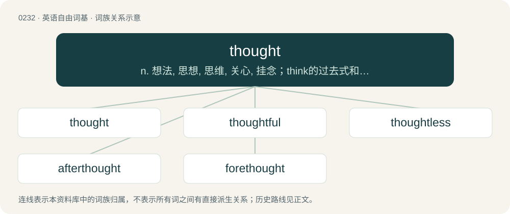

# 0258 · thought — n. 想法, 思想, 思维, 关心, 挂念；think的过去式和过去分词

[总目录](../00_总目录_按常用程度.md)

**类型**：英语自由词基　｜　**来源语言**：见词源记录

## 核心含义与来源

- 核心含义：n. 想法, 思想, 思维, 关心, 挂念；think的过去式和过去分词
- 英文含义：A representation created in the mind without the use of one's faculties of vision, sound, smell, touch, or taste; an instance of thinking.
- 词形：thought

**来源记录 1**（名词；A representation created in the mind without the use of one's faculties of vision, sound, smell, touch, or taste; an instance of thinking.）

From Middle English thought, ithoȝt, from Old English þōht, ġeþōht, from Proto-West Germanic \*þą̄ht, from Proto-Germanic \*þanhtaz, \*gaþanhtą (“thought”), from Proto-Indo-European \*teng- (“to think”). Cognate with Scots thocht (“thought”), Saterland Frisian Toacht (“thought”), West Frisian dacht (“attention, regard, thought”), Dutch gedachte (“thought”), German Andacht (“reverence, devotion, prayer”), Icelandic þóttur (“thought”). Related to thank, think.

## 词族图

## 单词速览（常用到不常用）

| 单词 | 音标 | 释义 |
|---|---|---|
| [thought](#w-1) | 英 /θɔːt/；/θɔt/ | n. 想法, 思想, 思维, 关心, 挂念；think的过去式和过去分词 |
| [thoughtful](#w-2) | 英 /ˈθɔːtfəl/；/ˈfoːtfəl/ | a. 深思的, 体贴的 |
| [thoughtless](#w-3) | 英 /ˈθɔːtləs/；美 /ˈθɔtləs/ | a. 欠考虑的, 无深虑的, 轻率的 |
| [afterthought](#w-4) | 美 /ˈæft.ɚ.θɔt/ | n. 事后的想法 |
| [forethought](#w-5) | /ˈfɔː(ɹ)θɔːt/ | n. 事先的考虑, 事先的筹划, 深虑, 先见；\[法\] 预谋 |

## 逐词详解

### 1. thought

**词性**：名词　｜　**音标**：英 /θɔːt/；/θɔt/

**中文释义**：n. 想法, 思想, 思维, 关心, 挂念；think的过去式和过去分词

**英文义项**：A representation created in the mind without the use of one's faculties of vision, sound, smell, touch, or taste; an instance of thinking. / The operation by which mental activity arise or are manipulated; the process of thinking; the agency by which thinking is accomplished.

**词源与演化**：

From Middle English thought, ithoȝt, from Old English þōht, ġeþōht, from Proto-West Germanic \*þą̄ht, from Proto-Germanic \*þanhtaz, \*gaþanhtą (“thought”), from Proto-Indo-European \*teng- (“to think”). Cognate with Scots thocht (“thought”), Saterland Frisian Toacht (“thought”), West Frisian dacht (“attention, regard, thought”), Dutch gedachte (“thought”), German Andacht (“reverence, devotion, prayer”), Icelandic þóttur (“thought”). Related to thank, think.

**例句**：

> The greatest weapon against stress is our ability to choose one thought over another.

该用例对应义项：A representation created in the mind without the use of one's faculties of vision, sound, smell, touch, or taste; an instance of thinking.

### 2. thoughtful

**词性**：形容词　｜　**音标**：英 /ˈθɔːtfəl/；/ˈfoːtfəl/

**中文释义**：a. 深思的, 体贴的

**英文义项**：Demonstrating thought or careful consideration. / Demonstrating kindness or consideration for others.

**构词拆分**：thought + -ful

**词源与演化**：

From Middle English thoȝtful, thohtful, equivalent to thought + -ful. Compare Dutch gedachtenvol, Swedish tankfull.

**例句**：

> Preparing dinner is a thoughtful gesture for a new mother.

该用例对应义项：Demonstrating kindness or consideration for others.

### 3. thoughtless

**词性**：形容词　｜　**音标**：英 /ˈθɔːtləs/；美 /ˈθɔtləs/

**中文释义**：a. 欠考虑的, 无深虑的, 轻率的

**英文义项**：Marked by or showing lack of due thought or care. / Inconsiderate, inattentive.

**构词拆分**：thought + -less

**词源与演化**：

From thought + -less.

**例句**：

> The debate turned into thoughtless bickering.

该用例对应义项：Lacking thought or consideration.

### 4. afterthought

**词性**：名词　｜　**音标**：美 /ˈæft.ɚ.θɔt/

**中文释义**：n. 事后的想法

**英文义项**：A reflection after an act; a later or subsequent thought, action, or expedient. / Something additional to the original plan or concept.

**构词拆分**：after- + thought

**词源与演化**：

From after- + thought, probably modelled on forethought. Compare also the verb afterthink.

**例句**：

> This whole remodeling was an afterthought; we were only going to paint and call it good.

该用例对应义项：Something additional to the original plan or concept.

### 5. forethought

**词性**：名词　｜　**音标**：/ˈfɔː(ɹ)θɔːt/

**中文释义**：n. 事先的考虑, 事先的筹划, 深虑, 先见；\[法\] 预谋

**英文义项**：Thinking beforehand or in advance, planning; prior or previous consideration. / Anticipation.

**构词拆分**：fore- + thought

**词源与演化**：

From Middle English forethouht, forethoght, from Old English \*foreþōht (“forethought”); equivalent to fore- + thought. See also forethink.

**例句**：

> With a little forethought we'd have planned for this contingency and not been stuck here now.

该用例对应义项：Thinking beforehand or in advance, planning; prior or previous consideration.
