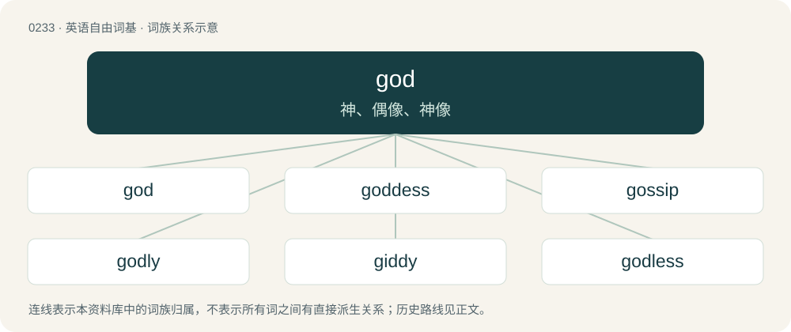

# 0259 · god — 神、偶像、神像

[总目录](../00_总目录_按常用程度.md)

**类型**：英语自由词基　｜　**来源语言**：见词源记录

## 核心含义与来源

- 核心含义：神、偶像、神像
- 英文含义：A deity or supreme being; a supernatural, typically immortal, being with superior powers, to which personhood is attributed.
- 词形：god

**来源记录 1**（名词；A deity or supreme being; a supernatural, typically immortal, being with superior powers, to which personhood is attributed.）

Inherited from Middle English god, from Old English god, originally neuter, then changed to masculine to reflect the change in religion to Christianity, from Proto-West Germanic \*god n, from Proto-Germanic \*gudą; see there for further origin. Cognates Cognate with Scots God (“God”), Yola God, Gud (“God”), gud (“god”), Saterland Frisian God (“God”), West Frisian God (“God”), god (“deity, god”), Alemannic German, Cimbrian, German, Luxembourgish and Mòcheno Gott (“God”), Central Franconian Jott (“God”), Dutch god (“deity, god”), Limburgish Gód (“God”), gód (“god”), Vilamovian Göt (“God”), Yiddish גאָט (got, “god; God”), Danish, Norwegian Bokmål and Swedish gud (“god; God”), Faroese Gud (“God”), Icelandic goð (“idol, pagan god”), guð, Guð (“God”), Norwegian Nynorsk Gu, Gud (“God”), gu, gud (“god”), Gothic 𐌲𐌿𐌸 (guþ, “deity, god; God”). Not related to the word good or Persian خدا (xodâ, “god”).

## 词族图

## 单词速览（常用到不常用）

| 单词 | 音标 | 释义 |
|---|---|---|
| [god](#w-1) | 英 /ɡɒd/；美 /ɡɑd/ | 神、偶像、神像 |
| [goddess](#w-2) | 英 /ˈɡɒdɛs/；美 /ˈɡɑdəs/ | n. 女神, 美女, 受崇拜的女性 |
| [gossip](#w-3) | 英 /ˈɡɒsɪp/；美 /ˈɡɑsɪp/ | n. 闲聊, 随笔, 流言, 爱讲闲话的人；vi. 说闲话, 闲聊 |
| [godly](#w-4) | 英 /ˈɡɒdli/；美 /ˈɡɑdli/ | a. 敬神的, 虔诚的, 神的 |
| [giddy](#w-5) | 英 /ˈɡɪd.i/；美 /ˈɡɪd.i/ | a. 眼花的, 头晕的；v. (使)眼花, (使)眩晕 |
| [godless](#w-6) | /ˈɡɒdləs/ | a. 不信神的, 无神论者的, 罪恶的, 邪恶的 |
| [godhead](#w-7) | /ˈɡɒd.hɛd/ | n. 神性 |
| [godlike](#w-8) | 英 /ˈɡɒdlaɪk/；美 /ˈɡɑdlaɪk/ | a. 似神的, 庄严的 |
| [demigod](#w-9) | 英 /ˈdɛmiɡɒd/；美 /ˈdɛmiɡɑd/ | n. 半神半人, 小神, 受崇拜的人 |
| [godforsaken](#w-10) | /ˌɡɒd.fə(ɹ)ˈseɪ.kɪn/ | a. 被上帝抛弃的, 堕落的, 邪恶的, 倒霉的, 凄凉的, 荒凉的 |
| [godman](#w-11) |  | 【英文】A charismatic male guru. |

## 逐词详解

### 1. god

**词性**：名词　｜　**音标**：英 /ɡɒd/；美 /ɡɑd/

**中文释义**：神、偶像、神像

**英文义项**：A deity or supreme being; a supernatural, typically immortal, being with superior powers, to which personhood is attributed. / A representation of a deity, especially a statue or statuette.

**词源与演化**：

Inherited from Middle English god, from Old English god, originally neuter, then changed to masculine to reflect the change in religion to Christianity, from Proto-West Germanic \*god n, from Proto-Germanic \*gudą; see there for further origin. Cognates Cognate with Scots God (“God”), Yola God, Gud (“God”), gud (“god”), Saterland Frisian God (“God”), West Frisian God (“God”), god (“deity, god”), Alemannic German, Cimbrian, German, Luxembourgish and Mòcheno Gott (“God”), Central Franconian Jott (“God”), Dutch god (“deity, god”), Limburgish Gód (“God”), gód (“god”), Vilamovian Göt (“God”), Yiddish גאָט (got, “god; God”), Danish, Norwegian Bokmål and Swedish gud (“god; God”), Faroese Gud (“God”), Icelandic goð (“idol, pagan god”), guð, Guð (“God”), Norwegian Nynorsk Gu, Gud (“God”), gu, gud (“god”), Gothic 𐌲𐌿𐌸 (guþ, “deity, god; God”). Not related to the word good or Persian خدا (xodâ, “god”).

**例句**：

> The most frequently used name for the Islamic god is Allah.

该用例对应义项：A deity or supreme being; a supernatural, typically immortal, being with superior powers, to which personhood is attributed.

### 2. goddess

**词性**：名词　｜　**音标**：英 /ˈɡɒdɛs/；美 /ˈɡɑdəs/

**中文释义**：n. 女神, 美女, 受崇拜的女性

**英文义项**：A female deity. / An incredibly beautiful, gorgeous, sexy, attractive woman honored and adored for her beauty or of superior charm and intelligence.

**构词拆分**：god + -ess

**词源与演化**：

From Middle English goddesse, equivalent to god + -ess, formed about 1350. The figurative meaning is first found in Edmund Spenser's Shepheardes calender (1579). Displaced Old English gyden.

**例句**：

> Artemis was the goddess of chastity, virginity, hunting, the moon and nature.

### 3. gossip

**词性**：名词　｜　**音标**：英 /ˈɡɒsɪp/；美 /ˈɡɑsɪp/

**中文释义**：n. 闲聊, 随笔, 流言, 爱讲闲话的人；vi. 说闲话, 闲聊

**英文义项**：Someone who likes to talk about other people's private or personal business. / Idle talk about someone’s private or personal matters, especially about someone not present.

**构词拆分**：god + sib

**词源与演化**：

From Middle English godsybbe, godsib (“a close friend or relation, a confidant; a godparent”), from Old English godsibb (“godparent, sponsor”), equivalent to god + sib. Doublet of godsib. For sense evolution to "gossip, discussing others' personal affairs," compare French commérage.

**例句**：

> According to the latest gossip, their relationship is on the rocks.

该用例对应义项：Idle talk about someone’s private or personal matters, especially about someone not present.

### 4. godly

**词性**：形容词　｜　**音标**：英 /ˈɡɒdli/；美 /ˈɡɑdli/

**中文释义**：a. 敬神的, 虔诚的, 神的

**英文义项**：Of or pertaining to a god / Devoted to a god or God; devout; holy; righteous.

**构词拆分**：god + -ly

**词源与演化**：

From god + -ly (adjectival suffix).

**用法示例／搭配（非完整句）**：

> her godly powers = her superhuman powers

该用例对应义项：Of or pertaining to a god

### 5. giddy

**词性**：形容词　｜　**音标**：英 /ˈɡɪd.i/；美 /ˈɡɪd.i/

**中文释义**：a. 眼花的, 头晕的；v. (使)眼花, (使)眩晕

**英文义项**：Feeling a sense of spinning in the head, causing a perception of unsteadiness and being about to fall down; dizzy. / Causing or likely to cause dizziness or a feeling of unsteadiness.

**构词拆分**：god + -y (suffix meaning ‘having the quality of’, forming adjectives)

**词源与演化**：

The adjective is derived from Middle English gidi, gedy, gydy (“demonically controlled or possessed; crazy, insane; foolish, idiotic, ridiculous, unwise; unsure; (rare) dizzy, shaky; (rare) of an animal: crazed, out of control; a fool”) \[and other forms\], from Old English gidiġ, gydiġ (“possessed by a demon or spirit, insane, mad”), from Proto-West Germanic \*gudīg (“ghostly, spirited”, literally “possessed by a god or spirit”), from \*god (“god”) + \*-ig, \*-g (suffix forming adjectives with the senses of being, doing, or having). Thus the word's elements correspond to god + -y (suffix meaning ‘having the quality of’, forming adjectives). The noun and the verb are derived from the adjective.

**例句**：

> The boy was giddy when he opened his birthday presents.

该用例对应义项：Joyfully elated; overcome with excitement or happiness.

### 6. godless

**词性**：形容词　｜　**音标**：/ˈɡɒdləs/

**中文释义**：a. 不信神的, 无神论者的, 罪恶的, 邪恶的

**英文义项**：Not acknowledging any deity or god; without belief in any deity or god. / Evil, wicked, worldly.

**构词拆分**：god + -less

**词源与演化**：

From god + -less. Compare Saterland Frisian godloos (“godless”), West Frisian goddeleas (“godless; wicked”), Dutch goddeloos (“godless; wicked”), German Low German gottlos (“godless”), German gottlos (“godless”), Danish gudløse (“godless”), Swedish gudlös (“godless; ungodly”), Icelandic guðlaus (“godless”), Gothic 𐌲𐌿𐌳𐌰𐌻𐌰𐌿𐍃 (gudalaus, “godless”).

**例句**：

> A bit of peace and quiet is welcome in this godless world.

### 7. godhead

**词性**：名词　｜　**音标**：/ˈɡɒd.hɛd/

**中文释义**：n. 神性

**英文义项**：Divinity or godhood, divine essence or nature. / God.

**构词拆分**：god + -head (“-hood”)

**词源与演化**：

Inherited from Middle English godhede, equivalent to god + -head (“-hood”). First attested in the Ancrene Wisse (ca. 1225); compare godhood and Dutch godheid as well as German Gottheit.

**例句**：

> Krishna is the Supreme Personality of Godhead.

### 8. godlike

**词性**：形容词　｜　**音标**：英 /ˈɡɒdlaɪk/；美 /ˈɡɑdlaɪk/

**中文释义**：a. 似神的, 庄严的

**英文义项**：Having the characteristics of a god. / Characteristic of a god.

**构词拆分**：god + -like

**词源与演化**：

From god + -like.

**例句**：

> A man of godlike sagacity.

该用例对应义项：appropriate to or befitting a god

### 9. demigod

**词性**：名词　｜　**音标**：英 /ˈdɛmiɡɒd/；美 /ˈdɛmiɡɑd/

**中文释义**：n. 半神半人, 小神, 受崇拜的人

**英文义项**：A half-god or hero; the offspring of a deity and a mortal. / Someone held up for reverence as a supreme example.

**构词拆分**：demi- + god

**词源与演化**：

From demi- + god. Calque of the Latin semideus (“half-god”), which is probably a coining by the Roman poet Ovid for less important gods such as dryads.

**例句**：

> Elvis Costello is a demigod of new wave music.

### 10. godforsaken

**词性**：形容词　｜　**音标**：/ˌɡɒd.fə(ɹ)ˈseɪ.kɪn/

**中文释义**：a. 被上帝抛弃的, 堕落的, 邪恶的, 倒霉的, 凄凉的, 荒凉的

**英文义项**：Abandoned by a deity or God. / Desolate, boring and depressing.

**构词拆分**：god + forsaken

**词源与演化**：

From god + forsaken.

**例句**：

> I wanted nothing more than to get out of that godforsaken place without delay.

该用例对应义项：Desolate, boring and depressing.

### 11. godman

**词性**：名词

**英文义项**：A charismatic male guru.

**构词拆分**：god + -man

**词源与演化**：

From god + -man.
