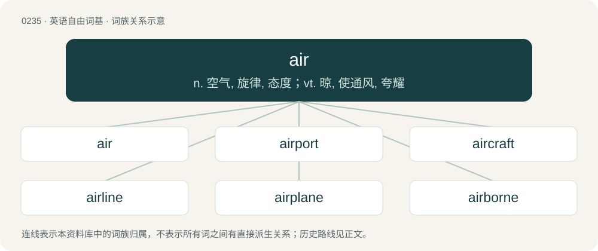

# 0261 · air — n. 空气, 旋律, 态度；vt. 晾, 使通风, 夸耀

[总目录](../00_总目录_按常用程度.md)

**类型**：英语自由词基　｜　**来源语言**：见词源记录

## 核心含义与来源

- 核心含义：n. 空气, 旋律, 态度；vt. 晾, 使通风, 夸耀
- 英文含义：The substance constituting Earth's atmosphere: a gaseous mixture of nitrogen, oxygen, and various trace gases.
- 词形：air

**来源记录 1**（名词；The substance constituting Earth's atmosphere: a gaseous mixture of nitrogen, oxygen, and various trace gases.）

From Middle English aire, from Old French air, from Latin āēr, from Ancient Greek ἀήρ (aḗr). Displaced native Old English lyft. More at lift, loft.

## 词族图

## 单词速览（常用到不常用）

| 单词 | 音标 | 释义 |
|---|---|---|
| [air](#w-1) | 英 /ˈɛə̯/；美 /ˈɛɚ/ | n. 空气, 旋律, 态度；vt. 晾, 使通风, 夸耀 |
| [airport](#w-2) | 英 /ˈɛə.pɔːt/；美 /ˈɛɹ.pɔɹt/ | n. 飞机场；\[机\] 航空站, 机场 |
| [aircraft](#w-3) | 英 /ˈɛə.kɹɑːft/；美 /ˈɛɚ.kɹæft/ | n. 航空器, 飞机；\[机\] 航空器 |
| [airline](#w-4) | 英 /ˈɛəˌlaɪn/；美 /ˈɛɹˌlaɪn/ | n. 航线, 航线的设备, 航空公司 |
| [airplane](#w-5) | 英 /ˈɛəˌpleɪ̯n/；美 /ˈɛɹˌpleɪ̯n/ | n. 飞机；\[机\] 飞机 |
| [airborne](#w-6) | /ˈєəbɒːn/ | a. 升空的, 空运的, 空中传播的, 空降的 |
| [airing](#w-7) | 英 /ˈɛəɹɪŋ/；美 /ˈɛɹɪŋ/ | n. 晾, 通风, 兜风；\[化\] 充气 |
| [airbus](#w-8) | 美 /ˈeɹ.bʌs/ | 空中客车 |
| [airfield](#w-9) | /ˈєəfiːld/ | n. 飞机场 |
| [airspace](#w-10) | /ˈєəspeis/ | n. 空域, 空间；\[机\] 气隙 |
| [airy](#w-11) | 英 /ˈɛə.ɹi/；/ˈɛɹ.i/ | a. 空气的, 空中的, 通风的, 幻想的, 轻快的 |
| [airway](#w-12) | 英 /ˈɛə.weɪ/；美 /ˈɛɚ.weɪ/ | n. 空中航线, 风道；\[医\] 导气管 |
| [airflow](#w-13) | /ˈєəfləu/ | n. 空气的流动, 气流 |
| [airliner](#w-14) | /ˈєəlainə/ | n. 班机, 大型客机 |
| [airstrike](#w-15) | /ˈer,straik/ | n. 空袭；空中打击 |
| [airtime](#w-16) | /ˈeətaim/ | 电影或电视节目开始的时间 |
| [airtight](#w-17) | /ˈєətait/ | a. 气密的, 不透气的, 无懈可击的；\[机\] 气密, 不透气 |
| [airbag](#w-18) | /ˈeəbæ^/ | \[机\] 空气囊 |
| [airman](#w-19) | 英 /ˈɛə.mən/；美 /ˈɛɹ.mən/ | n. 飞行员, 空军士兵 |
| [airship](#w-20) | /ˈєəʃip/ | n. 飞艇, 飞船 |
| [airlift](#w-21) | 英 /ˈɛə.lɪft/ | n. 空运, 空中补给线, 空运物资；vt. 空运 |
| [airplay](#w-22) | /ˈeəplei/ | n. (无线电台上)唱片的播送 |
| [airfare](#w-23) | /ˈεə.fεə/ | n. 飞机票价 |
| [airstrip](#w-24) | /ˈɛə(ɹ)stɹɪp/ | n. 飞机跑道 |
| [midair](#w-25) | 美 /(ˈ)mɪdˈɛɹ/ | n. 半空中 |
| [airframe](#w-26) | /ˈɛɹ.fɹe(ɪ)m/ | n. 机身 |
| [airbrush](#w-27) | /ˈєəbrʌʃ/ | n. 喷枪 |
| [airsoft](#w-28) |  | 【英文】A modern combat sport in which participants eliminate their opponents by hitting them with spherical non-metallic pellets launched from a type of air gun running compressed air or similar compressed gas (e.g., carbon |
| [airlock](#w-29) |  | n. 气塞, 气闸, 气密舱；\[化\] 风闸; 气封; 气窝(塑料表面的) |
| [airspeed](#w-30) | /ˈєəspiːd/ | n. 空速 |
| [airdrop](#w-31) | /ˈєədrɒp/ | n. 空投；vt. 空投 |
| [aircrew](#w-32) | /ˈєəkruː/ | n. 空勤组 |
| [airmail](#w-33) | /ˈɛəɹ(ˌ)meɪl/ | n. 航空邮件 |
| [airfoil](#w-34) | /ˈeəfɔil/ | n. 机翼, 方向舱 |
| [airstream](#w-35) | /ˈeəstriːm/ | n. 气流 |
| [airpower](#w-36) | /ˈεəpauə/ | n. 空中实力；制空权 |
| [airhead](#w-37) | 英 /ˈɛə̯hɛd/；美 /ˈɛɹˌ(h)ɛd/ | n. 空降物 |
| [airless](#w-38) | 英 /ˈɛə.ləs/；美 /ˈɛɹ.ləs/ | a. 无空气的, 不通风的；\[机\] 无气, 无气式 |

## 逐词详解

### 1. air

**词性**：名词　｜　**音标**：英 /ˈɛə̯/；美 /ˈɛɚ/

**中文释义**：n. 空气, 旋律, 态度；vt. 晾, 使通风, 夸耀

**英文义项**：The substance constituting Earth's atmosphere: a gaseous mixture of nitrogen, oxygen, and various trace gases. / The substance of the atmosphere seen as an agency of freshness.

**词源与演化**：

From Middle English aire, from Old French air, from Latin āēr, from Ancient Greek ἀήρ (aḗr). Displaced native Old English lyft. More at lift, loft.

**例句**：

> Hey, did you mean to leave the airs on all week while you were on vacation?

该用例对应义项：An air conditioning system.

### 2. airport

**词性**：名词　｜　**音标**：英 /ˈɛə.pɔːt/；美 /ˈɛɹ.pɔɹt/

**中文释义**：n. 飞机场；\[机\] 航空站, 机场

**英文义项**：An airfield (an area designated for the takeoff and landing of aircraft), including one or more runways and (for commercial airports) one or more passenger terminals.

**构词拆分**：air + port

**词源与演化**：

From air + port.

**例句**：

> She met Sam and the others at the airport at 7:00 am.

该用例对应义项：An airfield (an area designated for the takeoff and landing of aircraft), including one or more runways and (for commercial airports) one or more passenger terminals.

### 3. aircraft

**词性**：名词　｜　**音标**：英 /ˈɛə.kɹɑːft/；美 /ˈɛɚ.kɹæft/

**中文释义**：n. 航空器, 飞机；\[机\] 航空器

**英文义项**：A vehicle capable of atmospheric flight due to interaction with the air, such as buoyancy or lift. / One that can carry a person or persons.

**构词拆分**：air + -craft

**词源与演化**：

From air + -craft.

**用法示例／搭配（非完整句）**：

> aircraft manufacturer

该用例对应义项：A vehicle capable of atmospheric flight due to interaction with the air, such as buoyancy or lift.

### 4. airline

**词性**：名词　｜　**音标**：英 /ˈɛəˌlaɪn/；美 /ˈɛɹˌlaɪn/

**中文释义**：n. 航线, 航线的设备, 航空公司

**英文义项**：A company that flies airplanes to transport people and goods.

**构词拆分**：air + line

**词源与演化**：

From air + line.

**例句**：

> The airline provided free accommodation to stranded passengers as a goodwill gesture.

### 5. airplane

**词性**：名词　｜　**音标**：英 /ˈɛəˌpleɪ̯n/；美 /ˈɛɹˌpleɪ̯n/

**中文释义**：n. 飞机；\[机\] 飞机

**英文义项**：A powered heavier-than-air aircraft with fixed wings: a fixed-wing aircraft with at least one engine or electric motor. / One that can carry a person or persons.

**构词拆分**：air + plane

**词源与演化**：

From air + plane as an alteration of aeroplane.

**例句**：

> They use airplanes to deliver mail and supplies to the far northern villages.

该用例对应义项：One that can carry a person or persons.

### 6. airborne

**词性**：形容词　｜　**音标**：/ˈєəbɒːn/

**中文释义**：a. 升空的, 空运的, 空中传播的, 空降的

**英文义项**：In or carried by the air. / In flight.

**构词拆分**：air + -borne

**词源与演化**：

Attested since the 1640s; air + -borne

**例句**：

> Airborne pollen can aggravate allergies.

该用例对应义项：In or carried by the air.

### 7. airing

**词性**：名词　｜　**音标**：英 /ˈɛəɹɪŋ/；美 /ˈɛɹɪŋ/

**中文释义**：n. 晾, 通风, 兜风；\[化\] 充气

**英文义项**：Exposure of something to the air, especially fresh or warm air for the purpose of ventilating or drying; (countable) an instance of this. / An act of taking an animal (especially a dog or horse) into the open air for exercise.

**构词拆分**：air (“to bring (something) into contact with the air; to let fresh air into (a place); to make public (an opinion, etc.); to broadcast (something)”, verb) + -ing (suffix forming nouns or noun-like terms from verbs, denoting acts of doing something, actions, or the embodiment of action; and forming the present participles of verbs)

**词源与演化**：

From air (“substance constituting Earth’s atmosphere”, noun) and air (“to bring (something) into contact with the air; to let fresh air into (a place); to make public (an opinion, etc.); to broadcast (something)”, verb) + -ing (suffix forming nouns or noun-like terms from verbs, denoting acts of doing something, actions, or the embodiment of action; and forming the present participles of verbs).

**用法示例／搭配（非完整句）**：

> airing of grievances

该用例对应义项：Public disclosure or discussion of a subject, or expression of an opinion; (countable) an instance of this.

### 8. airbus

**词性**：名词　｜　**音标**：美 /ˈeɹ.bʌs/

**中文释义**：空中客车

**英文义项**：A subsonic jet airliner, especially a wide-bodied one.

**构词拆分**：air + bus

**词源与演化**：

From air + bus.

### 9. airfield

**词性**：名词　｜　**音标**：/ˈєəfiːld/

**中文释义**：n. 飞机场

**英文义项**：An open field designated for the taking off and landing of aircraft, but which, unlike an airport, does not necessarily have terminals or paved runways.

**构词拆分**：air + field

**词源与演化**：

From air + field.

**例句**：

> The airfield on the island is now covered with weeds.

### 10. airspace

**词性**：名词　｜　**音标**：/ˈєəspeis/

**中文释义**：n. 空域, 空间；\[机\] 气隙

**英文义项**：A specified portion of the atmosphere, especially that under the technical aviation control and/or jurisdiction of a particular state over which territory (and territorial waters) it lies. / That part of the sky designated for the sole use of aircraft.

**构词拆分**：air + space

**词源与演化**：

From air + space.

**例句**：

> The legalisation of free radios caused a bitter fight for airspace.

该用例对应义项：Space (i.e. a few neighboring frequencies) available for broadcasting within a particular frequency band.

### 11. airy

**词性**：形容词　｜　**音标**：英 /ˈɛə.ɹi/；/ˈɛɹ.i/

**中文释义**：a. 空气的, 空中的, 通风的, 幻想的, 轻快的

**英文义项**：Consisting of air. / Relating or belonging to air; high in air; aerial.

**构词拆分**：air + -y

**词源与演化**：

From air + -y.

**用法示例／搭配（非完整句）**：

> an airy substance; the airy parts of bodies

该用例对应义项：Consisting of air.

### 12. airway

**词性**：名词　｜　**音标**：英 /ˈɛə.weɪ/；美 /ˈɛɚ.weɪ/

**中文释义**：n. 空中航线, 风道；\[医\] 导气管

**英文义项**：The trachea. / The trachea and bronchial tree.

**构词拆分**：air + way

**词源与演化**：

From air + way.

### 13. airflow

**词性**：名词　｜　**音标**：/ˈєəfləu/

**中文释义**：n. 空气的流动, 气流

**英文义项**：Any flow of air, especially the motion of air around a moving aircraft or aerofoil.

**构词拆分**：air + flow

**词源与演化**：

From air + flow.

**例句**：

> She adjusted the fan so that the airflow was directed right at her.

该用例对应义项：the flow of air

### 14. airliner

**词性**：名词　｜　**音标**：/ˈєəlainə/

**中文释义**：n. 班机, 大型客机

**英文义项**：A passenger-carrying aircraft, especially one of a fleet operated by an airline.

**构词拆分**：air + liner

**词源与演化**：

From air + liner.

**例句**：

> The pilot of an airliner is responsible for the safety of passengers.

### 15. airstrike

**词性**：动词　｜　**音标**：/ˈer,straik/

**中文释义**：n. 空袭；空中打击

**英文义项**：To attack a ground target through the use of aircraft or missiles.

**构词拆分**：air + strike

**词源与演化**：

From air + strike.

**例句**：

> Outnumbered and outgunned, the squad was forced to call in an airstrike.

### 16. airtime

**词性**：名词　｜　**音标**：/ˈeətaim/

**中文释义**：电影或电视节目开始的时间

**英文义项**：The duration during which a radio or television program (or part of one) is transmitted. / The duration spent talking during a conversation.

**构词拆分**：air + time

**词源与演化**：

From air + time.

**例句**：

> Can you get me some airtime for my latest single?

该用例对应义项：The duration during which a radio or television program (or part of one) is transmitted.

### 17. airtight

**词性**：形容词　｜　**音标**：/ˈєətait/

**中文释义**：a. 气密的, 不透气的, 无懈可击的；\[机\] 气密, 不透气

**英文义项**：Impermeable to air or other gases. / Having no weak points or flaws.

**构词拆分**：air + tight

**词源与演化**：

From air + tight.

**例句**：

> We have an airtight argument they won’t be able to punch holes in.

该用例对应义项：Having no weak points or flaws.

### 18. airbag

**词性**：名词　｜　**音标**：/ˈeəbæ^/

**中文释义**：\[机\] 空气囊

**英文义项**：A protective system in automobiles in which when a crash occurs, a bag containing nitrogen, formed by the explosive decomposition of sodium azide, quickly inflates in front of the driver or passenger, preventing injury to the head. Side air bags, including the back seat passengers, also prevent injury. / A similar inflated bag used in performing stunts, or for lifting objects in firefighting, etc.

**构词拆分**：air + bag

**词源与演化**：

From air + bag.

**例句**：

> He had to be hospitalized because of an airbag.

### 19. airman

**词性**：名词　｜　**音标**：英 /ˈɛə.mən/；美 /ˈɛɹ.mən/

**中文释义**：n. 飞行员, 空军士兵

**英文义项**：A pilot of an aircraft. / A person employed in one of several aviation-adjacent professions other than flight crew, such as a mechanic or air traffic controller.

**构词拆分**：air + -man

**词源与演化**：

From air + -man.

**例句**：

> When the engines failed, the airman panicked and failed to properly follow the emergency checklist.

### 20. airship

**词性**：名词　｜　**音标**：/ˈєəʃip/

**中文释义**：n. 飞艇, 飞船

**英文义项**：A lighter-than-air aircraft that can be propelled forward through the air as well as steered. / A police air unit, a police helicopter.

**构词拆分**：air + ship

**词源与演化**：

From air + ship. \* (jocular British sense): is in imitation of worship "form of address for magistrates et al., possibly also an oblique reference to Colonel Blimp.

**例句**：

> On weekends, I liked to spend my time at the airport watching the various airships take off and land.

该用例对应义项：Any aircraft.

### 21. airlift

**词性**：动词　｜　**音标**：英 /ˈɛə.lɪft/

**中文释义**：n. 空运, 空中补给线, 空运物资；vt. 空运

**英文义项**：To transport (supplies, troops, etc) in an airlift.

**构词拆分**：air + lift

**词源与演化**：

From air + lift; compare sealift.

**例句**：

> Emergency food and bottled water were airlifted into the earthquake zone.

该用例对应义项：To transport (supplies, troops, etc) in an airlift.

### 22. airplay

**词性**：名词　｜　**音标**：/ˈeəplei/

**中文释义**：n. (无线电台上)唱片的播送

**英文义项**：The playing of a particular song, band or genre on the radio, or the frequency with which it is played.

**构词拆分**：air + play

**词源与演化**：

From air + play.

**例句**：

> Country music gets more airplay than heavy metal.

该用例对应义项：The playing of a particular song, band or genre on the radio, or the frequency with which it is played.

### 23. airfare

**词性**：名词　｜　**音标**：/ˈεə.fεə/

**中文释义**：n. 飞机票价

**英文义项**：The cost or expense of an airplane ticket or trip.

**构词拆分**：air + fare

**词源与演化**：

From air + fare.

**例句**：

> I'd love to visit Paris, but I can't afford the airfare.

该用例对应义项：The cost or expense of an airplane ticket or trip.

### 24. airstrip

**词性**：名词　｜　**音标**：/ˈɛə(ɹ)stɹɪp/

**中文释义**：n. 飞机跑道

**英文义项**：An aircraft landing field, usually with one runway and only basic facilities.

**构词拆分**：air + strip

**词源与演化**：

From air + strip.

**例句**：

> The outfitter deposited us at a small airstrip out in the bush, promising to pick us up again in a week's time.

该用例对应义项：An aircraft landing field, usually with one runway and only basic facilities.

### 25. midair

**词性**：名词　｜　**音标**：美 /(ˈ)mɪdˈɛɹ/

**中文释义**：n. 半空中

**英文义项**：The condition of being airborne. / A collision between two or more aerospace vehicles in flight.

**构词拆分**：mid (adjetive) + air (noun)

**词源与演化**：

From mid (adjetive) + air (noun).

**例句**：

> The leaping dog spun around in midair.

该用例对应义项：The condition of being airborne.

### 26. airframe

**词性**：名词　｜　**音标**：/ˈɛɹ.fɹe(ɪ)m/

**中文释义**：n. 机身

**英文义项**：The main body and structure of an aircraft (without the powerplant).

**构词拆分**：air + frame

**词源与演化**：

From air + frame.

**例句**：

> Crashes in the early days of commercial jets tended to be caused by technical faults, such as metal fatigue in the airframe or engines.

### 27. airbrush

**词性**：动词　｜　**音标**：/ˈєəbrʌʃ/

**中文释义**：n. 喷枪

**英文义项**：To paint using an airbrush. / To touch up or enhance a photograph or person, often with intent to mislead.

**构词拆分**：air + brush

**词源与演化**：

From air + brush.

**例句**：

> This photo has definitely been airbrushed; no one has skin this smooth.

该用例对应义项：To touch up or enhance a photograph or person, often with intent to mislead.

### 28. airsoft

**词性**：名词

**英文义项**：A modern combat sport in which participants eliminate their opponents by hitting them with spherical non-metallic pellets launched from a type of air gun running compressed air or similar compressed gas (e.g., carbon dioxide).

**构词拆分**：air + soft

**词源与演化**：

From air + soft.

### 29. airlock

**词性**：名词

**中文释义**：n. 气塞, 气闸, 气密舱；\[化\] 风闸; 气封; 气窝(塑料表面的)

**英文义项**：A sealed, airtight chamber, such as in a manned spacecraft or submarine, used to provide access to and from the sealed area without allowing air out or water in. / A vestibule, foyer or entranceway with doors to the exterior on one end and doors to the interior on the other, functioning to keep indoor and outdoor air, humidity, and air temperatures separate.

**构词拆分**：air + lock

**词源与演化**：

From air + lock.

**例句**：

> What is the access number for this airlock door to the Martian surface?

### 30. airspeed

**词性**：名词　｜　**音标**：/ˈєəspiːd/

**中文释义**：n. 空速

**英文义项**：The speed of an aircraft relative to the air through which it is flying.

**构词拆分**：air + speed

**词源与演化**：

From air + speed.

### 31. airdrop

**词性**：名词　｜　**音标**：/ˈєədrɒp/

**中文释义**：n. 空投；vt. 空投

**英文义项**：The act of delivering goods, equipment, or personnel by dropping them from an aircraft in flight. / The distribution of free tokens to help bootstrap a new cryptocurrency.

**构词拆分**：air + drop

**词源与演化**：

From air + drop.

**例句**：

> Until then, front line troops will be supplied by airdrop.

该用例对应义项：delivery of supplies or equipment or personnel by dropping them by parachute from an aircraft

### 32. aircrew

**词性**：名词　｜　**音标**：/ˈєəkruː/

**中文释义**：n. 空勤组

**英文义项**：A group of two or more trained individuals, formed as a team that operates an aircraft.

**构词拆分**：air + crew

**词源与演化**：

From air + crew.

**例句**：

> The aircrew ran to the bomber.

该用例对应义项：A group of two or more trained individuals, formed as a team that operates an aircraft.

### 33. airmail

**词性**：名词　｜　**音标**：/ˈɛəɹ(ˌ)meɪl/

**中文释义**：n. 航空邮件

**英文义项**：The system of conveying mail using aircraft. / The items of mail so carried.

**构词拆分**：air + mail

**词源与演化**：

From air + mail.

**用法示例／搭配（非完整句）**：

> to send a letter by airmail

该用例对应义项：The system of conveying mail using aircraft.

### 34. airfoil

**词性**：名词　｜　**音标**：/ˈeəfɔil/

**中文释义**：n. 机翼, 方向舱

**英文义项**：A structure shaped to produce lift when moving in air. / A wing of an aircraft.

**构词拆分**：air + foil

**词源与演化**：

From air + foil.

### 35. airstream

**词性**：名词　｜　**音标**：/ˈeəstriːm/

**中文释义**：n. 气流

**英文义项**：A flow or current of air. / The flow of air around an object.

**构词拆分**：air + stream

**词源与演化**：

From air + stream.

**例句**：

> Maintaining a clean airstream around the car is important for good fuel economy.

该用例对应义项：The flow of air around an object.

### 36. airpower

**词性**：名词　｜　**音标**：/ˈεəpauə/

**中文释义**：n. 空中实力；制空权

**英文义项**：Airborne military power; an air force.

**构词拆分**：air + power

**词源与演化**：

From air + power.

### 37. airhead

**词性**：名词　｜　**音标**：英 /ˈɛə̯hɛd/；美 /ˈɛɹˌ(h)ɛd/

**中文释义**：n. 空降物

**英文义项**：An area of hostile territory that has been seized for use as an airbase to ensure the further safe landing of troops and materiel. / A (usually temporary) landing area for aircraft for supplying a non-military operation.

**构词拆分**：air + head (“foremost, topmost, or leading part”)

**词源与演化**：

From air + head (“foremost, topmost, or leading part”), sense 1 (“area of hostile territory seized for use as an airbase”) by analogy with beachhead and bridgehead.

**例句**：

> I'm a bit of an airhead; I keep forgetting to do my homework.

### 38. airless

**词性**：形容词　｜　**音标**：英 /ˈɛə.ləs/；美 /ˈɛɹ.ləs/

**中文释义**：a. 无空气的, 不通风的；\[机\] 无气, 无气式

**英文义项**：Lacking or being without air. / Lacking air circulation.

**构词拆分**：air + -less

**词源与演化**：

From air + -less.

**例句**：

> A dusty airless attic.

该用例对应义项：lacking fresh air
