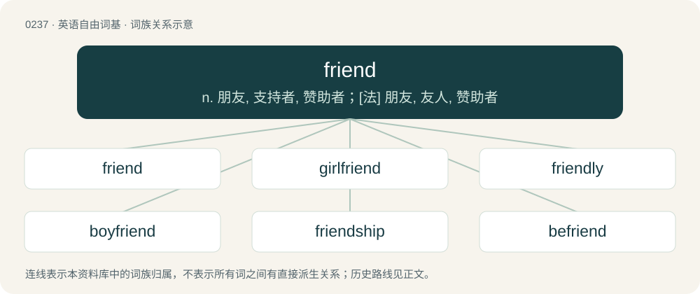

# 0264 · friend — n. 朋友, 支持者, 赞助者；\[法\] 朋友, 友人, 赞助者

[总目录](../00_总目录_按常用程度.md)

**类型**：英语自由词基　｜　**来源语言**：见词源记录

## 核心含义与来源

- 核心含义：n. 朋友, 支持者, 赞助者；\[法\] 朋友, 友人, 赞助者
- 英文含义：A person, typically someone other than a family member, spouse or lover, whose company one enjoys and towards whom one feels affection.
- 词形：friend

**来源记录 1**（名词；A person, typically someone other than a family member, spouse or lover, whose company one enjoys and towards whom one feels affection.）

From Middle English freend, frend, frende, freynde, friend, frind, frond, frund, vrend, vryend, from Old English frēond, frīond (“friend”, literally “loving \[one\], lover”), from Proto-West Germanic \*friund, from Proto-Germanic \*frijōndz (“friend, loved one”), from Proto-Indo-European \*preyH- (“to please; to love”), roughly equivalent to free + -nd. See also Friday. Cognates Cognate with Scots freend (“friend”), Yola friend, vriene (“friend”), North Frisian frinj, frün (“friend”), Saterland Frisian Fjund, Früünd (“friend”), West Frisian freon, freondinne (“friend”), Cimbrian bròint, vròint (“friend”), Dutch vriend (“friend”), German Freund (“friend”), German Low German Fründ (“friend, relative”), Limburgish vröndj (“friend”), Luxembourgish Frënd (“friend”), Vilamovian fraeind, frajnd (“friend”), Yiddish פֿרײַנד (fraynd, “friend”), Danish frænde (“kinsman”), Faroese and Icelandic frændi (“kinsman”), Norwegian Bokmål and Norwegian Nynorsk frende (“relative”), Swedish frände (“kinsman, relative”), Gothic 𐍆𐍂𐌹𐌾𐍉𐌽𐌳𐍃 (frijōnds, “friend”); also Welsh rhydd (“free”), Latin proprius (“own, proper”), Belarusian пры́яцель (prýjacjelʹ, “friend”), Bulgarian прия́тел (prijátel, “male friend”), Czech přítel (“friend; supporter; lover”), Macedonian при́јател (príjatel, “friend, mate, pal”), Polish przyjaciel, przyjáciel (“friend; lover”), Russian прия́тель (prijátelʹ, “friend; buddy, mate, pal”), Serbo-Croatian при̏јатељ, prȉjatelj (“friend”), Slovak priateľ (“friend; supporter”), Slovene prijatelj (“friend; companion; chum”), Ukrainian при́ятель (prýjatelʹ, “friend; buddy, pal”), Avestan 𐬟𐬭𐬌𐬌𐬀 (friia, “good, pleasant”), Persian فری (fari, “beloved, dear; pleasing”), Sanskrit प्रिय (priya, “beloved; own, wonted”). More at free.

## 词族图

## 单词速览（常用到不常用）

| 单词 | 音标 | 释义 |
|---|---|---|
| [friend](#w-1) | 英 /fɹɛnd/ | n. 朋友, 支持者, 赞助者；\[法\] 朋友, 友人, 赞助者 |
| [girlfriend](#w-2) | 英 /ˈɡɜːlfɹɛnd/；美 /ˈɡɝlfɹɛnd/ | n. 女朋友 |
| [friendly](#w-3) | /ˈfɹɛnd.li/ | a. 友好的, 亲切的, 互助的；adv. 友善地, 温和地 |
| [boyfriend](#w-4) | 美 /ˈbɔɪˌfɹɛnd/ | n. 男朋友 |
| [friendship](#w-5) | /ˈfɹɛn(d)ʃɪp/ | n. 友谊, 友爱, 友善 |
| [befriend](#w-6) | 英 /bɪˈfɹɛnd/；美 /bəˈfɹɛnd/ | vt. 待人如友, 扶助 |
| [friendless](#w-7) | /ˈfrɛndləs/ | a. 没有朋友的, 无依无靠的 |
| [unfriend](#w-8) | 英 /ˈʌnfɹɛnd/ | vt. 删除好友, 即, 将某人从社交网站（如Facebook等）的‘好友’中删除 |

## 逐词详解

### 1. friend

**词性**：名词　｜　**音标**：英 /fɹɛnd/

**中文释义**：n. 朋友, 支持者, 赞助者；\[法\] 朋友, 友人, 赞助者

**英文义项**：A person, typically someone other than a family member, spouse or lover, whose company one enjoys and towards whom one feels affection. / An associate who provides assistance; patron, mentor.

**词源与演化**：

From Middle English freend, frend, frende, freynde, friend, frind, frond, frund, vrend, vryend, from Old English frēond, frīond (“friend”, literally “loving \[one\], lover”), from Proto-West Germanic \*friund, from Proto-Germanic \*frijōndz (“friend, loved one”), from Proto-Indo-European \*preyH- (“to please; to love”), roughly equivalent to free + -nd. See also Friday. Cognates Cognate with Scots freend (“friend”), Yola friend, vriene (“friend”), North Frisian frinj, frün (“friend”), Saterland Frisian Fjund, Früünd (“friend”), West Frisian freon, freondinne (“friend”), Cimbrian bròint, vròint (“friend”), Dutch vriend (“friend”), German Freund (“friend”), German Low German Fründ (“friend, relative”), Limburgish vröndj (“friend”), Luxembourgish Frënd (“friend”), Vilamovian fraeind, frajnd (“friend”), Yiddish פֿרײַנד (fraynd, “friend”), Danish frænde (“kinsman”), Faroese and Icelandic frændi (“kinsman”), Norwegian Bokmål and Norwegian Nynorsk frende (“relative”), Swedish frände (“kinsman, relative”), Gothic 𐍆𐍂𐌹𐌾𐍉𐌽𐌳𐍃 (frijōnds, “friend”); also Welsh rhydd (“free”), Latin proprius (“own, proper”), Belarusian пры́яцель (prýjacjelʹ, “friend”), Bulgarian прия́тел (prijátel, “male friend”), Czech přítel (“friend; supporter; lover”), Macedonian при́јател (príjatel, “friend, mate, pal”), Polish przyjaciel, przyjáciel (“friend; lover”), Russian прия́тель (prijátelʹ, “friend; buddy, mate, pal”), Serbo-Croatian при̏јатељ, prȉjatelj (“friend”), Slovak priateľ (“friend; supporter”), Slovene prijatelj (“friend; companion; chum”), Ukrainian при́ятель (prýjatelʹ, “friend; buddy, pal”), Avestan 𐬟𐬭𐬌𐬌𐬀 (friia, “good, pleasant”), Persian فری (fari, “beloved, dear; pleasing”), Sanskrit प्रिय (priya, “beloved; own, wonted”). More at free.

**例句**：

> A close friend helped me prepare for the interview.

一位亲密的朋友帮我准备面试。

### 2. girlfriend

**词性**：名词　｜　**音标**：英 /ˈɡɜːlfɹɛnd/；美 /ˈɡɝlfɹɛnd/

**中文释义**：n. 女朋友

**英文义项**：A female partner in an unmarried romantic relationship. / A female friend of a woman or girl.

**构词拆分**：girl + friend

**词源与演化**：

From girl + friend.

**例句**：

> Marc went to the park with his girlfriend and watched the sunset with her.

该用例对应义项：A female partner in an unmarried romantic relationship.

### 3. friendly

**词性**：形容词　｜　**音标**：/ˈfɹɛnd.li/

**中文释义**：a. 友好的, 亲切的, 互助的；adv. 友善地, 温和地

**英文义项**：Generally warm, approachable and easy to relate with in character. / Inviting, characteristic of friendliness.

**构词拆分**：friend + -ly

**词源与演化**：

From Middle English frendly, freendly, frendely, frendlich, from Old English frēondlīċ, from Proto-Germanic \*frijōndlīkaz, equivalent to friend + -ly. Cognate with Saterland Frisian früntelk, fjuntelk (“friendly”), West Frisian freonlik (“friendly”), Dutch vriendelijk (“friendly”), German Low German fründelk, frünnelk (“friendly”), German freundlich (“friendly”). Doublet of friendlike.

**例句**：

> Our sandwiches are made with dolphin-friendly tuna.

该用例对应义项：Compatible with, or not damaging to (the compounded noun).

### 4. boyfriend

**词性**：名词　｜　**音标**：美 /ˈbɔɪˌfɹɛnd/

**中文释义**：n. 男朋友

**英文义项**：A male partner in an unmarried romantic relationship. / A male friend.

**构词拆分**：boy + friend

**词源与演化**：

From boy + friend.

**例句**：

> I was playing the drums and my boyfriend was playing the electric guitar.

该用例对应义项：A male partner in an unmarried romantic relationship.

### 5. friendship

**词性**：名词　｜　**音标**：/ˈfɹɛn(d)ʃɪp/

**中文释义**：n. 友谊, 友爱, 友善

**英文义项**：The condition of being friends. / A friendly relationship, or a relationship as friends.

**构词拆分**：friend + -ship

**词源与演化**：

From Middle English frendshipe, from Old English frēondsċiepe, from Proto-West Germanic \*friundskapi. Equivalent to friend + -ship.

**例句**：

> Their friendship continued long after they left school.

离开学校很久之后，他们的友谊仍然持续着。

### 6. befriend

**词性**：动词　｜　**音标**：英 /bɪˈfɹɛnd/；美 /bəˈfɹɛnd/

**中文释义**：vt. 待人如友, 扶助

**英文义项**：To become a friend of (someone), to make friends with (someone). / To act as a friend to (someone, especially a client) by providing companionship and support; to assist, to help.

**构词拆分**：be- + friend；be- (intensifying prefix) + friend (verb)

**词源与演化**：

From be- (intensifying prefix) + friend (verb). cognates \* Dutch bevrienden (“to befriend”) \* German befreunden (“to befriend”) \* German Low German befründen (“to befriend”) \* Saterland Frisian befrüündje (“to befriend”) \* West Frisian befreone (“befriended”)

**例句**：

> If you capture a fox and try to befriend it, be careful.

### 7. friendless

**词性**：形容词　｜　**音标**：/ˈfrɛndləs/

**中文释义**：a. 没有朋友的, 无依无靠的

**英文义项**：Without friends (without a friend).

**构词拆分**：By surface analysis, friend + -less

**词源与演化**：

From Middle English frendles, from Old English frēondlēas. By surface analysis, friend + -less.

**用法示例／搭配（非完整句）**：

> friendless homebody

该用例对应义项：Without friends (without a friend).

### 8. unfriend

**词性**：名词　｜　**音标**：英 /ˈʌnfɹɛnd/

**中文释义**：vt. 删除好友, 即, 将某人从社交网站（如Facebook等）的‘好友’中删除

**英文义项**：One who is not a friend; an enemy.

**构词拆分**：un- (noun/adjective prefix) + friend

**词源与演化**：

From Middle English unfreend, onfrend, equivalent to un- (noun/adjective prefix) + friend. Cognate with Scots unfrend (“unfriend”). Compare Old English unfriþmann, unwine.
