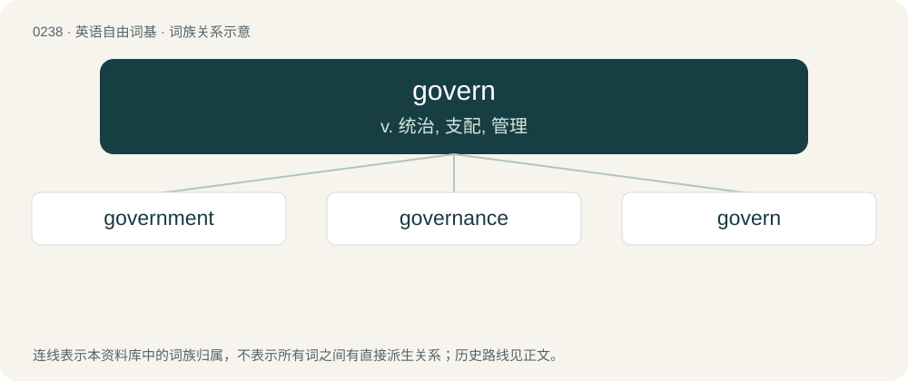

# 0265 · govern — v. 统治, 支配, 管理

[总目录](../00_总目录_按常用程度.md)

**类型**：英语自由词基　｜　**来源语言**：见词源记录

## 核心含义与来源

- 核心含义：v. 统治, 支配, 管理
- 英文含义：To make and administer the public policy and affairs of; to exercise sovereign authority in.
- 词形：govern

**来源记录 1**（动词；To make and administer the public policy and affairs of; to exercise sovereign authority in.）

From Middle English governen, governe, from Anglo-Norman and Old French governer, guverner, from Latin gubernō, from Ancient Greek κυβερνάω (kubernáō, “to steer, drive, govern”). Displaced native Old English wealdan, whence modern dialectical English wald (“to govern”).

## 词族图

## 单词速览（常用到不常用）

| 单词 | 音标 | 释义 |
|---|---|---|
| [government](#w-1) | 英 /ˈɡʌv.ə.mənt/；美 /ˈɡʌv.ɚ(n).mənt/ | n. 政府, 内阁；\[经\] 政府, 政治, 政体 |
| [governance](#w-2) | 英 /ˈɡʌvənəns/；美 /ˈɡʌvəɹnəns/ | n. 统治, 统辖, 管理；\[法\] 统治, 管理, 支配 |
| [govern](#w-3) | 英 /ˈɡʌv.ən/；美 /ˈɡʌv.ɚn/ | v. 统治, 支配, 管理 |

## 逐词详解

### 1. government

**词性**：名词　｜　**音标**：英 /ˈɡʌv.ə.mənt/；美 /ˈɡʌv.ɚ(n).mənt/

**中文释义**：n. 政府, 内阁；\[经\] 政府, 政治, 政体

**英文义项**：The body with the power to make and/or enforce laws to control a country, land area, people or organization. / The relationship between a word and its dependents.

**构词拆分**：govern + -ment

**词源与演化**：

From Middle English governement, from Old French governement (modern French gouvernement), from governer (see govern) + -ment. Morphologically govern + -ment. Displaced native Old English gerec, leodweard, ræden, rǣding and ealdordōm.

**例句**：

> The Sunak government announced plans to stem the flow of migrants coming into Great Britain.

该用例对应义项：The tenure of a head of government; the ministry or administration led by a specified individual.

### 2. governance

**词性**：名词　｜　**音标**：英 /ˈɡʌvənəns/；美 /ˈɡʌvəɹnəns/

**中文释义**：n. 统治, 统辖, 管理；\[法\] 统治, 管理, 支配

**英文义项**：The process, or the power, of governing; government or administration. / The specific system by which a political system is ruled.

**构词拆分**：govern + -ance

**词源与演化**：

From Middle English governaunce, from Old French gouvernance, governance, equivalent to govern + -ance.

**例句**：

> The governance of an association is responsible to its members.

该用例对应义项：the persons (or committees or departments etc.) who make up a body for the purpose of administering something

### 3. govern

**词性**：动词　｜　**音标**：英 /ˈɡʌv.ən/；美 /ˈɡʌv.ɚn/

**中文释义**：v. 统治, 支配, 管理

**英文义项**：To make and administer the public policy and affairs of; to exercise sovereign authority in. / To exercise political authority; to run a government.

**词源与演化**：

From Middle English governen, governe, from Anglo-Norman and Old French governer, guverner, from Latin gubernō, from Ancient Greek κυβερνάω (kubernáō, “to steer, drive, govern”). Displaced native Old English wealdan, whence modern dialectical English wald (“to govern”).

**例句**：

> Chance governs the outcome of many card games.

该用例对应义项：To exercise a deciding or determining influence on.
