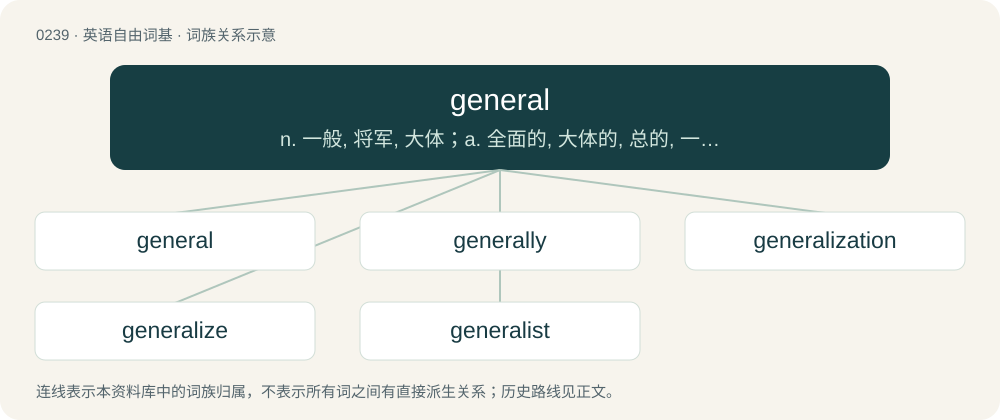

# 0266 · general — n. 一般, 将军, 大体；a. 全面的, 大体的, 总的, 一般的, 普遍的；n. 常规

[总目录](../00_总目录_按常用程度.md)

**类型**：英语自由词基　｜　**来源语言**：见词源记录

## 核心含义与来源

- 核心含义：n. 一般, 将军, 大体；a. 全面的, 大体的, 总的, 一般的, 普遍的；n. 常规
- 英文含义：Including or involving every part or member of a given or implied entity, whole, etc.; common to all, universal.
- 词形：general

**来源记录 1**（形容词；Including or involving every part or member of a given or implied entity, whole, etc.; common to all, universal.）

From Middle English general, in turn from Anglo-Norman general, generall, Middle French general, and their source, Latin generālis, from genus (“class, kind”) + -ālis (“-al”).

## 词族图

## 单词速览（常用到不常用）

| 单词 | 音标 | 释义 |
|---|---|---|
| [general](#w-1) | 英 /ˈd͡ʒɛn.(ə.)ɹəl/ | n. 一般, 将军, 大体；a. 全面的, 大体的, 总的, 一般的, 普遍的；n. 常规 |
| [generally](#w-2) | 英 /ˈd͡ʒɛn.ɹə.li/；美 /ˈd͡ʒɛn.ɚ.li/ | adv. 通常, 逐渐地, 普遍地 |
| [generalization](#w-3) | /,dʒenərəlaiˈzeiʃən/ | n. 一般化, 普遍化, 概括；\[化\] 推广; 普适化 |
| [generalize](#w-4) | 英 /ˈd͡ʒɛn.(ə.)ɹə.laɪz/ | vt. 一般化, 概括, 推广；vi. 形成概念, 笼统讲 |
| [generalist](#w-5) | 英 /ˈd͡ʒɛn.(ə.)ɹə.lɪst/ | n. 多面手, 通才 |

## 逐词详解

### 1. general

**词性**：形容词　｜　**音标**：英 /ˈd͡ʒɛn.(ə.)ɹəl/

**中文释义**：n. 一般, 将军, 大体；a. 全面的, 大体的, 总的, 一般的, 普遍的；n. 常规

**英文义项**：Including or involving every part or member of a given or implied entity, whole, etc.; common to all, universal. / Applied to a person (as a postmodifier or a normal preceding adjective) to indicate supreme rank, in civil or military titles, and later in other terms; pre-eminent.

**词源与演化**：

From Middle English general, in turn from Anglo-Norman general, generall, Middle French general, and their source, Latin generālis, from genus (“class, kind”) + -ālis (“-al”).

**用法示例／搭配（非完整句）**：

> general goods

该用例对应义项：Not of a specific class; miscellaneous.

### 2. generally

**词性**：副词　｜　**音标**：英 /ˈd͡ʒɛn.ɹə.li/；美 /ˈd͡ʒɛn.ɚ.li/

**中文释义**：adv. 通常, 逐渐地, 普遍地

**英文义项**：Popularly or widely. / As a rule; usually; typically; in most cases.

**构词拆分**：general + -ly

**词源与演化**：

From Middle English generally, generalliche, equivalent to general + -ly.

**例句**：

> It is generally true that the angles of a triangle sum to 180 degrees.

该用例对应义项：In the general case, without exception; in all cases.

### 3. generalization

**词性**：名词　｜　**音标**：/,dʒenərəlaiˈzeiʃən/

**中文释义**：n. 一般化, 普遍化, 概括；\[化\] 推广; 普适化

**英文义项**：An act or instance of generalizing; concluding that something true of a subclass is true of the entire class. / The formulation of general concepts from specific instances by abstracting common properties.

**构词拆分**：general + -ization

**词源与演化**：

From general + -ization.

**例句**：

> A hypersphere is a generalization of a sphere across more than three dimensions.

该用例对应义项：A proof, axiom, problem, or definition that includes another's cases, and also some additional cases; a conclusion reached by inferring from specific cases to more general cases or principles.

### 4. generalize

**词性**：动词　｜　**音标**：英 /ˈd͡ʒɛn.(ə.)ɹə.laɪz/

**中文释义**：vt. 一般化, 概括, 推广；vi. 形成概念, 笼统讲

**英文义项**：To speak in generalities, or in vague terms. / To infer or induce from specific cases to more general cases or principles.

**构词拆分**：general + -ize

**词源与演化**：

From general + -ize.

**例句**：

> In general, people who generalize are imbeciles, but only in general.

### 5. generalist

**词性**：名词　｜　**音标**：英 /ˈd͡ʒɛn.(ə.)ɹə.lɪst/

**中文释义**：n. 多面手, 通才

**英文义项**：A person with a broad general knowledge, especially one with more than superficial knowledge in several areas and the ability to combine ideas from diverse fields. / A general practitioner.

**构词拆分**：general + -ist

**词源与演化**：

From general + -ist.

**例句**：

> A statistician has to be something of a generalist.

该用例对应义项：a modern scholar who is in a position to acquire more than superficial knowledge about many different interests
