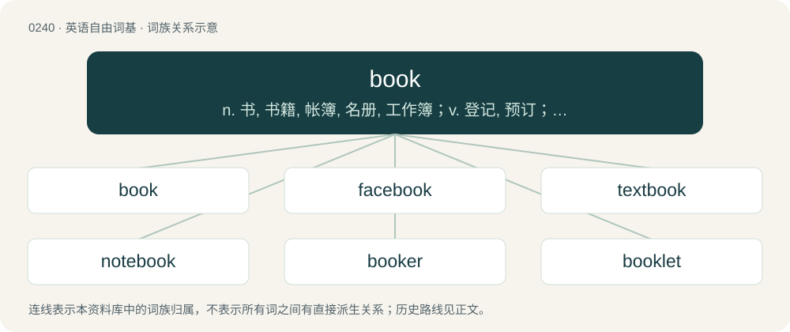

# 0267 · book — n. 书, 书籍, 帐簿, 名册, 工作簿；v. 登记, 预订；\[计\] 工作簿

[总目录](../00_总目录_按常用程度.md)

**类型**：英语自由词基　｜　**来源语言**：见词源记录

## 核心含义与来源

- 核心含义：n. 书, 书籍, 帐簿, 名册, 工作簿；v. 登记, 预订；\[计\] 工作簿
- 英文含义：A collection of sheets of paper bound together to hinge at one edge, containing printed or written material, pictures, etc.
- 词形：book

**多个词源／构词路径**：同一拼写可能有不同来源；以下按词性和含义分别列出。

**来源记录 1**（名词；A collection of sheets of paper bound together to hinge at one edge, containing printed or written material, pictures, etc.）

From Middle English bok, book, from Old English bōc, from Proto-West Germanic \*bōk, from Proto-Germanic \*bōks. Bookmaker sense by clipping. Cognates Cognate with Scots beuk, buik, buke (“book”), Yola buke (“book”), North Frisian Bok, buk, bök (“book”), Saterland Frisian Bouk (“book”), West Frisian, Dutch boek (“book”), Alemannic German Buech (“book”), Bavarian Buach (“book”), Central Franconian Booch, Buch (“book”), German, Luxembourgish Buch (“book”), German Low German Book (“book”), Limburgish book, Bouk (“book”), Vilamovian büch (“book”), Yiddish בוך (bukh, “book”), Danish bog (“book”), Elfdalian buok (“book”), Faroese, Icelandic bók (“book”), Norwegian Bokmål, Norwegian Nynorsk and Swedish bok (“book”).

**来源记录 2**（动词；To reserve (something) for future use.）

From Middle English booken, boken, from Old English bōcian, ġebōcian, from the noun (see above).

## 词族图

## 单词速览（常用到不常用）

| 单词 | 音标 | 释义 |
|---|---|---|
| [book](#w-1) | 英 /bʊk/；/buːk/ | n. 书, 书籍, 帐簿, 名册, 工作簿；v. 登记, 预订；\[计\] 工作簿 |
| [facebook](#w-2) | /ˈfeɪsˌbʊk/ | n. 脸谱网 |
| [textbook](#w-3) | 英 /ˈtɛkst.bʊk/ | n. 教科书 |
| [notebook](#w-4) | 英 /ˈnəʊtˌbʊk/；美 /ˈnoʊtˌbʊk/ | n. 笔记本, 手册, 期票簿 |
| [booker](#w-5) | /ˈbukə/ | n. （旅馆车票, 戏票等的）登记人；寻选模特儿的人 |
| [booklet](#w-6) | /ˈbʊk.lət/ | n. 小册子 |
| [yearbook](#w-7) | /ˈjiəbuk/ | n. 年鉴 |
| [bookstore](#w-8) | 英 /ˈbʊkstɔː/ | n. 书店 |
| [cookbook](#w-9) | 英 /ˈkʊkˌbʊk/；/ˈkuːkˌbuːk/ | n. 食谱 |
| [playbook](#w-10) | /ˈpleɪ.bʊk/ | n. 剧本, 剧本集 |
| [bookshop](#w-11) | /ˈbukʃɒp/ | n. 书店 |
| [audiobook](#w-12) | 英 /ˈɔːdi.əʊbʊk/；美 /ˈɔdi.oʊbʊk/ | n. 有声读物（把文字录制成语音的“有声书”） |
| [bookmark](#w-13) | 英 /ˈbʊkmɑːk/；美 /ˈbʊkmɑːɹk/ | n. 书签；\[计\] 书签 |
| [scrapbook](#w-14) | 美 /ˈskɹæpˌbʊk/ | n. 剪贴簿 |
| [bookshelf](#w-15) | /ˈbʊkˌʃɛlf/ | n. 书架 |
| [bookseller](#w-16) | 美 /ˈbʊksɛlɚ/ | n. 书商 |
| [bookkeeper](#w-17) | 英 /ˌbʊkˈkiː.pə(ɹ)/ | n. 簿记员；\[经\] 簿记员, 记帐员 |
| [workbook](#w-18) | 英 /ˈwɜːk.bʊk/；美 /ˈwɝk.bʊk/ | n. 辅助练习册, 工作规程书, 工作记事簿, 笔记本, 工作手册；\[计\] 工作簿 |
| [storybook](#w-19) | /ˈstɒːribuk/ | n. 故事书, 小说 |
| [bookcase](#w-20) | 英 /ˈbʊkˌkeɪs/ | n. 书架, 书柜 |
| [sketchbook](#w-21) | /ˈskɛt͡ʃˌbʊk/ | n. 写生簿, 素描簿, 短文集, 随笔集 |
| [rulebook](#w-22) | 美 /ˌɹulˌbʊk/ | n. 规则手册\[说明\] |
| [pocketbook](#w-23) | 英 /ˈpɒ.kɪt.bʊk/；美 /ˈpɑ.kɪtˌbʊk/ | n. 笔记本, 钱袋, 皮夹, 经济来源 |
| [bookmaker](#w-24) | 英 /ˈbʊkmeɪkə/；美 /ˈbʊkmeɪkɚ/ | n. 著作家, 编辑者, 赌注登记经营人；\[法\] 以赌为业者, 赌本, 编书谋利者 |
| [bookworm](#w-25) | /ˈbʊk.wɜːm/ | n. 书呆子, 蛀书虫 |
| [bookish](#w-26) | 英 /ˈbʊkɪʃ/；/ˈbuːkɪʃ/ | a. 好读书的, 书呆子的 |
| [songbook](#w-27) | /ˈsɒŋbuk/ | n. 歌谣集, 歌集 |
| [sourcebook](#w-28) | /ˈsɔːsbjk/ | n. 原始资料(集),资料读物 |
| [booklist](#w-29) | /ˈbʊklɪst/ | (某个题目或学科的)推荐书目, 书单 |
| [casebook](#w-30) | /ˈkeɪsˌbʊk/ | n. 个案病例记录簿；\[医\] 病案簿 |
| [bookmaking](#w-31) | /ˈbjk,meikiŋ/ | n. 编书 |
| [photobook](#w-32) |  | 【英文】A book of photographs, often by a single photographer. |
| [bookbinding](#w-33) | /ˈbukbaindiŋ/ | n. 装订 |
| [factbook](#w-34) |  | 【英文】A book of facts. |
| [bookman](#w-35) | /ˈbukmən/ | n. 学者, 文人, 书商 |
| [bookable](#w-36) | /ˈbjkəbl/ | a. 可预定的, 可预约的, 可预购的 |
| [lookbook](#w-37) | 英 /ˈlʊkbʊk/；/ˈluːkbuːk/ | \[网络\] 型录；街拍；搭配 |
| [sportsbook](#w-38) |  | 【英文】A place where a gambler can bet on various sports competitions; the company that runs it; the website that is its online presence. (Most such companies offer online betting, subject to geofencing by state.) |
| [bookend](#w-39) | 英 /ˈbʊkɛnd/ | n. 书挡, 压书具 |
| [phonebook](#w-40) | 美 /ˈfoʊnˌbʊk/ | n. 电话簿 |
| [ultrabook](#w-41) |  | 【英文】A very lightweight and thin portable computer the areal size of a notebook computer or subnotebook. |
| [passbook](#w-42) | /ˈpæsbuk/ | n. 存款簿, 银行存折 |
| [artbook](#w-43) |  | 【英文】A book about art, particularly concept art for an animated media production. |
| [bookbinder](#w-44) | 美 /ˈbʊkˌbaɪn.dəɹ/ | n. 装订工人 |
| [bookselling](#w-45) | /ˈbukseliŋ/ | n. 书籍贩卖 |
| [matchbook](#w-46) | /ˈmætʃbuk/ | n. 纸板火柴 |
| [rebook](#w-47) |  | vi. 重新订票 |

## 逐词详解

### 1. book

**词性**：名词　｜　**音标**：英 /bʊk/；/buːk/

**中文释义**：n. 书, 书籍, 帐簿, 名册, 工作簿；v. 登记, 预订；\[计\] 工作簿

**英文义项**：A collection of sheets of paper bound together to hinge at one edge, containing printed or written material, pictures, etc. / A long work fit for publication, typically prose, such as a novel or textbook, and typically published as such a bound collection of sheets, but now sometimes electronically as an e-book.

**词源与演化**：

From Middle English bok, book, from Old English bōc, from Proto-West Germanic \*bōk, from Proto-Germanic \*bōks. Bookmaker sense by clipping. Cognates Cognate with Scots beuk, buik, buke (“book”), Yola buke (“book”), North Frisian Bok, buk, bök (“book”), Saterland Frisian Bouk (“book”), West Frisian, Dutch boek (“book”), Alemannic German Buech (“book”), Bavarian Buach (“book”), Central Franconian Booch, Buch (“book”), German, Luxembourgish Buch (“book”), German Low German Book (“book”), Limburgish book, Bouk (“book”), Vilamovian büch (“book”), Yiddish בוך (bukh, “book”), Danish bog (“book”), Elfdalian buok (“book”), Faroese, Icelandic bók (“book”), Norwegian Bokmål, Norwegian Nynorsk and Swedish bok (“book”).

**例句**：

> He was frustrated because he couldn't find anything about dinosaurs in the book.

该用例对应义项：A collection of sheets of paper bound together to hinge at one edge, containing printed or written material, pictures, etc.

### 2. facebook

**词性**：名词　｜　**音标**：/ˈfeɪsˌbʊk/

**中文释义**：n. 脸谱网

**英文义项**：A reference book or electronic directory containing the photographs and names of various individuals. / A college publication distributed at the start of the academic year by university administrations with the intention of helping students become acquainted with each other.

**构词拆分**：face + book + namebook；face + book

**词源与演化**：

From face + book, likely modelled after namebook.

**例句**：

> The shipment of facebooks will be distributed to the freshmen during orientation and move-in-week.

该用例对应义项：A college publication distributed at the start of the academic year by university administrations with the intention of helping students become acquainted with each other.

### 3. textbook

**词性**：形容词　｜　**音标**：英 /ˈtɛkst.bʊk/

**中文释义**：n. 教科书

**英文义项**：Of or pertaining to textbooks or their style, especially in being dry and pedagogical; textbooky, textbooklike. / Having the typical characteristics of some class of phenomenon, so that it might be included as an example in a textbook.

**构词拆分**：text + book

**词源与演化**：

From text + book.

**例句**：

> He has a textbook understanding of company law but no practical experience of litigation.

该用例对应义项：Learned from, or as if learned from, a textbook, as opposed to personal discovery or experience.

### 4. notebook

**词性**：名词　｜　**音标**：英 /ˈnəʊtˌbʊk/；美 /ˈnoʊtˌbʊk/

**中文释义**：n. 笔记本, 手册, 期票簿

**英文义项**：A book (physical or digital) in which notes or memoranda are written. / A kind of user interface in literate programming, allowing calculations to be interspersed with human-readable comments, diagrams, etc.

**构词拆分**：note + book

**词源与演化**：

From note + book.

**例句**：

> Tom and Mary gave me a notebook full of their favorite recipes.

### 5. booker

**词性**：名词　｜　**音标**：/ˈbukə/

**中文释义**：n. （旅馆车票, 戏票等的）登记人；寻选模特儿的人

**英文义项**：One who makes a reservation. / One who records transactions, such as reservations.

**构词拆分**：book + -er

**词源与演化**：

From Middle English bokere, from Old English bōcere (“scribe”), equivalent to book + -er. Modern sense influenced by the verb to book.

**例句**：

> No British authors are on the shortlist for the Booker Prize this year.

### 6. booklet

**词性**：名词　｜　**音标**：/ˈbʊk.lət/

**中文释义**：n. 小册子

**英文义项**：A small or thin book.

**构词拆分**：book + -let

**词源与演化**：

From book + -let.

**例句**：

> The new hoover came with a thick booklet of instructions in twenty-one languages.

### 7. yearbook

**词性**：名词　｜　**音标**：/ˈjiəbuk/

**中文释义**：n. 年鉴

**英文义项**：A reference book, published annually. / A publication compiled by the graduating class of a high school or college, recording the year's events and containing photographs of students and faculty.

**构词拆分**：year + book

**词源与演化**：

From year + book. Compare Saterland Frisian Jierbouk (“yearbook”), West Frisian jierboek (“yearbook”), Dutch jaarboek (“yearbook”), German Low German Johrbook (“yearbook”), German Jahrbuch (“yearbook”), Swedish årsbok (“yearbook”), Faroese árbók (“annal, record, yearbook”).

**例句**：

> William's old high school yearbook was a treasure trove of nostalgia.

### 8. bookstore

**词性**：名词　｜　**音标**：英 /ˈbʊkstɔː/

**中文释义**：n. 书店

**英文义项**：A store where books are bought and sold. / A stationery store.

**构词拆分**：book + store

**词源与演化**：

From book + store.

**例句**：

> Is it possible to buy the book at the bookstore in Akita?

### 9. cookbook

**词性**：名词　｜　**音标**：英 /ˈkʊkˌbʊk/；/ˈkuːkˌbuːk/

**中文释义**：n. 食谱

**英文义项**：A book or an encyclopedia of recipes and cookery tips. / Any book or set of strategies and tips.

**构词拆分**：cook + book

**词源与演化**：

From cook + book; possibly also a calque of German Kochbuch, from kochen (“cook”) + Buch (“book”).

**例句**：

> Reading business biographies is interesting, but they are not cookbooks that can teach hacks how to be greats.

该用例对应义项：Any book or set of strategies and tips.

### 10. playbook

**词性**：名词　｜　**音标**：/ˈpleɪ.bʊk/

**中文释义**：n. 剧本, 剧本集

**英文义项**：A book containing the text of a play or plays. / A book of games and amusements for children.

**构词拆分**：play + book

**词源与演化**：

From play + book.

**例句**：

> The 1963 playbook leaves out the whole first scene.

该用例对应义项：a book containing the scripts of one or more dramatic plays

### 11. bookshop

**词性**：名词　｜　**音标**：/ˈbukʃɒp/

**中文释义**：n. 书店

**英文义项**：A shop that sells books.

**构词拆分**：book + shop

**词源与演化**：

From book + shop.

**例句**：

> I am working full-time at a bookshop until the end of September.

### 12. audiobook

**词性**：名词　｜　**音标**：英 /ˈɔːdi.əʊbʊk/；美 /ˈɔdi.oʊbʊk/

**中文释义**：n. 有声读物（把文字录制成语音的“有声书”）

**英文义项**：A recording, usually made available for sale, of a reading of the full text or of an abridgement of a book.

**构词拆分**：audio- + book

**词源与演化**：

From audio- + book.

**例句**：

> Can you recommend me a good audiobook to fall asleep to?

### 13. bookmark

**词性**：名词　｜　**音标**：英 /ˈbʊkmɑːk/；美 /ˈbʊkmɑːɹk/

**中文释义**：n. 书签；\[计\] 书签

**英文义项**：A strip of material used to mark a place in a book. / A record of the address of a file or Internet page, serving as a shortcut to it.

**构词拆分**：book + mark

**词源与演化**：

From Middle English \*boke-merk, \*boke-merke (attested only in the bare form merk (“bookmark”)), equivalent to book + mark. Cognate with Danish bogmærke (“bookmark”), Swedish bokmärke (“bookmark”), Norwegian bokmerke (“bookmark”), Icelandic bókamerki (“bookmark”). Eclipsed non-native Old English æstel (“bookmark”), from Old Irish astal, from Latin hastula (“little spear, splint”).

**例句**：

> He placed a bookmark on page 234, which had an interesting footnote from the author.

该用例对应义项：A strip of material used to mark a place in a book.

### 14. scrapbook

**词性**：名词　｜　**音标**：美 /ˈskɹæpˌbʊk/

**中文释义**：n. 剪贴簿

**英文义项**：A book, similar to a notebook or journal, in which personal or family memorabilia and photos are collected and arranged.

**构词拆分**：scrap + book

**词源与演化**：

From scrap + book.

**例句**：

> I love the scrapbook Tom made for me.

### 15. bookshelf

**词性**：名词　｜　**音标**：/ˈbʊkˌʃɛlf/

**中文释义**：n. 书架

**英文义项**：A shelf or shelves for storing books for easy visual reference.

**构词拆分**：book + shelf

**词源与演化**：

From book + shelf.

**例句**：

> In my bedroom are my computer and the bookshelf with my books.

### 16. bookseller

**词性**：名词　｜　**音标**：美 /ˈbʊksɛlɚ/

**中文释义**：n. 书商

**英文义项**：A person engaged in the business of selling books. / A business that sells books.

**构词拆分**：book + seller

**词源与演化**：

From Middle English boksellere, bok-sillere, equivalent to book + seller.

**例句**：

> The bookseller reads a lot of books.

### 17. bookkeeper

**词性**：名词　｜　**音标**：英 /ˌbʊkˈkiː.pə(ɹ)/

**中文释义**：n. 簿记员；\[经\] 簿记员, 记帐员

**英文义项**：A person responsible for keeping records or documents, such as of a business. / A bookseller

**构词拆分**：book + keeper

**词源与演化**：

From book + keeper.

**例句**：

> A bookkeeper computes all the company's income and expenses each week.

### 18. workbook

**词性**：名词　｜　**音标**：英 /ˈwɜːk.bʊk/；美 /ˈwɝk.bʊk/

**中文释义**：n. 辅助练习册, 工作规程书, 工作记事簿, 笔记本, 工作手册；\[计\] 工作簿

**英文义项**：A book, used by a student, in which answers and workings may be entered besides questions and exercises. / A book, used by a business, containing a record of work to be done, or work completed.

**构词拆分**：work + book

**词源与演化**：

From work + book.

**例句**：

> Are you absolutely sure that you took your workbook with you?

### 19. storybook

**词性**：名词　｜　**音标**：/ˈstɒːribuk/

**中文释义**：n. 故事书, 小说

**英文义项**：A book containing stories, especially children's stories.

**构词拆分**：story + book

**词源与演化**：

From story + book.

**例句**：

> The curtains are adorned with patterns from his favorite storybook.

### 20. bookcase

**词性**：名词　｜　**音标**：英 /ˈbʊkˌkeɪs/

**中文释义**：n. 书架, 书柜

**英文义项**：A piece of furniture for the storage and display of books.

**构词拆分**：book + case

**词源与演化**：

From book + case.

**例句**：

> He is buying some wood so that he can make a bookcase.

### 21. sketchbook

**词性**：名词　｜　**音标**：/ˈskɛt͡ʃˌbʊk/

**中文释义**：n. 写生簿, 素描簿, 短文集, 随笔集

**英文义项**：A book or pad with blank pages for sketching; a sketch pad. / A book of printed sketches.

**构词拆分**：sketch + book

**词源与演化**：

From sketch + book.

**例句**：

> If I draw this in my sketchbook, do you think my parents will kill me?

### 22. rulebook

**词性**：名词　｜　**音标**：美 /ˌɹulˌbʊk/

**中文释义**：n. 规则手册\[说明\]

**英文义项**：A book containing a set of rules.

**构词拆分**：rule + book

**词源与演化**：

From rule + book.

### 23. pocketbook

**词性**：名词　｜　**音标**：英 /ˈpɒ.kɪt.bʊk/；美 /ˈpɑ.kɪtˌbʊk/

**中文释义**：n. 笔记本, 钱袋, 皮夹, 经济来源

**英文义项**：A purse or handbag. / A wallet for paper money.

**构词拆分**：pocket + book

**词源与演化**：

1610s, from pocket + book, popularized in its sense as a paperback by the success of Pocket Books in the United States after its 1939 launch.

**例句**：

> The publishers brought out small format pocketbooks of the whole of their nature series.

该用例对应义项：A small book, particularly (US) a paperback or (UK) notebook able to fit into a pocket (of any genre, from reference work to fine art).

### 24. bookmaker

**词性**：名词　｜　**音标**：英 /ˈbʊkmeɪkə/；美 /ˈbʊkmeɪkɚ/

**中文释义**：n. 著作家, 编辑者, 赌注登记经营人；\[法\] 以赌为业者, 赌本, 编书谋利者

**英文义项**：A person who prints or binds books. / A person who compiles books from the writings of others.

**构词拆分**：book + maker

**词源与演化**：

From Middle English bokmakere, boke maker, equivalent to book + maker. The gambling term came from the archaic phrase make book or make a book, used in 19th century England.

### 25. bookworm

**词性**：名词　｜　**音标**：/ˈbʊk.wɜːm/

**中文释义**：n. 书呆子, 蛀书虫

**英文义项**：Any of various insects that infest books. / An avid book reader.

**构词拆分**：book + worm

**词源与演化**：

From book + worm. Compare West Frisian boekewjirm (“bookworm”), Dutch boekworm, boekwurm, boekenwurm (“bookworm”), Low German Bökerworm (“bookworm”), German Bücherwurm (“bookworm”), Danish bogorm (“bookworm”), Norwegian bokorm (“bookworm”), Faroese bókaormur (“bookworm”), Icelandic bókaormur (“bookworm”).

**例句**：

> Even the bookworm Donald was nervous as he prepared for that test.

### 26. bookish

**词性**：形容词　｜　**音标**：英 /ˈbʊkɪʃ/；/ˈbuːkɪʃ/

**中文释义**：a. 好读书的, 书呆子的

**英文义项**：Fond of reading or studying, especially said of someone lacking social skills as a result. / Characterized by a method of expression generally found in books.

**构词拆分**：book + -ish

**词源与演化**：

From book + -ish.

**例句**：

> A bookish farmer who always had a book in his pocket.

该用例对应义项：characterized by diligent study and fondness for reading

### 27. songbook

**词性**：名词　｜　**音标**：/ˈsɒŋbuk/

**中文释义**：n. 歌谣集, 歌集

**英文义项**：A book containing songs. / A repertoire of songs.

**构词拆分**：song + book

**词源与演化**：

From Middle English song boke, from Old English sangbōc (“a music book; songbook”), equivalent to song + book. Compare Saterland Frisian Songbouk (“songbook”), West Frisian sjongboek (“songbook”), Dutch zangboek (“songbook”), German Low German Sangbook (“songbook; hymnbook; hymnal”), German Gesangbuch (“songbook; hymnbook; hymnal”), Danish sangbog (“songbook”), Swedish sångbok (“songbook”), Faroese songbók (“songbook”), Icelandic söngbók (“songbook”).

**用法示例／搭配（非完整句）**：

> the great American songbook

该用例对应义项：A repertoire of songs.

### 28. sourcebook

**词性**：名词　｜　**音标**：/ˈsɔːsbjk/

**中文释义**：n. 原始资料(集),资料读物

**英文义项**：A book consisting of a collection of writings on a particular subject. / A publication intended to supplement the core materials of a roleplaying game.

**构词拆分**：source + book

**词源与演化**：

From source + book.

### 29. booklist

**词性**：名词　｜　**音标**：/ˈbʊklɪst/

**中文释义**：(某个题目或学科的)推荐书目, 书单

**英文义项**：Any list of books. / The list of books published by a publisher.

**构词拆分**：book + list

**词源与演化**：

From book + list.

### 30. casebook

**词性**：名词　｜　**音标**：/ˈkeɪsˌbʊk/

**中文释义**：n. 个案病例记录簿；\[医\] 病案簿

**英文义项**：A kind of book, used in law schools, containing the text of court opinions in legal cases accompanied by analysis and related materials. / A collection of stories or accounts that can individually be described as cases.

**构词拆分**：case + book

**词源与演化**：

From case + book. First use appears c. 1675.

### 31. bookmaking

**词性**：名词　｜　**音标**：/ˈbjk,meikiŋ/

**中文释义**：n. 编书

**英文义项**：The art or profession of determining odds and receiving and paying off bets, especially bets on the outcome of sporting events. / The art or practice of printing and binding books.

**构词拆分**：book + making

**词源与演化**：

From Middle English boke-making, equivalent to book + making.

### 32. photobook

**词性**：名词

**英文义项**：A book of photographs, often by a single photographer.

**构词拆分**：photo + book

**词源与演化**：

From photo + book.

### 33. bookbinding

**词性**：名词　｜　**音标**：/ˈbukbaindiŋ/

**中文释义**：n. 装订

**英文义项**：The art, craft or process of binding books.

**构词拆分**：book + binding

**词源与演化**：

From book + binding.

### 34. factbook

**词性**：名词

**英文义项**：A book of facts.

**构词拆分**：fact + book

**词源与演化**：

From fact + book.

### 35. bookman

**词性**：名词　｜　**音标**：/ˈbukmən/

**中文释义**：n. 学者, 文人, 书商

**英文义项**：A studious or learned man; a scholar; a student of books. / One who sells or publishes books; a bookseller.

**构词拆分**：book + man

**词源与演化**：

From Middle English bocman, from Old English bōcmann (“bookman, a holder of bookland”), equivalent to book + man.

### 36. bookable

**词性**：形容词　｜　**音标**：/ˈbjkəbl/

**中文释义**：a. 可预定的, 可预约的, 可预购的

**英文义项**：Able to be booked or reserved. / Worth booking; likely to attract a large audience or similar.

**构词拆分**：book + -able

**词源与演化**：

From book + -able.

**例句**：

> The player was sent off for two bookable offences.

该用例对应义项：Warranting a booking (a yellow card).

### 37. lookbook

**词性**：动词　｜　**音标**：英 /ˈlʊkbʊk/；/ˈluːkbuːk/

**中文释义**：\[网络\] 型录；街拍；搭配

**英文义项**：To locate fashion-related information by means of a directory.

**构词拆分**：look + book

**词源与演化**：

From look + book.

**例句**：

> She lookbooked little black dresses in order to locate the one she wanted.

该用例对应义项：To locate fashion-related information by means of a directory.

### 38. sportsbook

**词性**：名词

**英文义项**：A place where a gambler can bet on various sports competitions; the company that runs it; the website that is its online presence. (Most such companies offer online betting, subject to geofencing by state.)

**构词拆分**：sports + book

**词源与演化**：

From sports + book.

### 39. bookend

**词性**：名词　｜　**音标**：英 /ˈbʊkɛnd/

**中文释义**：n. 书挡, 压书具

**英文义项**：A heavy object or moveable support placed at one or both ends of a row of books for the purpose of keeping them upright. / Something that comes before, after, or at both sides of something else.

**构词拆分**：book + end

**词源与演化**：

From book + end.

### 40. phonebook

**词性**：名词　｜　**音标**：美 /ˈfoʊnˌbʊk/

**中文释义**：n. 电话簿

**英文义项**：A directory of all the phone numbers used in a district. / A large lookup table.

**构词拆分**：phone + book

**词源与演化**：

From phone + book.

### 41. ultrabook

**词性**：名词

**英文义项**：A very lightweight and thin portable computer the areal size of a notebook computer or subnotebook.

**构词拆分**：ultra- + book

**词源与演化**：

From ultra- + book; see notebook computer.

### 42. passbook

**词性**：名词　｜　**音标**：/ˈpæsbuk/

**中文释义**：n. 存款簿, 银行存折

**英文义项**：A customer's record of deposits and withdrawals from a savings account or current account at a bank, typically recorded in a small booklet. The bank keeps its own record, which is final in any dispute. / A book that passes between a trader and a customer, used to record credit purchases.

**构词拆分**：pass + book

**词源与演化**：

From pass + book.

### 43. artbook

**词性**：名词

**英文义项**：A book about art, particularly concept art for an animated media production. / A book containing art.

**构词拆分**：art + book

**词源与演化**：

From art + book.

### 44. bookbinder

**词性**：名词　｜　**音标**：美 /ˈbʊkˌbaɪn.dəɹ/

**中文释义**：n. 装订工人

**英文义项**：A person whose profession is binding pages together to form books.

**构词拆分**：book + binder

**词源与演化**：

From Middle English bokebynder, bok-bindere, equivalent to book + binder.

### 45. bookselling

**词性**：名词　｜　**音标**：/ˈbukseliŋ/

**中文释义**：n. 书籍贩卖

**英文义项**：The sale of books.

**构词拆分**：book + selling

**词源与演化**：

From book + selling.

### 46. matchbook

**词性**：名词　｜　**音标**：/ˈmætʃbuk/

**中文释义**：n. 纸板火柴

**英文义项**：A small assemblage of cut and folded paperboard comprising a folded sheet (the matchcover) and some rows of matches (paperboard strips with the ends dipped to produce the matchheads), generally with a striker on the outside.

**构词拆分**：match + book

**词源与演化**：

From match + book, since the 1890s. Paper matches were developed in the 1880s; folded books containing them, and the strike-on-cover concept, were developed in the 1890s; more in Wikipedia at matchbook.

**例句**：

> My company had matchbooks printed with the corporate logo as giveaway promotional items.

该用例对应义项：A small assemblage of cut and folded paperboard comprising a folded sheet (the matchcover) and some rows of matches (paperboard strips with the ends dipped to produce the matchheads), generally with a striker on the outside.

### 47. rebook

**词性**：动词

**中文释义**：vi. 重新订票

**英文义项**：To book again.

**构词拆分**：re- + book

**词源与演化**：

From re- + book.
