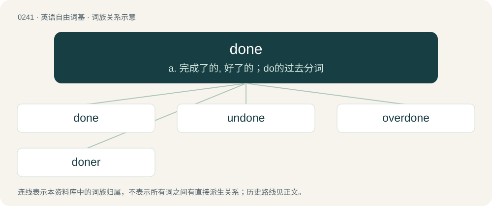

# 0268 · done — a. 完成了的, 好了的；do的过去分词

[总目录](../00_总目录_按常用程度.md)

**类型**：英语自由词基　｜　**来源语言**：见词源记录

## 核心含义与来源

- 核心含义：a. 完成了的, 好了的；do的过去分词
- 英文含义：Having completed or finished an activity.
- 词形：done

**来源记录 1**（形容词；Having completed or finished an activity.）

From Middle English don, idon, ydon, ȝedon, gedon, from Old English dōn, ġedōn, from Proto-West Germanic \*dān, from Proto-Germanic \*dēnaz (past participle of \*dōną (“to do”)). Equivalent to do + -en (past participle ending). Cognate with Scots dune, deen, dene, dane (“done”), Saterland Frisian däin (“done”), West Frisian dien (“done”), Dutch gedaan (“done”), German Low German daan (“done”), German getan (“done”). More at do.

## 词族图

## 单词速览（常用到不常用）

| 单词 | 音标 | 释义 |
|---|---|---|
| [done](#w-1) | 英 /dʌn/ | a. 完成了的, 好了的；do的过去分词 |
| [undone](#w-2) | /ʌnˈdʌn/ | a. 没有做好, 未完成的, 破灭的, 解开的；undo的过去分词 |
| [overdone](#w-3) | 英 /ˌəʊ.vəˈdʌn/；美 /ˌoʊ.vɚˈdʌn/ | overdo的过去分词 |
| [doner](#w-4) |  | 【英文】Goner; someone who is done for. |

## 逐词详解

### 1. done

**词性**：形容词　｜　**音标**：英 /dʌn/

**中文释义**：a. 完成了的, 好了的；do的过去分词

**英文义项**：Having completed or finished an activity. / Completed or finished.

**构词拆分**：do + -en (past participle ending)

**词源与演化**：

From Middle English don, idon, ydon, ȝedon, gedon, from Old English dōn, ġedōn, from Proto-West Germanic \*dān, from Proto-Germanic \*dēnaz (past participle of \*dōną (“to do”)). Equivalent to do + -en (past participle ending). Cognate with Scots dune, deen, dene, dane (“done”), Saterland Frisian däin (“done”), West Frisian dien (“done”), Dutch gedaan (“done”), German Low German daan (“done”), German getan (“done”). More at do.

**例句**：

> I can't believe he just walked up and spoke to her like that, those kind of things just aren't done!

该用例对应义项：Fashionable, socially acceptable, tasteful.

### 2. undone

**词性**：形容词　｜　**音标**：/ʌnˈdʌn/

**中文释义**：a. 没有做好, 未完成的, 破灭的, 解开的；undo的过去分词

**英文义项**：Not done.

**构词拆分**：un- + done

**词源与演化**：

From un- + done.

**例句**：

> The work could be done or undone and nobody cared.

该用例对应义项：not done

### 3. overdone

**词性**：形容词　｜　**音标**：英 /ˌəʊ.vəˈdʌn/；美 /ˌoʊ.vɚˈdʌn/

**中文释义**：overdo的过去分词

**英文义项**：Cooked too much. / Exaggerated; overwrought.

**构词拆分**：over- + done

**词源与演化**：

From Middle English overdon, from Old English oferdōn, equivalent to over- + done.

**例句**：

> The comic scenes in the play were overdone.

### 4. doner

**词性**：名词

**英文义项**：Goner; someone who is done for.

**构词拆分**：done + -er

**词源与演化**：

From done + -er. Compare goner.
