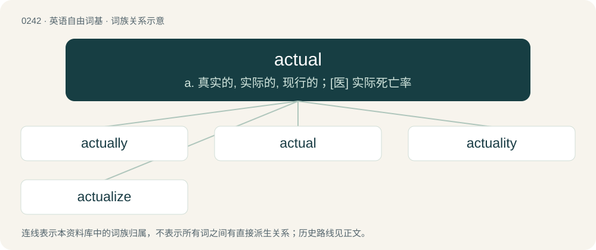

# 0269 · actual — a. 真实的, 实际的, 现行的；\[医\] 实际死亡率

[总目录](../00_总目录_按常用程度.md)

**类型**：英语自由词基　｜　**来源语言**：见词源记录

## 核心含义与来源

- 核心含义：a. 真实的, 实际的, 现行的；\[医\] 实际死亡率
- 英文含义：relating to a person's acts or deeds; active, practical
- 词形：actual

**来源记录 1**（形容词；relating to a person's acts or deeds; active, practical）

From Middle English actual, actuel (“active”), from Anglo-Norman actuel, actual, and its source Late Latin actuālis (“active, practical”), from Latin actus (“act, action, performance”), from agere (“to do; to act”) + -alis (“-al”), ultimately from Proto-Indo-European \*h₂éǵeti, from the root \*h₂eǵ-. By surface analysis, act + -u- + -al.

## 词族图

## 单词速览（常用到不常用）

| 单词 | 音标 | 释义 |
|---|---|---|
| [actually](#w-1) | 英 /ˈæk(t)ʃᵿli/；美 /ˈæk.t͡ʃ(u.)(ə.)li/ | adv. 事实上, 竟然, 如今, 现在 |
| [actual](#w-2) | /ˈækʃuəl/ | a. 真实的, 实际的, 现行的；\[医\] 实际死亡率 |
| [actuality](#w-3) | /ˌækt͡ʃuˈælɪti/ | n. 事实, 现实, 现状 |
| [actualize](#w-4) | /ˈæktju.əlaɪz/ | vt. 实行, 使现实化 |

## 逐词详解

### 1. actually

**词性**：副词　｜　**音标**：英 /ˈæk(t)ʃᵿli/；美 /ˈæk.t͡ʃ(u.)(ə.)li/

**中文释义**：adv. 事实上, 竟然, 如今, 现在

**英文义项**：In act or in fact; really; in truth; positively. / Currently; at the time.

**构词拆分**：actual + -ly

**词源与演化**：

From Middle English actually, actuelly, equivalent to actual + -ly.

**例句**：

> His promises did not correspond with what he actually did.

该用例对应义项：In act or in fact; really; in truth; positively.

### 2. actual

**词性**：形容词　｜　**音标**：/ˈækʃuəl/

**中文释义**：a. 真实的, 实际的, 现行的；\[医\] 实际死亡率

**英文义项**：relating to a person's acts or deeds; active, practical / Existing in reality, not just potentially; really acted or acting; occurring in fact.

**词源与演化**：

From Middle English actual, actuel (“active”), from Anglo-Norman actuel, actual, and its source Late Latin actuālis (“active, practical”), from Latin actus (“act, action, performance”), from agere (“to do; to act”) + -alis (“-al”), ultimately from Proto-Indo-European \*h₂éǵeti, from the root \*h₂eǵ-. By surface analysis, act + -u- + -al.

**例句**：

> The actual government expenses dramatically exceed the budget.

该用例对应义项：Existing in reality, not just potentially; really acted or acting; occurring in fact.

### 3. actuality

**词性**：名词　｜　**音标**：/ˌækt͡ʃuˈælɪti/

**中文释义**：n. 事实, 现实, 现状

**英文义项**：The state of existing; existence. / An instance or quality of being actual or factual; fact.

**构词拆分**：actual + -ity

**词源与演化**：

From actual + -ity. \* (television): Influenced by French actualité.

**例句**：

> A hope that progressed from possibility to actuality.

该用例对应义项：the state of actually existing objectively

### 4. actualize

**词性**：动词　｜　**音标**：/ˈæktju.əlaɪz/

**中文释义**：vt. 实行, 使现实化

**英文义项**：To make real; to realize. / To become actual or real.

**构词拆分**：actual + -ize

**词源与演化**：

From actual + -ize.

**例句**：

> Despite me wanting to go to this place for a long time, I never had the courage to actualize my dream.
