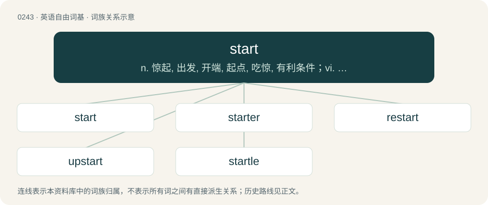

# 0270 · start — n. 惊起, 出发, 开端, 起点, 吃惊, 有利条件；vi. 开始, 出发, 启动, 跳起, 吃惊, 出现, 松动, 脱落, 起价, 参赛；vt. 使惊起, 开动, 发动, 启动, 开始, 创办, 提议, 使松动, 使脱落, 起用

[总目录](../00_总目录_按常用程度.md)

**类型**：英语自由词基　｜　**来源语言**：见词源记录

## 核心含义与来源

- 核心含义：n. 惊起, 出发, 开端, 起点, 吃惊, 有利条件；vi. 开始, 出发, 启动, 跳起, 吃惊, 出现, 松动, 脱落, 起价, 参赛；vt. 使惊起, 开动, 发动, 启动, 开始, 创办, 提议, 使松动, 使脱落, 起用
- 英文含义：The beginning of an activity.
- 词形：start

**多个词源／构词路径**：同一拼写可能有不同来源；以下按词性和含义分别列出。

**来源记录 1**（名词；The beginning of an activity.）

From Middle English stert, from the verb sterten (“to start, startle”). See below.

**来源记录 2**（动词；To set in motion.）

From Middle English sterten (“to leap up suddenly, rush out”), from Old English styrtan (“to leap up, start”), from Proto-West Germanic \*sturtijan (“to startle, move, set in motion”), from Proto-Indo-European \*(s)ter- (“to be stiff”). Cognate with Old Frisian stirta (“to fall down, tumble”), Middle Dutch sterten (“to rush, fall, collapse”) (Dutch storten), Old High German sturzen (“to hurl, plunge, turn upside down”) (German stürzen), Old High German sterzan (“to be stiff, protrude”). More at stare.

**来源记录 3**（名词；A projection or protrusion; that which pokes out.）

From Middle English stert, start (“tail, handle, projection”), from Old English steort (“tail”), from Proto-West Germanic \*stert, from Proto-Germanic \*stertaz (“tail”). Cognate with Scots start, stairt (“side post, shaft, upright post”), Dutch staart (“tail”), German Sterz (“tail, handle”), Danish stjert (“tail of a bird”), Faroese stertur (“tail”), Icelandic stertur (“short horse tail”), Norn skjårt (“tail”), sterti (“tail of a large fish”), stjårt (“tail of a large fish”), Norwegian stjert (“tail of a bird”), Swedish stjärt (“tail, arse”).

## 词族图

## 单词速览（常用到不常用）

| 单词 | 音标 | 释义 |
|---|---|---|
| [start](#w-1) | 英 /stɑːt/；美 /stɑɹt/ | n. 惊起, 出发, 开端, 起点, 吃惊, 有利条件；vi. 开始, 出发, 启动, 跳起, 吃惊, 出现, 松动, 脱落, 起价, 参赛；vt. 使惊起, 开动, 发动, 启动, 开始, 创办, 提议, 使松动, 使脱落, 起用 |
| [starter](#w-2) | 英 /ˈstɑː.tə(ɹ)/；美 /ˈstɑɹ.tɚ/ | n. 开端者, 在起跑线上的人, 参加赛跑的人, 调度员, 起动机, 酵母；\[计\] 启动程序, 启动器 |
| [restart](#w-3) | 英 /ˌɹɪˈstɑːt/；美 /ˈɹiːˌstɑɹt/ | v. 重新开始, 重新启动；\[计\] 重新启动 |
| [upstart](#w-4) | 英 /ˈʌp.stɑːt/；美 /ˈʌp.stɑɹt/ | n. 新贵, 暴发户, 自命不凡者；a. 暴富的 |
| [startle](#w-5) | 英 /ˈstɑːt(ə)l/；美 /ˈstɑɹt(ə)l/ | n. 惊愕, 惊恐；vt. 吃惊, 使惊愕；vi. 惊起 |

## 逐词详解

### 1. start

**词性**：名词　｜　**音标**：英 /stɑːt/；美 /stɑɹt/

**中文释义**：n. 惊起, 出发, 开端, 起点, 吃惊, 有利条件；vi. 开始, 出发, 启动, 跳起, 吃惊, 出现, 松动, 脱落, 起价, 参赛；vt. 使惊起, 开动, 发动, 启动, 开始, 创办, 提议, 使松动, 使脱落, 起用

**英文义项**：The beginning of an activity. / A sudden involuntary movement.

**词源与演化**：

From Middle English stert, from the verb sterten (“to start, startle”). See below.

**例句**：

> Jones has been a substitute before, but made his first start for the team last Sunday.

该用例对应义项：An appearance in a sports game, horserace, etc., from the beginning of the event.

### 2. starter

**词性**：名词　｜　**音标**：英 /ˈstɑː.tə(ɹ)/；美 /ˈstɑɹ.tɚ/

**中文释义**：n. 开端者, 在起跑线上的人, 参加赛跑的人, 调度员, 起动机, 酵母；\[计\] 启动程序, 启动器

**英文义项**：Someone who starts, or who starts something. / The person who starts a race by firing a gun or waving a flag.

**构词拆分**：From start + -er.

**词源与演化**：

From start + -er.

**例句**：

> It's small, but it's a good starter house.

该用例对应义项：Something with which to begin; a first property, etc.

### 3. restart

**词性**：名词　｜　**音标**：英 /ˌɹɪˈstɑːt/；美 /ˈɹiːˌstɑɹt/

**中文释义**：v. 重新开始, 重新启动；\[计\] 重新启动

**英文义项**：The act of starting something again.

**构词拆分**：re- + start

**词源与演化**：

From re- + start.

**例句**：

> After the restart of my browser, the problem went away.

该用例对应义项：The act of starting something again.

### 4. upstart

**词性**：名词　｜　**音标**：英 /ˈʌp.stɑːt/；美 /ˈʌp.stɑɹt/

**中文释义**：n. 新贵, 暴发户, 自命不凡者；a. 暴富的

**英文义项**：One who has suddenly gained wealth, power, or other prominence, but either has not received social acceptance or has become arrogant or presumptuous. / The meadow saffron.

**构词拆分**：up- + start

**词源与演化**：

From Middle English upstarten, upsterten, equivalent to up- + start.

**例句**：

> The upstart tried to pass for a man of culture.

### 5. startle

**词性**：动词　｜　**音标**：英 /ˈstɑːt(ə)l/；美 /ˈstɑɹt(ə)l/

**中文释义**：n. 惊愕, 惊恐；vt. 吃惊, 使惊愕；vi. 惊起

**英文义项**：To move suddenly, or be excited, on feeling alarm; to start. / To excite by sudden alarm, surprise, or apprehension; to frighten suddenly and not seriously; to alarm; to surprise.

**构词拆分**：start + -le

**词源与演化**：

From Middle English startlen, stertlen, stertyllen (“to rush, stumble along”), from Old English steartlian (“to kick with the foot, struggle, stumble”), equivalent to start + -le. Cognate with Old Norse stirtla (“to hobble, stagger”), Icelandic stirtla (“to straighten up, erect”). Compare also Middle English stertil (“hasty”). More at start.

**用法示例／搭配（非完整句）**：

> a horse that startles easily

该用例对应义项：To move suddenly, or be excited, on feeling alarm; to start.
