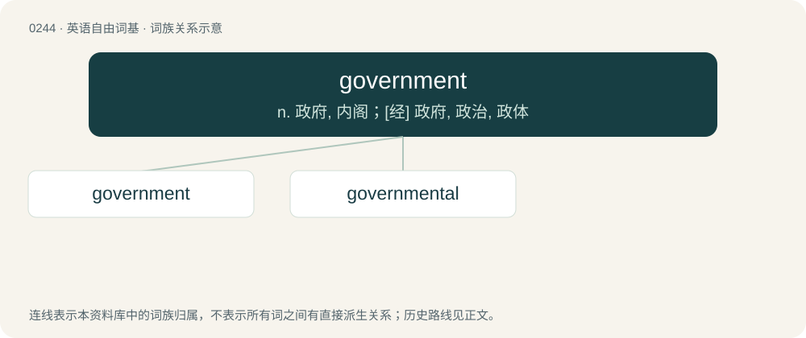

# 0271 · government — n. 政府, 内阁；\[经\] 政府, 政治, 政体

[总目录](../00_总目录_按常用程度.md)

**类型**：英语自由词基　｜　**来源语言**：见词源记录

## 核心含义与来源

- 核心含义：n. 政府, 内阁；\[经\] 政府, 政治, 政体
- 英文含义：The body with the power to make and/or enforce laws to control a country, land area, people or organization.
- 词形：government

**来源记录 1**（名词；The body with the power to make and/or enforce laws to control a country, land area, people or organization.）

From Middle English governement, from Old French governement (modern French gouvernement), from governer (see govern) + -ment. Morphologically govern + -ment. Displaced native Old English gerec, leodweard, ræden, rǣding and ealdordōm.

## 词族图

## 单词速览（常用到不常用）

| 单词 | 音标 | 释义 |
|---|---|---|
| [government](#w-1) | 英 /ˈɡʌv.ə.mənt/；美 /ˈɡʌv.ɚ(n).mənt/ | n. 政府, 内阁；\[经\] 政府, 政治, 政体 |
| [governmental](#w-2) | 英 /ˌɡʌv(ə)nˈmɛnt(ə)l/；美 /ˌɡʌvɚnˈmɛnt(ə)l/ | a. 政治的, 统治上的, 政府的；\[法\] 政府的, 统治的, 政治上的 |

## 逐词详解

### 1. government

**词性**：名词　｜　**音标**：英 /ˈɡʌv.ə.mənt/；美 /ˈɡʌv.ɚ(n).mənt/

**中文释义**：n. 政府, 内阁；\[经\] 政府, 政治, 政体

**英文义项**：The body with the power to make and/or enforce laws to control a country, land area, people or organization. / The relationship between a word and its dependents.

**构词拆分**：govern + -ment

**词源与演化**：

From Middle English governement, from Old French governement (modern French gouvernement), from governer (see govern) + -ment. Morphologically govern + -ment. Displaced native Old English gerec, leodweard, ræden, rǣding and ealdordōm.

**例句**：

> The Sunak government announced plans to stem the flow of migrants coming into Great Britain.

该用例对应义项：The tenure of a head of government; the ministry or administration led by a specified individual.

### 2. governmental

**词性**：形容词　｜　**音标**：英 /ˌɡʌv(ə)nˈmɛnt(ə)l/；美 /ˌɡʌvɚnˈmɛnt(ə)l/

**中文释义**：a. 政治的, 统治上的, 政府的；\[法\] 政府的, 统治的, 政治上的

**英文义项**：Relating to a government. / Relating to governing.

**构词拆分**：government + -al

**词源与演化**：

From government + -al.

**用法示例／搭配（非完整句）**：

> governmental department

该用例对应义项：Relating to a government.
