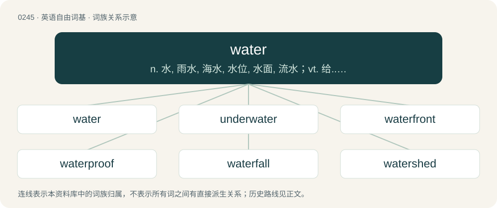

# 0272 · water — n. 水, 雨水, 海水, 水位, 水面, 流水；vt. 给...浇水, 供以水, 注入水, 使湿；vi. 流泪, 流口水, 加水

[总目录](../00_总目录_按常用程度.md)

**类型**：英语自由词基　｜　**来源语言**：见词源记录

## 核心含义与来源

- 核心含义：n. 水, 雨水, 海水, 水位, 水面, 流水；vt. 给...浇水, 供以水, 注入水, 使湿；vi. 流泪, 流口水, 加水
- 英文含义：An inorganic compound (of molecular formula H₂O) found at room temperature and pressure as a clear liquid; it is present naturally as rain, and found in rivers, lakes and seas; its solid form is ice and its gaseous form is steam.
- 词形：water

**多个词源／构词路径**：同一拼写可能有不同来源；以下按词性和含义分别列出。

**来源记录 1**（名词；An inorganic compound (of molecular formula H₂O) found at room temperature and pressure as a clear liquid; it is present naturally as rain, and found in rivers, lakes and seas; its solid form is ice and its gaseous form is steam.）

From Middle English water, from Old English wæter (“water”), from Proto-West Germanic \*watar, from Proto-Germanic \*watōr (“water”), from Proto-Indo-European \*wódr̥ (“water”). Cognates \* Scots watter (“water”) \* Yola wadher, waudher (“water”) \* North Frisian waar, weeder, weeter, woar, woor, wååder, wåår (“water”) \* Saterland Frisian Woater (“water”) \* West Frisian wetter (“water”) \* Cimbrian bassar, bazzar (“water”) \* Dutch water (“water”) \* Dutch Low Saxon water, wotter (“water”) \* German Wasser (“water”) \* German Low German Water, Woter (“water”) \* Gottscheerish boßər, bàsser (“water”) \* Limburgish Waater, water (“water”) \* Luxembourgish Waasser (“water”) \* Mòcheno bòsser (“water”) \* Vilamovian woser (“water”) \* West Flemish woater (“water”) \* Yiddish וואַסער (vaser, “water”) \* Danish vand (“water”) \* Elfdalian wattn (“water”) \* Faroese vatn (“water”) \* Icelandic vatn (“water”) \* Norwegian Nynorsk vatn (“water”) \* Norwegian Bokmål vann (“water”) \* Swedish vatten (“water”) \* Gothic 𐍅𐌰𐍄𐍉 (watō, “water”) \* Old Irish coin fodorne (“otters”, literally “water-dogs”) \* Latin unda (“wave”) \* Lithuanian vanduõ (“water”) \* Polish woda (“water”) \* Russian вода́ (vodá, “water”) \* Albanian ujë (“water”) \* Ancient Greek ὕδωρ (húdōr, “water”) \* Armenian գետ (get, “river”) \* Sanskrit उदन् (udán, “wave, water”) \* Hittite 𒉿𒀀𒋻 (wa-a-tar, “water”)

**来源记录 2**（动词；To wet or supply with water; to moisten; to overflow with water; to irrigate.）

From Middle English wateren, from Old English wæterian, from Proto-Germanic \*watrōną, \*watrijaną, from Proto-Germanic \*watōr (“water”), from Proto-Indo-European \*wódr̥ (“water”). Cognates Cognate with Scots watter (“water”), Saterland Frisian woaterje (“to water”), West Frisian wetterje (“to water”), Dutch wateren (“to water”), German Low German watern (“to water”), German wässern (“to water”), Danish vande (“to water”), Swedish vattna (“to water”), Icelandic vatna (“to water”).

## 词族图

## 单词速览（常用到不常用）

| 单词 | 音标 | 释义 |
|---|---|---|
| [water](#w-1) | 英 /ˈwɔː.tə/；/ˈwɔ.tɚ/ | n. 水, 雨水, 海水, 水位, 水面, 流水；vt. 给...浇水, 供以水, 注入水, 使湿；vi. 流泪, 流口水, 加水 |
| [underwater](#w-2) | 英 /ʌndə(ɹ)ˈwɔːtə/；美 /ʌndɚˈwɔtəɹ/ | a. 在水中的；adv. 在水下 |
| [waterfront](#w-3) | /ˈwɔːtəfrʌnt/ | n. 水边, 滨水区, 滩, 海滨, 江边 |
| [waterproof](#w-4) | 英 /ˈwɔːtəˌpruːf/；美 /ˈwɔt̬ɚˌpruf/ | n. 防水材料；a. 不透水的, 防水的；vt. 使防水 |
| [waterfall](#w-5) | 英 /ˈwɔːtəfɔːl/；/ˈwɔtɚfɔl/ | n. 瀑布 |
| [watershed](#w-6) | 英 /ˈwɔːtəʃɛd/；美 /ˈwɔtɚʃɛd/ | n. 流域, 分水岭；\[医\] 分水界, 分水岭 |
| [freshwater](#w-7) | 英 /ˈfɹɛʃˌwɔːtə(ɹ)/；/ˈfɹɛʃˌwɔtər/ | a. 江河湖泊的, 淡水的 |
| [groundwater](#w-8) | /ˈgraundwɒːtə/ | n. 地下水 |
| [wastewater](#w-9) | /ˈweistwɔːtə/ | n. 废水 |
| [watermelon](#w-10) | 英 /ˈwɔːtəˌmɛlən/；美 /ˈwɑtəɹˌmɛlən/ | n. 西瓜 |
| [watered](#w-11) | /ˈwɔːtə(ɹ)d/ | a. 洒了水的, 用水的, 搀了水的, 有波纹的, 有光泽的, 滥发的；\[法\] 票面额增加而实际价值并未相应增加的 |
| [watergate](#w-12) | /ˈwɔːtəɡeit. ˈwɔ-/ | n. 水门, 水闸；水门事件 |
| [watery](#w-13) | 英 /ˈwɔːtəɹi/；美 /ˈwɔtəɹi/ | a. 水的, 湿的, 平淡的, 稀薄的, 水淋淋的 |
| [waterway](#w-14) | 英 /ˈwɔːtəweɪ/；/ˈwɔtɚweɪ/ | n. 航道, 水路；\[法\] 水道, 水路航道 |
| [seawater](#w-15) | /ˈsiː.wɒtə/ | n. 海水；\[化\] 海水 |
| [clearwater](#w-16) | /ˈkliə,wɔːtə/ | n. 清水；纯净水 |
| [saltwater](#w-17) | /ˈsɒːltwɒːtə/ | a. 盐水的, 海产的, 海上的 |
| [blackwater](#w-18) | /ˈblæk,wɔːtə(r)/ | n. \[医\]黑尿病 |
| [rainwater](#w-19) | /ˈreinwɒːtə/ | n. 雨水 |
| [waterhouse](#w-20) |  | 【英文】A house on floats. |
| [watermark](#w-21) | /ˈwɔːtəmɑːk/ | n. 水位标志, 水印；vt. 印水印于 |
| [deepwater](#w-22) | /ˈdiːp,wɔːtə(r)/ | a. 深海的,海洋上的,靠近海洋的 |
| [watercolour](#w-23) | 英 /ˈwɔ.tɜˌkʌ.lɜ/ | n. 水彩画 |
| [waterman](#w-24) | /ˈwɔːtəmən/ | n. 船工, 船家, 船夫, 划手 |
| [waterfowl](#w-25) | /ˈwɒtəfəul/ | n. 水鸟 |
| [backwater](#w-26) | /ˈbæk.wɒːtə/ | n. 死水, 滞水, 停滞, 回水 |
| [watertight](#w-27) | 英 /ˈwɔː.tə.taɪt/ | a. 不透水的, 不漏水的, 无懈可击的；\[化\] 不透水的; 不漏水的 |
| [waterworks](#w-28) | 英 /ˈwɔːtəˌwəːks/；美 /ˈwɔtɚˌwɚks/ | n. 供水系统, 自来水厂, 喷泉, 眼泪 |
| [stormwater](#w-29) | /stɔːmˈwɔːtə/ | 暴雨水 |
| [headwaters](#w-30) | Canada /ˈhɛdˌwɑtɝz/ | n. 源头, 上游 |
| [breakwater](#w-31) | 英 /ˈbɹeɪkˌwɔːtə/ | n. 防浪堤 |
| [waterside](#w-32) |  | n. 水边, 海滨, 湖滨, 河滨 |
| [sweetwater](#w-33) | /ˈswiːtwɔtə/ | n. 淡水 |
| [coldwater](#w-34) |  | \[医\]双孔镖鲈; \[人名\] 科德沃特; \[地名\] \[加拿大、美国\] 科尔德沃特 |
| [waterline](#w-35) | /ˈwɔːtə(ɹ)laɪn/ | n. 吃水线 |
| [tidewater](#w-36) | /ˈtaidwɒːtə/ | n. 潮水, 有潮水域, 低洼海岸 |
| [watercraft](#w-37) | 美 /ˈwɔtɚkɹæft/ | n. 水性, 船舶, 驾船技术 |
| [drinkwater](#w-38) |  | 【英文】Potable water; water intended for drinking |
| [watercress](#w-39) | 英 /ˈwɔːtəkɹɛs/；美 /ˈwɔtəɹkɹɛs/ | n. 水田芥, 西洋菜 |
| [waterborne](#w-40) | /ˈwɒtəbɒːn/ | a. 浮起的, 水传播的, 水运的 |
| [mouthwatering](#w-41) | /ˈmaʊðwɔːtərɪŋ/ | a. 令人垂涎的 |
| [rosewater](#w-42) | /ˈɹəʊzˌwɔːtə(ɹ)/ | a. 有玫瑰香水味的, 感伤的, 做作的 |
| [bluewater](#w-43) |  | \[地名\] \[美国\] 布卢沃特 |
| [watercourse](#w-44) | /ˈwɔːtə(ɹ)ˌkɔː(ɹ)s/ | n. 水道, 河道；\[法\] 水流权, 河流, 水路 |
| [bathwater](#w-45) | 英 /ˈbɑːθwɔːtə(ɹ)/；美 /ˈbæθwɔtɚ/ | n. 浴缸里的水 |
| [waterhole](#w-46) |  | n. 水坑, 水眼 |
| [floodwater](#w-47) | /ˈflʌdwɒːtə/ | n. 洪水 |
| [meltwater](#w-48) | /ˈmelt,wɔːtə/ | n. 冰雪融化成的水,冰河融化后的水 |
| [waterless](#w-49) | /ˈwɔːtə(ɹ)ləs/ | a. 无水的, 干的, 不用水的 |
| [waterworld](#w-50) |  | 未来水世界 |
| [shearwater](#w-51) | /ˈʃiə.wɒːtə/ | n. 剪嘴鸥 |
| [headwater](#w-52) | /ˈhed,wɔːtə(r)/ | n. \[常作～s\](河流)上游源头 |

## 逐词详解

### 1. water

**词性**：名词　｜　**音标**：英 /ˈwɔː.tə/；/ˈwɔ.tɚ/

**中文释义**：n. 水, 雨水, 海水, 水位, 水面, 流水；vt. 给...浇水, 供以水, 注入水, 使湿；vi. 流泪, 流口水, 加水

**英文义项**：An inorganic compound (of molecular formula H₂O) found at room temperature and pressure as a clear liquid; it is present naturally as rain, and found in rivers, lakes and seas; its solid form is ice and its gaseous form is steam. / The liquid form of this substance: liquid H₂O.

**词源与演化**：

From Middle English water, from Old English wæter (“water”), from Proto-West Germanic \*watar, from Proto-Germanic \*watōr (“water”), from Proto-Indo-European \*wódr̥ (“water”). Cognates \* Scots watter (“water”) \* Yola wadher, waudher (“water”) \* North Frisian waar, weeder, weeter, woar, woor, wååder, wåår (“water”) \* Saterland Frisian Woater (“water”) \* West Frisian wetter (“water”) \* Cimbrian bassar, bazzar (“water”) \* Dutch water (“water”) \* Dutch Low Saxon water, wotter (“water”) \* German Wasser (“water”) \* German Low German Water, Woter (“water”) \* Gottscheerish boßər, bàsser (“water”) \* Limburgish Waater, water (“water”) \* Luxembourgish Waasser (“water”) \* Mòcheno bòsser (“water”) \* Vilamovian woser (“water”) \* West Flemish woater (“water”) \* Yiddish וואַסער (vaser, “water”) \* Danish vand (“water”) \* Elfdalian wattn (“water”) \* Faroese vatn (“water”) \* Icelandic vatn (“water”) \* Norwegian Nynorsk vatn (“water”) \* Norwegian Bokmål vann (“water”) \* Swedish vatten (“water”) \* Gothic 𐍅𐌰𐍄𐍉 (watō, “water”) \* Old Irish coin fodorne (“otters”, literally “water-dogs”) \* Latin unda (“wave”) \* Lithuanian vanduõ (“water”) \* Polish woda (“water”) \* Russian вода́ (vodá, “water”) \* Albanian ujë (“water”) \* Ancient Greek ὕδωρ (húdōr, “water”) \* Armenian գետ (get, “river”) \* Sanskrit उदन् (udán, “wave, water”) \* Hittite 𒉿𒀀𒋻 (wa-a-tar, “water”)

**例句**：

> Please bring enough water for the walk.

请为这次徒步带足饮用水。

### 2. underwater

**词性**：形容词　｜　**音标**：英 /ʌndə(ɹ)ˈwɔːtə/；美 /ʌndɚˈwɔtəɹ/

**中文释义**：a. 在水中的；adv. 在水下

**英文义项**：Beneath the surface of the water; of or pertaining to the region beneath the water surface. / Beneath the water line of a vessel.

**构词拆分**：under (preposition) + water

**词源与演化**：

From under (preposition) + water.

**例句**：

> When the ship was brought into dry dock, it was found that she had underwater damage.

该用例对应义项：Beneath the water line of a vessel.

### 3. waterfront

**词性**：名词　｜　**音标**：/ˈwɔːtəfrʌnt/

**中文释义**：n. 水边, 滨水区, 滩, 海滨, 江边

**英文义项**：The land alongside a body of water. / The dockland district of a town.

**构词拆分**：water + front

**词源与演化**：

From water + front.

**例句**：

> On Monday night, around one hundred rebels came to the city's waterfront.

### 4. waterproof

**词性**：形容词　｜　**音标**：英 /ˈwɔːtəˌpruːf/；美 /ˈwɔt̬ɚˌpruf/

**中文释义**：n. 防水材料；a. 不透水的, 防水的；vt. 使防水

**英文义项**：Resistant to the effects of water. / Made of or covered with material that doesn't allow water in; impervious to water and immune to its effects.

**构词拆分**：water + -proof

**词源与演化**：

From water + -proof. Compare West Frisian wetterproef (“waterproof”), Dutch waterproef (“waterproof”).

**例句**：

> Keep the map in a waterproof bag.

把地图放在防水袋里。

### 5. waterfall

**词性**：名词　｜　**音标**：英 /ˈwɔːtəfɔːl/；/ˈwɔtɚfɔl/

**中文释义**：n. 瀑布

**英文义项**：A flow of water over the edge of a cliff. / A waterfall-like outpouring of liquid, smoke, etc.

**构词拆分**：water + fall

**词源与演化**：

From Middle English waterfal, waterfalle, from Old English wæterġefeall (“waterfall”), equivalent to water + fall. Cognate with West Frisian wetterfal (“waterfall”), Dutch waterval (“waterfall”), German Wasserfall (“waterfall”), Swedish vattenfall (“waterfall”).

**例句**：

> Hey man, can I take a waterfall from your bottle?

该用例对应义项：The action of drinking from a vessel without touching it with the lips, considered more sanitary for a shared vessel.

### 6. watershed

**词性**：名词　｜　**音标**：英 /ˈwɔːtəʃɛd/；美 /ˈwɔtɚʃɛd/

**中文释义**：n. 流域, 分水岭；\[医\] 分水界, 分水岭

**英文义项**：The topographical boundary dividing two adjacent catchment basins, such as a ridge or a crest. / A region of land within which water flows down into a specified body, such as a river, lake, sea, or ocean; a drainage basin.

**构词拆分**：water + shed

**词源与演化**：

From water + shed. A calque of German Wasserscheide.

**用法示例／搭配（非完整句）**：

> watershed moment — watershed event — watershed ruling

该用例对应义项：A critical point marking a change in course or development.

### 7. freshwater

**词性**：形容词　｜　**音标**：英 /ˈfɹɛʃˌwɔːtə(ɹ)/；/ˈfɹɛʃˌwɔtər/

**中文释义**：a. 江河湖泊的, 淡水的

**英文义项**：Living in fresh water. / Consisting of fresh water.

**构词拆分**：fresh + water

**词源与演化**：

From Middle English freche watur, fresshe water; equivalent to fresh + water.

**例句**：

> Lake Baikal is the world's largest freshwater lake in terms of volume.

该用例对应义项：Consisting of fresh water.

### 8. groundwater

**词性**：名词　｜　**音标**：/ˈgraundwɒːtə/

**中文释义**：n. 地下水

**英文义项**：Water that exists beneath the earth's surface in underground streams and aquifers.

**构词拆分**：ground + water

**词源与演化**：

From ground + water.

**例句**：

> Algeria has plenty of groundwater in the Sahara Desert.

### 9. wastewater

**词性**：名词　｜　**音标**：/ˈweistwɔːtə/

**中文释义**：n. 废水

**英文义项**：Any water that has been used in some human domestic or industrial activity and, as a result, now contains waste products.

**构词拆分**：waste + water

**词源与演化**：

From waste + water.

**例句**：

> Benedito's work has implications for the future of wastewater treatment.

### 10. watermelon

**词性**：名词　｜　**音标**：英 /ˈwɔːtəˌmɛlən/；美 /ˈwɑtəɹˌmɛlən/

**中文释义**：n. 西瓜

**英文义项**：A plant of the species Citrullus lanatus, bearing a melon-like fruit. / The fruit of the watermelon plant, having a green rind and watery flesh that is typically bright red when ripe and contains black seeds.

**构词拆分**：water + melon；Endocentric compound of water + melon

**例句**：

> The flesh of this watermelon is too soft and not very good.

### 11. watered

**词性**：形容词　｜　**音标**：/ˈwɔːtə(ɹ)d/

**中文释义**：a. 洒了水的, 用水的, 搀了水的, 有波纹的, 有光泽的, 滥发的；\[法\] 票面额增加而实际价值并未相应增加的

**英文义项**：Supplied with water. / Marked with wavy lines like those made by water.

**构词拆分**：water + -ed

**词源与演化**：

From Middle English watered, watred, ywaterd, y-wattered, i-watred, i-watered, from Old English \*wæterod, \*ġewæterod, equivalent to water + -ed. Cognate with West Frisian wetterd, Dutch verwaterd, German bewässert.

**例句**：

> Keep the horses well fed and watered.

该用例对应义项：Supplied with water.

### 12. watergate

**词性**：名词　｜　**音标**：/ˈwɔːtəɡeit. ˈwɔ-/

**中文释义**：n. 水门, 水闸；水门事件

**英文义项**：A gate opening onto water, or only or mainly accessible by water.

**构词拆分**：water + gate

**词源与演化**：

From Middle English watergate, wateregate, watur-ȝate, equivalent to water + gate.

**例句**：

> Nixon tried to stonewall through Watergate by ignoring it, but it didn't work.

### 13. watery

**词性**：形容词　｜　**音标**：英 /ˈwɔːtəɹi/；美 /ˈwɔtəɹi/

**中文释义**：a. 水的, 湿的, 平淡的, 稀薄的, 水淋淋的

**英文义项**：Resembling or characteristic of water. / Wet, soggy or soaked with water.

**构词拆分**：water + -y

**词源与演化**：

From Middle English watery, wattry, from Old English wæteriġ (“watery”), from Proto-West Germanic \*watarīg. Equivalent to water + -y.

**例句**：

> I took my cat to the vet because I was worried about his watery eyes.

该用例对应义项：Discharging water or similar substance as a result of disease etc.

### 14. waterway

**词性**：名词　｜　**音标**：英 /ˈwɔːtəweɪ/；/ˈwɔtɚweɪ/

**中文释义**：n. 航道, 水路；\[法\] 水道, 水路航道

**英文义项**：A body of water, such as a river, channel or canal, that is navigable. / A conduit or watercourse, such as on the deck of a ship, to drain water.

**构词拆分**：water + way

**词源与演化**：

From Middle English waterwey, from Old English wæterweġ (“waterway”), from Proto-West Germanic \*watarweg, equivalent to water + way. Compare Saterland Frisian Woaterwai (“waterway”), West Frisian wetterwei (“waterway”), Dutch waterweg (“waterway”), German Wasserweg (“waterway”), Danish vandvej (“waterway”), Swedish vattenväg (“waterway”).

**例句**：

> A river and a canal are both types of waterway.

### 15. seawater

**词性**：名词　｜　**音标**：/ˈsiː.wɒtə/

**中文释义**：n. 海水；\[化\] 海水

**英文义项**：The saltwater of a sea or ocean.

**构词拆分**：sea + water

**词源与演化**：

From Middle English seewater, se water, from Old English sǣwæter (“seawater”), equivalent to sea + water. Cognate with Saterland Frisian Seewoater (“seawater”), West Frisian seewetter (“seawater”), Dutch zeewater (“seawater”), Icelandic sjóvatn (“seawater”).

**例句**：

> You can not drink the seawater, for it is too salty.

### 16. clearwater

**词性**：形容词　｜　**音标**：/ˈkliə,wɔːtə/

**中文释义**：n. 清水；纯净水

**英文义项**：Having relatively clear water, free of large quantities of mud or tannin.

**构词拆分**：clear + water

**词源与演化**：

From clear + water.

### 17. saltwater

**词性**：形容词　｜　**音标**：/ˈsɒːltwɒːtə/

**中文释义**：a. 盐水的, 海产的, 海上的

**英文义项**：New Keynesian or Keynesian, in reference to macroeconomics and economics departments on the East Coast and West Coast of the United States of America.

**构词拆分**：salt + water

**词源与演化**：

From Middle English saltwater, salte water, equivalent to salt + water. Cognate with Saterland Frisian Soaltwoater (“saltwater”), West Frisian sâltwetter (“saltwater”), Dutch zoutwater (“saltwater”), German Low German Soltwater (“saltwater”), German Salzwasser (“saltwater”), Danish saltvand (“saltwater”), Swedish saltvatten (“saltwater”), Icelandic saltvatn (“saltwater”).

**例句**：

> As its name implies, the saltwater crocodile can live in salt water.

### 18. blackwater

**词性**：名词　｜　**音标**：/ˈblæk,wɔːtə(r)/

**中文释义**：n. \[医\]黑尿病

**英文义项**：Water that contains dark organic matter such as loam or tannins. / Water that is acidic and low in nutrients.

**构词拆分**：black + water

**词源与演化**：

From black + water.

### 19. rainwater

**词性**：名词　｜　**音标**：/ˈreinwɒːtə/

**中文释义**：n. 雨水

**英文义项**：Rainfall. / Water (for a house, etc.) sourced from rain which has not joined a spring, stream or river, pond, lake or sea.

**构词拆分**：rain + water

**词源与演化**：

From Middle English reinwater, from Old English reġnwæter, equivalent to rain + water. Cognate with West Frisian reinwetter, Dutch regenwater, German Regenwasser, Swedish regnvatten.

**例句**：

> Rainwater flows from the gutter, down the downpipe and into the sewer.

### 20. waterhouse

**词性**：名词

**英文义项**：A house on floats.

**构词拆分**：water + house

**词源与演化**：

From water + house.

### 21. watermark

**词性**：名词　｜　**音标**：/ˈwɔːtəmɑːk/

**中文释义**：n. 水位标志, 水印；vt. 印水印于

**英文义项**：A translucent design impressed on the surface of paper and visible when the paper is held to the light. / A logo superimposed on a digital image, a television broadcast, etc.

**构词拆分**：water + mark

**词源与演化**：

From water + mark.

**例句**：

> The documents are saved as read-only PDFs with a watermark including the dates and times of receipt (timestamping by the court).

### 22. deepwater

**词性**：名词　｜　**音标**：/ˈdiːp,wɔːtə(r)/

**中文释义**：a. 深海的,海洋上的,靠近海洋的

**英文义项**：Brine collected in a seafloor depression (brine pool).

**构词拆分**：deep + water

**词源与演化**：

From deep + water.

### 23. watercolour

**词性**：名词　｜　**音标**：英 /ˈwɔ.tɜˌkʌ.lɜ/

**中文释义**：n. 水彩画

**英文义项**：A water-soluble pigment or paint. / A painting made by using such pigment.

**构词拆分**：water + colour

**词源与演化**：

From water + colour.

**例句**：

> I'm not a big fan of watercolour; I much prefer oil painting.

该用例对应义项：This kind of painting as a genre.

### 24. waterman

**词性**：名词　｜　**音标**：/ˈwɔːtəmən/

**中文释义**：n. 船工, 船家, 船夫, 划手

**英文义项**：A man who lives or works on the water; a boatman. / Someone who distributes or supplies water for a living; a water-carrier.

**构词拆分**：water + -man

**词源与演化**：

From Middle English waterman, equivalent to water + -man.

### 25. waterfowl

**词性**：名词　｜　**音标**：/ˈwɒtəfəul/

**中文释义**：n. 水鸟

**英文义项**：Any of the birds, such as ducks, geese and swans, that spend most of their non-flying time on water; especially those of the family Anatidae.

**构词拆分**：water + fowl

**词源与演化**：

From Middle English waterfoul, water-foul, equivalent to water + fowl. Compare Old English dopfugel (“waterfowl, moorhen”, literally “dipping-fowl”).

**例句**：

> The zoo's waterfowl exhibit had many ducks, Adriano observed.

### 26. backwater

**词性**：名词　｜　**音标**：/ˈbæk.wɒːtə/

**中文释义**：n. 死水, 滞水, 停滞, 回水

**英文义项**：The water held back by a dam or other obstruction. / A remote place: somewhere that remains unaffected by new events, progresses, ideas, etc; any field of endeavor that figuratively resembles such a place.

**构词拆分**：back + water

**词源与演化**：

From back + water.

**用法示例／搭配（非完整句）**：

> an academic backwater

该用例对应义项：A remote place: somewhere that remains unaffected by new events, progresses, ideas, etc; any field of endeavor that figuratively resembles such a place.

### 27. watertight

**词性**：形容词　｜　**音标**：英 /ˈwɔː.tə.taɪt/

**中文释义**：a. 不透水的, 不漏水的, 无懈可击的；\[化\] 不透水的; 不漏水的

**英文义项**：So tightly made that water cannot enter or escape. / So devised or planned as to be impossible to defeat, evade or nullify.

**构词拆分**：water + tight

**词源与演化**：

From water + tight. Compare Scots wattirticht (“watertight”), West Frisian wetterticht (“waterproof”), Dutch waterdicht (“waterproof, watertight”), German wasserdicht (“watertight, waterproof”), Danish vandtæt (“watertight”), Swedish vattentät (“watertight, waterproof”).

**用法示例／搭配（非完整句）**：

> a watertight regulation

该用例对应义项：So devised or planned as to be impossible to defeat, evade or nullify.

### 28. waterworks

**词性**：名词　｜　**音标**：英 /ˈwɔːtəˌwəːks/；美 /ˈwɔtɚˌwɚks/

**中文释义**：n. 供水系统, 自来水厂, 喷泉, 眼泪

**英文义项**：The water supply system of a district, town, city, or other place, including reservoirs, pipes, and pumps. / Any single facility, such as a filtration plant or pumping station, within such a system.

**构词拆分**：water + works (“machine, mechanism; factory or factories”)

**词源与演化**：

From water + works (“machine, mechanism; factory or factories”).

**例句**：

> She is employed by a waterworks at the outskirts of the city.

该用例对应义项：Any single facility, such as a filtration plant or pumping station, within such a system.

### 29. stormwater

**词性**：名词　｜　**音标**：/stɔːmˈwɔːtə/

**中文释义**：暴雨水

**英文义项**：Water that is not absorbed into soil and rapidly flows downstream, increasing the level of waterways. In some municipal systems it intermixes with wastewater, increasing the volume of the latter.

**构词拆分**：storm + water

**词源与演化**：

From storm + water.

**例句**：

> A small boy swept into a stormwater drain kept himself afloat using strokes he'd recently learned at swim school.

### 30. headwaters

**词性**：名词　｜　**音标**：Canada /ˈhɛdˌwɑtɝz/

**中文释义**：n. 源头, 上游

**英文义项**：The source of a river, the set of streams that feed into the river's beginning.

**构词拆分**：head + waters

**词源与演化**：

From head + waters.

**例句**：

> The headwaters of the River Thames are found in Gloucestershire, and its mouth is on the North Sea.

### 31. breakwater

**词性**：名词　｜　**音标**：英 /ˈbɹeɪkˌwɔːtə/

**中文释义**：n. 防浪堤

**英文义项**：A construction in or around a harbour designed to break the force of the sea and to provide shelter for vessels lying inside. / A low bulkhead across the forecastle deck of a ship which diverts water breaking over the bows into the scuppers.

**构词拆分**：break + water

**词源与演化**：

From break + water. Compare Dutch breekwater (“breakwater”). Compare firebreak.

**例句**：

> A long breakwater was built, along with piers and docking terminals.

### 32. waterside

**词性**：名词

**中文释义**：n. 水边, 海滨, 湖滨, 河滨

**英文义项**：The land bordering a body of water.

**构词拆分**：water + -side

**词源与演化**：

From Middle English water-syde, water side, equivalent to water + -side.

**例句**：

> The upper parts of town enjoy a lovely view across the waterside and harbour to the sparkling bay.

### 33. sweetwater

**词性**：名词　｜　**音标**：/ˈswiːtwɔtə/

**中文释义**：n. 淡水

**英文义项**：A variety of white grape, better known as Chasselas. / Water that still contains sucrose after filtration by a sugar cane refinery, usually one of the main by-products of a sugar cane refining process.

**构词拆分**：sweet + water

**词源与演化**：

From sweet + water.

### 34. coldwater

**词性**：形容词

**中文释义**：\[医\]双孔镖鲈; \[人名\] 科德沃特; \[地名\] \[加拿大、美国\] 科尔德沃特

**英文义项**：Located in or near cold ocean waters. / Characterized by the presence or use of cold water.

**构词拆分**：cold + water

**词源与演化**：

From cold + water.

**例句**：

> Coldwater fish, notably salmon and sardines, are good sources of omega-3 acids.

### 35. waterline

**词性**：名词　｜　**音标**：/ˈwɔːtə(ɹ)laɪn/

**中文释义**：n. 吃水线

**英文义项**：A line formed by the surface of the water on the hull of a ship when she is afloat; any of a series of short lines marked on the hull to show where the waterline would be under different loadings / A horizontal line indicating the shape of an airfoil.

**构词拆分**：water + line

**词源与演化**：

From water + line.

### 36. tidewater

**词性**：名词　｜　**音标**：/ˈtaidwɒːtə/

**中文释义**：n. 潮水, 有潮水域, 低洼海岸

**英文义项**：Water affected by the flow of the tide, especially tidal streams. / The seaboard.

**构词拆分**：tide + water

**词源与演化**：

From tide + water.

### 37. watercraft

**词性**：名词　｜　**音标**：美 /ˈwɔtɚkɹæft/

**中文释义**：n. 水性, 船舶, 驾船技术

**英文义项**：Any vessel with implements designed to move it in arbitrary direction through one or various bodies of water: a boat, ship, sea scooter, or similar vehicle. / Skill in boating, swimming, or other water-related sports.

**构词拆分**：water + -craft (vehicle)；water + -craft (skill)

**词源与演化**：

From water + -craft (vehicle) or water + -craft (skill).

**例句**：

> A gunboat is a naval watercraft.

### 38. drinkwater

**词性**：名词

**英文义项**：Potable water; water intended for drinking

**构词拆分**：drink + water

**词源与演化**：

From Middle English drinkwater (attested as a nickname), equivalent to drink + water. Compare Saterland Frisian Drinkwoater (“drinkwater”), West Frisian drinkwetter (“drinkwater”), Dutch drinkwater (“drinkwater”), German Low German Drinkwater (“drinkwater”), German Trinkwasser (“drinkwater”).

### 39. watercress

**词性**：名词　｜　**音标**：英 /ˈwɔːtəkɹɛs/；美 /ˈwɔtəɹkɹɛs/

**中文释义**：n. 水田芥, 西洋菜

**英文义项**：A perennial European herb, Nasturtium officinale, that grows in freshwater streams; used in salads and as a garnish. / A similar plant, Nasturtium microphyllum.

**构词拆分**：water + cress

**词源与演化**：

From Middle English water cresse, water-kresse, watercrasse, water cars, equivalent to water + cress. Cognate with West Frisian wetterkers (“watercress”), Dutch waterkers (“watercress”), German Wasserkresse (“waterkress”), Swedish vattenkrasse (“watercress”).

**例句**：

> Watercress is high in vitamins A, C, and K.

### 40. waterborne

**词性**：形容词　｜　**音标**：/ˈwɒtəbɒːn/

**中文释义**：a. 浮起的, 水传播的, 水运的

**英文义项**：Transported or transmitted by water. / Floating on the water; afloat.

**构词拆分**：water + -borne

**词源与演化**：

From water + -borne.

**例句**：

> Without water, the risk of waterborne diseases increases in the population.

### 41. mouthwatering

**词性**：形容词　｜　**音标**：/ˈmaʊðwɔːtərɪŋ/

**中文释义**：a. 令人垂涎的

**英文义项**：Causing one to salivate. / That is pleasing to the sense of taste; appetizing.

**构词拆分**：mouth + water

**词源与演化**：

From mouth + watering.

**例句**：

> Bivouac Canteen and Bar offers a variety of mouthwatering dishes, breakfast options, fast food, cocktails, and wine – all in a comfortable, inviting atmosphere.

### 42. rosewater

**词性**：名词　｜　**音标**：/ˈɹəʊzˌwɔːtə(ɹ)/

**中文释义**：a. 有玫瑰香水味的, 感伤的, 做作的

**英文义项**：A liquid produced by steeping rose petals in water, used as a coloring agent and a flavoring ingredient in certain foods.

**构词拆分**：rose + water

**词源与演化**：

From rose + water.

### 43. bluewater

**词性**：形容词

**中文释义**：\[地名\] \[美国\] 布卢沃特

**英文义项**：Oceangoing, capable of travelling in rough seas.

**构词拆分**：blue + water

**词源与演化**：

From blue + water, from the blue of deep oceanic waters.

**例句**：

> Almost every maritime country has some kind of bluewater navy.

该用例对应义项：Oceangoing, capable of travelling in rough seas.

### 44. watercourse

**词性**：名词　｜　**音标**：/ˈwɔːtə(ɹ)ˌkɔː(ɹ)s/

**中文释义**：n. 水道, 河道；\[法\] 水流权, 河流, 水路

**英文义项**：Any channel, either natural or artificial, through which water flows.

**构词拆分**：water + course

**词源与演化**：

From Middle English water course; equivalent to water + course.

**例句**：

> The watercourse is to the biosphere what blood circulation is to a human being.

### 45. bathwater

**词性**：名词　｜　**音标**：英 /ˈbɑːθwɔːtə(ɹ)/；美 /ˈbæθwɔtɚ/

**中文释义**：n. 浴缸里的水

**英文义项**：The water used in a bath (bathtub).

**构词拆分**：bath + water

**词源与演化**：

From bath + water. Compare Dutch badwater (“bathwater”), German Badewasser (“bathwater”), Swedish badvatten (“bathwater”).

**例句**：

> Some people reuse their bathwater for washing their cars.

### 46. waterhole

**词性**：名词

**中文释义**：n. 水坑, 水眼

**英文义项**：A depression in which water collects, especially one where wild animals come to drink. / A watering hole; a place where people meet to drink and talk.

**构词拆分**：water + hole

**词源与演化**：

\* water + hole. \* (astronomy): Coined by Bernard Oliver in 1971, in allusion to the idea that this part of the spectrum would be that used by extraterrestrial intelligence to communicate.

**例句**：

> Ziri was in the desert and stumbled upon a waterhole.

### 47. floodwater

**词性**：名词　｜　**音标**：/ˈflʌdwɒːtə/

**中文释义**：n. 洪水

**英文义项**：The water of a flood.

**构词拆分**：flood + water

**词源与演化**：

From flood + water.

**例句**：

> The levee kept the floodwater back.

### 48. meltwater

**词性**：名词　｜　**音标**：/ˈmelt,wɔːtə/

**中文释义**：n. 冰雪融化成的水,冰河融化后的水

**英文义项**：Water from melting ice or snow.

**构词拆分**：melt + water

**词源与演化**：

From melt + water.

**例句**：

> Glacial meltwater is not purer than other types of water.

### 49. waterless

**词性**：形容词　｜　**音标**：/ˈwɔːtə(ɹ)ləs/

**中文释义**：a. 无水的, 干的, 不用水的

**英文义项**：Dry, arid, lacking water. / Not requiring water.

**构词拆分**：water + -less

**词源与演化**：

From Middle English waterles, waterlees, from Old English wæterlēas (“waterless”), from Proto-Germanic \*watōrlausaz, equivalent to water + -less. Cognate with Saterland Frisian woaterloos (“waterless”), West Frisian wetterleas (“waterless”), Dutch waterloos (“waterless”), German wasserlos (“waterless”), Swedish vattenlös (“waterless”), Icelandic vatnslaus (“waterless”).

**例句**：

> The waterless desert can kill in many ways but dehydration is often fastest.

该用例对应义项：Dry, arid, lacking water.

### 50. waterworld

**词性**：名词

**中文释义**：未来水世界

**英文义项**：A planet or other large environment that is dominated by water.

**构词拆分**：water + world

**词源与演化**：

From water + world.

### 51. shearwater

**词性**：名词　｜　**音标**：/ˈʃiə.wɒːtə/

**中文释义**：n. 剪嘴鸥

**英文义项**：Any of the long-winged pelagic seabirds of the family Procellariidae in genera Puffinus, Ardenna, and Calonectris, that breed on islands and coastal cliffs. / Any of the entire family Procellariidae, including certain of the petrels.

**构词拆分**：shear + water

**词源与演化**：

From shear + water.

### 52. headwater

**词性**：名词　｜　**音标**：/ˈhed,wɔːtə(r)/

**中文释义**：n. \[常作～s\](河流)上游源头

**英文义项**：The source (and the initial part) of a stream.

**构词拆分**：head + water

**词源与演化**：

From head + water.
