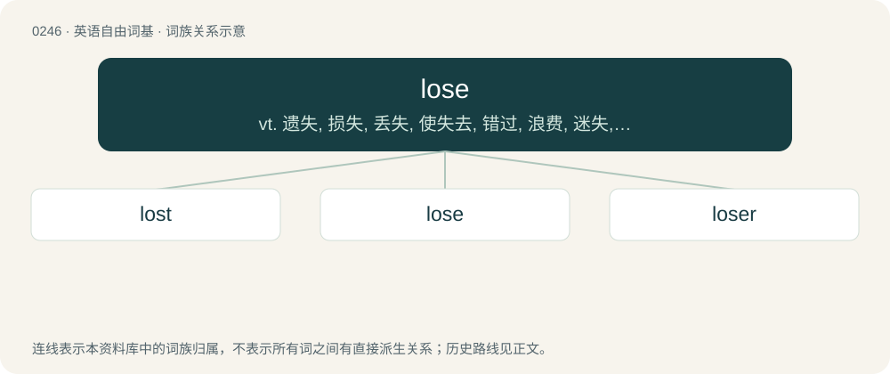

# 0273 · lose — vt. 遗失, 损失, 丢失, 使失去, 错过, 浪费, 迷失, 使迷路, 输去, 使沉溺于；vi. 受损失, 失败

[总目录](../00_总目录_按常用程度.md)

**类型**：英语自由词基　｜　**来源语言**：见词源记录

## 核心含义与来源

- 核心含义：vt. 遗失, 损失, 丢失, 使失去, 错过, 浪费, 迷失, 使迷路, 输去, 使沉溺于；vi. 受损失, 失败
- 英文含义：To cease to have (something) in one's possession or capability.
- 词形：lose

**来源记录 1**（动词；To cease to have (something) in one's possession or capability.）

From Middle English losen, from Old English losian. The modern pronunciation with /uː/ (instead of the /oʊ~əʊ/ that would be expected from Early Modern /ɔː/) is due to conflation with loose.

## 词族图

## 单词速览（常用到不常用）

| 单词 | 音标 | 释义 |
|---|---|---|
| [lost](#w-1) | 英 /lɒst/；美 /lɔst/ | a. 失去的, 遗失的, 迷惑的；lose的过去式和过去分词 |
| [lose](#w-2) | 英 /luːz/；美 /luz/ | vt. 遗失, 损失, 丢失, 使失去, 错过, 浪费, 迷失, 使迷路, 输去, 使沉溺于；vi. 受损失, 失败 |
| [loser](#w-3) | 美 /luzɚ/；/luːzə(ɹ)/ | n. 失败者, 遗失者；\[法\] 失败者, 失物者, 遗失者 |

## 逐词详解

### 1. lost

**词性**：形容词　｜　**音标**：英 /lɒst/；美 /lɔst/

**中文释义**：a. 失去的, 遗失的, 迷惑的；lose的过去式和过去分词

**英文义项**：Having wandered from, or unable to find, the way. / In an unknown location; unable to be found.

**构词拆分**：lose + -t

**词源与演化**：

From Middle English loste, losede (preterite) and Middle English lost, ilost, ilosed (past participle), from Old English losode (preterite) and Old English losod, ġelosod, equivalent to lose + -t.

**例句**：

> The children were soon lost in the forest.

该用例对应义项：Having wandered from, or unable to find, the way.

### 2. lose

**词性**：动词　｜　**音标**：英 /luːz/；美 /luz/

**中文释义**：vt. 遗失, 损失, 丢失, 使失去, 错过, 浪费, 迷失, 使迷路, 输去, 使沉溺于；vi. 受损失, 失败

**英文义项**：To cease to have (something) in one's possession or capability. / To have (an organ) removed from one's body, especially by accident.

**词源与演化**：

From Middle English losen, from Old English losian. The modern pronunciation with /uː/ (instead of the /oʊ~əʊ/ that would be expected from Early Modern /ɔː/) is due to conflation with loose.

**例句**：

> The team scored four goals but still managed to lose.

该用例对应义项：To be defeated (in a game, competition, contest, etc.)

### 3. loser

**词性**：名词　｜　**音标**：美 /luzɚ/；/luːzə(ɹ)/

**中文释义**：n. 失败者, 遗失者；\[法\] 失败者, 失物者, 遗失者

**英文义项**：A person who loses; one who fails to win or thrive. / Something of poor quality.

**构词拆分**：lose + -er

**词源与演化**：

From Middle English loser, losere, equivalent to lose + -er. In the sense of contemptible or worthless individual, perhaps an alteration of losel, which see.

**例句**：

> In a two-horse race there is always one winner and one loser.

该用例对应义项：A person who loses; one who fails to win or thrive.
