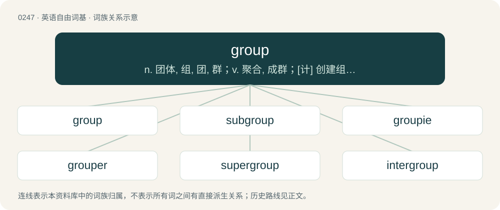

# 0274 · group — n. 团体, 组, 团, 群；v. 聚合, 成群；\[计\] 创建组; 组, 用户组

[总目录](../00_总目录_按常用程度.md)

**类型**：英语自由词基　｜　**来源语言**：见词源记录

## 核心含义与来源

- 核心含义：n. 团体, 组, 团, 群；v. 聚合, 成群；\[计\] 创建组; 组, 用户组
- 英文含义：A number of things or persons being in some relation to one another.
- 词形：group

**来源记录 1**（名词；A number of things or persons being in some relation to one another.）

From French groupe (“cluster, group”), from Italian gruppo, groppo (“a knot, heap, group, bag (of money)”). Displaced native Old English hād (“tribe, group”). In the "group theory" sense, calqued from French groupe, a term coined by the young French mathematician Évariste Galois in 1830. Cognate with German Kropf (“crop, craw, bunch”); Old English cropp, croppa (“cluster, bunch, sprout, flower, berry, ear of corn, crop”) (whence English crop); Dutch krop (“craw”), Icelandic kroppr (“hump, bunch”). Doublet of crop and croup. Compare Persian گروه.

## 词族图

## 单词速览（常用到不常用）

| 单词 | 音标 | 释义 |
|---|---|---|
| [group](#w-1) | 英 /ɡɹuːp/；美 /ɡɹup/ | n. 团体, 组, 团, 群；v. 聚合, 成群；\[计\] 创建组; 组, 用户组 |
| [subgroup](#w-2) | /ˈsʌbˌɡɹuːp/ | n. 小群, 隶属的小组织, 子群；\[化\] 族; 族周期表; 副族(指周期表中B族); 子群; 亚群(生物分类); 族(数) |
| [groupie](#w-3) | /ˈɡɹuːpi/ | n. 追随歌星的年轻女子, 歌星倾慕者 |
| [grouper](#w-4) | 英 /ˈɡɹuːpə(ɹ)/ | 【英文】One who groups things. |
| [supergroup](#w-5) | /ˈsjuːpə,^ruːp/ | \[计\] 超群 |
| [intergroup](#w-6) | /ˈintə(ː)ˈ^ruːp/ | a. 团体之间的 |
| [playgroup](#w-7) |  | n. 托儿所 |
| [groupthink](#w-8) | 英 /ˈɡɹuːpθɪŋk/ | n. 小集团思想 |
| [outgroup](#w-9) | /ˈaʊtɡruːp/ | n. 外集团, 外围集团 |
| [workgroup](#w-10) | 英 /ˈwəːkɡɹuːp/ | \[计\] 工作组 |
| [ingroup](#w-11) | /ˈingruːp/ | n. 内集团 |
| [haplogroup](#w-12) |  | 【英文】A group of closely related haplotypes. |
| [newsgroup](#w-13) | 美 /ˈnuzˌɡɹup/ | \[计\] 新闻组 |
| [semigroup](#w-14) | /ˈsemi^ruːp/ | \[计\] 半群 |

## 逐词详解

### 1. group

**词性**：名词　｜　**音标**：英 /ɡɹuːp/；美 /ɡɹup/

**中文释义**：n. 团体, 组, 团, 群；v. 聚合, 成群；\[计\] 创建组; 组, 用户组

**英文义项**：A number of things or persons being in some relation to one another. / A set with an associative binary operation, under which there exists an identity element, and such that each element has an inverse.

**词源与演化**：

From French groupe (“cluster, group”), from Italian gruppo, groppo (“a knot, heap, group, bag (of money)”). Displaced native Old English hād (“tribe, group”). In the "group theory" sense, calqued from French groupe, a term coined by the young French mathematician Évariste Galois in 1830. Cognate with German Kropf (“crop, craw, bunch”); Old English cropp, croppa (“cluster, bunch, sprout, flower, berry, ear of corn, crop”) (whence English crop); Dutch krop (“craw”), Icelandic kroppr (“hump, bunch”). Doublet of crop and croup. Compare Persian گروه.

**例句**：

> A group of people is/are gathering in front of the Parliament to demonstrate against the Prime Minister's proposals.

该用例对应义项：A number of things or persons being in some relation to one another.

### 2. subgroup

**词性**：名词　｜　**音标**：/ˈsʌbˌɡɹuːp/

**中文释义**：n. 小群, 隶属的小组织, 子群；\[化\] 族; 族周期表; 副族(指周期表中B族); 子群; 亚群(生物分类); 族(数)

**英文义项**：A group within a larger group; a group whose members are some, but not all, of the members of a larger group. / A subset H of a group G that is itself a group and has the same binary operation as G.

**构词拆分**：sub- + group

**词源与演化**：

From sub- + group.

**例句**：

> The subgroup of people who had loss of smell developed more severe illness.

### 3. groupie

**词性**：名词　｜　**音标**：/ˈɡɹuːpi/

**中文释义**：n. 追随歌星的年轻女子, 歌星倾慕者

**英文义项**：A fan, especially a young female fan of a male singer or rock group, who seeks intimacy (most often physical, sometimes emotional) with a celebrity; usually with a rock 'n' roll artist or band member. / Any dedicated fan of something.

**构词拆分**：group + -ie (“person associated”)

**词源与演化**：

From group + -ie (“person associated”). In the fan sense, from 1967.

**例句**：

> You didn't just call me a groupie, did you?

### 4. grouper

**词性**：名词　｜　**音标**：英 /ˈɡɹuːpə(ɹ)/

**英文义项**：One who groups things. / A groupie.

**构词拆分**：group + -er

**词源与演化**：

From group + -er.

### 5. supergroup

**词性**：名词　｜　**音标**：/ˈsjuːpə,^ruːp/

**中文释义**：\[计\] 超群

**英文义项**：Any group composed of other groups. / The group to which a subgroup belongs.

**构词拆分**：super- + group

**词源与演化**：

From super- + group.

### 6. intergroup

**词性**：形容词　｜　**音标**：/ˈintə(ː)ˈ^ruːp/

**中文释义**：a. 团体之间的

**英文义项**：Taking place between groups, especially between social groups.

**构词拆分**：inter- + group

**词源与演化**：

From inter- + group.

### 7. playgroup

**词性**：名词

**中文释义**：n. 托儿所

**英文义项**：A group of children who meet together for supervised play. / A group of gamers who meet together, especially for role-playing games.

**构词拆分**：play + group

**词源与演化**：

From play + group.

**例句**：

> Once a week Mary took her children to playgroup.

### 8. groupthink

**词性**：名词　｜　**音标**：英 /ˈɡɹuːpθɪŋk/

**中文释义**：n. 小集团思想

**英文义项**：A process of reasoning or decision-making by a group, especially one characterized by uncritical acceptance of or conformity to a perceived majority view.

**构词拆分**：group + think

**词源与演化**：

Coined by William H. Whyte in 1952, from group + think, modelled on earlier doublethink from Orwell's Nineteen Eighty-Four.

### 9. outgroup

**词性**：名词　｜　**音标**：/ˈaʊtɡruːp/

**中文释义**：n. 外集团, 外围集团

**英文义项**：The group of people who do not belong to one's own social group. / In cladistics, all the taxa included in a study that do not belong to the ingroup that is of immediate interest.

**构词拆分**：out- + group

**词源与演化**：

From out- + group.

**例句**：

> Tom is a member of the outgroup.

### 10. workgroup

**词性**：名词　｜　**音标**：英 /ˈwəːkɡɹuːp/

**中文释义**：\[计\] 工作组

**英文义项**：A group of workers engaged in a series of collaborative tasks who usually work together. / A computer network created for use by such groups.

**构词拆分**：work + group

**词源与演化**：

From work + group.

**例句**：

> In this workgroup, I'm responsible for digital affairs and mass media.

### 11. ingroup

**词性**：名词　｜　**音标**：/ˈingruːp/

**中文释义**：n. 内集团

**英文义项**：The social group that one belongs to. / In cladistics, the monophyletic group that includes all taxa of interest to the current study.

**构词拆分**：in- + group

**词源与演化**：

From in- + group.

### 12. haplogroup

**词性**：名词

**英文义项**：A group of closely related haplotypes.

**构词拆分**：haplo- + group

**词源与演化**：

From haplo- + group.

**例句**：

> What's the haplogroup of North Africa's Berber populations?

### 13. newsgroup

**词性**：名词　｜　**音标**：美 /ˈnuzˌɡɹup/

**中文释义**：\[计\] 新闻组

**英文义项**：A repository on a computer network where people can post messages, usually about a single subject.

**构词拆分**：news + group

**词源与演化**：

From news + group.

**例句**：

> I posted in my first newsgroup when I was thirteen years old.

### 14. semigroup

**词性**：名词　｜　**音标**：/ˈsemi^ruːp/

**中文释义**：\[计\] 半群

**英文义项**：Any set for which there is a binary operation that is closed and associative.

**构词拆分**：semi- + group

**词源与演化**：

From semi- + group, reflecting the fact that not all the conditions required for a group are required for a semigroup. (Specifically, the requirements for the existence of identity and inverse elements are omitted.)
