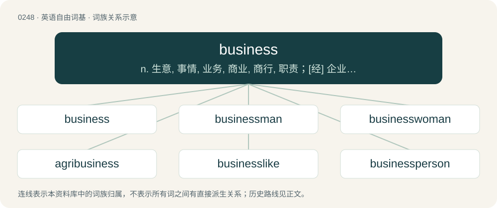

# 0275 · business — n. 生意, 事情, 业务, 商业, 商行, 职责；\[经\] 企业, 商业, 营业

[总目录](../00_总目录_按常用程度.md)

**类型**：英语自由词基　｜　**来源语言**：见词源记录

## 核心含义与来源

- 核心含义：n. 生意, 事情, 业务, 商业, 商行, 职责；\[经\] 企业, 商业, 营业
- 英文含义：A specific commercial enterprise or establishment.
- 词形：business

**来源记录 1**（名词；A specific commercial enterprise or establishment.）

From Middle English busines, busynes, businesse, bisynes, from Old English bisiġnes (“business, busyness”), equivalent to busy + -ness. Doublet of busyness. Sense 17 (something very good, top quality), possibly derives from "the bee's knees"

## 词族图

## 单词速览（常用到不常用）

| 单词 | 音标 | 释义 |
|---|---|---|
| [business](#w-1) | /ˈbɪz.nɪs/ | n. 生意, 事情, 业务, 商业, 商行, 职责；\[经\] 企业, 商业, 营业 |
| [businessman](#w-2) | 英 /ˈbɪznəsmən/；美 /ˈbɪznəsmæn/ | n. 商人, 实业家, 工商业家 |
| [businesswoman](#w-3) | /ˈbizniswjmæn/ | n. 商人, 办理实务的人, 经商者 |
| [agribusiness](#w-4) | 英 /ˈæɡɹɪˌbɪznəs/ | n. 农业综合经营；\[经\] 农产品行业 |
| [businesslike](#w-5) | /ˈbiznislaik/ | a. 有条理的, 有效率的 |
| [businessperson](#w-6) | /ˈbɪznəspɜːsn/ | n. 商人 |

## 逐词详解

### 1. business

**词性**：名词　｜　**音标**：/ˈbɪz.nɪs/

**中文释义**：n. 生意, 事情, 业务, 商业, 商行, 职责；\[经\] 企业, 商业, 营业

**英文义项**：A specific commercial enterprise or establishment. / A person's occupation, work, or trade.

**构词拆分**：busy + -ness

**词源与演化**：

From Middle English busines, busynes, businesse, bisynes, from Old English bisiġnes (“business, busyness”), equivalent to busy + -ness. Doublet of busyness. Sense 17 (something very good, top quality), possibly derives from "the bee's knees"

**例句**：

> They did nearly a million dollars of business over the long weekend.

该用例对应义项：The volume or amount of commercial trade.

### 2. businessman

**词性**：名词　｜　**音标**：英 /ˈbɪznəsmən/；美 /ˈbɪznəsmæn/

**中文释义**：n. 商人, 实业家, 工商业家

**英文义项**：A man in business, one who works at a commercial institution.

**构词拆分**：business + -man

**词源与演化**：

From business + -man. Displaced earlier merchant, ultimately from Latin mercāns (“merchant, buyer”).

**例句**：

> Learning Klingon will be of great use for his career as a businessman.

### 3. businesswoman

**词性**：名词　｜　**音标**：/ˈbizniswjmæn/

**中文释义**：n. 商人, 办理实务的人, 经商者

**英文义项**：A woman involved in business.

**构词拆分**：business + -woman

**词源与演化**：

From business + -woman.

**例句**：

> A businesswoman by day, Natasja leads a nightlife unfit for print.

### 4. agribusiness

**词性**：名词　｜　**音标**：英 /ˈæɡɹɪˌbɪznəs/

**中文释义**：n. 农业综合经营；\[经\] 农产品行业

**英文义项**：Business (especially big business) connected to agriculture, either owning or operating large-scale farms, or catering to those who do. / A business or group of businesses engaged in agriculture, particularly if using modern farming techniques in the process.

**构词拆分**：agri- + business

**词源与演化**：

From agri- + business, or a blend of agriculture + business, coined by American academic and diplomat John Herbert Davis (1904–1988).

**例句**：

> She plans to launch an agribusiness once she is done with her studies.

### 5. businesslike

**词性**：形容词　｜　**音标**：/ˈbiznislaik/

**中文释义**：a. 有条理的, 有效率的

**英文义项**：Methodical and efficient, in a way that would be advantageous to a business or businessperson. / Earnest and practical without being distracted or enthusiastic.

**构词拆分**：business + -like

**词源与演化**：

From business + -like.

**例句**：

> The prime minister's businesslike approach to welfare reform earned him accolades among the upper class.

### 6. businessperson

**词性**：名词　｜　**音标**：/ˈbɪznəspɜːsn/

**中文释义**：n. 商人

**英文义项**：A person in business, or one who works at a commercial institution.

**构词拆分**：business + person

**词源与演化**：

From business + person.

**例句**：

> What do you think: should we say businessperson instead of businessman?
