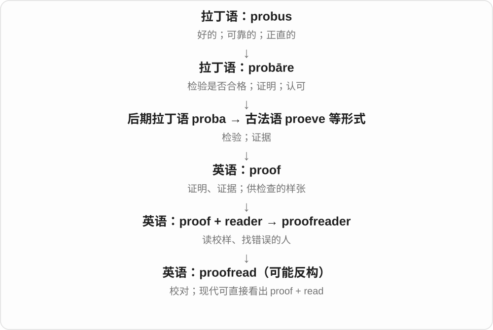

# 0276 · read — 阅读；把文字、符号读成信息

[逐词精讲目录](../00_逐词精讲目录.md) · [总目录](../00_总目录_按常用程度.md)

## 核心词根与来源

read 接古英语 rǣdan，早期包含劝告、解释、阅读等义，经中古英语 reden 演变。现代原形 /riːd/，过去式与过去分词 /red/；拼写相同不等于读音相同。

**READ：从可见符号里解出意思**

不只眼睛扫到字，而是读懂字；表情、仪表、数据也能提供可解读的信息。

- **动作、活动和执行者**：read · reading · reader
- **易读这一性质**：readable · readability
- **重读、未读及其他处理**：reread · unread · misread · proofread
- **说明文件名称**：readme
- **read → reader → readers：读者、读本与读取工具**：read · reader · readers
- **read → reads：读懂文字与显示信息**：read · reads
- **reading → readings：诵读、读数与解读**：reading · readings
- **riddle 的猜解词族与另源筛孔词分路**：read · riddle · riddles · riddled · riddling

## 词形与演化规律

先看 read、reading、reader，再看 readable → readability，随后是 reread、unread、misread、proofread 这些前后添加的具体任务，readme 最后作为文件命名看。

reader 的 read 读 /riːd/，不是过去式 /red/；人物、读本、读取装置等用法分场景。

古英语解释、阅读词传承，reads 读 ri:dz，不沿过去式 red。

read 的读取、解释用途名词化后，可以数具体活动、结果、理解版本。

谜语 riddle 接古英语 raedels，与 read 的解释、猜解旧义相关；筛子 riddle 承 hriddel，筛、打孔和布满用法另路。这里不把两种 riddle 合成一个来源。

## 单词速览（按词族由简到繁）

同一基础词的相关扩展放在一起，先读基础形式，再读扩展；各组之间优先读常用的。具体词源关系见各词讲解。

| 单词 | 音标 | 核心意思 |
|---|---|---|
| [read](#w-1) | 原形 /riːd/；过去式、过去分词 /red/ | 读；阅读；解读；显示为 |
| [reading](#w-2) | /ˈriːdɪŋ/ | 阅读；读数；解读；朗读会 |
| [readings](#w-13) | /ˈriːdɪŋz/ | 诵读活动；读数；解读版本〔复数〕 |
| [reader](#w-3) | 英 /ˈriːdə/；美 /ˈriːdər/ | 读者；阅读器；读本 |
| [readers](#w-11) | 英 /ˈriːdəz/；美 /ˈriːdərz/ | 读者；读本；读取器；reader 的复数 |
| [reads](#w-12) | /riːdz/ | 阅读；读作；显示〔第三人称单数〕；可读的作品、读物〔名词复数〕 |
| [readable](#w-4) | /ˈriːdəbəl/ | 可读的；清楚易读的；读起来顺畅的 |
| [readability](#w-7) | /ˌriːdəˈbɪləti/ | 可读性；易读程度 |
| [readme](#w-10) | /ˈriːdmi/ | 说明文件；自述文件〔计算机〕 |
| [reread](#w-5) | 原形 /ˌriːˈriːd/；过去式、过去分词 /ˌriːˈred/ | 重读；再读一遍 |
| [misread](#w-6) | 现在时 /ˌmɪsˈriːd/；过去式、过去分词 /ˌmɪsˈred/ | 读错；误判；误解 |
| [unread](#w-8) | /ˌʌnˈred/ | 未读的；未被阅读的 |
| [proofread](#w-9) | 现在时 /ˈpruːfriːd/；过去式、过去分词 /ˈpruːfred/ | 校对文字 |
| [riddle](#w-14) | /ˈrɪdəl/ | 谜语、谜团；使布满〔孔洞、问题等〕 |
| [riddled](#w-15) | /ˈrɪdəld/ | 满是孔的；充斥、布满问题等的；出谜、解谜了 |
| [riddles](#w-16) | /ˈrɪdəlz/ | 谜语、谜团〔复数〕；出谜、打得多孔、筛〔第三人称单数〕 |
| [riddling](#w-17) | /ˈrɪdlɪŋ/ | 谜语般含混的；正在出谜、解谜；筛、打孔 |

## 逐词讲解

### 1. read — 读；阅读；解读；显示为

**音标**：原形 /riːd/；过去式、过去分词 /red/

**先抓住这个画面**

眼前是符号、文字或表情，把它们读成信息，而不只是看见形状。

**怎么拆**

接古英语 rǣdan，早期含劝告、解释、阅读，经中古英语 reden 延续；英语里“解释符号、字母”的阅读义突出。原形与过去式同拼写，元音不同。

**怎么变成今天的意思**

**古英语 rǣdan → 中古英语 reden**  
劝告、解释；读懂文字

↓

**英语 read**  
阅读；解读；读出信息

read a book 是读书，read someone’s expression 是看懂表情；The sign reads ... 是牌上写着……。read aloud 是出声读；读取设备、数据也可用 read。

**常见搭配与例句**

read a book；read aloud；read the instructions；read someone’s mind。

> Please read the instructions before you begin.

开始前请阅读说明。

> The sign reads “Entrance at the back.”

牌上写着“入口在后面”。

> I read the letter twice yesterday.

我昨天把信读了两遍。

**别混淆**

read 是读懂信息，look at 是看向；看了一眼说明书不代表认真读过。I read it yesterday 里的 read 读 /red/，不因拼写一样而照原形读。

### 2. reading — 阅读；读数；解读；朗读会

**音标**：/ˈriːdɪŋ/

**先抓住这个画面**

把信息读出来：读文章是阅读，读仪表是读数，读出另一层意思是解读。

**怎么拆**

read + -ing，接古英语 rǣding、中古英语 reding 等；-ing 既能表示活动，也能把一次读取结果或活动事件名词化。

**怎么变成今天的意思**

**古英语 rǣdan → 中古英语 reden**  
劝告、解释；读懂文字

↓

**古英语 rǣding → 中古英语 reding → reading**  
阅读活动；读取结果、解释

do some reading 是读点东西，a temperature reading 是一次温度读数，my reading of the poem 是我对诗的理解；a poetry reading 是诗歌朗读会。

**常见搭配与例句**

reading skills；a meter reading；a reading of the text；a poetry reading。

> Reading is part of her evening routine.

阅读是她晚间日常的一部分。

> The meter gave a reading of twenty units.

仪表显示读数为二十个单位。

> My reading of the ending is quite different from yours.

我对结局的理解与你很不同。

**别混淆**

reading 是活动或读取结果，reader 是人或设备。an accurate reading 是准确读数，不是“一位准确的读者”。

### 3. readings — 诵读活动；读数；解读版本〔复数〕

**音标**：/ˈriːdɪŋz/

**先抓住这个画面**

一次公开读作品、仪表一次读出的数、对文本的一种理解，都可叫 a reading；多次、多种就用 readings。

**怎么拆**

read + -ing 已有古英语、中古英语的名词材料；固定活动、结果义可加 -s，/ŋ/ 后读 /z/。

**怎么变成今天的意思**

**read + -ing → reading**  
阅读、解释；一次读出的结果、活动

↓

**reading + -s → readings**  
多场诵读、多组读数、多种解读

poetry readings 诗歌朗诵会；temperature readings 温度读数。

**常见搭配与例句**

different readings of the text 对文本的不同解读；take readings 记录读数。

> The library hosts poetry readings every month.

图书馆每个月举办诗歌朗诵会。

> We compared the temperature readings from two instruments.

我们比较了两台仪器的温度读数。

**别混淆**

reading 不总是正在读的动词形式；前面有数字、形容词并加复数时，常在数活动、结果或解释。

### 4. reader — 读者；阅读器；读本

**音标**：英 /ˈriːdə/；美 /ˈriːdər/

**先抓住这个画面**

把文字、编码读进去的，可以是人，也可以是设备；供练习阅读的书也叫 reader。

**怎么拆**

read + -er；接古英语 rǣdere、中古英语 redere 等。-er 常表人或执行某动作的东西，读本义则是供读者阅读的书籍名称。

**怎么变成今天的意思**

**古英语 rǣdan → 中古英语 reden**  
劝告、解释；读懂文字

↓

**古英语 rǣdere → 中古英语 redere → reader**  
读者等角色 → 阅读设备、读本等用法

a regular reader 是常读者，a card reader 是读卡器，a graded reader 是按难度分级的读本。学术职位 Reader 等另按当地体系理解。

**常见搭配与例句**

an avid reader；a card reader；a graded reader；readers of the magazine。

> The magazine invites readers to send in their stories.

杂志邀请读者投稿讲述自己的故事。

> Insert the card into the reader.

把卡插入读卡器。

**别混淆**

reader 不只指电子书设备；a reader of novels 常是读小说的人，a novel reader 又需按语境判断是读者还是软件。

### 5. readers — 读者；读本；读取器；reader 的复数

**音标**：英 /ˈriːdəz/；美 /ˈriːdərz/

**先抓住这个画面**

人读文章，是 readers；给人练阅读的书可以是 readers；机器读取卡片、信息，也能叫 readers。它们都围着读取这个动作展开。

**怎么拆**

reader + -s，词尾 /z/。reader 现代对应 read /riːd/ + -er，接古英语 rǣdere、中古英语 redere 等，读者、读本、装置义后来各自发展。

**怎么变成今天的意思**

**古英语 rǣdere → 中古英语 redere → reader**  
阅读的人；后来有读本、读取装置等

↓

**reader + -s → readers**  
多位读者；多本读本；多台读取器

regular readers 常读某刊物的读者；young readers 年轻读者；graded readers 分级读物；card readers 读卡器。

**常见搭配与例句**

readers of the magazine；books for early readers。

> The introduction gives readers a quick overview of the book.

引言让读者快速了解这本书的全貌。

> The classroom has several graded readers for beginners.

教室里有几本适合初学者的分级读物。

**别混淆**

readers 里的 read 读 /riːd/，read 的过去式 /red/ 是另一种读音。graded readers 常指学习阅读用的书，card readers 指设备，要看前面的修饰词。

### 6. reads — 阅读；读作；显示〔第三人称单数〕；可读的作品、读物〔名词复数〕

**音标**：/riːdz/

**先抓住这个画面**

眼睛沿着文字走，脑中理解它，是 reads 的基本动作。仪表上的字数也能说“读出来是……”，一本读起来有意思的作品还可叫 a good read。

**怎么拆**

read + -s，/d/ 后读 /z/，这里词干读 /riːd/。read 接古英语 raedan 的解释、劝告、阅读材料；同拼写的过去式读 /red/。

**怎么变成今天的意思**

**古英语解释、阅读词 → read**  
解释符号、文字 → 阅读；也扩展到显示值

↓

**read + -s → reads**  
某人阅读、某处显示；也可数某类读物

reads every night 每晚阅读；the sign reads 标牌写着；the meter reads 仪表显示。

**常见搭配与例句**

easy reads 容易读的作品；reads aloud 朗读。

> She reads for half an hour before bed.

她睡前读半小时书。

> The sign reads “Please use the other entrance.”

牌子上写着：“请走另一个入口。”

**别混淆**

reads 的元音是 /iː/；过去式 read 的 /e/ 不带到这里。a good read 是读起来好的作品，不是说某个人读得好。

### 7. readable — 可读的；清楚易读的；读起来顺畅的

**音标**：/ˈriːdəbəl/

**先抓住这个画面**

不只文字还认得出，文章也可能写得让人愿意一路读下去。

**怎么拆**

read + -able，-able 表能够、适合。可从物理上看得清、技术上读得出，延伸到文风流畅好读。

**怎么变成今天的意思**

**古英语 rǣdan → 中古英语 reden**  
劝告、解释；读懂文字

↓

**英语 read**  
阅读；解读；读出信息

↓

**read + -able → readable**  
能读出；容易、值得读下去

readable handwriting 是能辨认的字迹，a highly readable book 是好读的书；machine-readable 是机器可读的常见短语拼法。不同可读性要按对象区分。

**常见搭配与例句**

a readable account；clear and readable；a highly readable book。

> Her notes were still readable despite the water damage.

笔记虽被水浸过，仍能读清。

> He wrote a lively, readable history of the town.

他写了一部生动易读的小镇历史。

**别混淆**

legible 更专注字迹能否辨认，readable 还可评价文风；看得清每个字，也可能整篇文章很难懂。

### 8. readability — 可读性；易读程度

**音标**：/ˌriːdəˈbɪləti/

**先抓住这个画面**

同样的信息，换了字号、句子和安排，读者需要花的力气就不同。

**怎么拆**

readable + -ity，词尾 -able 对应 -ability；也可整体看 read + -ability。它是易读这一性质的名词，不是另一个阅读动作。

**怎么变成今天的意思**

**古英语 rǣdan → 中古英语 reden**  
劝告、解释；读懂文字

↓

**英语 read**  
阅读；解读；读出信息

↓

**read + -able → readable**  
可读、易读的

↓

**readable + -ity → readability**  
可读、易读的程度

improve readability 可指改善字体排版，也可指简化句子和组织。可读性指标只是部分线索，不保证内容正确或解释到位。

**常见搭配与例句**

improve readability；text readability；a readability score。

> Shorter paragraphs improved the readability of the report.

更短的段落提升了报告的可读性。

> The designer tested the page’s readability on a small screen.

设计师测试了页面在小屏幕上的易读程度。

**别混淆**

readability 关注阅读的容易程度，accuracy 关注信息准确；改得简洁不该把准确细节删错。

### 9. readme — 说明文件；自述文件〔计算机〕

**音标**：/ˈriːdmi/

**先抓住这个画面**

软件包先放一张“先读我”的便条，告诉你这是什么、怎样开始、还要注意什么。

**怎么拆**

read + me，把祈使语“读我”连写成文件名称，也常大写 README。这里是短句命名，不是 me 作某种词根后缀。

**怎么变成今天的意思**

**英语 read；me**  
并列组合的两部分

↓

**read + me → readme**  
以“读我”命名的说明文件

通常介绍项目、安装使用和相关说明，具体内容随项目而异。文件名常见 README.md、README.txt，扩展名表示文件格式。

**常见搭配与例句**

the project’s readme；check the readme；update the readme file。

> The readme explains how to install the package.

说明文件介绍了如何安装这个软件包。

> She updated the readme after changing the setup process.

修改配置流程后，她更新了说明文件。

**别混淆**

readme 是说明文档，reader 是读取者或阅读器；写好了 readme 不等于软件会自动执行其中每一条说明。

### 10. reread — 重读；再读一遍

**音标**：原形 /ˌriːˈriːd/；过去式、过去分词 /ˌriːˈred/

**先抓住这个画面**

第一次已经读过，再回到同一段文字，可能检查细节，也可能读出新意思。

**怎么拆**

re-（再次）+ read。前缀 re- 不变，后半 read 仍按原形和过去式切换 /riːd/、/red/。

**怎么变成今天的意思**

**古英语 rǣdan → 中古英语 reden**  
劝告、解释；读懂文字

↓

**英语 read**  
阅读；解读；读出信息

↓

**re- + read → reread**  
再次阅读、重新解读

reread the instructions 是重读说明；reread a novel 可以隔多年再次读整本。一次 reread 也可作名词说再读一遍。

**常见搭配与例句**

reread a sentence；reread the instructions；reread a favourite novel。

> Please reread the last paragraph before answering.

回答前请重读最后一段。

> I reread the novel last summer and noticed many new details.

去年夏天我重读了那部小说，发现许多新细节。

**别混淆**

reread 是再读，rewrite 是重写，retell 是重新讲述；改前缀后的基词决定做的动作。

### 11. misread — 读错；误判；误解

**音标**：现在时 /ˌmɪsˈriːd/；过去式、过去分词 /ˌmɪsˈred/

**先抓住这个画面**

可以是把字看错，也可以是把一个人的态度或整个形势看错。

**怎么拆**

mis- + read；历史有古英语 misrǣdan。现在与过去拼写相同，读音不同。

**怎么变成今天的意思**

**日耳曼语系的 mis-，古英语已有**  
方向或结果不对；不是希腊“厌恶”

↓

**古英语 misrǣdan → 中古英语 misreden**  
错误地劝告或读解

↓

**英语 misread**  
读错；看错局势或人的意思

misread the date 是日期看错；misread the room 是没有看准现场人的情绪或反应。read 本来就能指理解一个情境，misread 随着它一起从读文字扩展到看人、看局势。

**常见搭配与例句**

misread a label；misread the situation；misread someone’s intentions。

> I misread the timetable and arrived an hour early.

我看错了时刻表，早到了一个小时。

> He misread her nervousness as a lack of interest.

他把她的紧张误解成了不感兴趣。

**别混淆**

I often misread 读 /riːd/；I misread it yesterday 读 /red/。不要因为前面加了 mis- 就忘记 read 的不规则读音。

### 12. unread — 未读的；未被阅读的

**音标**：/ˌʌnˈred/

**先抓住这个画面**

信已经到了，甚至躺了几天，内容却还没被人读过。

**怎么拆**

un-（未、不）+ read 的过去分词，常用未读义后半读 /red/。另有少用的未受阅读教育等义，本页先记邮件、书信等常见用法。

**怎么变成今天的意思**

**古英语 rǣdan → 中古英语 reden**  
劝告、解释；读懂文字

↓

**英语 read**  
阅读；解读；读出信息

↓

**un- + read〔过去分词〕 → unread**  
尚未被阅读的

unread messages 是未读消息，leave a letter unread 是让信一直没被读；应用里 mark as unread 是把状态重新标成未读，不表示人真的忘掉内容。

**常见搭配与例句**

unread messages；an unread letter；mark as unread。

> There are twelve unread messages in my inbox.

我的收件箱里有十二条未读消息。

> The letter remained unread on the table.

那封信搁在桌上，一直没被读过。

**别混淆**

unread 没被读过，unreadable 读不出或难读；一封字迹非常清楚的信也可能一直 unread。

### 13. proofread — 校对文字

**音标**：现在时 /ˈpruːfriːd/；过去式、过去分词 /ˈpruːfred/

**先抓住这个画面**

把即将交出去的文字再逐行过一遍，抓出拼写、标点和排版的小错。

**怎么拆**

现代可拆 proof 校样 + read 阅读；历史上很可能从较早的 proofreader 反构出动词。不要把“读证明题”当作默认意思。

**怎么变成今天的意思**

既可校对印刷校样，也可校对邮件、简历或网页。read 这一部分过去式拼写不变，读音变为 /red/。

**常见搭配与例句**

proofread a document；proofread for spelling errors。

> Please proofread the email before sending it.

请在发送前校对这封邮件。

> She proofread the final draft yesterday.

她昨天校对了最后一稿。

**别混淆**

proofread 主要找文字和呈现错误；edit 更宽，还可能改结构、论点和表达。

### 14. riddle — 谜语、谜团；使布满〔孔洞、问题等〕

**音标**：/ˈrɪdəl/

**先抓住这个画面**

“有钥匙却开不了门，是什么？”是 a riddle。be riddled with errors 则是错误多得像筛子上的孔，来自另一条筛子词史。

**怎么拆**

谜语义接古英语 rædels，旧尾 -els 的 s 后来被当作复数而脱落；另有 hriddel 筛子，发展为筛、打出很多孔，再有布满的比喻。两路不能混作现代 rid + -le。

**怎么变成今天的意思**

**古英语 rædels → redels → riddle**  
解释、猜测的材料 → 谜语、谜团

↓

**另一路：古英语 hriddel 筛子 → riddle**  
筛、打出孔 → 布满问题等

solve a riddle 解谜；a riddle about something 关于某物的谜语；be riddled with errors 错误百出。

**常见搭配与例句**

solve a riddle；be riddled with。

> Can you solve this riddle?

你能解出这个谜语吗？

> The report was riddled with errors.

报告错误百出。

**别混淆**

a riddle 常是有待猜解的问题；riddled with problems 说问题很多，不是说那些问题本身都是谜语。

### 15. riddled — 满是孔的；充斥、布满问题等的；出谜、解谜了

**音标**：/ˈrɪdəld/

**先抓住这个画面**

一张板上到处是孔，像筛子，叫 riddled with holes；文章处处是错，也像坏点散得到处都是，叫 riddled with errors。

**怎么拆**

riddle 去 e 加完整 -ed，词尾读 /d/；满布用法接筛具一支，谜语动词也有同形过去式。

**怎么变成今天的意思**

**谜语一支：古英语 raedels 等猜解材料 → riddle**  
旧词尾 s 被当成复数后去掉，与 read 的解释、猜解材料同族

↓

**筛具一支：古英语 hriddel → riddle 筛子**  
由筛、像筛子一样多孔，形成打得满是孔及 riddled with 布满的用法；不是由谜语推出漏洞

↓

**riddle → riddled**  
筛孔一支形成满布；另源出谜、解谜动词也同形

riddled with holes 满是孔；riddled with errors 错误百出；riddled with problems 问题重重。

**常见搭配与例句**

a report riddled with mistakes；a wall riddled with holes。

> The draft was riddled with spelling mistakes.

草稿里到处是拼写错误。

> The old wooden panel was riddled with tiny holes.

那块旧木板上满是小孔。

**别混淆**

riddled with 常带不良内容到处都是的评价；filled with flowers 只是装满花，通常不带这种坏点遍布的感觉。

### 16. riddles — 谜语、谜团〔复数〕；出谜、打得多孔、筛〔第三人称单数〕

**音标**：/ˈrɪdəlz/

**先抓住这个画面**

需要猜的几道谜语是 riddles；另一支动词可让东西变得像筛子一样满是孔。谜语和筛具虽然同形，来源不同。

**怎么拆**

riddle + -s，词尾读 /z/；名词复数与动词三单同形，先判断是在说谜题还是筛、打孔。

**怎么变成今天的意思**

**谜语一支：古英语 raedels 等猜解材料 → riddle**  
旧词尾 s 被当成复数后去掉，与 read 的解释、猜解材料同族

↓

**筛具一支：古英语 hriddel → riddle 筛子**  
由筛、像筛子一样多孔，形成打得满是孔及 riddled with 布满的用法；不是由谜语推出漏洞

↓

**riddle + -s → riddles**  
多个谜语、谜团；另源动词的现代三单

tell riddles 说谜语；solve riddles 解谜；riddles something with holes 把某物打得多孔。

**常见搭配与例句**

children’s riddles；unanswered riddles 未解谜团。

> The children took turns telling riddles.

孩子们轮流说谜语。

> Heavy hail riddles the soft leaves with holes.

强烈的冰雹把柔软的叶片打得到处是孔。

**别混淆**

riddles 的谜语义与 riddled with errors 的满是错误不是一条从谜面变错误的历史，后者接筛孔那一路。

### 17. riddling — 谜语般含混的；正在出谜、解谜；筛、打孔

**音标**：/ˈrɪdlɪŋ/

**先抓住这个画面**

话故意说得弯弯绕绕，让人猜里面什么意思，可以叫 riddling words；筛东西、打出孔的动作则属于同形的另一支。

**怎么拆**

riddle 去 e 加 -ing；谜语名词转用的动词与筛具转用的动词都能有这个形式，具体来源分开。

**怎么变成今天的意思**

**谜语一支：古英语 raedels 等猜解材料 → riddle**  
旧词尾 s 被当成复数后去掉，与 read 的解释、猜解材料同族

↓

**筛具一支：古英语 hriddel → riddle 筛子**  
由筛、像筛子一样多孔，形成打得满是孔及 riddled with 布满的用法；不是由谜语推出漏洞

↓

**riddle → riddling**  
出谜、猜解过程与含谜语的性质；另一路是筛、打孔过程

a riddling answer 谜语般的回答；riddling language 隐晦让人猜的话；riddling sand 筛沙，较专门的器具义。

**常见搭配与例句**

riddling remarks；speak in a riddling way。

> She answered in a playful, riddling way.

她用一种俏皮、像说谜语的方式回答。

> His riddling remarks left us guessing.

他那些谜语般的话，让我们猜个不停。

**别混淆**

riddling answer 常像故意留谜面，confusing answer 也可能只是说得差、无意让人糊涂；意图的感觉不同。

## 这一组要分清什么

reading／reader：活动或读数与人、设备。readable／unread：读得出与尚未读。readme 是“读我”命名，不把 me 当后缀。

## 串起来练习

The reader reread the instructions, then checked the unread note.

读者重读了说明，接着查看那张还没读过的便条。
