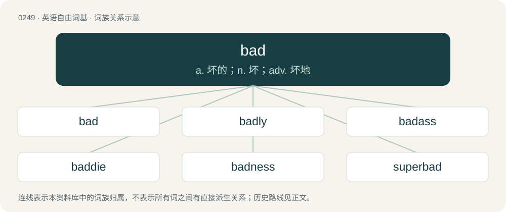

# 0277 · bad — a. 坏的；n. 坏；adv. 坏地

[总目录](../00_总目录_按常用程度.md)

**类型**：英语自由词基　｜　**来源语言**：见词源记录

## 核心含义与来源

- 核心含义：a. 坏的；n. 坏；adv. 坏地
- 英文含义：Of low quality.
- 词形：bad

**多个词源／构词路径**：同一拼写可能有不同来源；以下按词性和含义分别列出。

**来源记录 1**（形容词；Of low quality.）

From Middle English bad, badde (“wicked, evil, depraved”), of uncertain origin. Perhaps a shortening of Old English bæddel (“hermaphrodite”) (for loss of -el compare Middle English muche from Old English myċel, and Middle English wenche from Old English wenċel), or at least related to it and/or to bǣ̆dan (“to defile”), compare Old High German pad (“hermaphrodite”). Alternatively, perhaps a loan from Old Norse into Middle English, compare Norwegian bad (“effort, trouble, fear”, neuter noun), East Danish bad (“damage, destruction, fight”, neuter noun), from the Proto-Germanic noun \*badą, whence also Proto-Germanic \*badōną (“to frighten”), Old Saxon undarbadōn (“to frighten”), Norwegian Nynorsk bada (“to weigh down, press”); ultimately from Proto-Indo-European \*bʰedʰ- (“to bend, press, push, oppress”). False cognate of Persian بد (bad).

**来源记录 2**（动词；To shell (a walnut).）

Unknown.

## 词族图

## 单词速览（常用到不常用）

| 单词 | 音标 | 释义 |
|---|---|---|
| [bad](#w-1) | 英 /bæd/；/bɛəd/ | a. 坏的；n. 坏；adv. 坏地 |
| [badly](#w-2) | /ˈbæd.li/ | adv. 严重地, 恶劣地, 极度地 |
| [badass](#w-3) | 英 /ˈbædæs/；美 /ˈbædˌæs/ | a. & n.&lt;美俚&gt;到处惹是生非的(坏蛋) |
| [baddie](#w-4) | /ˈbædi/ | n. 坏人, (尤指电影中之)恶人 |
| [badness](#w-5) | /ˈbæd.nəs/ | n. 坏, 恶, 不良 |
| [superbad](#w-6) |  | 太坏了 |
| [badman](#w-7) | /ˈbædmæn/ | n. 偷牲口贼, 不法之徒 |

## 逐词详解

### 1. bad

**词性**：形容词　｜　**音标**：英 /bæd/；/bɛəd/

**中文释义**：a. 坏的；n. 坏；adv. 坏地

**英文义项**：Of low quality. / Inaccurate; incorrect

**词源与演化**：

From Middle English bad, badde (“wicked, evil, depraved”), of uncertain origin. Perhaps a shortening of Old English bæddel (“hermaphrodite”) (for loss of -el compare Middle English muche from Old English myċel, and Middle English wenche from Old English wenċel), or at least related to it and/or to bǣ̆dan (“to defile”), compare Old High German pad (“hermaphrodite”). Alternatively, perhaps a loan from Old Norse into Middle English, compare Norwegian bad (“effort, trouble, fear”, neuter noun), East Danish bad (“damage, destruction, fight”, neuter noun), from the Proto-Germanic noun \*badą, whence also Proto-Germanic \*badōną (“to frighten”), Old Saxon undarbadōn (“to frighten”), Norwegian Nynorsk bada (“to weigh down, press”); ultimately from Proto-Indo-European \*bʰedʰ- (“to bend, press, push, oppress”). False cognate of Persian بد (bad).

**例句**：

> Lard is bad for you. Smoking is bad for you, too. Grapes are bad for dogs but not for humans.

该用例对应义项：Harmful, especially unhealthy; liable to cause health problems.

### 2. badly

**词性**：形容词　｜　**音标**：/ˈbæd.li/

**中文释义**：adv. 严重地, 恶劣地, 极度地

**英文义项**：Ill, unwell.

**构词拆分**：bad + -ly

**词源与演化**：

From Middle English badly, baddely, baddeliche, equivalent to bad + -ly.

**用法示例／搭配（非完整句）**：

> He's never badly.

该用例对应义项：Ill, unwell.

### 3. badass

**词性**：名词　｜　**音标**：英 /ˈbædæs/；美 /ˈbædˌæs/

**中文释义**：a. & n.&lt;美俚&gt;到处惹是生非的(坏蛋)

**英文义项**：A belligerent or mean person; a person with an unpleasantly extreme appearance, attitudes, or behavior. / A person considered impressive due to courage, skill, daring, audacity, and/or toughness.

**构词拆分**：bad + ass (“buttocks; one's self or person”)

**词源与演化**：

From bad + ass (“buttocks; one's self or person”).

**例句**：

> Don’t mess with that guy, he’s a real badass.

该用例对应义项：A belligerent or mean person; a person with an unpleasantly extreme appearance, attitudes, or behavior.

### 4. baddie

**词性**：名词　｜　**音标**：/ˈbædi/

**中文释义**：n. 坏人, (尤指电影中之)恶人

**英文义项**：A person of bad character, especially in a work of fiction. / An attractive, confident woman, especially one who is a social media influencer.

**构词拆分**：From bad + -ie.

**词源与演化**：

From bad + -ie.

**例句**：

> I didn't realize my professor was dating an absolute baddie; I didn't know he had motion like that.

该用例对应义项：An attractive person.

### 5. badness

**词性**：名词　｜　**音标**：/ˈbæd.nəs/

**中文释义**：n. 坏, 恶, 不良

**英文义项**：The quality or degree of being bad.

**构词拆分**：bad + -ness

**词源与演化**：

From Middle English baddenes, badnes, badnesse; equivalent to bad + -ness.

**例句**：

> Unfortunately, there's still a lot of badness in the world.

### 6. superbad

**词性**：形容词

**中文释义**：太坏了

**英文义项**：Very bad. / Fine, excellent.

**构词拆分**：super- + bad

**词源与演化**：

From super- + bad.

### 7. badman

**词性**：名词　｜　**音标**：/ˈbædmæn/

**中文释义**：n. 偷牲口贼, 不法之徒

**英文义项**：A gangster.

**构词拆分**：bad + man

**词源与演化**：

From bad + man.
