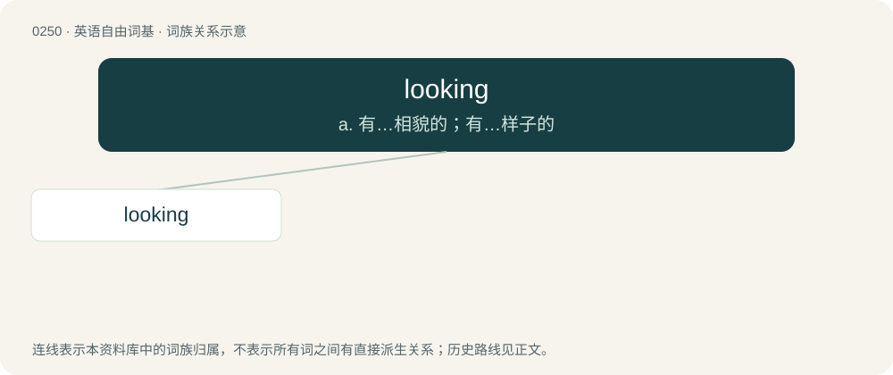

# 0278 · looking — a. 有…相貌的；有…样子的

[总目录](../00_总目录_按常用程度.md)

**类型**：英语自由词基　｜　**来源语言**：见词源记录

## 核心含义与来源

- 核心含义：a. 有…相貌的；有…样子的
- 英文含义：as the last part of compound adjectives: relating to or having the appearance of.
- 词形：looking

**多个词源／构词路径**：同一拼写可能有不同来源；以下按词性和含义分别列出。

**来源记录 1**（动词；as the last part of compound adjectives: relating to or having the appearance of.）

From Middle English lokynge, from earlier lokinde, lokende, from Old English lōciende, present participle of Old English lōcian (“to look”), equivalent to look + -ing.

**来源记录 2**（名词；The act of one who looks; a glance.）

From Middle English lokynge, lokinge, from Old English lōcung (attested in Old English þurhlōcung), equivalent to look + -ing.

## 词族图

## 单词速览（常用到不常用）

| 单词 | 音标 | 释义 |
|---|---|---|
| [looking](#w-1) | /ˈlʊkɪŋ/ | a. 有…相貌的；有…样子的 |

## 逐词详解

### 1. looking

**词性**：动词　｜　**音标**：/ˈlʊkɪŋ/

**中文释义**：a. 有…相貌的；有…样子的

**英文义项**：as the last part of compound adjectives: relating to or having the appearance of.

**构词拆分**：look + -ing

**词源与演化**：

From Middle English lokynge, from earlier lokinde, lokende, from Old English lōciende, present participle of Old English lōcian (“to look”), equivalent to look + -ing.

**用法示例／搭配（非完整句）**：

> dorky-looking

该用例对应义项：as the last part of compound adjectives: relating to or having the appearance of.
